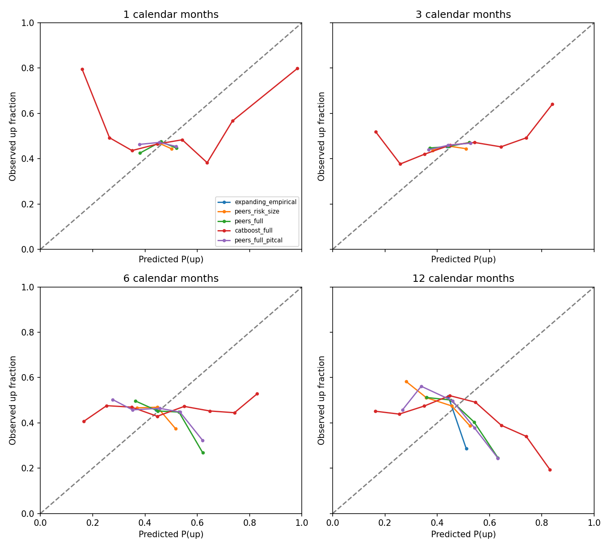

# 四期限概率预测研究：R10 / R11

目标是预测上涨、下跌与不同涨跌幅的概率，并验证这些概率；所有实际收益仅作为结果标签。

本报告为历史时点回溯实验。行情截止2026-05-29，最近预测时点2026-04-30，不是2026-10-19实时预测。

## 当前证据判断

**尚未证明四个期限的条件上涨概率可信。** 各模型在上涨 Brier 上都没有相对扩展历史基线的显著改善。风险/规模近邻在1、3个月的五档分数与CRPS、6个月的五档分数上有改善；12个月尚无显著改善。这里的显著仅指本次探索的时间块区间，不是独立测试确认。

CatBoost在预测70%—80%上涨组中，四期限的平均预测约73%—74%，实际上涨频率分别约57%、49%、44%、34%；不能直接把这些模型数值当成可信概率。PIT校准与直接多类别学习没有建立稳定方向优势。

风险/规模近邻的方向预测主要集中在40%—50%附近，较少作高确信度判断；这与强个股方向识别能力不同。总体尾部频率接近，也不能掩盖部分概率组失准；3/6/12个月的大涨尾部存在有足够样本的偏差组。

## 预测口径

1、3、6、12个日历月分别拟合；基点为当日收盘，目标日休市顺延到首个市场交易日。使用前复权价格变化代理，未宣称严格含税分红再投资总收益。五档边界：<-20%、[-20%,-5%)、[-5%,5%)、[5%,20%)、>=20%；上涨>0、下跌<0、严格平盘=0另列。

## 概率误差（越小越好）

|月数|模型|上涨 Brier|五档 Brier|CRPS|
|---|---|---|---|---|
|1|catboost_full|0.2657|0.6935|0.0650|
|1|catboost_full_pitcal|0.2644|0.6915|0.0649|
|1|expanding_empirical|0.2494|0.6956|0.0634|
|1|logistic_bins|0.2630|0.6896|0.0646|
|1|peers_full|0.2509|0.6851|0.0631|
|1|peers_full_pitcal|0.2511|0.6851|0.0631|
|1|peers_risk_size|0.2496|0.6812|0.0626|
|1|peers_risk_size_pitcal|0.2498|0.6814|0.0626|
|1|recent24_empirical|0.2505|0.6972|0.0636|
|3|catboost_full|0.2648|0.7836|0.1109|
|3|catboost_full_pitcal|0.2642|0.7825|0.1110|
|3|expanding_empirical|0.2485|0.7741|0.1083|
|3|logistic_bins|0.2792|0.7999|0.1168|
|3|peers_full|0.2497|0.7671|0.1077|
|3|peers_full_pitcal|0.2508|0.7686|0.1080|
|3|peers_risk_size|0.2490|0.7644|0.1072|
|3|peers_risk_size_pitcal|0.2499|0.7658|0.1075|
|3|recent24_empirical|0.2504|0.7766|0.1090|
|6|catboost_full|0.2821|0.8224|0.1567|
|6|catboost_full_pitcal|0.2876|0.8282|0.1583|
|6|expanding_empirical|0.2512|0.7978|0.1468|
|6|logistic_bins|0.3016|0.8514|0.1664|
|6|peers_full|0.2550|0.7977|0.1483|
|6|peers_full_pitcal|0.2592|0.8017|0.1495|
|6|peers_risk_size|0.2519|0.7919|0.1461|
|6|peers_risk_size_pitcal|0.2548|0.7950|0.1471|
|6|recent24_empirical|0.2557|0.8046|0.1493|
|12|catboost_full|0.2899|0.8456|0.2259|
|12|catboost_full_pitcal|0.3030|0.8603|0.2314|
|12|expanding_empirical|0.2574|0.8065|0.2051|
|12|logistic_bins|0.3154|0.8929|0.2401|
|12|peers_full|0.2686|0.8178|0.2140|
|12|peers_full_pitcal|0.2811|0.8336|0.2199|
|12|peers_risk_size|0.2566|0.8011|0.2045|
|12|peers_risk_size_pitcal|0.2649|0.8112|0.2087|
|12|recent24_empirical|0.2698|0.8269|0.2148|

按预测月份先平均，再跨月平均；避免一个月的股票数更多就占更大权重。五档 Brier 是五个类别平方误差之和。

## 是否优于简单历史分布

- **1个月**：相对扩展历史基线，配对月份差异的时间块95%区间完全低于零的项目：peers_full/multiclass_brier; peers_full_pitcal/multiclass_brier; peers_risk_size/multiclass_brier; peers_risk_size_pitcal/multiclass_brier; peers_risk_size/crps; peers_risk_size_pitcal/crps。
- **3个月**：相对扩展历史基线，配对月份差异的时间块95%区间完全低于零的项目：peers_full/multiclass_brier; peers_full_pitcal/multiclass_brier; peers_risk_size/multiclass_brier; peers_risk_size_pitcal/multiclass_brier; peers_risk_size/crps。
- **6个月**：相对扩展历史基线，配对月份差异的时间块95%区间完全低于零的项目：peers_risk_size/multiclass_brier。
- **12个月**：相对扩展历史基线，配对月份差异的时间块95%区间完全低于零的项目：无。

区间按期限长度（月数）做时间块重采样；只有约5年回溯数据，12个月的独立时间块很少。多模型探索未做多重比较修正，因此局部改善不等于稳定可泛化优势。最近24个月历史基线的完整对照在 baseline_comparisons.csv。

## 上涨概率是否可信

曲线接近对角线才表示相应概率组的实际上涨频率相近；总样本平均概率正确不代表每个概率组可靠。图仅显示至少200条结果的组；完整表额外标记月份覆盖不足。

|月数|模型|预测60%—80%上涨组：平均预测 / 实际频率 / 样本数|
|---|---|---|
|1|peers_full|无样本，不能验证|
|1|catboost_full|65.4% / 41.3% / 3239（合并组，非精确70%）|
|1|peers_full_pitcal|无样本，不能验证|
|3|peers_full|无样本，不能验证|
|3|catboost_full|68.0% / 46.7% / 6621（合并组，非精确70%）|
|3|peers_full_pitcal|60.6% / 37.5% / 40（合并组，非精确70%）|
|6|peers_full|62.1% / 26.8% / 418（合并组，非精确70%）|
|6|catboost_full|68.6% / 44.9% / 8844（合并组，非精确70%）|
|6|peers_full_pitcal|62.0% / 32.3% / 554（合并组，非精确70%）|
|12|peers_full|63.2% / 24.5% / 1903（合并组，非精确70%）|
|12|catboost_full|68.0% / 37.1% / 5547（合并组，非精确70%）|
|12|peers_full_pitcal|63.2% / 24.4% / 1897（合并组，非精确70%）|

## 尾部、缺失与适用边界

probability_calibration.csv 对上涨及五档分别给出预测概率、实际频率、样本数、不同预测月份数及时间块校准误差区间；loss_over20 / gain_over20 是两端尾部。不能用整体分数替代尾部校准。missing_outcome_bounds.csv 把所有已到期缺失标签分别视为未上涨或上涨，给出方向频率上下界。

股票池存在沪市终身ST过滤偏差，不能外推全市场；财报使用公告/更新日较晚者导致信息陈旧；估值2018年起，样本受可用特征限制。200原子分布是近似，概率步长0.5%，未见极端尾部不能解读为风险不存在。

R11仅使用预测时已到期的旧预测做PIT分布校准，少于12个历史预测月份回退原预测；审核见 prequential_calibration_audit.csv。校准带来的局部改善仍是探索性证据。

## 使用与适用范围

src/predict_probability.py --stock SH600000 --asof 2026-04-30 --model peers_full 可输出四期限分布与对应上涨概率组的回溯可靠性证据。未缓存的股票或日期明确报错，不自动替换为旧日期。单只股票单次预测不能单独检验概率准确性，需要重复的相似预测样本。

现有证据支持把短周期幅度概率作为继续探索的候选；不支持把任意模型的70%上涨概率直接当成已验证事实。历史查询入口保留精确日期；新增当前快照预测入口已使用2026-10-19公开行情及市值生成示例，见 current_probability_example.md。当前预测仍标记尚未证明可信：训练标签尚未更新到10月，且预测日期/重训节奏超出原验证范围。
