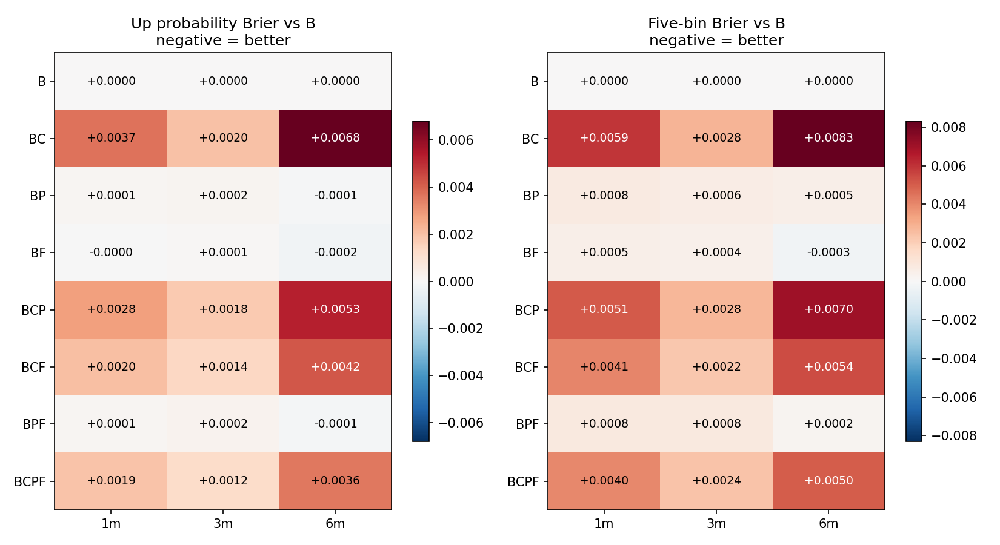

# 信用利差、PE分位与前瞻收益率：消融实验（R15）

完成1/3/6个月逐月walk-forward，共8种因子组合和1个无条件历史基线。所有组合共用同一训练/预测人群，不用策略收益评价。

## 当前结论

**在完整历史窗口中，三个因素全加没有优于仅波动率/市值的基础模型。** 信用利差单独加入及在完整模型中保留，都使1/6个月方向或区间评分变差；3个月变化不够稳定。PE分位没有稳定增量。前瞻锚单独加入时，6个月分数略好，但置信区间跨零。

前瞻锚在完整模型中对6个月五档分数有条件增量：含F相对移除F的差值约−0.00199，12月时间块95%区间约[−0.00316,−0.00088]；但完整模型五档分数0.79971仍差于基础模型0.79469。这表示它缓解了较差组合的问题，不能解读成整个方案已胜出。

前瞻锚的1/3月五档效果在2021–23偏差、2024+略好，6月也主要在后段略好；缺少跨阶段稳定改善，因此不按单个时段选择性宣布成功。

## 三个因素实际怎样构造

- **C 信用利差**：3年AAA中短票减3年国债，及其63观测日变化；取预测日之前最近观测。
- **P PE分位**：当日正PE在截至当日可得正PE历史中的位置，至少252个有效值；数据主要从2018年开始，不是十年分位。
- **F 前瞻估值锚**：`(1+增长假设) × 此前正PE中位数 / 当日PE − 1`。增长假设取当时可用报告的归母利润同比，固定截为±30%；假设总股数不变、12个月后PE回到历史中位。输入使用该回报的log(1+R)，没有引入未来实际收益。

**F是公开历史信息构造的情景代理，不是分析师一致预期，也不是已经验证的未来盈利预测。** 不包含股息；三个预测期限都使用同一12月定价锚。

## 样本和可用性限制

共同预测样本为27,600个股票月、64个月；旧R14为29,596个股票月，本次基础模型也在共同样本上重算。
可用财报年龄中位数456天，90%分位517天；盈利增长假设截断比例50.7%。这些限制会削弱F代表真实前瞻盈利信息的能力。
共同特征样本中，PE分位与前瞻锚秩相关约−0.84；两者共享估值信息，不能解释为两个独立来源。财报取公告/更新较晚日期，均严格早于预测日；PE中位数严格只用此前历史。

## 全部组合评分

B为原风险/规模模型。以下分数越小越好，按预测月份先平均；方向与五档Brier不能互相比大小。

|期限|组合|上涨Brier|五档Brier|CRPS|Q05跌破|90%覆盖|
|---|---|---|---|---|---|---|
|1月|B：基础|0.24982|0.67875|0.06185|5.0%|89.7%|
|1月|BC：基础+信用|0.25348|0.68467|0.06263|4.7%|89.4%|
|1月|BP：基础+PE|0.24993|0.67952|0.06189|5.2%|89.5%|
|1月|BF：基础+前瞻锚|0.24981|0.67922|0.06190|5.2%|89.5%|
|1月|BCP：基础+信用+PE|0.25258|0.68382|0.06245|4.7%|89.5%|
|1月|BCF：基础+信用+前瞻锚|0.25186|0.68282|0.06231|4.8%|89.5%|
|1月|BPF：基础+PE+前瞻锚|0.24995|0.67957|0.06193|5.1%|89.5%|
|1月|BCPF：三个因素全加|0.25176|0.68273|0.06229|4.7%|89.6%|
|1月|historical：无条件历史|0.24971|0.69389|0.06267|5.0%|89.9%|
|3月|B：基础|0.24977|0.76437|0.10659|5.8%|88.8%|
|3月|BC：基础+信用|0.25175|0.76718|0.10723|4.9%|88.9%|
|3月|BP：基础+PE|0.24997|0.76497|0.10667|6.0%|88.6%|
|3月|BF：基础+前瞻锚|0.24987|0.76482|0.10665|6.0%|88.5%|
|3月|BCP：基础+信用+PE|0.25155|0.76716|0.10713|5.1%|88.8%|
|3月|BCF：基础+信用+前瞻锚|0.25117|0.76661|0.10702|5.1%|88.8%|
|3月|BPF：基础+PE+前瞻锚|0.25002|0.76521|0.10671|6.0%|88.6%|
|3月|BCPF：三个因素全加|0.25102|0.76673|0.10698|5.1%|88.9%|
|3月|historical：无条件历史|0.24927|0.77364|0.10763|5.8%|89.2%|
|6月|B：基础|0.25344|0.79469|0.14601|6.8%|87.8%|
|6月|BC：基础+信用|0.26023|0.80299|0.14932|6.4%|87.2%|
|6月|BP：基础+PE|0.25334|0.79517|0.14601|7.1%|87.5%|
|6月|BF：基础+前瞻锚|0.25320|0.79440|0.14584|7.0%|87.7%|
|6月|BCP：基础+信用+PE|0.25874|0.80170|0.14871|6.6%|87.2%|
|6月|BCF：基础+信用+前瞻锚|0.25764|0.80012|0.14810|6.6%|87.4%|
|6月|BPF：基础+PE+前瞻锚|0.25331|0.79491|0.14592|7.0%|87.6%|
|6月|BCPF：三个因素全加|0.25704|0.79971|0.14786|6.6%|87.5%|
|6月|historical：无条件历史|0.25273|0.80050|0.14668|6.6%|88.5%|

## 逐个加入：相对基础B的变化

差值为“加入后−加入前”，负数表示改善；括号为12个月时间块的95%探索性区间。6个月块的结果也保存在CSV；并未做多模型比较校正。

|期限|因素|方向分数变化 [95%区间]|五档分数变化 [95%区间]|
|---|---|---|---|
|1月|信用利差|+0.00366 [+0.00074, +0.00826]|+0.00592 [+0.00332, +0.00873]|
|1月|PE分位|+0.00012 [-0.00012, +0.00033]|+0.00077 [+0.00009, +0.00151]|
|1月|前瞻估值锚|-0.00001 [-0.00028, +0.00027]|+0.00047 [-0.00050, +0.00145]|
|3月|信用利差|+0.00198 [-0.00096, +0.00498]|+0.00280 [-0.00012, +0.00546]|
|3月|PE分位|+0.00020 [-0.00017, +0.00053]|+0.00059 [-0.00014, +0.00130]|
|3月|前瞻估值锚|+0.00009 [-0.00043, +0.00063]|+0.00044 [-0.00045, +0.00135]|
|6月|信用利差|+0.00678 [+0.00266, +0.01017]|+0.00830 [+0.00243, +0.01273]|
|6月|PE分位|-0.00010 [-0.00085, +0.00063]|+0.00047 [-0.00046, +0.00123]|
|6月|前瞻估值锚|-0.00025 [-0.00139, +0.00088]|-0.00029 [-0.00165, +0.00110]|

## 从完整模型移除：检验该因素在其余因素存在时的增量

下表仍以“包含该因素−移除该因素”计差，负数才支持保留它。不能将“在较差组合中有帮助”混同为“优于原始基础模型”。

|期限|因素|方向分数增量|五档分数增量|
|---|---|---|---|
|1月|信用利差|+0.00181 [+0.00038, +0.00366]|+0.00316 [+0.00184, +0.00475]|
|1月|PE分位|-0.00011 [-0.00040, +0.00015]|-0.00009 [-0.00067, +0.00048]|
|1月|前瞻估值锚|-0.00082 [-0.00228, +0.00013]|-0.00109 [-0.00265, +0.00032]|
|3月|信用利差|+0.00100 [-0.00198, +0.00403]|+0.00152 [-0.00123, +0.00406]|
|3月|PE分位|-0.00015 [-0.00041, +0.00010]|+0.00012 [-0.00025, +0.00045]|
|3月|前瞻估值锚|-0.00053 [-0.00124, +0.00030]|-0.00043 [-0.00086, +0.00001]|
|6月|信用利差|+0.00373 [+0.00149, +0.00595]|+0.00480 [+0.00121, +0.00776]|
|6月|PE分位|-0.00060 [-0.00120, -0.00002]|-0.00041 [-0.00105, +0.00017]|
|6月|前瞻估值锚|-0.00170 [-0.00254, -0.00089]|-0.00199 [-0.00316, -0.00088]|



## 时段稳定性与解释边界

phase_scores.csv和factor_effects.csv分开报告2021–2023与2024+阶段；annual_scores.csv逐年报告。probability_calibration.csv包含上涨、下跌和五档概率组的预测/实际频率。不能只看总平均或最好的组合。

这里检验的是固定近邻模型、固定因子定义和可用历史数据下的增量。信用利差是共同时间状态，可能同时改变近邻的历史时段构成；PE与F高度相关；F使用较旧财报且对估值回归作了强假设。因此负面结果不能推出这些经济信息本身没有预测价值。

本次没有调参找最好结果，没有引入新的独立封存时段。源修订、股票池选择偏差、前复权价格代理等旧限制保留。

## 复跑

```bash
EP=experiments/pending/24_conditional_return_distribution_exploration
.venv/bin/python "$EP/src/build_three_factor_panel.py"
OPENBLAS_NUM_THREADS=1 OMP_NUM_THREADS=1 .venv/bin/python "$EP/src/run_three_factor_ablation.py"
.venv/bin/python "$EP/src/evaluate_three_factor_ablation.py"
.venv/bin/python "$EP/src/score_three_factor_extension.py"
.venv/bin/python "$EP/src/report_three_factor_ablation.py"
.venv/bin/python "$EP/src/audit_three_factor_ablation.py"
```

## 新增到期标签的回溯敏感性

这批标签已在R14查看，本次绝不是新独立测试。1/3/6月仍只有1/2/4个预测月份，源一致样本分别407/808/1605个股票月；所有组合在相同样本上比较。

|期限|模型|方向Brier|五档Brier|Q05跌破|90%覆盖|
|---|---|---|---|---|---|
|1月|B|0.24508|0.71573|9.3%|82.8%|
|1月|BC|0.25365|0.72480|9.8%|83.0%|
|1月|BF|0.24715|0.71872|8.8%|83.8%|
|1月|BCPF|0.25205|0.72309|9.1%|83.3%|
|3月|B|0.23801|0.77880|13.9%|76.4%|
|3月|BC|0.24027|0.77891|13.0%|78.2%|
|3月|BF|0.23777|0.77865|13.6%|76.6%|
|3月|BCPF|0.23774|0.77796|13.6%|76.7%|
|6月|B|0.24463|0.78526|12.3%|80.2%|
|6月|BC|0.24298|0.78090|9.3%|82.7%|
|6月|BF|0.24584|0.78824|13.2%|79.5%|
|6月|BCPF|0.24641|0.78756|10.7%|81.5%|

信用利差在新增6月样本中出现了相反表现：BC相对B方向、五档与尾部覆盖均改善，Q05跌破从约12.3%降至9.3%，但仍高于5%。前瞻锚在这些新增6月样本中反而使分数变差。3月完整模型略好，1/6月完整模型较差。

这种符号变化说明增量具有明显时段依赖，不能简单概括为信用因子永远有害，或前瞻锚已经有效。新增月份少且已查看，不据此选择新参数或宣称市场状态机制已被证实。

补充复跑：`src/score_three_factor_extension.py`；输出在 `outputs/r15_three_factor_ablation/newly_matured_sensitivity/`。它重评分已有预测，不把已看到的新标签回填进本轮历史训练。
