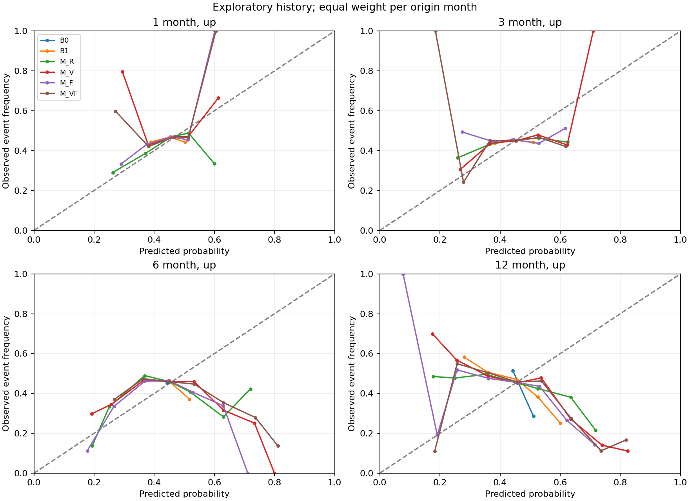
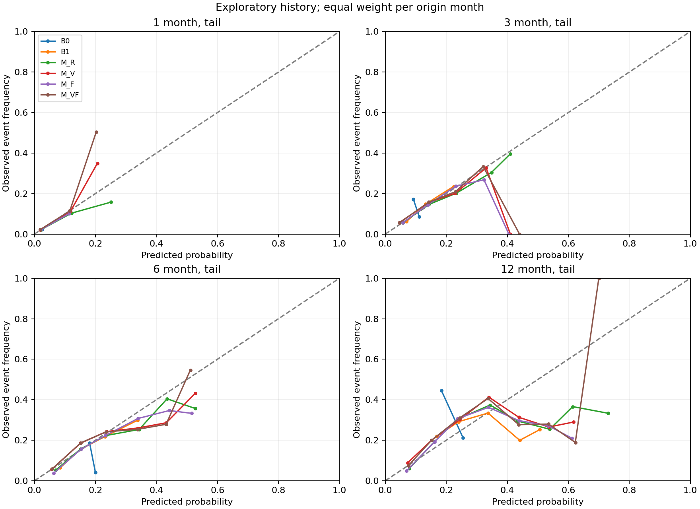
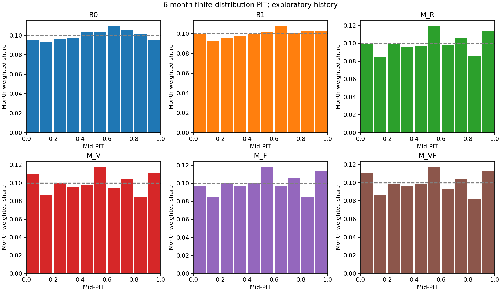

# EP25 概率可靠性、PIT与尾部

概率及观察事件率先按月平均。上涨是R>0，重大亏损为R<−20%；阈值相等时不计入事件。tail_error为预测减观察事件率，tail_absolute_error为逐条绝对概率误差；尾部Brier为主要尾部诊断。方向命中仅诊断。

| horizon | model | p_up | observed_up | brier | p_tail | observed_tail | tail_brier | tail_error | tail_absolute_error |
| --- | --- | --- | --- | --- | --- | --- | --- | --- | --- |
| 1 | B0 | 0.452381 | 0.467959 | 0.249416 | 0.025000 | 0.023294 | 0.022802 | 0.001706 | 0.047167 |
| 1 | B1 | 0.452619 | 0.467959 | 0.249620 | 0.023153 | 0.023294 | 0.022336 | -0.000141 | 0.044676 |
| 1 | M_F | 0.458438 | 0.467959 | 0.249675 | 0.022818 | 0.023294 | 0.022325 | -0.000476 | 0.044052 |
| 1 | M_R | 0.456734 | 0.467959 | 0.249275 | 0.023608 | 0.023294 | 0.022309 | 0.000314 | 0.044642 |
| 1 | M_V | 0.473635 | 0.467959 | 0.249479 | 0.020706 | 0.023294 | 0.022234 | -0.002589 | 0.041877 |
| 1 | M_VF | 0.474370 | 0.467959 | 0.249646 | 0.020460 | 0.023294 | 0.022270 | -0.002835 | 0.041715 |
| 3 | B0 | 0.437419 | 0.452640 | 0.248494 | 0.106532 | 0.106945 | 0.096097 | -0.000413 | 0.191191 |
| 3 | B1 | 0.440254 | 0.452640 | 0.248950 | 0.103009 | 0.106945 | 0.092916 | -0.003936 | 0.183617 |
| 3 | M_F | 0.449299 | 0.452640 | 0.249486 | 0.105408 | 0.106945 | 0.092046 | -0.001537 | 0.182972 |
| 3 | M_R | 0.447846 | 0.452640 | 0.248725 | 0.107986 | 0.106945 | 0.092426 | 0.001041 | 0.184966 |
| 3 | M_V | 0.458997 | 0.452640 | 0.248433 | 0.098393 | 0.106945 | 0.091581 | -0.008552 | 0.175555 |
| 3 | M_VF | 0.459638 | 0.452640 | 0.248990 | 0.097354 | 0.106945 | 0.091591 | -0.009591 | 0.174975 |
| 6 | B0 | 0.442881 | 0.453947 | 0.251232 | 0.182881 | 0.170665 | 0.143274 | 0.012216 | 0.292529 |
| 6 | B1 | 0.444599 | 0.453947 | 0.251894 | 0.173130 | 0.170665 | 0.138745 | 0.002464 | 0.278905 |
| 6 | M_F | 0.450534 | 0.453947 | 0.252374 | 0.178365 | 0.170665 | 0.136546 | 0.007700 | 0.277226 |
| 6 | M_R | 0.448329 | 0.453947 | 0.251912 | 0.179074 | 0.170665 | 0.137757 | 0.008408 | 0.278539 |
| 6 | M_V | 0.460066 | 0.453947 | 0.253913 | 0.163422 | 0.170665 | 0.136352 | -0.007244 | 0.264331 |
| 6 | M_VF | 0.460963 | 0.453947 | 0.254538 | 0.163136 | 0.170665 | 0.136248 | -0.007529 | 0.264498 |
| 12 | B0 | 0.462500 | 0.448009 | 0.257396 | 0.238558 | 0.265815 | 0.205042 | -0.027258 | 0.385283 |
| 12 | B1 | 0.462444 | 0.448009 | 0.256641 | 0.236697 | 0.265815 | 0.197872 | -0.029119 | 0.372520 |
| 12 | M_F | 0.469083 | 0.448009 | 0.256380 | 0.236511 | 0.265815 | 0.193211 | -0.029304 | 0.364489 |
| 12 | M_R | 0.464183 | 0.448009 | 0.255445 | 0.241772 | 0.265815 | 0.194372 | -0.024043 | 0.367178 |
| 12 | M_V | 0.478762 | 0.448009 | 0.266741 | 0.230702 | 0.265815 | 0.191077 | -0.035113 | 0.356585 |
| 12 | M_VF | 0.480811 | 0.448009 | 0.266007 | 0.228434 | 0.265815 | 0.191103 | -0.037381 | 0.356415 |

## 分位数覆盖

coverXX=P(实现收益≤预测QXX)，理想为XX%；并列用≤。90%区间含两端，PIT用离散CDF左右极限的中点。离散原子和端点截断会产生并列，因此PIT并非连续分布下严格均匀变换；直方图形状结合条件校准理解，不进行伪独立股票样本的KS显著性检验。

| horizon | model | cover05 | cover10 | cover50 | cover90 | cover95 | coverage90 | pit | direction |
| --- | --- | --- | --- | --- | --- | --- | --- | --- | --- |
| 1 | B0 | 0.049199 | 0.094116 | 0.484751 | 0.895183 | 0.943522 | 0.894323 | 0.509269 | 0.532041 |
| 1 | B1 | 0.046118 | 0.092427 | 0.483463 | 0.891587 | 0.941758 | 0.895640 | 0.511673 | 0.531402 |
| 1 | M_F | 0.045399 | 0.091940 | 0.480596 | 0.886763 | 0.938882 | 0.893483 | 0.512272 | 0.528047 |
| 1 | M_R | 0.045406 | 0.092769 | 0.478135 | 0.887278 | 0.938184 | 0.892778 | 0.513177 | 0.531737 |
| 1 | M_V | 0.050792 | 0.100040 | 0.497038 | 0.895240 | 0.943500 | 0.892708 | 0.500078 | 0.522687 |
| 1 | M_VF | 0.051626 | 0.100928 | 0.497866 | 0.894474 | 0.943156 | 0.891530 | 0.499514 | 0.520906 |
| 3 | B0 | 0.053433 | 0.103664 | 0.482886 | 0.899978 | 0.946716 | 0.893283 | 0.506499 | 0.547360 |
| 3 | B1 | 0.051919 | 0.101353 | 0.485291 | 0.893112 | 0.942532 | 0.890613 | 0.507668 | 0.544664 |
| 3 | M_F | 0.052985 | 0.102602 | 0.485859 | 0.883751 | 0.936123 | 0.883137 | 0.507534 | 0.536508 |
| 3 | M_R | 0.052029 | 0.101277 | 0.482635 | 0.882922 | 0.936081 | 0.884052 | 0.508744 | 0.544380 |
| 3 | M_V | 0.059531 | 0.109776 | 0.494814 | 0.889168 | 0.939336 | 0.879805 | 0.499499 | 0.540592 |
| 3 | M_VF | 0.059580 | 0.109992 | 0.496248 | 0.888920 | 0.938639 | 0.879060 | 0.498930 | 0.535192 |
| 6 | B0 | 0.051649 | 0.099351 | 0.487475 | 0.905619 | 0.948481 | 0.896832 | 0.505479 | 0.546053 |
| 6 | B1 | 0.054788 | 0.104149 | 0.487213 | 0.897834 | 0.943753 | 0.888965 | 0.505797 | 0.521093 |
| 6 | M_F | 0.053196 | 0.101175 | 0.482413 | 0.886298 | 0.935738 | 0.882542 | 0.507713 | 0.520775 |
| 6 | M_R | 0.054596 | 0.103456 | 0.479492 | 0.886587 | 0.937477 | 0.882881 | 0.508254 | 0.529954 |
| 6 | M_V | 0.062723 | 0.115014 | 0.492156 | 0.889517 | 0.938796 | 0.876072 | 0.499457 | 0.520810 |
| 6 | M_VF | 0.062896 | 0.115306 | 0.494141 | 0.887989 | 0.938290 | 0.875394 | 0.498825 | 0.517771 |
| 12 | B0 | 0.085617 | 0.145095 | 0.512738 | 0.920096 | 0.959960 | 0.874343 | 0.478398 | 0.444287 |
| 12 | B1 | 0.081928 | 0.143918 | 0.513834 | 0.913363 | 0.958041 | 0.876113 | 0.479743 | 0.474603 |
| 12 | M_F | 0.086000 | 0.145981 | 0.510303 | 0.892604 | 0.943213 | 0.857213 | 0.480553 | 0.502660 |
| 12 | M_R | 0.083466 | 0.142129 | 0.505876 | 0.894895 | 0.947686 | 0.864220 | 0.482665 | 0.504692 |
| 12 | M_V | 0.082530 | 0.142520 | 0.518475 | 0.893126 | 0.946380 | 0.863849 | 0.477655 | 0.495053 |
| 12 | M_VF | 0.082742 | 0.143433 | 0.522288 | 0.892806 | 0.944604 | 0.861862 | 0.476606 | 0.487214 |

## 主要对比安全性

退化Delta=联合模型−B1。覆盖项比较每月|覆盖率−名义分位|。预注册界限分别为Brier增加0.01、覆盖绝对误差增加5个百分点。只有区间上界也落在界限内才能对该诊断给出不退化的统计支持；不是仅按点估计宣布可靠。

| metric | delta | low95 | high95 | margin | point_within_margin | upper95_within_margin |
| --- | --- | --- | --- | --- | --- | --- |
| brier | 0.002643 | -0.002577 | 0.008343 | 0.010000 | True | True |
| tail_brier | -0.002496 | -0.005127 | -0.000309 | 0.010000 | True | True |
| absolute_cover05_error | 0.005529 | -0.001400 | 0.013606 | 0.050000 | True | True |
| absolute_cover10_error | 0.006853 | -0.003209 | 0.018091 | 0.050000 | True | True |
| absolute_cover50_error | 0.003711 | -0.003559 | 0.011459 | 0.050000 | True | True |
| absolute_cover90_error | 0.000772 | -0.004989 | 0.007172 | 0.050000 | True | True |
| absolute_cover95_error | 0.000561 | -0.002534 | 0.004076 | 0.050000 | True | True |

完整分位覆盖差异及两种块长区间在outputs/paired_intervals.csv；所有期限的条件校准在stratum_scores.csv与reliability.csv，PIT条件直方图在pit_histograms.csv。可靠性图使用固定概率十分位桶，样本先给每个预测月相等权重；表内保留各桶行数及月权重。图未绘制伪独立股票误差条。

总体覆盖接近名义水平不等于条件可靠：6月B1的Q05覆盖为5.48%，联合模型为6.29%，但上涨概率可靠性曲线明显偏离对角线，高预测概率桶并未稳定对应更高实现事件率。部分边缘桶样本很少，须同时查rows和month_weight。预定义安全界限内的相对退化检验通过，也不代表绝对概率已校准。

有限原子表示并不提供无界右尾或真实灾难损失的可靠上界。缺失端点事件率界限另存missing_event_bounds.csv。缺失退市/重整数据不能由漂亮校准图修复。
