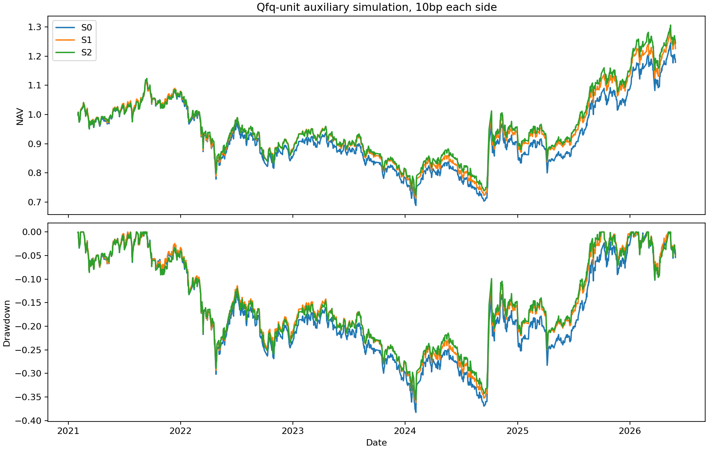

# EP26 风险过滤辅助组合对照

这是风险管理研究代理，不是可执行交易或独立科学确认。S0固定哈希等权基础子池，S1按直接M_R过滤，S2按M_VF过滤；每月板块×规模三分位×波动三分位中排除floor(20%n)，三组各层目标持股数完全相同、目标股票总仓位100%。原池全部预测人群决定名单，不按未来标签或是否缺价筛股票。因各层floor，实际过滤比例略少于20%，三组数量相同。

真实动态辅助曲线使用月末预测、下一交易日收盘成交，避免同收盘信息提前成交。前复权单位模拟，先卖后买、双向10bp及30bp成本，现金守恒；缺报价不能成交，已有持仓按最后可见价估值并记录陈旧风险。未精确模拟真实分红/退市结算、涨跌停、税费和整手。收益源截至2026-05-29，1287个市场交易日，约2021-02至2026-05。

| strategy | cost_bps | cumulative_return | annual_return | annual_vol | sharpe_zero_cash | max_drawdown | daily_es05 | monthly_es05 | mean_equity_fraction | maximum_stale_fraction | turnover_total_nav_multiple | transaction_cost_nav_multiple |
| --- | --- | --- | --- | --- | --- | --- | --- | --- | --- | --- | --- | --- |
| S0 | 10 | 0.178721 | 0.032720 | 0.188794 | 0.264881 | -0.382719 | -0.026694 | -0.091404 | 0.999998 | 0.010906 | 15.310863 | 0.015311 |
| S1 | 10 | 0.225465 | 0.040614 | 0.184567 | 0.307924 | -0.361407 | -0.025820 | -0.088753 | 0.999968 | 0.008760 | 27.120459 | 0.027120 |
| S2 | 10 | 0.243768 | 0.043639 | 0.186211 | 0.322528 | -0.356246 | -0.026343 | -0.086731 | 0.999999 | 0.008752 | 20.622664 | 0.020623 |
| S0 | 30 | 0.143306 | 0.026570 | 0.188648 | 0.233278 | -0.390857 | -0.026706 | -0.091817 | 1.000000 | 0.010915 | 15.284035 | 0.045852 |
| S1 | 30 | 0.160873 | 0.029639 | 0.184333 | 0.250563 | -0.376647 | -0.025862 | -0.089498 | 0.999980 | 0.008767 | 27.087064 | 0.081261 |
| S2 | 30 | 0.193696 | 0.035276 | 0.186021 | 0.279414 | -0.367974 | -0.026359 | -0.087232 | 1.000000 | 0.008757 | 20.590034 | 0.061770 |

实际股票仓位均接近100%，最大同日组间差0.2181%，在预设1个百分点内，低仓位不是主要比较来源。目标持股数/层计数严格相同；实际报价失败可能造成微小持股数差，portfolio_daily.csv保留每日实际数。不能只凭总仓位接近就宣称风险暴露完全相同。

ES为最差5%样本收益均值，越不负越好。S2最大回撤略优于S1，但日ES更差（−2.6343%对−2.5820%）；月ES和累计收益较好。这些指标不是同一个尾部优势，不能只挑回撤或月ES。全部月收益ES及6月固定名单ES差的整月块区间见portfolio_es_intervals.csv。

## 持有重大亏损股票与配对增量

以下为预测日固定等权名单的6月标签诊断，与按月调仓曲线区分；cohort_return不是提前可得的可交易结果。

| strategy | loss20_rate | cohort_return | stock_tail_es05 | missing |
| --- | --- | --- | --- | --- |
| S0 | 0.171550 | 0.023887 | -0.354398 | 0.288136 |
| S1 | 0.163285 | 0.023232 | -0.343197 | 0.372881 |
| S2 | 0.158577 | 0.026926 | -0.344036 | 0.372881 |
| comparison | metric | estimate | low95 | high95 | months |
| --- | --- | --- | --- | --- | --- |
| S1-S0 | loss20_rate | -0.008265 | -0.012974 | -0.004216 | 59 |
| S1-S0 | cohort_return | -0.000654 | -0.005150 | 0.003345 | 59 |
| S2-S0 | loss20_rate | -0.012973 | -0.019264 | -0.007362 | 59 |
| S2-S0 | cohort_return | 0.003040 | -0.000563 | 0.006944 | 59 |
| S2-S1 | loss20_rate | -0.004708 | -0.009553 | 0.000006 | 59 |
| S2-S1 | cohort_return | 0.003694 | 0.000021 | 0.007188 | 59 |

S1相对S0持有重大亏损率下降约0.8265个百分点；S2相对S0下降约1.2973个百分点。但S2−S1仅约−0.4708个百分点，L6区间[-0.9553, +0.0006]个百分点跨0，L12区间低于0。既定主块长未提供稳健新增信息优势，不能事后挑L12。

## 市值、波动、行业与市场暴露

| strategy | log_cap_standardized_vs_s0 | vol63_standardized_vs_s0 | industry_total_variation_vs_s0 | industry_unknown_fraction | industry_stale_fraction |
| --- | --- | --- | --- | --- | --- |
| S0 | 0.000000 | 0.000000 | 0.000000 | 0.066959 | 0.281870 |
| S1 | 0.045824 | -0.123318 | 0.041923 | 0.059762 | 0.277615 |
| S2 | 0.022355 | -0.076048 | 0.056928 | 0.033483 | 0.257806 |
| strategy | cost_bps | paired_days | realized_csi300_beta | mean_excess_daily_return |
| --- | --- | --- | --- | --- |
| S0 | 10 | 1287 | 0.964948 | 0.000205 |
| S0 | 30 | 1287 | 0.963827 | 0.000181 |
| S1 | 10 | 1287 | 0.954490 | 0.000232 |
| S1 | 30 | 1287 | 0.952647 | 0.000190 |
| S2 | 10 | 1287 | 0.956729 | 0.000245 |
| S2 | 30 | 1287 | 0.955315 | 0.000213 |

分层计数完全匹配，连续风险变量仍有残差；S1比S2降低的历史波动更多。实现CSI300 beta只作事后归因，不是训练信号。行业权重总变差和逐行业权重保留在portfolio_exposures.csv、portfolio_industry_weights.csv；分类未知/陈旧的影响不隐藏。

| comparison | metric | total_difference | industry_allocation | within_industry_residual |
| --- | --- | --- | --- | --- |
| S1-S0 | loss_rate | -0.008265 | -0.001659 | -0.006606 |
| S1-S0 | return_value | -0.000654 | -0.000303 | -0.000351 |
| S2-S0 | loss_rate | -0.012973 | -0.004335 | -0.008638 |
| S2-S0 | return_value | 0.003040 | -0.000600 | 0.003640 |
| S2-S1 | loss_rate | -0.004708 | -0.002676 | -0.002032 |
| S2-S1 | return_value | 0.003694 | -0.000297 | 0.003991 |

行业分解使用同月原池行业平均结果：总差=行业配置项+行业内残差。S2−S1事件率下降中约0.2676个百分点来自行业配置，占总差约57%；行业内残差约−0.2032个百分点，完整区间见portfolio_attribution_intervals.csv。该恒等诊断不建立行业因果识别，且受缺失/陈旧行业与收益影响。

## 换手成本与机会成本

双边成交额/NAV累计和交易成本在主表；30bp结果全部保留，未通过长期现金回避风险。排除股票的后续收益和大涨机会如下，不因其“高风险”而省略上涨机会：

| strategy | excluded_mean_return | excluded_gain20_rate | selected_mean_return |
| --- | --- | --- | --- |
| S0 | 0.016702 | 0.163922 | 0.023887 |
| S1 | 0.019375 | 0.180069 | 0.023232 |
| S2 | 0.003267 | 0.162216 | 0.026926 |

陈旧估值最高约1%的资产仍可隐藏真实损失，退市和特殊公司行动未解决；行业中性也未严格达到。因此历史过滤相对S0减少重大亏损暴露可作探索性线索，尚不能证明新增V/F在维持严格可比市场风险暴露后创造稳定尾部经济价值。组合表现不替代概率模型主检验。

