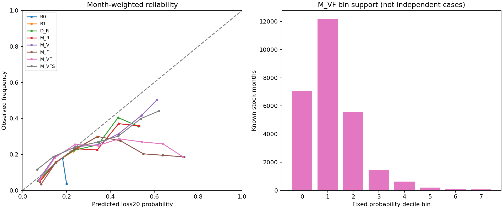
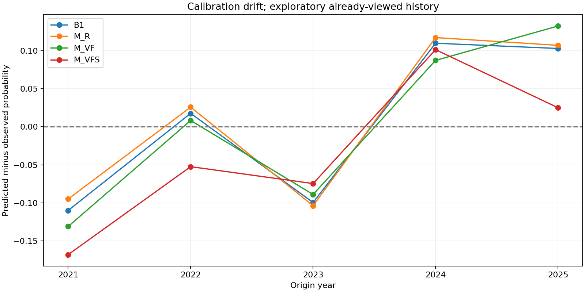

# EP26 概率校准与条件可靠性

本轮没有测试后拟合校准器，直接检查冻结原始概率。所有结果仅探索性，概率未标为独立可信。总体预测均值接近总体发生率，并不证明条件校准。

| model | estimate | low95 | high95 | months |
| --- | --- | --- | --- | --- |
| B0 | 0.012355 | -0.053857 | 0.077613 | 59 |
| B1 | 0.002464 | -0.063104 | 0.070113 | 59 |
| D_F | 0.007700 | -0.055016 | 0.072026 | 59 |
| D_R | 0.008408 | -0.056055 | 0.075592 | 59 |
| D_V | -0.007244 | -0.072421 | 0.059653 | 59 |
| D_VF | -0.007529 | -0.071840 | 0.057626 | 59 |
| M_F | 0.015358 | -0.049903 | 0.079614 | 59 |
| M_R | 0.008612 | -0.056332 | 0.076125 | 59 |
| M_V | -0.007551 | -0.073611 | 0.060073 | 59 |
| M_VF | -0.000654 | -0.066653 | 0.065027 | 59 |
| M_VFS | -0.034769 | -0.108581 | 0.035187 | 59 |

联合模型整体偏差约−0.0654个百分点，但2021–2023低估约7.06个百分点、2024以后高估约10.88个百分点，误差被跨阶段平均抵消。上涨趋势与非上涨趋势、市场高/低波动也有不同偏差；历史排序较好仍会系统性误报概率水平。

| model | dimension | condition | rows | events | months | base_rate | bias | brier | auc |
| --- | --- | --- | --- | --- | --- | --- | --- | --- | --- |
| M_R | phase | 2021-2023 | 16199 | 3739 | 36 | 0.230896 | -0.057637 | 0.173113 | 0.688207 |
| M_R | phase | 2024-2026 | 11031 | 842 | 23 | 0.076391 | 0.112305 | 0.083284 | 0.651513 |
| M_R | regime | non_uptrend | 15562 | 3014 | 34 | 0.196178 | -0.021486 | 0.151848 | 0.705360 |
| M_R | regime | uptrend | 11668 | 1567 | 25 | 0.135969 | 0.049544 | 0.119392 | 0.631119 |
| M_R | vol_regime | high_vol | 7341 | 985 | 16 | 0.136361 | 0.067519 | 0.118825 | 0.685979 |
| M_R | vol_regime | low_vol | 19889 | 3596 | 43 | 0.183430 | -0.013307 | 0.145266 | 0.669409 |
| M_VF | phase | 2021-2023 | 16199 | 3739 | 36 | 0.230896 | -0.070598 | 0.173027 | 0.701014 |
| M_VF | phase | 2024-2026 | 11031 | 842 | 23 | 0.076391 | 0.108823 | 0.084798 | 0.664610 |
| M_VF | regime | non_uptrend | 15562 | 3014 | 34 | 0.196178 | -0.035815 | 0.151152 | 0.713946 |
| M_VF | regime | uptrend | 11668 | 1567 | 25 | 0.135969 | 0.047164 | 0.121606 | 0.649934 |
| M_VF | vol_regime | high_vol | 7341 | 985 | 16 | 0.136361 | 0.028512 | 0.115926 | 0.675505 |
| M_VF | vol_regime | low_vol | 19889 | 3596 | 43 | 0.183430 | -0.011507 | 0.147081 | 0.691033 |
| M_VFS | phase | 2021-2023 | 16199 | 3739 | 36 | 0.230896 | -0.098379 | 0.180844 | 0.714129 |
| M_VFS | phase | 2024-2026 | 11031 | 842 | 23 | 0.076391 | 0.064796 | 0.077509 | 0.666968 |
| M_VFS | regime | non_uptrend | 15562 | 3014 | 34 | 0.196178 | -0.059503 | 0.159813 | 0.725947 |
| M_VFS | regime | uptrend | 11668 | 1567 | 25 | 0.135969 | -0.001129 | 0.114377 | 0.654668 |
| M_VFS | vol_regime | high_vol | 7341 | 985 | 16 | 0.136361 | -0.018544 | 0.113797 | 0.683361 |
| M_VFS | vol_regime | low_vol | 19889 | 3596 | 43 | 0.183430 | -0.040806 | 0.150520 | 0.700352 |

## 主模型概率桶与偏差区间

| probability_bin | rows | events | covered_months | predicted | observed | bias | bias_low95 | bias_high95 | evidence |
| --- | --- | --- | --- | --- | --- | --- | --- | --- | --- |
| 0 | 7080 | 382 | 59 | 0.075909 | 0.055315 | 0.020594 | -0.010078 | 0.045963 | exploratory_unconfirmed |
| 1 | 12172 | 2176 | 59 | 0.147044 | 0.181710 | -0.034665 | -0.103464 | 0.039072 | exploratory_unconfirmed |
| 2 | 5552 | 1397 | 59 | 0.238007 | 0.255029 | -0.017022 | -0.112299 | 0.080858 | exploratory_unconfirmed |
| 3 | 1422 | 353 | 59 | 0.344213 | 0.250113 | 0.094100 | -0.006647 | 0.172403 | exploratory_unconfirmed |
| 4 | 632 | 180 | 53 | 0.440098 | 0.286771 | 0.153326 | 0.009981 | 0.237754 | exploratory_unconfirmed |
| 5 | 198 | 53 | 18 | 0.542987 | 0.269718 | 0.273269 | 0.033735 | 0.351252 | exploratory_unconfirmed |
| 6 | 109 | 28 | 4 | 0.640004 | 0.258469 | 0.381534 | -0.306085 | 0.438447 | exploratory_sparse |
| 7 | 65 | 12 | 3 | 0.730822 | 0.186318 | 0.544504 | -0.012258 | 0.631621 | exploratory_sparse |

固定宽度0.1桶，bin=3表示[0.3,0.4)。表的predicted/observed按每月总体等权定义，在桶内重归一；95%区间使用完整59月日历整月bootstrap，桶缺席月权重为零，不将其当成零事件。所有模型、辅助阈值、年份/市场状态/财报年龄的桶结果在calibration.csv，另有L12敏感性。小于6个覆盖月份标descriptive sparse，即使数千股票也不升级可信。确认性范围标准另见validation_protocol.md。

## 5%与10%收益分位辅助

| model | cover05 | cover10 |
| --- | --- | --- |
| B0 | 0.048988 | 0.097252 |
| B1 | 0.054788 | 0.104149 |
| D_F | 0.053196 | 0.101175 |
| D_R | 0.054596 | 0.103456 |
| D_V | 0.062723 | 0.115014 |
| D_VF | 0.062896 | 0.115306 |

直接事件分类器的三个概率不能唯一识别收益分位数，所以M_*的Q05/Q10明确为空，不伪造分位输出。这里复用冻结历史/近邻/EP25分位树，理想覆盖分别5%/10%；有限原子/端点截断和未解决退市口径仍限制解释。分位覆盖近名义水平不能替代条件概率可靠性。

25条到期缺失记录可能集中于坏结果；missing_brier_bounds.csv给出每模型最有利/最不利二元结果的Brier界限。不能对未来ST剔除的整个池外人群给出伪精确校准保证。
