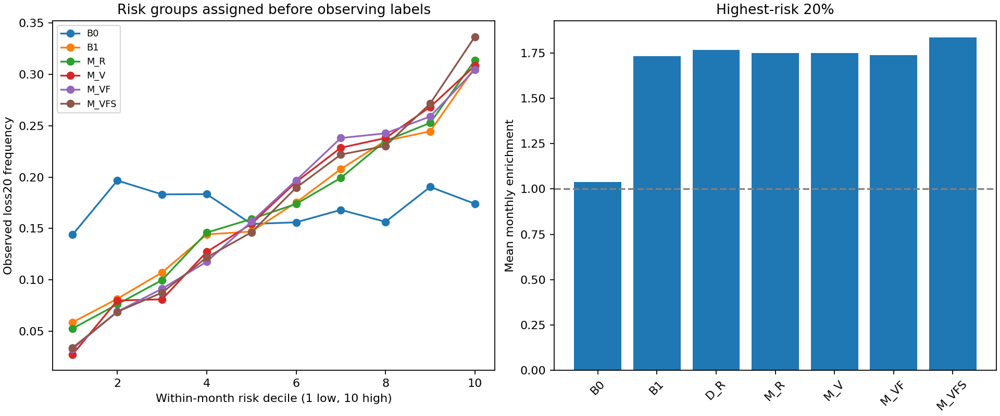

# EP26 重大亏损风险区分

AUC/AP均先按同一预测月计算，再等权平均，避免把“某年全市场都差”误称个股排序。PR-AUC采用average precision阶梯积分，非梯形PR曲线面积；参照事件率17.0665%（月等权），pooled发生率另列。没有正类的月份AP记NA、单类月份AUC记NA，并保留有效月份数。

| model | auc | pr_auc | enrichment10 | enrichment20 | recall10 | recall20 | fpr10 | fpr20 | auc_months | pr_auc_months |
| --- | --- | --- | --- | --- | --- | --- | --- | --- | --- | --- |
| B0 | 0.500000 | 0.170665 | 0.982757 | 1.038238 | 0.099142 | 0.208405 | 0.104740 | 0.201084 | 59 | 59 |
| B1 | 0.668258 | 0.283021 | 1.938627 | 1.733442 | 0.195696 | 0.348018 | 0.082764 | 0.172257 | 59 | 59 |
| D_F | 0.679643 | 0.295129 | 2.045083 | 1.808896 | 0.206438 | 0.363344 | 0.081804 | 0.169768 | 59 | 59 |
| D_R | 0.673437 | 0.284330 | 1.976305 | 1.767871 | 0.199466 | 0.354936 | 0.083438 | 0.171875 | 59 | 59 |
| D_V | 0.687716 | 0.294470 | 1.974283 | 1.731804 | 0.199347 | 0.347816 | 0.083583 | 0.170681 | 59 | 59 |
| D_VF | 0.685204 | 0.288603 | 1.928026 | 1.727351 | 0.194667 | 0.346823 | 0.083993 | 0.170634 | 59 | 59 |
| M_F | 0.675025 | 0.292172 | 2.065115 | 1.779981 | 0.208417 | 0.357616 | 0.081992 | 0.170624 | 59 | 59 |
| M_R | 0.673902 | 0.290343 | 2.065618 | 1.749044 | 0.208487 | 0.351227 | 0.082485 | 0.171632 | 59 | 59 |
| M_V | 0.690875 | 0.297696 | 1.994028 | 1.751112 | 0.201269 | 0.351722 | 0.082557 | 0.168704 | 59 | 59 |
| M_VF | 0.686822 | 0.290884 | 1.948184 | 1.737523 | 0.196738 | 0.349000 | 0.082862 | 0.170778 | 59 | 59 |
| M_VFS | 0.695744 | 0.306929 | 2.162424 | 1.835813 | 0.218347 | 0.368775 | 0.078470 | 0.164803 | 59 | 59 |

最高10%/20%组在全部当前预测人群上形成，先分组再观察结果；未来缺失不影响排序选择。并列用固定股票代码哈希破除，不使用结果。B0常数概率的分组只是固定随机对照，其偶然富集不代表区分力。enrichment是每月组内发生率/全池发生率再等月平均；recall分母为全部已知重大亏损；FPR分母为全部已知非重大亏损。FPR低不等于高风险预警大多数都会亏损，precision另存monthly_scores.csv。

基础风险排序确有历史信号：B1月内AUC约0.668、D_R约0.673、直接M_R约0.674，高风险20%约1.7倍富集。但这主要来自波动/市值，不是新增V/F的证明。M_VF AUC相对M_R增量区间跨0，且最高20%召回率约34.9%，略低于M_R的35.1%。风险排序不能替代概率校准。

风险十分位的全部行数、事件数、覆盖月份、预测与实际频率见outputs/risk_deciles.csv；逐月记录见risk_decile_monthly.csv。Pooled AUC/AP见pooled_metrics.csv，只作市场共同变化混杂诊断，不作为主检验。

辅助阈值10%/30%全部模型结果见summary.csv、paired_intervals.csv和calibration.csv；不以表现最好阈值替换20%。不同收益位置的结果说明尾部结构，而非提高普通分类accuracy或收益Rank IC。
