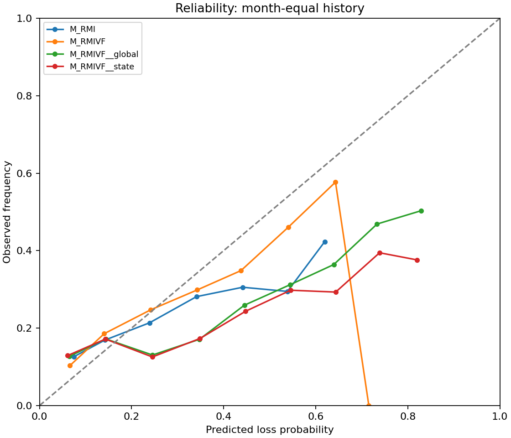

# EP27 市场状态条件校准

校准只用过去真正样本外概率及严格已成熟标签，最近36起点、至少12起点/30事件/30非事件；不足精确退回raw。global固定原logit斜率1拟合截距，state再按过去市场状态调整共同截距。没有训练内概率、未来标签或事后改校准算法。

| model | brier | auc | bias | base_rate | enrichment20 | recall20 |
| --- | --- | --- | --- | --- | --- | --- |
| M_RMI | 0.141732 | 0.666210 | -0.018603 | 0.170665 | 1.597798 | 0.320948 |
| M_RMIVF | 0.138253 | 0.691730 | -0.029179 | 0.170665 | 1.788011 | 0.359218 |
| M_RMIVF__global | 0.151837 | 0.691730 | 0.041560 | 0.170665 | 1.788011 | 0.359218 |
| M_RMIVF__state | 0.156948 | 0.691730 | 0.049449 | 0.170665 | 1.788011 | 0.359218 |
| M_RMI__global | 0.156616 | 0.666210 | 0.049083 | 0.170665 | 1.597798 | 0.320948 |
| M_RMI__state | 0.164748 | 0.666211 | 0.063002 | 0.170665 | 1.597798 | 0.320948 |
| candidate | baseline | estimate | low95 | high95 |
| --- | --- | --- | --- | --- |
| M_RM__global | M_RM | 0.015399 | 0.003442 | 0.029880 |
| M_RM__state | M_RM | 0.024002 | 0.007205 | 0.042144 |
| M_RMI__global | M_RMI | 0.014884 | 0.003760 | 0.027354 |
| M_RMI__state | M_RMI | 0.023015 | 0.007001 | 0.040971 |
| M_RMIVF__global | M_RMIVF | 0.013584 | 0.003439 | 0.024697 |
| M_RMIVF__state | M_RMIVF | 0.018694 | 0.004471 | 0.036972 |

两种校准均退化，而非仅没有显著改善。Full的global增加Brier约0.013584，state增加0.018694，95%区间均为正；不能挑局部年份的偏差修复当整体成功。

| model | condition | brier | auc | bias | base_rate | months |
| --- | --- | --- | --- | --- | --- | --- |
| M_RMIVF | 2021-2023 | 0.178405 | 0.711018 | -0.085666 | 0.230896 | 36 |
| M_RMIVF | 2024-2026 | 0.075408 | 0.661539 | 0.059235 | 0.076391 | 23 |
| M_RMIVF__global | 2021-2023 | 0.188607 | 0.711018 | -0.005215 | 0.230896 | 36 |
| M_RMIVF__global | 2024-2026 | 0.094285 | 0.661539 | 0.114774 | 0.076391 | 23 |
| M_RMIVF__state | 2021-2023 | 0.198063 | 0.711018 | 0.010390 | 0.230896 | 36 |
| M_RMIVF__state | 2024-2026 | 0.092593 | 0.661539 | 0.110587 | 0.076391 | 23 |

raw Full在2021–23低估约8.57个百分点，后段高估约5.92个百分点。整体校准减小前段平均偏差，却使后段高估加重至约11个百分点；状态校准也未稳定修复。这说明预注册可观测状态/有限成熟历史没有可靠外推漂移，不证明所有市场状态方法永远无效。

384份校准记录中108份因预热不足原样回退，276份成功拟合，优化失败0。全部训练键、最大成熟日期、系数和训练内变换记录在calibration_fits.json。主要判定仍未校准Full−RMI，不能以另一个校准版本重定主检验。

理论上共同logit偏移保存同月排序。实际双精度中两个模型各有1个月的并列被约1e−17打破，预警名单不变，Full两种校准排序精确不变；不将浮点并列噪声称排序增量。原概率文件未改，细节见calibration_rank_invariance.csv。

可靠性固定0.1桶，reliability.csv含行数、事件数、覆盖月份及整月块偏差区间；稀疏桶不标可信。年份/趋势/高低波动/高风险20%组见calibrated_conditional_scores.csv；空桶月零权重，不伪造零事件。

