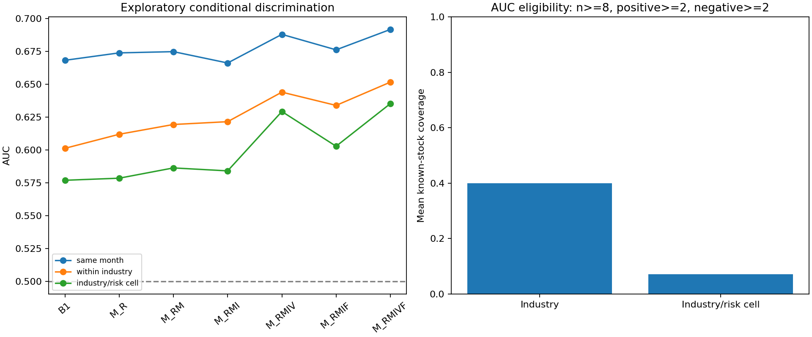

# EP27 行业风险与同行业评价

行业分类只使用预测前已经发布的表，时点和未知/陈旧状态见data_integrity_audit.md。行业状态从未做未来ST排除的报价覆盖重建，同伴排除本股；数据覆盖仍不是完整历史市场。

| metric | estimate | low95 | high95 |
| --- | --- | --- | --- |
| brier | -0.000520 | -0.001913 | 0.000843 |
| auc | -0.008631 | -0.018923 | 0.001491 |
| industry_auc | 0.002139 | -0.003317 | 0.008524 |
| matched_cell_auc | -0.002250 | -0.012276 | 0.007691 |

行业M_RMI相对M_RM的Brier差约−0.000520，但区间跨0；本模型没有验证稳定的行业新增概率优势。不能把“行业均值能重现一部分风险分数”当作有效行业预测。

## 同月同行业与风险格的评分覆盖

| model | industry_auc | industry_coverage | industry_eligible_groups | matched_cell_auc | matched_cell_coverage | matched_cell_eligible_groups |
| --- | --- | --- | --- | --- | --- | --- |
| B0 | 0.500000 | 0.399529 | 8.864407 | 0.500000 | 0.072012 | 2.949153 |
| B1 | 0.601278 | 0.399529 | 8.864407 | 0.576967 | 0.072012 | 2.949153 |
| M_R | 0.611976 | 0.399529 | 8.864407 | 0.578548 | 0.072012 | 2.949153 |
| M_RM | 0.619414 | 0.399529 | 8.864407 | 0.586369 | 0.072012 | 2.949153 |
| M_RMI | 0.621553 | 0.399529 | 8.864407 | 0.584119 | 0.072012 | 2.949153 |
| M_RMIF | 0.633928 | 0.399529 | 8.864407 | 0.602856 | 0.072012 | 2.949153 |
| M_RMIV | 0.644020 | 0.399529 | 8.864407 | 0.629279 | 0.072012 | 2.949153 |
| M_RMIVF | 0.651638 | 0.399529 | 8.864407 | 0.635273 | 0.072012 | 2.949153 |

同行业至少8行、2正2负才评价。主对照行业AUC覆盖平均39.95%的已知股票月，56/59个月有可评价组；风险格仅7.20%、49/59个月。未覆盖部分不填AUC=0.5或0，不能声称结果适用全部行业和股票。风险格更窄的覆盖不能与全池AUC直接当等人群比较。

conditional_group_audit.csv保存每个模型、日期、行业/风险格的已知行数、事件/非事件、状态及排除原因。组资格仅用于评价是否可定义AUC，原预测人群和模型没有因事后事件数改变。月内组AUC按正负对数加权，再跨月平均，不把小组当独立样本。

