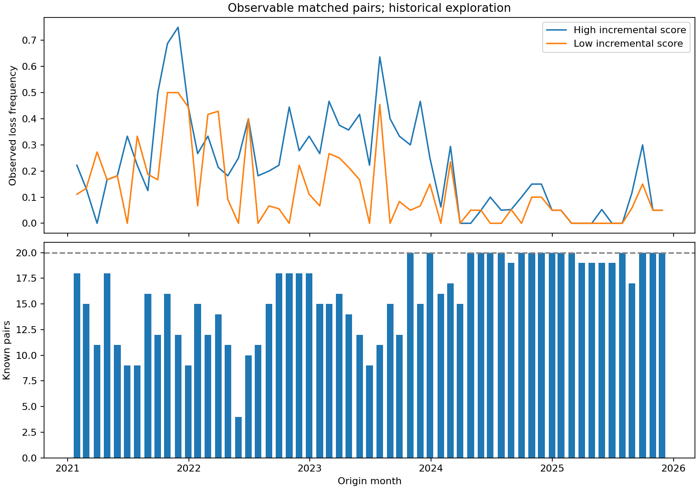

# EP27 匹配风险组

每月同历史行业、同板块；行业至少10只，增量分数logit(Full)−logit(RMI)最高/最低20%（ceil），市值log差≤0.35、波动log差≤0.20。按可观测距离贪心无放回、最多20对/月；不是用未来损失找相似样本。

形成1036对，成熟双端可观察934对；主评价59个月，未到期/端点缺失保留在matched_monthly.csv。实际平均每月对数低于目标时不放宽卡尺，不能把不足样本删除。每个高/低端数量相同，行业和板块精确一致，连续风险仅近似匹配。

| statistic | formed_pairs | known_pairs | missing_pairs | log_cap_gap_mean | log_vol_gap_mean |
| --- | --- | --- | --- | --- | --- |
| mean | 15.898305 | 15.830508 | 0.067797 | 0.139606 | 0.085757 |
| min | 4.000000 | 4.000000 | 0.000000 | 0.066612 | 0.050122 |
| max | 20.000000 | 20.000000 | 1.000000 | 0.206678 | 0.120734 |
| metric | estimate | low95 | high95 | months | defined_months | block |
| --- | --- | --- | --- | --- | --- | --- |
| event_difference | 0.095270 | 0.042142 | 0.154852 | 59 | 59 | 6 |
| event_difference | 0.095270 | 0.038414 | 0.156774 | 59 | 59 | 12 |
| pair_concordance | 0.719071 | 0.618870 | 0.819647 | 59 | 51 | 6 |
| pair_concordance | 0.719071 | 0.618717 | 0.816324 | 59 | 51 | 12 |

按月等权，高−低重大亏损发生率差9.527个百分点，95%区间[4.214, 15.485]；L12同方向。配对标签不同时的条件一致率约71.9%，51个月可定义，不能把同样标签的对当成独立成功。

按全部已知对合并（与等月估计权重不同），高组事件率约20.34%、低组11.46%；平均RMI概率差约−0.092个百分点，Full差约8.489个百分点。高低差不是仅按原基线更高风险选出的。仍不能排除连续风险残差、有限匹配覆盖、历史选择及估值版本问题，不作为因果识别。

matched_pairs.csv含每对身份、距离、源行业、预测差、结果及缺失；名单按预测信息先生成。自动测试在替换/反转全部未来标签后要求匹配结果完全不变。

