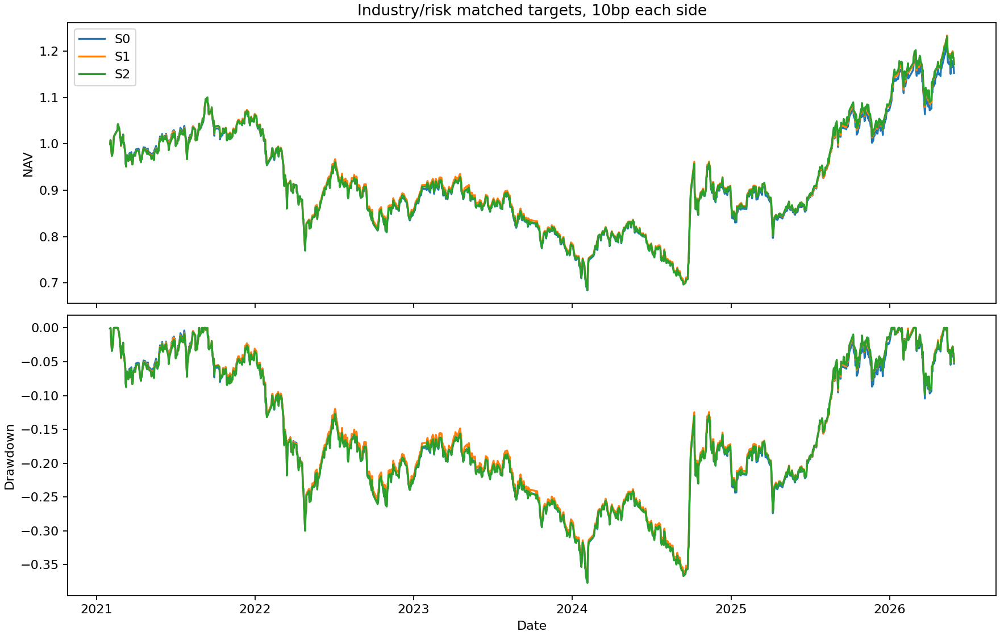

# EP27 行业中性风险过滤辅助检验

S1=raw RMI，S2=raw Full，S0=固定哈希基础子池。行业主要代码×板块×规模/波动中位数逐格相同保留数、等权，UNKNOWN三组全保留。因此目标已发布行业权重、风险格计数、总仓位、持股数精确一致。格内floor(20%n)意味着小格实际不筛选，整体过滤比例明显低于20%；不为了收益提高筛选比例。

可交易代理池要求当时过去21日金额≥500万元，仍不是完整交易所可交易性认证。模拟资本100万元、下一交易日收盘、双向10/30bp费用，成交额最多上一交易日为止21日平均金额的10%，现金守恒，不用当天收盘后量决定成交。缺报价不交易，已有资产最后价估值且显式记录。

| strategy | cost_bps | cumulative_return | annual_return | annual_vol | sharpe_zero_cash | daily_es05 | monthly_es05 | max_drawdown | drawdown_duration_sessions | mean_equity | turnover | fees | liquidity_limited_orders |
| --- | --- | --- | --- | --- | --- | --- | --- | --- | --- | --- | --- | --- | --- |
| S0 | 10 | 0.152671 | 0.028211 | 0.187260 | 0.242144 | -0.026413 | -0.093273 | -0.377000 | 1042 | 1.000000 | 14.105931 | 0.014106 | 94 |
| S1 | 10 | 0.172102 | 0.031582 | 0.186616 | 0.259874 | -0.026305 | -0.092122 | -0.373831 | 1041 | 1.000000 | 16.757563 | 0.016758 | 87 |
| S2 | 10 | 0.170941 | 0.031382 | 0.187529 | 0.258503 | -0.026461 | -0.091450 | -0.376607 | 1041 | 1.000000 | 15.810725 | 0.015811 | 89 |
| S0 | 30 | 0.120708 | 0.022565 | 0.187130 | 0.212758 | -0.026424 | -0.093617 | -0.384461 | 1045 | 1.000000 | 14.083202 | 0.042250 | 94 |
| S1 | 30 | 0.133510 | 0.024841 | 0.186458 | 0.224779 | -0.026323 | -0.092532 | -0.382616 | 1045 | 1.000000 | 16.732315 | 0.050197 | 87 |
| S2 | 30 | 0.134571 | 0.025029 | 0.187383 | 0.225588 | -0.026475 | -0.091844 | -0.384786 | 1043 | 1.000000 | 15.785777 | 0.047357 | 89 |

三组实际股票仓位均接近100%，最大同日差为0，没有低仓位/现金规避制造成功。持股数/目标行业计数精确匹配；实际仓位随价格和报价失败略漂移，不能忽略。

| metric | cost_bps | estimate | low95 | high95 | block |
| --- | --- | --- | --- | --- | --- |
| loss_rate | 0 | -0.000800 | -0.002080 | 0.000546 | 6 |
| loss_rate | 0 | -0.000800 | -0.001991 | 0.000450 | 12 |
| cohort_return | 0 | 0.000852 | -0.000191 | 0.001986 | 6 |
| cohort_return | 0 | 0.000852 | -0.000029 | 0.001817 | 12 |
| monthly_return | 10 | -0.000020 | -0.000356 | 0.000314 | 6 |
| monthly_return | 10 | -0.000020 | -0.000346 | 0.000289 | 12 |
| monthly_return | 30 | 0.000010 | -0.000328 | 0.000345 | 6 |
| monthly_return | 30 | 0.000010 | -0.000317 | 0.000321 | 12 |

S2−S1持有重大亏损率只下降约0.080个百分点，区间跨0；10bp下S2累计收益略低、最大回撤与日ES略差，月ES略好，30bp收益排序因换手费用略反转。风险排序/概率改善没有转化为本过滤规则下稳定的新增组合尾部价值。

| dataset | delta_es05 | low95 | high95 | block |
| --- | --- | --- | --- | --- |
| six_month_static_cohort | 0.001766 | -0.001502 | 0.002700 | 6 |
| six_month_static_cohort | 0.001766 | -0.000879 | 0.002700 | 12 |
| monthly_rebalance_10bp | 0.000672 | -0.000391 | 0.002121 | 6 |
| monthly_rebalance_10bp | 0.000672 | -0.000307 | 0.001820 | 12 |
| monthly_rebalance_30bp | 0.000689 | -0.000346 | 0.002137 | 6 |
| monthly_rebalance_30bp | 0.000689 | -0.000271 | 0.001854 | 12 |

ES为最差5%收益均值，差为左减右，正值表示较少亏损。6月静态名单与按月调仓时间序列分开，不把股票横截面尾部误作组合时间尾部。回撤持续时间单位为交易日，窗口末未恢复仍计到末日。

## 暴露与归因

| strategy | holdings | tradable_proxy_rows | log_cap_std_diff_vs_s0 | vol63_std_diff_vs_s0 | stale_industry_fraction |
| --- | --- | --- | --- | --- | --- |
| S0 | 427.109375 | 462.437500 | 0.000000 | 0.000000 | 0.234375 |
| S1 | 427.109375 | 462.437500 | 0.017670 | -0.049943 | 0.234375 |
| S2 | 427.109375 | 462.437500 | 0.008743 | -0.035608 | 0.234375 |
| strategy | cost_bps | days | realized_csi300_beta |
| --- | --- | --- | --- |
| S0 | 10 | 1287 | 0.960662 |
| S0 | 30 | 1287 | 0.959649 |
| S1 | 10 | 1287 | 0.958596 |
| S1 | 30 | 1287 | 0.957386 |
| S2 | 10 | 1287 | 0.962873 |
| S2 | 30 | 1287 | 0.961748 |
| comparison | mean_industry_TV | max_industry_TV |
| --- | --- | --- |
| S1-S0 | 0.001973 | 0.005876 |
| S2-S0 | 0.002079 | 0.006110 |
| S2-S1 | 0.001588 | 0.006601 |

S2/S1实际行业总变差均值约0.16%、最高0.66%；发布日变更与价格漂移都有影响。目标行业严格中性是对当时可见分类而言，原分类陈旧、未知或退市结算缺口仍不消失；连续规模/波动及实现市场beta残差另外记录。没有通过事后行业择时选择组合。

## 收益机会成本

| strategy | excluded_rows | excluded_mean_return | excluded_gain20_rate | selected_mean_return |
| --- | --- | --- | --- | --- |
| S0 | 34.728814 | 0.031477 | 0.177048 | 0.021645 |
| S1 | 34.728814 | 0.035098 | 0.188277 | 0.021216 |
| S2 | 34.728814 | 0.025234 | 0.183374 | 0.022068 |

被排除股票也可能大涨，机会成本完整保留。陈旧估值最高约1%资产可隐藏未记录损失，前复权单位不是完整真实交易收益。经济实验只作辅助，本结果不支持本策略的独立经济价值，也不抹掉历史概率主检验的条件增量。

