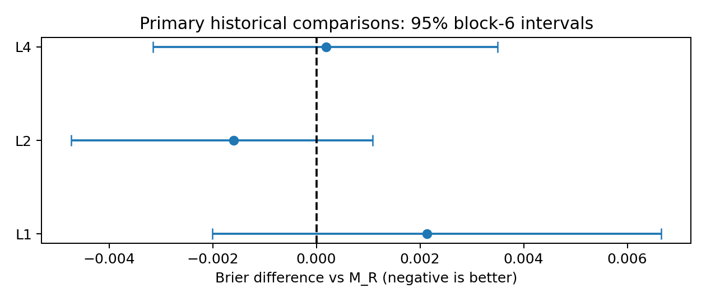

# EP28：文献驱动的A股左尾风险预测

**没有确认稳定的6个月重大亏损概率预测优势。** 风险结构L2有历史排序/消融线索，但对主要基线M_R的Brier区间跨零、阶段效果变号且概率校准不足。原论文偏度目标与累计亏损事件结果分开。全部可实施注册实验完成；数据不足的分支停止，没有为追求正结果追加模型。

研究截至2026-10-20，行情/标签源截至2026-05-29；全部历史效果为探索性证据，未获得独立前瞻或可执行经济确认。

## 阅读入口

| 材料 | 内容 |
| --- | --- |
| [最终结论](reports/final_conclusion.md) | 直接回答Q1–Q8，区分支持、不支持和不足 |
| [预注册](research_plan.md) / [配置](configs/preregistered_experiments.yaml) | 固定机制、候选、窗口、统计、停止规则 |
| [文献矩阵](literature/literature_matrix.md) | 九篇来源十项方法审计、页码、正文缺口 |
| [可复现性](literature/replication_feasibility.md) / [版本引用](literature/source_references.md) | A/B/C区别、原稿及访问记录 |
| [论文迁移](reports/paper_replication.md) | 偏度、预期收益与重大亏损事件不可混同 |
| [数据完整性](reports/data_integrity.md) | D0保留、228只退市报价恢复、D1停止与事件比例界 |
| [共同尾部](reports/common_tail_risk.md) | L1及个股暴露消融 |
| [风险结构](reports/idiosyncratic_volatility.md) | L2及残差风险消融 |
| [财务困境](reports/financial_distress.md) | L3停止原因、人工变化控制 |
| [信息与分歧](reports/information_opacity.md) | L4、换手消融及文本/交互缺口 |
| [条件与匹配](reports/matched_incremental_tests.md) | 同月/行业/风险格覆盖、配对区间 |
| [校准](reports/probability_calibration.md) | 可靠性图、预警尾部、状态漂移 |
| [5%过滤](reports/portfolio_risk_filter.md) | 事前L4目标持仓诊断、真实经济分支停止 |
| [统计与控制](reports/statistical_validation.md) | 多重比较、功效、控制、回放检查 |
| [前瞻协议](validation_protocol.md) | 与EP27共享队列、不可倒填、固定检查点 |



## 实验与证据链

事件严格未来6日历月收益<−20%。D0同股票/同日期/同标签：29,596预测股票月，27,230到期已知标签，59评价月，4,581事件，25到期缺失。原B0/B1/M_R/M_RMI概率直接复用并逐值核验。9个新增结构×22季度=198分类拟合；2个偏度目标×2结构×22=88回归；条件置乱4模型×22=88拟合；3个人工世界×2模型=6控制拟合。没有调参、早停或后见冠军选择。

| 链路 | 可追溯记录 |
| --- | --- |
| 原文→经济机制 | literature/及原始访问回执 |
| 公式→特征→原始源 | features.py、research_plan.md、data_sources.csv |
| 来源→时点/版本限制 | data_gate.json、feature_gate.json、pit_truncation.json |
| 训练→模型→预测 | fit_季度.json、fit_audit.json、local_cache模型/逐条预测 |
| 同样本→统计/消融/校准 | outputs/metrics全部CSV和PNG |
| 结论→核验 | conclusion_status.json、validation.json、公开/缓存哈希清单 |

核心方案、配置、模型/评分/控制代码和20项核心测试在评分前注册。启动时仅修正EP27文件路径缺少`P2_`的错误，发生于任何拟合前，保留原注册及修正链。报告、独立验证器、前瞻操作工具是评分后的支持文件，另列哈希，不能追溯称评分前完成。

## 环境与精确复现边界

仓库根目录运行，复用 `topics/02_AFML_BIG_WINNER/.venv/bin/python`。依赖版本见[requirements.txt](requirements.txt)及[环境回执](outputs/manifests/environment.json)。JSON语法配置使用`.yaml`扩展名，属于合法YAML子集，代码以标准JSON解析。

**只克隆Git不能精确重建所有结果。** EP24–EP27面板/模型/逐条基线、数千报价、19份行业原文/解析表、本轮下载源字节及模型缓存并非全部入Git。必须取得同哈希输入；缺失时明确无法复现，不能换成最新修订数据后声称相同实验。历史行业清单有原机绝对路径，新机器应提供相同路径映射并验证字节，不改原清单以绕过核验。

`outputs/manifests/data_sources.csv`路径相对主题目录；`local_cache_manifest.csv`路径相对本实验；原文/下载回执记录实际文件SHA。模型重训可能因CatBoost序列化时间/GUID改变文件SHA，精确概率回放以归档模型为准。

已有原始缓存时的验证与重评分：

```bash
EP=topics/02_AFML_BIG_WINNER/experiments/pending/28_literature_guided_tail_risk
PY=topics/02_AFML_BIG_WINNER/.venv/bin/python
export OPENBLAS_NUM_THREADS=1
export OMP_NUM_THREADS=2
export MPLCONFIGDIR=/tmp/ep28_matplotlib
$PY -m pytest -q "$EP/tests"
$PY "$EP/src/run.py"          # 已有季度检查点只验哈希并复用
$PY "$EP/src/evaluate.py"
$PY "$EP/src/calibrate.py"
$PY "$EP/src/portfolio.py"    # 目标持股诊断；可执行分支停止
$PY "$EP/src/diagnostics.py"  # 所有固定预警比例的误报/漏报会计
$PY "$EP/src/report.py"
$PY "$EP/src/validate.py"     # 不拟合，重放374个归档模型
$PY "$EP/src/delivery_check.py"
$PY "$EP/src/archive.py"      # 清单/前瞻锁；不改旧研究
```

`controls.py`、`mechanism_b.py`分别复现固定控制和独立B级标签迁移；不得更改种子重试寻找正结果。已归档负控制和偏度季度有检查点，正控制按固定种子重建。初始构建顺序为来源获取→data_audit.py→features.py→截断核验→核心测试→run.py注册→各固定实验。`data_audit.py`和非验证模式`features.py`会拒绝覆盖已注册历史面板；要从头构建，应在独立复现实验副本中保留原注册/清单作比较，不删除原封存件。

网络获取脚本仅请求公开作者/机构/报价端点；`fetch_sources.py`保留访问失败与版本区别，`fetch_delisted.py --offline --all`可从已归档响应解析。公开端点会修订，不以重新下载替代同字节归档。

## 存储、验收与停止

代码、配置、11份报告、文献审计、指标CSV/图、来源及训练回执进Git；原文PDF/HTML、原始响应、行情矩阵、逐条预测、模型权重保留本地忽略缓存并逐项哈希。没有上传受版权保护的论文全文。公开清单不把本地缓存冒称已发布。

验收已完成：23项测试；198分类、88置乱、88偏度模型推断回放；767模型月评分重建；256校准起点重放；同样本/训练到期/匹配不看结果/条件覆盖检查；1,739项旧文件SHA保留。数据缺口、未取得原文和停止分支均列报告。`validation.json`是实际回执，科学结论的负面或不足不等于程序失败。

## 前瞻操作

本轮没有生成未来预测。若实际到达同日真实月末，并已有EP27归档与当时准备的真实面板/来源，可运行：

```bash
$PY "$EP/src/forward.py" forecast \
  --panel /absolute/path/prepared_panel.parquet \
  --receipts /absolute/path/source_receipts.json \
  --calendar /absolute/path/actual_calendar.csv \
  --date 2026-10-30 \
  --ep27-archive /absolute/path/ep27/prospective/2026-10-30 \
  --destination "$EP/outputs/local_cache/prospective/2026-10-30" \
  --forecast-root "$EP/outputs/local_cache/prospective" \
  --label-root "$EP/outputs/local_cache/prospective_labels"
```

面板需包含原EP27资格/控制字段、全部冻结新特征、feature_cutoff、y_6/end_6/date/instrument；最新行y_6为空。来源收据必须包含源码校验列出的原始响应路径/哈希、真实可用时间、当日资格与尾部池规则及剩余版本限制；`ep27_prepared_panel_path`须指向同日EP27原始准备面板，用其归档SHA核验相同训练特征、标签和键。工具核对声明和文件一致性，不自动认证供应商原始版本。到期后先由EP27按其同源同版价格与实际日历审核标签，再用 `forward.py attach-labels --archive ... --ep27-label-archive ... --destination ...`追加到EP28标签目录，原预测不变。

前瞻工具通过时点拒绝测试；**尚无真实日期数据可进行实时端到端验收**。它不自动下载数据、调度、交易或宣布确认。共同未来队列不能被算作EP27与EP28各自独立样本。
