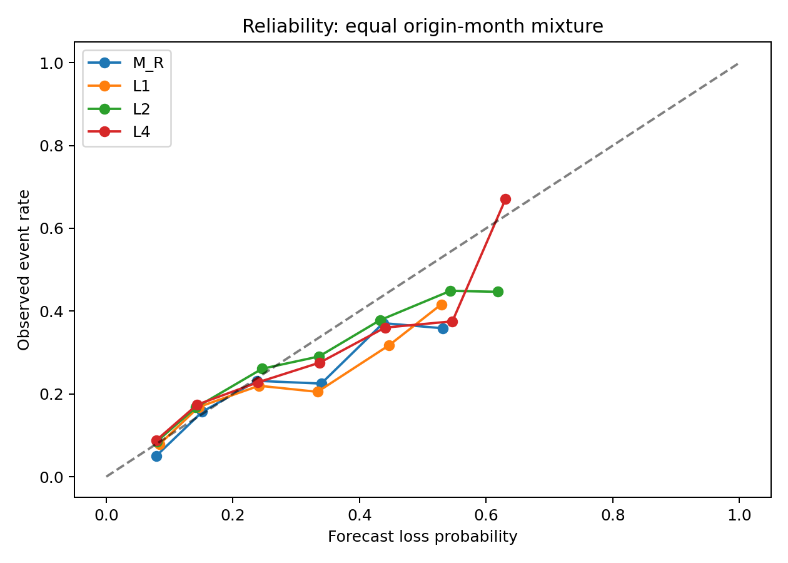
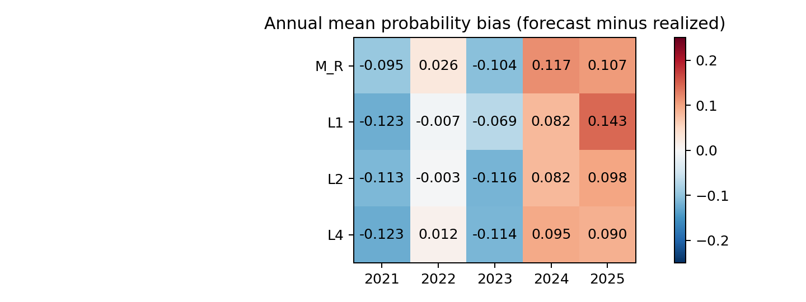

# 概率校准与关键尾部

所有主候选的月均ECE约0.11–0.12，超过预注册0.05诊断容忍度。较小的总体平均bias可由不同月份正负误差抵消，不能说明绝对概率可靠。原始主要模型完整结果：

| model | brier | bias | ece | precision5 | recall5 | enrichment5 | recall10 | enrichment10 | recall20 | enrichment20 |
| --- | --- | --- | --- | --- | --- | --- | --- | --- | --- | --- |
| L1 | 0.140231 | 0.002855 | 0.118843 | 0.320846 | 0.110585 | 2.175186 | 0.196927 | 1.950646 | 0.354901 | 1.766856 |
| L2 | 0.136503 | -0.012396 | 0.110463 | 0.314438 | 0.122283 | 2.405865 | 0.218282 | 2.164858 | 0.373568 | 1.860418 |
| L4 | 0.138283 | -0.009961 | 0.119076 | 0.329148 | 0.124663 | 2.456253 | 0.204106 | 2.024296 | 0.354824 | 1.768011 |
| M_R | 0.138095 | 0.008612 | 0.117754 | 0.310225 | 0.107325 | 2.110150 | 0.208572 | 2.066420 | 0.352162 | 1.753679 |

固定5%和20%预警的误报/漏报完整会计如下。TP/FP/FN/TN是股票月计数，Recall/FPR为先月后跨月平均，二者不能混算。FP只是未发生−20%事件，不等于必然上涨；FN为发生事件但未在该比例预警名单中的股票。

| model | fraction | TP | FP | FN | TN | mean_month_recall | mean_month_fpr | mean_month_false_discovery |
| --- | --- | --- | --- | --- | --- | --- | --- | --- |
| L1 | 0.050000 | 439 | 947 | 4142 | 21702 | 0.110585 | 0.040882 | 0.679154 |
| L1 | 0.200000 | 1513 | 3959 | 3068 | 18690 | 0.354901 | 0.172099 | 0.720694 |
| L2 | 0.050000 | 431 | 955 | 4150 | 21694 | 0.122283 | 0.041702 | 0.685562 |
| L2 | 0.200000 | 1529 | 3941 | 3052 | 18708 | 0.373568 | 0.171805 | 0.717735 |
| L4 | 0.050000 | 452 | 932 | 4129 | 21717 | 0.124663 | 0.040445 | 0.670852 |
| L4 | 0.200000 | 1521 | 3947 | 3060 | 18702 | 0.354824 | 0.171525 | 0.719289 |
| M_R | 0.050000 | 425 | 961 | 4156 | 21688 | 0.107325 | 0.041654 | 0.689775 |
| M_R | 0.200000 | 1531 | 3939 | 3050 | 18710 | 0.352162 | 0.171338 | 0.717168 |

固定10%及全部年份/状态/行业的误报漏报也在 `warning_errors_summary.csv`，原逐月记录在 `warning_errors_monthly.csv`；没有只挑选漏报少的行业。5%预警的召回率较低是容量约束与排序能力共同作用，不能以少量高风险股票的富集掩盖大量漏报。

概率可靠性图使用固定0.1宽度概率箱、每月等权；不是用测试标签拟合概率。图中聚合趋势还会掩盖状态漂移，因此同时给出逐月/逐年/状态/行业ECE和bias。

滚动36个成熟OOS起点、至少12月及30事件/非事件的固定截距校准，没有选择优化版本：

| model | brier | bias | ece | auc |
| --- | --- | --- | --- | --- |
| L1 | 0.140231 | 0.002855 | 0.118843 | 0.673781 |
| L1__offset | 0.146126 | 0.046557 | 0.141567 | 0.673781 |
| L2 | 0.136503 | -0.012396 | 0.110463 | 0.694947 |
| L2__offset | 0.142104 | 0.030619 | 0.126541 | 0.694947 |
| L4 | 0.138283 | -0.009961 | 0.119076 | 0.669634 |
| L4__offset | 0.144708 | 0.033234 | 0.135660 | 0.669634 |
| M_R | 0.138095 | 0.008612 | 0.117754 | 0.673902 |
| M_R__offset | 0.142882 | 0.037076 | 0.128914 | 0.673902 |

四组统一截距校准都使平均Brier恶化。六个月标签滞后使历史发生率不能及时跟踪新状态；这是对本补救方法的结果，不代表所有校准算法都无效。本轮按停止规则不追加算法。校准预测不改变月内风险排序和5/10/20%预警名单；模型回放核验此项。

状态层校准（所有预设状态，不只列有利状态）：

| model | condition | months | events | brier | bias | ece |
| --- | --- | --- | --- | --- | --- | --- |
| L1 | non_uptrend | 34 | 3014 | 0.155651 | -0.032308 | 0.126035 |
| L1 | uptrend | 25 | 1567 | 0.119260 | 0.050678 | 0.109063 |
| L2 | non_uptrend | 34 | 3014 | 0.151840 | -0.042130 | 0.122263 |
| L2 | uptrend | 25 | 1567 | 0.115645 | 0.028042 | 0.094415 |
| L4 | non_uptrend | 34 | 3014 | 0.153155 | -0.037477 | 0.128546 |
| L4 | uptrend | 25 | 1567 | 0.118059 | 0.027462 | 0.106197 |
| M_R | non_uptrend | 34 | 3014 | 0.151848 | -0.021486 | 0.129106 |
| M_R | uptrend | 25 | 1567 | 0.119392 | 0.049544 | 0.102314 |

行业/年份的全量结果在 `conditional_scores.csv` 与 `calibration_conditional.csv`。最高5/10/20%预警Recall/富集差的两种块区间在 `paired_intervals.csv`。没有把较高AUC或富集自动解释为绝对概率已经可信。
