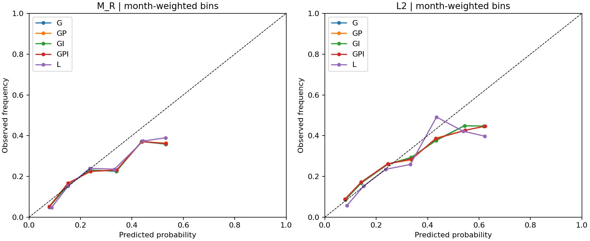

# 概率可靠性、排序与尾部识别

GPI没有同时改善绝对概率、排序与尾部识别。主M_R月内AUC由0.673902降到0.670218；同行业AUC也下降。平均概率偏差缩小，但各月共同Brier误差没有相应稳定改善，不能以整体偏差接近零声称校准可靠。

| model | brier | predicted | base_rate | bias | ece | auc | pr_auc | industry_auc | industry_coverage | recall5 | recall10 | recall20 | enrichment5 | enrichment10 | enrichment20 |
| --- | --- | --- | --- | --- | --- | --- | --- | --- | --- | --- | --- | --- | --- | --- | --- |
| G | 0.13809523 | 0.17927709 | 0.17066539 | 0.008611697 | 0.11775369 | 0.67390232 | 0.29034323 | 0.61197551 | 0.39952891 | 0.10766099 | 0.20844341 | 0.35177814 | 2.1166628 | 2.0651263 | 1.7517816 |
| GI | 0.13803591 | 0.17914903 | 0.17066539 | 0.008483636 | 0.11743335 | 0.67499228 | 0.2915289 | 0.61131894 | 0.39952891 | 0.10943532 | 0.21018087 | 0.35227777 | 2.1513402 | 2.0823051 | 1.754249 |
| GP | 0.13832719 | 0.17510113 | 0.17066539 | 0.0044357319 | 0.11670617 | 0.66912038 | 0.2898705 | 0.6101051 | 0.39952891 | 0.11023195 | 0.19711443 | 0.35231989 | 2.1665917 | 1.9523443 | 1.7543734 |
| GPI | 0.13827244 | 0.17497979 | 0.17066539 | 0.0043143968 | 0.11647751 | 0.67021755 | 0.2909826 | 0.60922106 | 0.39952891 | 0.11154349 | 0.19945671 | 0.35189601 | 2.1922984 | 1.9755023 | 1.7522521 |
| L | 0.13855308 | 0.17623407 | 0.17066539 | 0.0055686754 | 0.10173643 | 0.61117652 | 0.26515783 | 0.54845317 | 0.39952891 | 0.087796769 | 0.15936643 | 0.30707084 | 1.7369696 | 1.5814 | 1.5291618 |

概率误差为预测减真实事件率。ECE使用事前固定0.1箱，先每月算再平均；可靠性图是同样月等权下跨月聚合的箱均，可能掩盖市场状态漂移，因此必须同时看月度ECE和状态表。PR-AUC要连同基础发生率阅读；没有事件的月份相关召回/PR指标为NA，不零填。

有效月份数：全D0 Brier/整体AUC/PR为59月，同业AUC为56月；40公司Brier为59月，AUC/PR/事件召回只有46月，同业AUC为0月。每模型逐字段计数另见`metric_coverage.csv`，这些不同覆盖的指标不能无条件横比。

## 配对辅助差异（GPI−G，6月块；描述性）

| metric | estimate | low95 | high95 |
| --- | --- | --- | --- |
| auc | -0.003684769 | -0.0077783044 | -4.1575664e-05 |
| pr_auc | 0.00063936621 | -0.0032535551 | 0.0039352164 |
| industry_auc | -0.0027544494 | -0.0054427945 | -0.00029180187 |
| ece | -0.0012761729 | -0.0028239708 | 0.00030032561 |
| bias | -0.0042973002 | -0.0074372152 | -0.001683328 |
| common_brier | 7.3371855e-05 | -0.00051523173 | 0.00087940784 |
| relative_brier | 0.00010384189 | -1.7889844e-05 | 0.00024041054 |
| recall5 | 0.0038825025 | 0.0012735377 | 0.0065600713 |
| recall10 | -0.0089867065 | -0.024519325 | 0.0042993935 |
| recall20 | 0.0001178651 | -0.0080017042 | 0.0072615579 |
| enrichment5 | 0.075635604 | 0.024777422 | 0.12766472 |
| enrichment10 | -0.089623992 | -0.24369163 | 0.042404473 |
| enrichment20 | 0.00047052233 | -0.039943325 | 0.035949007 |

Brier在每月可精确拆为平均概率偏差平方`common_brier`与中心化横截面误差`relative_brier`。这里两个分量的差值合为总差值，但这是误差会计，不是因果贡献。总体均值偏差改善与均方共同误差改善不是同一件事。

5%预警召回/富集有小幅历史改善，10%预警反而下降，20%接近不变；没有跨所有阈值稳定的尾部识别优势。5%、10%、20%名单都在当月全D0形成，子队列沿用；不能事后选择最好比例作为主结论。误报/漏报数量和各月覆盖保留在`monthly_scores.csv`。

L2的同样五模型见结果全表；GPI Brier也变差，平均概率低估加深，不能以L2增强基线掩盖M_R主比较。单股万科A的GPI均值仅约15.9%，同期重叠事件率约45.8%，说明全体平均校准远不能保证目标公司的风险概率可信。

每条公开单股概率附当时已知的历史校准和样本范围。个股MAP区间仅条件于固定全局/同行/tau，缺少参数及版本等不确定性，回退行[0,1]明确无可用个股置信范围。这里没有经独立新样本验证的实盘赔率。
