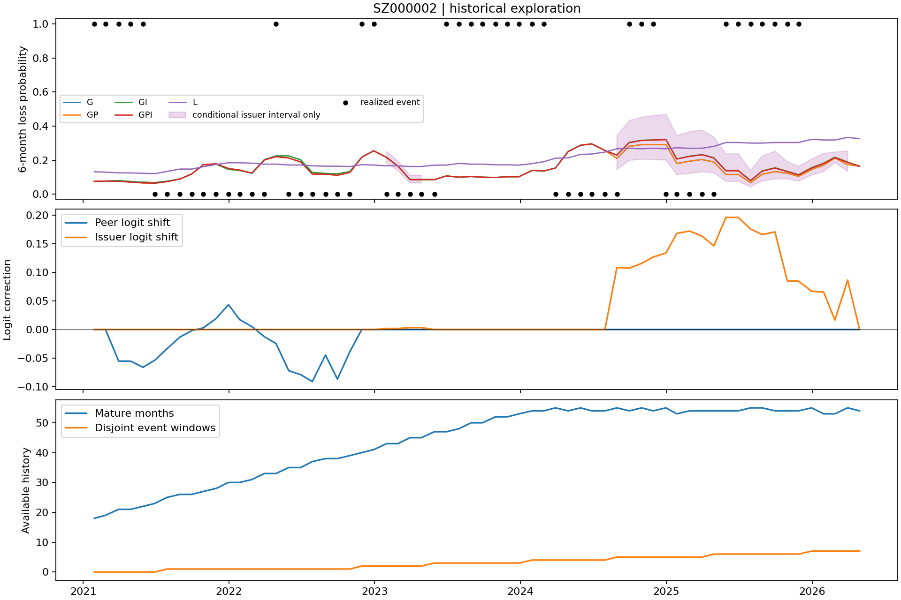

# SZ000002：完整单股案例

选择理由是首起点D0内上市日期最早，代码破并列，未看未来收益或模型成绩。当前显示名称万科A不参与模型，也没有假定其业务稳定。

64个预测月中59个已知到期结果，27个重大亏损标签；合并为5个风险区间阶段，贪心可取7个不重叠事件窗口、全标签9个不重叠窗口。阶段/窗口也不等于独立经济事件，不能把27个重叠标签视作27次独立危机。

GPI Brier 0.356882，G 0.360552，差-0.003670。历史事件率45.76%，GPI平均预测15.88%，仍明显低估。个股修正小幅改善不能使这条概率成为可靠赔率。

| model | months | events | risk_stages | nonoverlap_events | brier | bias | temporal_auc |
| --- | --- | --- | --- | --- | --- | --- | --- |
| G | 59 | 27 | 5 | 7 | 0.36055195 | -0.30349968 | 0.33391204 |
| GP | 59 | 27 | 5 | 7 | 0.36077684 | -0.30461924 | 0.34143519 |
| GI | 59 | 27 | 5 | 7 | 0.35632217 | -0.29739412 | 0.36284722 |
| GPI | 59 | 27 | 5 | 7 | 0.3568816 | -0.29887635 | 0.36342593 |
| L | 59 | 27 | 5 | 7 | 0.3092077 | -0.25630382 | 0.59375 |
| GPI_strong | 59 | 27 | 5 | 7 | 0.35775384 | -0.30092898 | 0.36458333 |
| L_unshrunk | 59 | 27 | 5 | 7 | 0.29255491 | -0.21769793 | 0.56712963 |

这里的temporal AUC是单股跨月份排序，区别于市场月内横截面AUC。所有单股统计区间仅作描述；总体只有少数风险阶段，未作单股显著性或因果宣称。L等更简单历史率在本例点估计更好，不能隐藏。

图中阴影只在触发个股适配时显示固定G/同行后的条件区间；其余回退行完整范围[0,1]留在CSV。每条概率附当时成熟历史的G/GP/GI/GPI/L偏差、Brier/ECE、首末起点、最大到期日及历史有效范围，见 [完整预测CSV](../outputs/predictions/single_stock_M_R.csv)。L2同路径亦公开。历史校准本身也只有少量有效样本，不是验证保证。

## 全部预测月份

`actual`为实际收益，NA表示尚未到期或缺失，不是零收益/无事件。个股计数只包含当时已经成熟的OOS历史；1/7权重不是严格独立样本量。

| date | G | GP | GI | GPI | L | actual | individual_months | nonoverlap_events | peer_offset | individual_offset_GP |
| --- | --- | --- | --- | --- | --- | --- | --- | --- | --- | --- |
| 2021-01-29 | 0.075300648 | 0.075300648 | 0.075300648 | 0.075300648 | 0.13207547 | -0.25881853 | 18 | 0 | 0 | 0 |
| 2021-02-26 | 0.076807982 | 0.076807982 | 0.076807982 | 0.076807982 | 0.12962963 | -0.33321441 | 19 | 0 | 0 | 0 |
| 2021-03-31 | 0.07970544 | 0.075744874 | 0.07970544 | 0.075744874 | 0.125 | -0.2488189 | 21 | 0 | -0.055261421 | 0 |
| 2021-04-30 | 0.074468676 | 0.070748321 | 0.074468676 | 0.070748321 | 0.125 | -0.31698113 | 21 | 0 | -0.055261421 | 0 |
| 2021-05-31 | 0.07027129 | 0.066083209 | 0.07027129 | 0.066083209 | 0.12280702 | -0.27686864 | 22 | 0 | -0.065943135 | 0 |
| 2021-06-30 | 0.068140011 | 0.064830902 | 0.068140011 | 0.064830902 | 0.12068966 | -0.15079365 | 23 | 0 | -0.05332699 | 0 |
| 2021-07-30 | 0.076057614 | 0.073736178 | 0.076057614 | 0.073736178 | 0.13333333 | 0.070325901 | 25 | 1 | -0.033506951 | 0 |
| 2021-08-31 | 0.089413287 | 0.088331107 | 0.089413287 | 0.088331107 | 0.14754098 | -0.030456853 | 26 | 1 | -0.013364695 | 0 |
| 2021-09-30 | 0.11887527 | 0.11866459 | 0.11887527 | 0.11866459 | 0.14754098 | -0.10953878 | 26 | 1 | -0.0020129289 | 0 |
| 2021-10-29 | 0.17283981 | 0.17326102 | 0.17283981 | 0.17326102 | 0.16129032 | 0.064417178 | 27 | 1 | 0.0029434143 | 0 |
| 2021-11-30 | 0.17613273 | 0.1789142 | 0.17613273 | 0.1789142 | 0.17460317 | -0.023853211 | 28 | 1 | 0.019050316 | 0 |
| 2021-12-31 | 0.14560557 | 0.15109806 | 0.14560557 | 0.15109806 | 0.18461538 | 0.037309214 | 30 | 1 | 0.043476936 | 0 |
| 2022-01-28 | 0.13962114 | 0.14171954 | 0.13962114 | 0.14171954 | 0.18461538 | -0.13186813 | 30 | 1 | 0.017359295 | 0 |
| 2022-02-28 | 0.12326273 | 0.12379809 | 0.12326273 | 0.12379809 | 0.18181818 | -0.13903432 | 31 | 1 | 0.0049446848 | 0 |
| 2022-03-31 | 0.20299253 | 0.20097115 | 0.20299253 | 0.20097115 | 0.17647059 | -0.011661808 | 33 | 1 | -0.01254079 | 0 |
| 2022-04-29 | 0.22455792 | 0.22035836 | 0.22455792 | 0.22035836 | 0.17647059 | -0.25936599 | 33 | 1 | -0.02427964 | 0 |
| 2022-05-31 | 0.22455792 | 0.21229155 | 0.22455792 | 0.21229155 | 0.17142857 | 0.11159875 | 35 | 1 | -0.071867847 | 0 |
| 2022-06-30 | 0.2016609 | 0.18925814 | 0.2016609 | 0.18925814 | 0.17142857 | -0.057220708 | 35 | 1 | -0.078891913 | 0 |
| 2022-07-29 | 0.12769478 | 0.11791182 | 0.12769478 | 0.11791182 | 0.16666667 | 0.11615834 | 37 | 1 | -0.090858518 | 0 |
| 2022-08-31 | 0.12197244 | 0.11726175 | 0.12197244 | 0.11726175 | 0.16438356 | 0.030993042 | 38 | 1 | -0.044737188 | 0 |
| 2022-09-30 | 0.1197567 | 0.11092498 | 0.1197567 | 0.11092498 | 0.16438356 | -0.12507375 | 38 | 1 | -0.086591342 | 0 |
| 2022-10-31 | 0.13220422 | 0.12782909 | 0.13220422 | 0.12782909 | 0.16216216 | 0.10583658 | 39 | 1 | -0.038682652 | 0 |
| 2022-11-30 | 0.21727609 | 0.21727609 | 0.21727609 | 0.21727609 | 0.17333333 | -0.23011844 | 40 | 2 | 0 | 0 |
| 2022-12-30 | 0.2550887 | 0.2550887 | 0.2550887 | 0.2550887 | 0.17105263 | -0.22947977 | 41 | 2 | 0 | 0 |
| 2023-01-31 | 0.21528659 | 0.21528659 | 0.21574183 | 0.21559364 | 0.16666667 | -0.16618746 | 43 | 2 | 0 | 0.0018166407 |
| 2023-02-28 | 0.16586871 | 0.16586871 | 0.1662416 | 0.16612021 | 0.16666667 | -0.13803681 | 43 | 2 | 0 | 0.0018166407 |
| 2023-03-31 | 0.085351396 | 0.085351396 | 0.085653542 | 0.085618394 | 0.1625 | -0.11042098 | 45 | 2 | 0 | 0.0034152993 |
| 2023-04-28 | 0.08564374 | 0.08564374 | 0.085946824 | 0.085911567 | 0.1625 | -0.19388464 | 45 | 2 | 0 | 0.0034152993 |
| 2023-05-31 | 0.08564374 | 0.08564374 | 0.08564374 | 0.08564374 | 0.17073171 | -0.15509601 | 47 | 3 | 0 | 0 |
| 2023-06-30 | 0.10726716 | 0.10726716 | 0.10726716 | 0.10726716 | 0.17073171 | -0.23855964 | 47 | 3 | 0 | 0 |
| 2023-07-31 | 0.099875536 | 0.099875536 | 0.099875536 | 0.099875536 | 0.18072289 | -0.33793103 | 48 | 3 | 0 | 0 |
| 2023-08-31 | 0.10374328 | 0.10374328 | 0.10374328 | 0.10374328 | 0.17647059 | -0.26392962 | 50 | 3 | 0 | 0 |
| 2023-09-28 | 0.099875536 | 0.099875536 | 0.099875536 | 0.099875536 | 0.17647059 | -0.29357798 | 50 | 3 | 0 | 0 |
| 2023-10-31 | 0.098225915 | 0.098225915 | 0.098225915 | 0.098225915 | 0.17241379 | -0.34598411 | 52 | 3 | 0 | 0 |
| 2023-11-30 | 0.10255301 | 0.10255301 | 0.10255301 | 0.10255301 | 0.17241379 | -0.2770979 | 52 | 3 | 0 | 0 |
| 2023-12-29 | 0.10255301 | 0.10255301 | 0.10255301 | 0.10255301 | 0.17045455 | -0.30305927 | 53 | 3 | 0 | 0 |
| 2024-01-31 | 0.14001243 | 0.14001243 | 0.14001243 | 0.14001243 | 0.17977528 | -0.26145833 | 54 | 4 | 0 | 0 |
| 2024-02-29 | 0.13604683 | 0.13604683 | 0.13604683 | 0.13604683 | 0.19101124 | -0.37848606 | 54 | 4 | 0 | 0 |
| 2024-03-29 | 0.15370893 | 0.15370893 | 0.15370893 | 0.15370893 | 0.21111111 | 0.08 | 55 | 4 | 0 | 0 |
| 2024-04-30 | 0.25044434 | 0.25044434 | 0.25044434 | 0.25044434 | 0.21348315 | 0.24426451 | 54 | 4 | 0 | 0 |
| 2024-05-31 | 0.28736045 | 0.28736045 | 0.28736045 | 0.28736045 | 0.23333333 | 0.052121212 | 55 | 4 | 0 | 0 |
| 2024-06-28 | 0.29536147 | 0.29536147 | 0.29536147 | 0.29536147 | 0.23595506 | 0.062049062 | 54 | 4 | 0 | 0 |
| 2024-07-31 | 0.25683236 | 0.25683236 | 0.25683236 | 0.25683236 | 0.24719101 | -0.016925247 | 54 | 4 | 0 | 0 |
| 2024-08-30 | 0.21060637 | 0.21060637 | 0.23000281 | 0.22917611 | 0.26666667 | 0.1464497 | 55 | 5 | 0 | 0.10830505 |
| 2024-09-30 | 0.28086677 | 0.28086677 | 0.30400045 | 0.3030382 | 0.26966292 | -0.27469136 | 54 | 5 | 0 | 0.10729445 |
| 2024-10-31 | 0.29100311 | 0.29100311 | 0.31652096 | 0.31538332 | 0.26666667 | -0.26616379 | 55 | 5 | 0 | 0.1154469 |
| 2024-11-29 | 0.29100311 | 0.29100311 | 0.31907763 | 0.31781193 | 0.26966292 | -0.22093023 | 54 | 5 | 0 | 0.1266716 |
| 2024-12-31 | 0.29158242 | 0.29158242 | 0.32103405 | 0.31994394 | 0.26666667 | -0.11570248 | 55 | 5 | 0 | 0.13368156 |
| 2025-01-27 | 0.18003399 | 0.18003399 | 0.20711998 | 0.20617387 | 0.27272727 | -0.066024759 | 53 | 5 | 0 | 0.16797256 |
| 2025-02-28 | 0.19358539 | 0.19358539 | 0.22295789 | 0.22185602 | 0.26966292 | -0.12645161 | 54 | 5 | 0 | 0.17199638 |
| 2025-03-31 | 0.20375004 | 0.20375004 | 0.23289995 | 0.23149754 | 0.26966292 | -0.022695035 | 54 | 5 | 0 | 0.16314473 |
| 2025-04-30 | 0.18889709 | 0.18889709 | 0.21396904 | 0.21232186 | 0.28089888 | -0.079295154 | 54 | 6 | 0 | 0.14620633 |
| 2025-05-30 | 0.11574887 | 0.11574887 | 0.13883303 | 0.13735244 | 0.30337079 | -0.21686747 | 54 | 6 | 0 | 0.19586208 |
| 2025-06-30 | 0.11574887 | 0.11574887 | 0.13883303 | 0.13735244 | 0.30337079 | -0.28037383 | 54 | 6 | 0 | 0.19586208 |
| 2025-07-31 | 0.067605817 | 0.067605817 | 0.080460463 | 0.079535896 | 0.3 | -0.27329193 | 55 | 6 | 0 | 0.17539208 |
| 2025-08-29 | 0.11673383 | 0.11673383 | 0.13665288 | 0.13496444 | 0.3 | -0.30044183 | 55 | 6 | 0 | 0.16597095 |
| 2025-09-30 | 0.1325278 | 0.1325278 | 0.15534198 | 0.15339403 | 0.30337079 | -0.4179971 | 54 | 6 | 0 | 0.17056562 |
| 2025-10-31 | 0.12309755 | 0.12309755 | 0.13420685 | 0.1325217 | 0.30337079 | -0.37639553 | 54 | 6 | 0 | 0.084574573 |
| 2025-11-28 | 0.10480919 | 0.10480919 | 0.11448348 | 0.11301367 | 0.30337079 | -0.38475836 | 54 | 6 | 0 | 0.084574573 |
| 2025-12-31 | 0.14527545 | 0.14527545 | 0.15586758 | 0.15377461 | 0.32222222 | NA | 55 | 7 | 0 | 0.066849862 |
| 2026-01-30 | 0.17063896 | 0.17063896 | 0.18227724 | 0.18009136 | 0.31818182 | NA | 53 | 7 | 0 | 0.065376937 |
| 2026-02-27 | 0.21218794 | 0.21218794 | 0.21713337 | 0.21496276 | 0.31818182 | NA | 53 | 7 | 0 | 0.016520778 |
| 2026-03-31 | 0.17357736 | 0.17357736 | 0.18891578 | 0.18631642 | 0.33333333 | NA | 55 | 7 | 0 | 0.086357762 |
| 2026-04-30 | 0.16413445 | 0.16413445 | 0.16413445 | 0.16413445 | 0.3258427 | NA | 54 | 7 | 0 | 0 |
