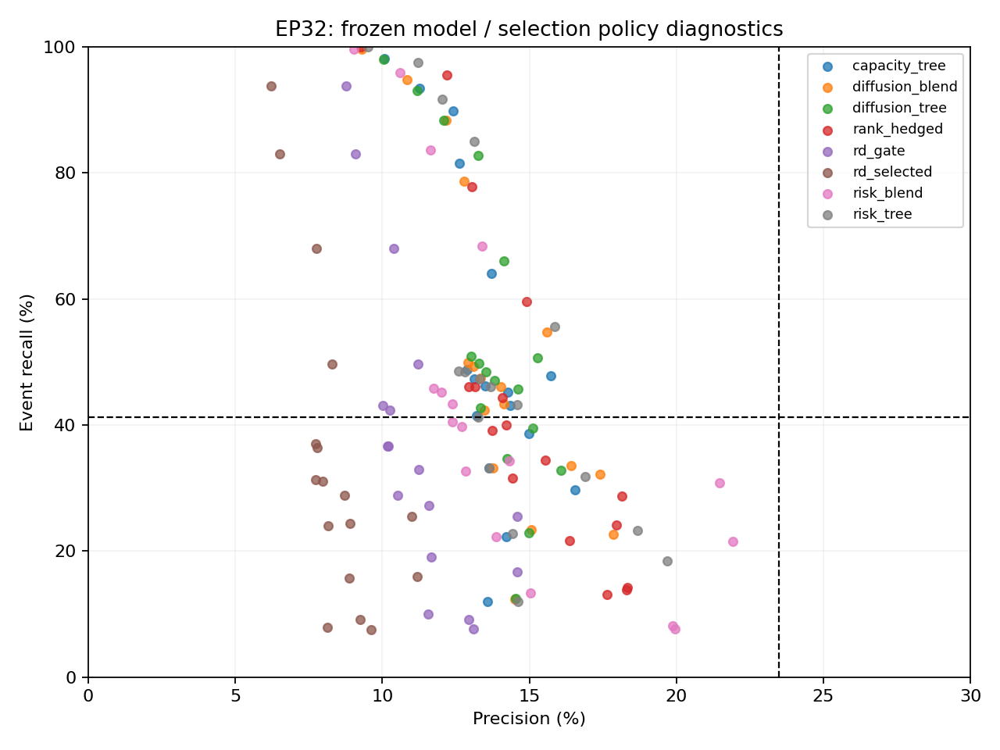

# EP32 V18：早期状态条件下的扩散信息

目标为precision≥23.50%、周期recall≥41.25%。本轮新候选在17项政策中命中目标的组合数：0。全部结果为已重复使用历史上的探索，不是独立验证。

两个同容量树分别使用原27项风险/阶段特征，以及加11项龙头/同业扩散特征；第三个模型为扩散树与原risk_blend各50%。参数在生成预测前冻结，没有按本轮指标调参。缺失扩散数据保留NaN，未删除行业。

预定主要观察政策如下：

|model|policy|precision|point_recall|event_recall|active_date_fraction|
|---|---|---|---|---|---|
|capacity_tree|all_p0.15|13.72%|31.13%|64.01%|75.11%|
|capacity_tree|top_0.1|12.88%|22.39%|48.83%|100.00%|
|diffusion_blend|all_p0.15|15.59%|26.92%|54.75%|70.23%|
|diffusion_blend|top_0.1|12.92%|22.57%|49.96%|100.00%|
|diffusion_tree|all_p0.15|14.13%|34.60%|65.96%|80.14%|
|diffusion_tree|top_0.1|13.02%|22.83%|50.84%|100.00%|

保留周期召回下限的最高precision网格点（只是诊断候选，未按历史最优部署）：

|model|policy|precision|point_recall|event_recall|active_date_fraction|
|---|---|---|---|---|---|
|risk_tree|all_p0.15|15.86%|26.40%|55.56%|67.51%|
|capacity_tree|all_p0.2|15.74%|19.08%|47.82%|63.55%|
|diffusion_blend|all_p0.15|15.59%|26.92%|54.75%|70.23%|
|diffusion_tree|all_p0.2|15.27%|23.15%|50.60%|67.42%|
|rank_hedged|all_p0.1|14.90%|33.05%|59.62%|92.80%|
|diffusion_tree|top10_p0.1|14.63%|19.15%|45.70%|88.30%|
|risk_tree|top10_p0.1|14.60%|17.33%|43.22%|82.30%|
|capacity_tree|top10_p0.1|14.34%|18.08%|43.14%|85.39%|

原主要候选及同容量模型的Brier对照（越低越好）：

|model|brier|
|---|---|
|capacity_tree|0.0524147971765557|
|diffusion_blend|0.0516924225579925|
|diffusion_tree|0.0522749130240443|
|risk_blend|0.052570869067868|
|risk_tree|0.0519535778955652|

扩散完整/缺失样本的Brier分别核对，见[分层结果](../outputs/missingness_summary.csv)。缺失程度随年份变化，模型预测增量不能直接解释为经济机制成立。

最佳保召回网格点的年度与频率结果：

|year|precision|point_recall|event_recall|active_date_fraction|
|---|---|---|---|---|
|2021|0.4115148673386666|0.3025299705061608|0.6503254083442763|0.5742321456937554|
|2022|0.2690061811244512|0.2697931274187451|0.5526225751015078|0.6906039562289563|
|2023|0.064531152224149|0.1880910923529425|0.2842450726909317|0.7335648148148148|
|2024|0.0876400058547421|0.2252814973153538|0.3523075454639862|0.708119658119658|

|frequency|precision|point_recall|event_recall|active_date_fraction|
|---|---|---|---|---|
|BW|0.1557463919832936|0.2691797358060522|0.5838113353054408|0.6907630522088354|
|M|0.170699072897809|0.2715900055791632|0.4089304430566118|0.6625|
|W|0.1494207655263177|0.2512234975804222|0.673937750711176|0.6720907297830374|

precision是已知报警的日期平均命中率；无报警日期无定义，活跃日期比例独立展示。周期召回始终使用原全部可评价周期作分母，不能随新筛选政策缩小；任务缺失precision不能靠跳过而通过门槛。前10%名单在删除未知标签之前确定，未知不记负例。时点recall另外报告。

主评价仍为2021年至2024年9月统一24个月随访，全二三级行业、周/双周/月度、三阈值、双基准。最新未成熟历史不强行计负。2021分类断点、历史反复探索、严格PIT BLOCKED_DATA及独立前瞻FORWARD_PENDING边界不变。

本轮沿用RD-Agent环境训练固定候选，没有新增LLM搜索。全部旧预测逐任务复核；训练标签成熟日严格早于季度起点；预测文件与训练方案哈希冻结后才开始评分。

[全部政策结果](../outputs/summary.csv) · [逐年](../outputs/annual_summary.csv) · [逐频率](../outputs/frequency_summary.csv) · [数据完整率](../outputs/feature_coverage.csv) · [冻结模型](../outputs/frozen_candidates.json) · [原始验证](../outputs/validation.json)

