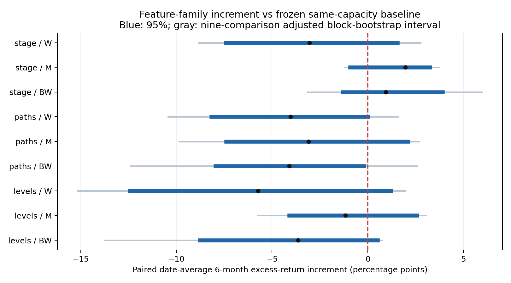

# EP32 V34：多尺度交易扩张与PE可用性实验

没有任何组在三个频率的主比较中均取得校正后正收益增量，本轮不升级现有模型。

在线阶段变量的概率误差有局部改善，但误差改善、分类命中率和实际后续收益是不同目标，不能互相替代。PE与成交共同扩张因缺少主样本PE序列尚未检验，不能把纯成交结果解释为PE假设失败。

执行用户确认的三组候选，未只使用63/252日，未遍历窗口或搜索新门槛。主实验三级行业、15%转折、中证全指，周/双周/月分别评价。原V1—V33与FOLLOWUP.md保持不变。

## 实际检验了什么

|组|新增内容|经济含义|
|---|---|---|
|levels 多尺度水平|换手率21日/此前63日，63日/此前126日；成交股数21日/此前63日；换手率504/756日历史位置；行业可用池成交额占比的短期变化|相对过去是否更活跃、处在长期什么位置|
|paths 扩张路径|平滑换手率63日斜率、21日增速变化、6个21日阶段的提高比例、成员放量广度及变化|扩张是否持续、加速并扩散到更多成员|
|stage 在线阶段|相对当时已知候选低点的换手率、成交份额、放量广度变化及单位交易日速度|当前候选行情启动以来参与度如何变化|

基线为原V18扩散树38项特征，包含原volume_ratio。三候选分别仅增加一组，模型容量、季度成熟标签训练、参数和随机种子全部相同；原2021Q1模型预测精确复现。三组未组合，未按结果调整窗口。特征按截至当时数据计算，但底层价格/成员/供应商换手率仍为Historical-proxy。

## PE审计：联合假设没有被偷换成纯成交结论

封存PE共529,304条：2017年仅1个日期、3,039只证券；2026年有101个日期、5,239只证券。所有记录known_at缺失。2021—2024主评价区间没有PE时间序列，PE特征可用行数为0，因此“PE扩张×成交扩张”四组比较仍BLOCKED_DATA，未估计。

2026年有限记录可以产生部分21/63日正PE变化代理，已列覆盖；不能用2017单日与2026记录跨缺口滚动，也不能补成2017年以来完整估值。成员PE变化中位数不被称为聚合行业PE；负PE及缺失不作为PE收缩样本，不用PE反推财务事实。本轮只完成交易扩张三组特征的预测增量检验，不能宣称证实或否定估值共同扩张机制。

## 主经济结果：相同原报警数量

在原早期状态+市场条件通过的候选池中，各模型按当期当前V28报警数K选前K；基线也用同K排名。先选名单，后检查未来收益，未因未来未知删样本。随后各方法独立采用V31的6月观察段首次报警规则；因此原报警数相同，最终首次启动数可能不同。

从信号后下一交易日收盘起算6个月收益，含误报及周期标签未知记录。表中mean_excess是每个已知结果的首次启动等权，非组合资金收益，缺失不补零。

|frequency|method|signals|known_returns|mean_return|median_return|mean_excess|median_excess|mean_max_drawdown|
|---|---|---|---|---|---|---|---|---|
|BW|baseline|457|394|5.67%|2.18%|5.79%|3.64%|-15.45%|
|BW|levels|459|399|5.60%|2.42%|6.01%|4.17%|-15.39%|
|BW|paths|456|393|5.18%|1.73%|5.46%|3.31%|-15.34%|
|BW|stage|454|396|5.80%|2.39%|5.91%|3.18%|-15.32%|
|M|baseline|397|344|6.91%|2.49%|8.15%|4.67%|-15.56%|
|M|levels|395|342|6.49%|1.94%|7.79%|4.94%|-15.57%|
|M|paths|398|343|5.85%|1.52%|7.09%|4.60%|-15.53%|
|M|stage|397|341|6.49%|1.94%|7.73%|4.58%|-15.42%|
|W|baseline|524|454|8.67%|3.06%|6.81%|3.22%|-15.80%|
|W|levels|518|452|8.39%|3.29%|6.66%|4.36%|-15.76%|
|W|paths|516|446|8.02%|3.22%|6.17%|3.59%|-15.60%|
|W|stage|514|452|8.24%|3.44%|6.36%|3.09%|-15.67%|

与冻结同容量基线的首次启动等权平均超额收益差：

|frequency|method|mean_excess_increment|
|---|---|---|
|BW|levels|0.22%|
|BW|paths|-0.32%|
|BW|stage|0.12%|
|M|levels|-0.37%|
|M|paths|-1.06%|
|M|stage|-0.42%|
|W|levels|-0.15%|
|W|paths|-0.65%|
|W|stage|-0.46%|

## 九项事前主比较与不确定性

以下比较为双方均有已知结果的共同启动日期上，先计算各日平均超额差，再跨日期等权。它与上表每启动等权不是同一权重。12自然月时间块bootstrap，5000次；95%为描述性区间，lower9/upper9为三组×三频率九项主比较的Bonferroni 99.444%区间。稀少共同日期、长时间重叠和历史反复探索使证据有限，校正不构成独立前瞻验证。

|family|frequency|paired_dates|estimate|lower95|upper95|lower9|upper9|
|---|---|---|---|---|---|---|---|
|levels|BW|14|-3.64%|-8.76%|0.51%|-13.76%|0.76%|
|paths|BW|15|-4.09%|-7.95%|-0.22%|-12.37%|2.59%|
|stage|BW|15|0.94%|-1.31%|3.91%|-3.14%|5.98%|
|levels|M|7|-1.18%|-4.11%|2.58%|-5.77%|3.05%|
|paths|M|7|-3.10%|-7.40%|2.12%|-9.84%|2.67%|
|stage|M|7|1.96%|-0.92%|3.24%|-1.20%|3.73%|
|levels|W|23|-5.74%|-12.42%|1.22%|-15.16%|1.95%|
|paths|W|23|-4.04%|-8.18%|0.01%|-10.43%|1.57%|
|stage|W|24|-3.05%|-7.41%|1.54%|-8.82%|2.76%|

## 完整特征支持范围的同样本检查

为避免仅因新特征覆盖改变样本构成，分别只在各组当时全部新特征已知的候选池中比较基线和该候选；K为原V28在该池内的报警数。未来标签/收益未知不影响入池。该检查是条件样本对照，不替代主结果，也不证明缺失模式无影响。

|family|frequency|paired_dates|estimate|lower95|upper95|
|---|---|---|---|---|---|
|levels|BW|15|-3.98%|-13.64%|0.48%|
|paths|BW|16|-1.77%|-4.43%|-0.27%|
|stage|BW|15|-0.52%|-1.96%|0.81%|
|levels|M|8|-2.04%|-4.43%|0.40%|
|paths|M|7|-0.20%|-0.56%|0.05%|
|stage|M|7|1.69%|0.00%|2.79%|
|levels|W|21|-2.18%|-5.51%|0.07%|
|paths|W|25|-2.26%|-5.12%|0.43%|
|stage|W|24|-2.50%|-5.11%|-0.46%|

三级行业特征覆盖（含不同阈值/频率重复观察，只用于覆盖审计，不是独立事件数）：

|year|family|rows|complete|complete_fraction|
|---|---|---|---|---|
|2021|levels|45024|30534|67.82%|
|2021|paths|45024|40476|89.90%|
|2021|stage|45024|41575|92.34%|
|2021|pe|45024|0|0.00%|
|2022|levels|43854|18423|42.01%|
|2022|paths|43854|16152|36.83%|
|2022|stage|43854|32637|74.42%|
|2022|pe|43854|0|0.00%|
|2023|levels|67806|33618|49.58%|
|2023|paths|67806|48864|72.06%|
|2023|stage|67806|49671|73.25%|
|2023|pe|67806|0|0.00%|
|2024|levels|70155|41745|59.50%|
|2024|paths|70155|51795|73.83%|
|2024|stage|70155|52631|75.02%|
|2024|pe|70155|0|0.00%|

长历史位置特征需要足够历史，2022年分类切换还影响路径和阶段计算。未把缺失填为0；树原生处理缺失，因此全样本模型也可能利用可得性模式。

## 分类与年度结果

周期指标沿用每个原任务完整可评价周期分母；precision按已知报警日期平均。下面的baseline采用同K扩散树排名，accepted为原双模型0.11政策，两者不能混称原模型。

|frequency|method|all_alerts|unknown_alerts|precision|cycle_recall|point_recall|median_delay|brier|
|---|---|---|---|---|---|---|---|---|
|BW|accepted|1000|339|24.43%|53.30%|21.01%|34.0|0.0533711953330405|
|BW|baseline|1000|340|21.65%|56.59%|21.01%|25.0|0.0545519329106361|
|BW|levels|1000|331|22.53%|56.04%|20.91%|29.5|0.0567284234509284|
|BW|paths|1000|341|22.03%|53.30%|20.61%|25.0|0.0543757709770219|
|BW|stage|1000|343|21.65%|54.95%|21.01%|25.0|0.0537503403084701|
|M|accepted|519|180|36.65%|54.95%|25.90%|51.0|0.0525656941140618|
|M|baseline|519|180|32.57%|54.95%|25.27%|51.0|0.0530321950879279|
|M|levels|519|177|31.15%|52.75%|25.05%|51.0|0.0540894994785587|
|M|paths|519|182|32.33%|51.65%|24.84%|51.0|0.0530587939363183|
|M|stage|519|181|31.65%|52.75%|24.84%|51.0|0.052526796933035|
|W|accepted|1759|605|23.37%|57.69%|17.70%|32.0|0.0542192263000827|
|W|baseline|1759|605|21.63%|58.24%|17.50%|28.0|0.0554627773526076|
|W|levels|1759|592|20.60%|59.34%|17.45%|34.0|0.0569486874543677|
|W|paths|1759|604|21.36%|57.14%|17.65%|26.5|0.0549716874837563|
|W|stage|1759|610|20.64%|57.69%|17.50%|25.0|0.0543802153879695|

|frequency|method|year|signals|known_returns|mean_return|mean_excess|
|---|---|---|---|---|---|---|
|BW|baseline|2021|208|146|12.67%|8.04%|
|BW|baseline|2022|141|140|4.18%|0.39%|
|BW|baseline|2023|87|87|-2.19%|9.19%|
|BW|baseline|2024|21|21|-0.41%|12.04%|
|BW|levels|2021|204|145|12.94%|8.32%|
|BW|levels|2022|139|138|4.29%|0.49%|
|BW|levels|2023|95|95|-1.79%|9.74%|
|BW|levels|2024|21|21|-2.98%|9.47%|
|BW|paths|2021|205|143|12.36%|7.74%|
|BW|paths|2022|139|138|3.55%|-0.27%|
|BW|paths|2023|91|91|-2.15%|9.25%|
|BW|paths|2024|21|21|-1.26%|11.19%|
|BW|stage|2021|204|147|12.89%|8.25%|
|BW|stage|2022|142|141|4.00%|0.22%|
|BW|stage|2023|87|87|-1.62%|9.86%|
|BW|stage|2024|21|21|-1.05%|11.40%|
|M|baseline|2021|176|123|16.20%|11.62%|
|M|baseline|2022|153|153|2.97%|4.55%|
|M|baseline|2023|47|47|-1.33%|9.07%|
|M|baseline|2024|21|21|-0.41%|12.04%|
|M|levels|2021|171|119|16.74%|12.14%|
|M|levels|2022|153|152|1.80%|3.38%|
|M|levels|2023|50|50|0.36%|10.12%|
|M|levels|2024|21|21|-2.98%|9.47%|
|M|paths|2021|176|121|15.62%|11.03%|
|M|paths|2022|153|153|1.13%|2.71%|
|M|paths|2023|48|48|-0.68%|9.34%|
|M|paths|2024|21|21|-1.26%|11.19%|
|M|stage|2021|176|120|16.50%|11.90%|
|M|stage|2022|153|153|1.78%|3.36%|
|M|stage|2023|47|47|-0.33%|9.72%|
|M|stage|2024|21|21|-1.05%|11.40%|
|W|baseline|2021|217|148|13.51%|9.34%|
|W|baseline|2022|162|161|3.35%|-0.34%|
|W|baseline|2023|91|91|-1.96%|8.97%|
|W|baseline|2024|54|54|29.17%|17.59%|
|W|levels|2021|212|147|12.77%|8.56%|
|W|levels|2022|157|156|4.22%|0.50%|
|W|levels|2023|97|97|-1.26%|9.78%|
|W|levels|2024|52|52|26.49%|13.98%|
|W|paths|2021|216|147|12.50%|8.31%|
|W|paths|2022|154|153|3.45%|-0.32%|
|W|paths|2023|94|94|-1.33%|9.48%|
|W|paths|2024|52|52|25.70%|13.19%|
|W|stage|2021|212|151|12.97%|8.80%|
|W|stage|2022|158|157|3.27%|-0.43%|
|W|stage|2023|91|91|-1.12%|9.83%|
|W|stage|2024|53|53|25.56%|13.53%|

其它阈值、行业层级和市场基准的分类分解在classification_all_tasks.csv；3/12月收益和固定0.11辅助政策在economics_primary.csv。辅助结果不用于挑选本轮最优窗口或门槛。

## 如何解释

只有跨频率、年度及完整覆盖检查仍保持改善，才值得进一步组合。单个方向为正、某个频率区间为正或特征重要性高，都不等于“成交扩张导致景气”。树可能使用收缩或过热特征，增量预测不自动验证假设方向。未见稳健增量的组应保留证据不足，不继续在同历史上搜索更多天数来追求达标。

本轮没有实盘部署、调度、交易或提交推送；没有新真实前瞻。严格PIT BLOCKED_DATA、独立前瞻FORWARD_PENDING。结论按decision.json逐组保留，包括正向点估计、95%区间和九项校正区间的数量。

[冻结方案](../research_plan.md) · [全部经济指标](../outputs/economics_primary.csv) · [主比较区间](../outputs/paired_intervals.csv) · [首次信号明细](../outputs/primary_six_month_launches.csv.gz) · [PE覆盖](../outputs/pe_raw_coverage.csv) · [逐组结论](../outputs/decision.json) · [公式与因果核验](../outputs/feature_validation.json)
