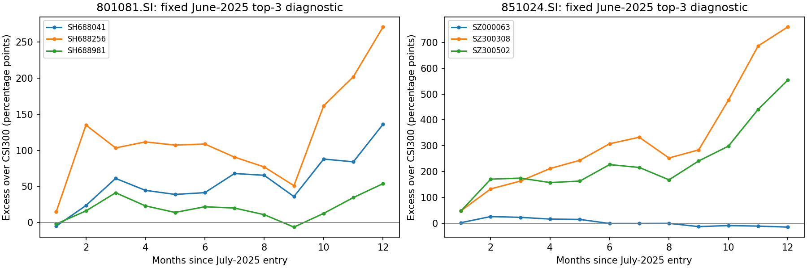

# 复查结论：有这段行情，原筛选不能替代现象查询

**用户指出的半导体、光通信相关行情，在现有数据中确实可观察。主要问题是筛选/展示问题与局部停牌报价缺口叠加，不是整个2025下半年—2026上半年没有数据。**

区间固定为2025-07-01开盘至2026-06-30收盘，成员与市值观察日为2025-06-30。股票仍使用EP30封存前复权推断；行业是起点固定成员的可观察等权收益，不是官方行业指数。未知入口、终点不补零、不改成复牌日成交，覆盖不足80%不声称行业可观察。严格PIT缺口仍保留。

|行业|成员端点覆盖|行业固定成员收益|沪深300|行业超额/百分点|前三组合超额/百分点|最差一只超额/百分点|严格市值排名完整|停牌估值诊断排名完整|
|---|---|---|---|---|---|---|---|---|
|半导体|100.0%|189.1%|26.5%|+162.6|+153.6|+54.0|True|True|
|通信设备|95.6%|121.2%|26.5%|+94.7|+433.0|-14.8|False|True|
|半导体设备|100.0%|309.4%|26.5%|+282.9|+219.4|+143.9|True|True|
|通信网络设备及器件|94.4%|174.4%|26.5%|+147.9|+433.0|-14.8|False|True|

通信设备及通信网络设备及器件的严格排名原本不完整。表中前三收益使用单独的“停牌末次成交估值诊断”排名：只有被原公告确认停牌的仕佳光子用6月27日最后成交收盘×当时股本估值；不向行情/收益写入价格。它远小于观察到的第三大市值，因此在这个有明确证据的诊断中不改变前三。原V2统计不回填。

## 具体漏选原因

1. **问题被换成“新进入事件后的收益”。** 半导体2025-06起点后的12个月超额已在V2底层明细，但2025-06不是新进入前25%的月，故不进入事件名单。半导体2025-01虽然是进入月，却被艾森股份停牌导致的单股市值缺失拦下；艾森并非前三。
2. **横截面分位会切碎真实超额。** 半导体2025-06过去12月跑赢沪深300，但行业分位只约60%，所以被标为非领先。2025-10和12分位恰为75%，严格“>75%”也会断段。这能定义一种排名状态，不能据此说行业没有领先大盘。
3. **展示只挑“已经结束且恰好12—18月”的段。** 通信设备从2024-10至2026-09已观察到24个月，三级通信网络设备及器件从2025-05至2026-09为17个月且尚未结束；都因右删失或超过18月不在已结束长段表中。右删失说明持续时间尚未完全观察到，不是无效或没有行情。
4. **一个非前三成员停牌，导致整组被跳过。** 仕佳光子2025-06-30起停牌，2025-07-11复牌；原封存分区缺当月末/下一日成交行符合停牌事实，并非已证实的供应商报价冲突。代码要求每个成员都有当月末成交价才能给全行业评分，把行业现象与严格市值排名耦合了。艾森股份2025-01同理。缺报价原因不能统称“缺数据”，更不能以此删除行业是否上涨的观察。
5. **光通信与申万行业并不一一对应。** 当时通信设备/通信网络设备及器件前三为中际旭创、中兴通讯、新易盛。中兴通讯不是用户所指纯光通信行情的代表，且在这段区间落后大盘；所以“三只全跑赢”失败不能被解释为光通信没行情。中际旭创、新易盛、天孚通信三只示例另列，不能按事后涨幅将它们改称行业前三。

## 逐股核对

|行业|起点市值序|标的/当前名称|代码|涨幅|超额/百分点|
|---|---|---|---|---|---|
|半导体|1|中芯国际|SH688981|80.5%|+54.0|
|半导体|2|海光信息|SH688041|162.7%|+136.2|
|半导体|3|寒武纪|SH688256|297.3%|+270.8|
|通信设备|1|中际旭创|SZ300308|786.4%|+759.9|
|通信设备|2|中兴通讯|SZ000063|11.7%|-14.8|
|通信设备|3|新易盛|SZ300502|580.6%|+554.0|
|半导体设备|1|北方华创|SZ002371|170.5%|+143.9|
|半导体设备|2|中微公司|SH688012|284.5%|+258.0|
|半导体设备|3|盛美上海|SH688082|282.8%|+256.3|
|通信网络设备及器件|1|中际旭创|SZ300308|786.4%|+759.9|
|通信网络设备及器件|2|中兴通讯|SZ000063|11.7%|-14.8|
|通信网络设备及器件|3|新易盛|SZ300502|580.6%|+554.0|

光通信相关示例（事后点名诊断，**不是**申万行业前三、不是新冻结的研究池）：

|示例标的|代码|涨幅|相对沪深300/百分点|
|---|---|---|---|
|中际旭创|SZ300308|786.4%|+759.9|
|天孚通信|SZ300394|443.4%|+416.9|
|新易盛|SZ300502|580.6%|+554.0|

## 修正后的查询结构

本轮已对所有二/三级行业统一运行同一个固定窗口查询：先保留行业是否跑赢、覆盖与缺失；再分别给严格排名、停牌估值诊断排名、组合和每只标的结果。新进入事件和完整段长度作为另一个维度，不再充当“历史上是否出现这段行情”的必要条件。没有更改前25%阈值来凑两个成功案例，没有伪造停牌成交。

原有V2算术结果仍可用于它定义的事件条件问题，但其筛选后样本不能代表全部行业轮动现象。**不能沿用此前样本去概括“这类12—18月行情不存在”或“前三通常不能受益”。**行业、组合、三只共同受益及基本面景气机制，仍须分开检验；这次复查不证明预测或交易有效。

明细：[全部行业固定窗口](../outputs/fixed_window/all_industries.csv)、[逐股结果](../outputs/fixed_window/focus_top3_stocks.csv)、[月度路径](../outputs/fixed_window/focus_monthly_paths.csv)、[逐层排除原因](../outputs/audits/focus_filter_trace.csv)、[所有当前未结束领先段](../outputs/audits/all_open_leading_runs.csv)、[全局排名流失](../outputs/audits/global_rank_attrition.csv)、[停牌估值诊断](../outputs/audits/valuation_diagnostics.csv)、[被跳过的排名示例](../outputs/audits/recovered_rank_examples.csv)、[原件来源及哈希](../outputs/audits/halt_sources.json)。

公开原件：[仕佳光子停牌公告](https://static.cninfo.com.cn/finalpage/2025-06-28/1224016285.PDF)、[仕佳光子复牌公告](https://static.cninfo.com.cn/finalpage/2025-07-11/1224131033.PDF)、[艾森股份停牌公告](https://file.finance.sina.com.cn/211.154.219.97%3A9494/MRGG/CNSESH_STOCK/2025/2025-1/2025-01-24/10726263.PDF)、[艾森股份后续公告](https://static.cninfo.com.cn/finalpage/2025-02-15/1222545559.PDF)。

