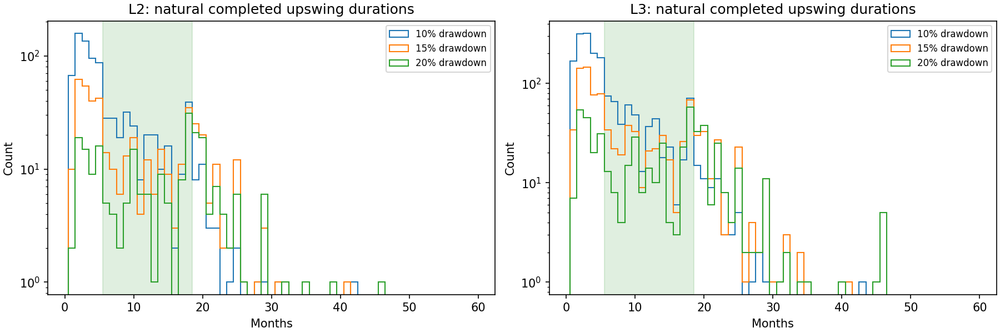

# EP32 V4：全历史、6—18个月自然上涨阶段

已按用户新要求重做：行业自身上涨且跑赢基准，起止由自然转折确定；超过18个月不拆分。未沿用固定9/12月持有期、前25%新进入条件或整行业市值齐全才能观察的门槛。

输入覆盖2017-01-03—2026-10-21；行业价格按月末观察，最早月末锚点为2017-01。2026-10-21为部分月尾端，可确认此前峰值回撤，不冒充完整10月。旧、新行业制度分别计算，2021-12和价格覆盖缺口断开。所有结果仍为Historical-proxy，严格PIT为BLOCKED_DATA。

用行业价格而非横截面前25%寻找自然段：从低点上涨10%/15%/20%进入上涨状态，从高点回撤相同幅度后才确认高点为段末。三套阈值并列；阶段起点和终点使用未来才知道的转折，**不是当时可交易信号**。段长由转折月决定，不再固定9或12个月。超过18个月原段保留，绝不切割。

“行业自身上涨”部分来自阶段定义，不能把上涨率当新发现。候选还须同期跑赢基准；行业价格路径按历史当时成员月度等权更新，不是官方行业指数。只有至少5成员、80%端点可比较时才形成收益，缺口断开，不补零。

全部自然段的长度与删失：

|回撤阈值|层级|确认且起点已知|短于6月|6—18月|超过18月不拆|左删失|未结束|
|---|---|---|---|---|---|---|---|
|10.0%|L2|829|542|255|32|48|125|
|10.0%|L3|1767|1187|518|62|125|275|
|15.0%|L2|450|208|157|85|57|113|
|15.0%|L3|978|477|344|157|126|248|
|20.0%|L2|232|61|97|74|80|120|
|20.0%|L3|528|157|214|157|159|257|

精确报价层：已确认、起点已知、6—18个月且行业上涨并跑赢基准的阶段：

|回撤阈值|层级|基准|行业候选段|前三终点已知/未知|组合超额中位/百分点|三只均涨且跑赢|
|---|---|---|---|---|---|---|
|10.0%|L2|沪深300|238|208/30|+21.8|42.3%|
|10.0%|L2|中证全指|227|197/30|+19.4|37.1%|
|10.0%|L3|沪深300|492|455/37|+22.5|39.8%|
|10.0%|L3|中证全指|471|432/39|+18.7|35.0%|
|15.0%|L2|沪深300|149|127/22|+18.8|38.6%|
|15.0%|L2|中证全指|141|120/21|+14.8|33.3%|
|15.0%|L3|沪深300|327|304/23|+22.0|37.2%|
|15.0%|L3|中证全指|312|288/24|+14.4|31.2%|
|20.0%|L2|沪深300|93|80/13|+19.1|36.2%|
|20.0%|L2|中证全指|86|73/13|+11.5|30.1%|
|20.0%|L3|沪深300|204|186/18|+25.7|39.2%|
|20.0%|L3|中证全指|187|169/18|+20.1|33.1%|

这些是事后条件观察，不是行业轮动预测或景气机制的确认。不同回撤阈值结果须并列看，不能从行业上涨段已被选中，再推导可提前选中上涨行业。

阅读：[方法与时点](01_method_and_boundaries.md)、[全部阶段长度](02_stage_duration_inventory.md)、[前三与估值缺失](03_top3_and_missing_valuations.md)、[近期全部案例](04_recent_case_audit.md)、[逐层汇总](../outputs/metrics/candidate_summary.csv)。

完整名单：[行业上涨且跑赢的6—18月阶段](../outputs/screens/industry_up_and_beat_6_18.csv)；三只均涨且跑赢：[10%口径](../outputs/screens/all_three_positive_and_beat_T10.csv)、[15%口径](../outputs/screens/all_three_positive_and_beat_T15.csv)、[20%口径](../outputs/screens/all_three_positive_and_beat_T20.csv)。

