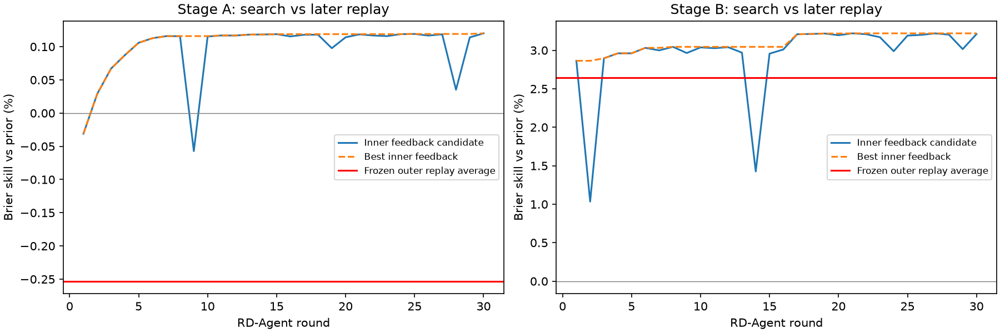

# EP32 V5：RD-Agent 行业价格景气研究

用户确认先用30轮预测未来1个月内启动；全部频率未通过验收才转向景气早期识别。周、双周、月度改变更新频率，目标期限一致。覆盖所有有可用价格路径的二级、三级行业，未只研究半导体或通信。

阶段A：未来1个月内启动

|频率|基准正例率|Brier相对先验改善|前10%候选命中率|命中率提升倍数|验收|
|---|---|---|---|---|---|
|双周|3.08%|-0.32%|3.48%|1.04|未通过|
|月|2.79%|+0.00%|3.18%|1.03|未通过|
|周|2.87%|-0.44%|3.30%|1.08|未通过|

阶段B：识别启动后前3个月

|频率|基准正例率|Brier相对先验改善|前10%候选命中率|命中率提升倍数|验收|
|---|---|---|---|---|---|
|双周|7.90%|+2.46%|11.30%|1.44|未通过|
|月|8.14%|+3.31%|11.42%|1.37|未通过|
|周|8.18%|+2.16%|11.47%|1.42|未通过|

冻结输入覆盖2017-01-03—2026-10-21，读取5798个证券日线分区，重建767515条行业日线；45347条完整月份收益与V4逐条对齐。本轮转折从日线识别，不能把阶段数量与V4月线阶段直接作同口径比较。

训练只接收当时已成熟标签，正例等到段末回撤确认；负例需要后续低点确认见证。搜索反馈限于2021—2022年，成熟截止2024年初；外层2024年起按季度滚动，预测先封存再评分。原V4看过全期间现象，所以外层仍为探索性历史回放；真正前瞻必须用配置冻结后的新数据。

分类成员没有完整原始known_at版本，复权价格也是历史推断，严格PIT仍为BLOCKED_DATA。本轮价格景气不等同基本面景气，尚未引入财报公告、订单、库存或利润修订。

搜索空间是23个历史价格、波动、成交、行业宽度和市场相对强弱特征，最多8个受限组合表达式，模型限逻辑回归和小容量梯度提升树。每轮只提交一个配置；失败或不改善都保留。未通过仅代表本次数据与搜索范围内未取得满意结果，不能推出行业景气原则上不可预测。

实现复用[Microsoft RD-Agent](https://github.com/microsoft/RD-Agent)的原生研发循环，本地固定提交及适配差异哈希保存在runtime.json；行业标签和成熟评估由本实验专用Scenario提供。

[阶段A详细报告](stage_a.md)；[阶段B详细报告](stage_b.md)；[执行方案](../research_plan.md)。

图中搜索与回放来自不同时期，不能把搜索曲线持续改善直接当成外层有效；不同频率的外层值在图中仅作等任务均值展示，验收仍逐项执行。
