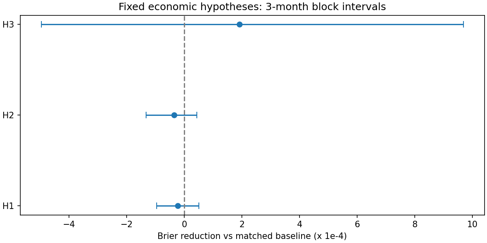

# EP32 V6：用经济学假设解释价格景气早期

**结论：六项主检验均未通过预定标准，暂不能把“龙头先行—同业扩散”用作可靠的早期景气判定。** H3市场调整后的强势只有较小的平均误差改善，前10%候选的命中率下降，不能据此升级为可用信号。

主假设：行业共同的需求或盈利预期改善可能逐步进入价格；较大公司先反映，随后同业扩散。竞争解释是行业共同风险、一般动量/反转，以及单纯市场反弹。该假设需要验证，不是预设结论。

理论来自[Hong与Stein的信息渐进扩散模型](https://users.ssc.wisc.edu/~cengel/IMF/HongSteinJF1999.pdf)和[Hou的行业内领先滞后研究](https://papers.ssrn.com/abstract=463005)。[坏消息传播较慢的研究](https://www.nber.org/system/files/working_papers/w6553/w6553.pdf)提醒我们，负面信息的扩散不能直接证明利好也由龙头先行；本轮正负收益分开。其他市场的发现不作为A股结论。

直接检验使用同业未来21日收益，避免把已经上涨当成领先证据；识别增量仍沿用V5的6—18个月景气、起点后前3个月标签。固定上一轮RD-Agent胜出模型的参数，每次只加一个预先指定特征组，未再搜索30轮挑最好结果。

|模型|Brier误差|相对同样本基线改善|前10%命中率|命中率提升倍数|
|---|---|---|---|---|
|原模型，同样本重训|0.072848|+0.00%|11.55%|1.44|
|加入龙头先行|0.072856|+0.00%|11.53%|1.44|
|加入同业扩散|0.072881|-0.04%|11.55%|1.44|
|加入市场调整后的强势|0.072581|+0.23%|10.85%|1.34|
|三个机制一起加入|0.072630|+0.19%|10.77%|1.32|
|跨行业龙头对照|0.072783|+0.08%|11.48%|1.43|
|同业领先龙头对照|0.072913|-0.06%|11.46%|1.43|

改善为正表示误差下降。命中率与提升倍数按日期、频率、阈值、基准和行业层级等权汇总；两个均值相除不一定等于平均提升倍数。这些是同样本对照，不能把剔除缺数据后的基线直接与V5全样本均值比较。

表内相对改善是各任务相对值的均值；主检验另按市场月份等权计算绝对误差差，权重不同，接近零时可能异号。H1在两种汇总下都几乎没有改善，不应强调其中一个微小正值。

共同完整机制特征覆盖原可预测记录的76.5%；市值排名或价格缺口保留为未知。另保留H3不依赖龙头排名的较宽样本结果，防止排名缺失驱动结论。旧版本结果未被改写。

六项预定主检验采用同市场月份、连续三个月成块重抽样，并统一BH-FDR调整；表中Brier效应为绝对误差下降，机制效应为风险尺度归一化后的回归斜率，不能解释为策略收益。

|检验|效应|95%区间|BH调整后q|支持预定正方向|
|---|---|---|---|---|
|H1_brier_increment|-0.000023|[-0.000096, +0.000051]|0.787|否|
|H2_brier_increment|-0.000036|[-0.000133, +0.000043]|0.787|否|
|H3_brier_increment|+0.000191|[-0.000496, +0.000968]|0.659|否|
|H1_positive_lead|+0.025259|[-0.009735, +0.063569]|0.303|否|
|H1_forward_minus_reverse|-0.034989|[-0.121275, +0.059225]|0.787|否|
|H1_forward_minus_other|+0.039902|[+0.003180, +0.075133]|0.072|否|

[H1 龙头先行](H1.md)；[H2 同业扩散](H2.md)；[H3 行业特有改善](H3.md)；[H4 盈利改善与数据缺口](H4.md)。

经济学解释的边界：本轮最多检验价格层面的可观察含义，未完成需求、订单或盈利冲击的因果识别。同业先行、共同因子、流动性差异都可能造成相关性。即使某组有预测增量，也不能因此确认基本面景气。

2024年起的历史已经被V5查看，本轮是机制引导的再次探索，不是新的独立holdout。未成熟标签不记负例，历史分类和股本known_at不足、复权价格推断仍使严格PIT为BLOCKED_DATA。

底层历史从2017年开始，用于历史特征与训练；滚动评价从2024年开始。概率检验只有34个市场月份，领先滞后检验33个月，不能把大量重叠行业记录当作独立证据。尤其2026年共同样本合计70,980条已知标签中仅20条正例（不同频率、阈值、基准存在重复，并非20个独立事件），零命中不能解释成该年没有景气；近期指标受选择性标签成熟影响。2024年H3误差低于基线，2025年反而高于基线，改善也不具备跨年一致性。

[完整固定方案](../research_plan.md)；[匹配样本比较](../outputs/matched_model_comparisons.csv)；[覆盖](../outputs/feature_coverage.csv)；[年度结果](../outputs/annual_metrics.csv)；[对照机制回归](../outputs/lead_lag_summary.csv)；[财务数据审计](../outputs/fundamental_audit.json)。

