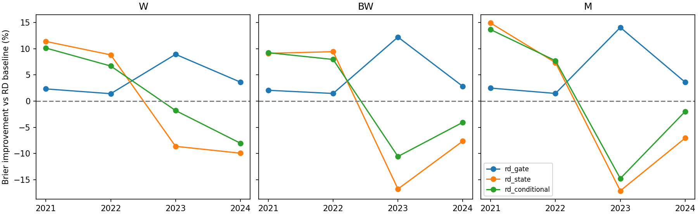

# EP32 V7：实时阶段状态与早期识别

达到本轮历史验收的组合：无。

最关键的变化是先判断“当前是否仍可能位于起点后三个月”，再估计未来是否发展成符合定义的6—18个月景气。原模型主要看收益、宽度和波动，没有直接表示当前上涨阶段已经持续多久。

实时状态只读取当日及以前的价格，逐日更新候选低点和已确认上行起点；已确认上行的起点不会随未来数据回改。如果起点已在三个月之外，或者属于初始左删失阶段，当前观察不符合早期定义。在计算范围内，该约束没有排除任何既有已知正例；追加未来价格不改变历史状态。

这是与目标定义一致的实时阶段约束，不是用未来低点做输入，也不是新的需求或盈利证据。仅加过滤在已知标签上的误差改善部分来自排除逻辑上不可能的负例；这不能自动证明候选阶段的后续持续性预测很强。因此同时保留前10%命中率、四个基线和逐年验收，不能只以Brier下降宣布成功。

|方法|Brier误差|较原RD相对改善|前10%命中率|命中率提升倍数|
|---|---|---|---|---|
|历史先验|0.056226|-0.53%|4.30%|0.70|
|静态逻辑回归|0.060558|-7.72%|7.43%|1.25|
|静态树|0.057585|-3.04%|7.82%|1.29|
|原RD-Agent模型|0.055858|+0.00%|7.73%|1.26|
|原模型加阶段过滤|0.054298|+2.48%|10.02%|1.60|
|加入实时阶段特征|0.052700|+4.89%|11.84%|1.83|
|候选阶段条件模型|0.052738|+4.87%|12.11%|1.88|

各频率、回撤口径、市场基准和行业层级等权汇总；相对改善先在同一任务内计算再平均。主要评价为2021-01-01至2024-09-30，每条标签统一跟踪24个日历月；尚未解决者仍为未知。底层数据从2017年起，训练仅用当时已成熟标签。

|方法|频率|两基准均通过的回撤口径|完整验收|
|---|---|---|---|
|原模型加阶段过滤|W|无|未通过|
|原模型加阶段过滤|BW|无|未通过|
|原模型加阶段过滤|M|无|未通过|
|加入实时阶段特征|W|无|未通过|
|加入实时阶段特征|BW|无|未通过|
|加入实时阶段特征|M|无|未通过|
|候选阶段条件模型|W|无|未通过|
|候选阶段条件模型|BW|无|未通过|
|候选阶段条件模型|M|无|未通过|

完整验收要求：误差低于历史先验、静态逻辑回归、静态树及原RD模型；前10%命中率至少为同日基准率的2倍；至少两个可评价年度且所有可评价年度均优于四个基线。每频率至少两个回撤口径在两市场基准同时成立，并通过下列增量检验。

|方法|绝对Brier改善|95%区间|BH调整q|统计增量|
|---|---|---|---|---|
|原模型加阶段过滤|+0.001514|[+0.001096,+0.001982]|0.003|通过|
|加入实时阶段特征|+0.003095|[-0.001640,+0.008056]|0.099|未通过|
|候选阶段条件模型|+0.002991|[-0.000928,+0.007144]|0.099|未通过|

三项固定候选统一BH校正；置信区间按同市场月份连续三个月成块重抽样，不把重复股票/行业/频率当作独立样本。

年度标签覆盖（跨频率、基准与阈值有重复，条数不是独立事件）：

|year|observations|known|unknown|positives|known_fraction|
|---|---|---|---|---|---|
|2021|136920|50568|86352|6328|36.9%|
|2022|129990|124558|5432|14158|95.8%|
|2023|199596|195942|3654|2908|98.2%|
|2024|157770|149937|7833|4705|95.0%|

历史选择限制：2021—2022年曾用于V5模型搜索，2024年也已在前轮查看；整轮是历史探索，不是未触碰的独立检验。统一跟踪24个月减轻观察时长不同的问题，但仍条件于标签可解决样本；2021年行业分类断点造成的未知不能忽略。主表命中率仅针对已知标签；另给出把所有未知分别当失败或成功的[命中率上下界](../outputs/unknown_label_bounds.csv)，用于检查缺标签能造成多大不确定性，这些上下界不回填原始标签。原口径2024年至末端结果单独保留在legacy_current，2026年正例未充分成熟，不用于宣称跨年稳定。

严格PIT仍为BLOCKED_DATA，独立前瞻验证FORWARD_PENDING。历史成员及股本known_at、复权价格和基本面公告版本的旧边界不变。

[逐年结果](../outputs/annual_summary.csv)；[完整任务结果](../outputs/task_metrics.csv)；[事件去重后的检出与延迟](../outputs/event_detection.csv)；[未知及选中覆盖](../outputs/coverage.csv)；[验收明细](../outputs/verdict.json)；[固定方案](../research_plan.md)。

