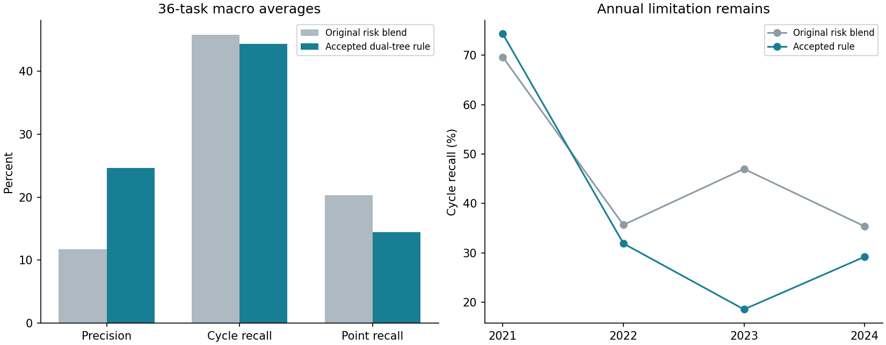
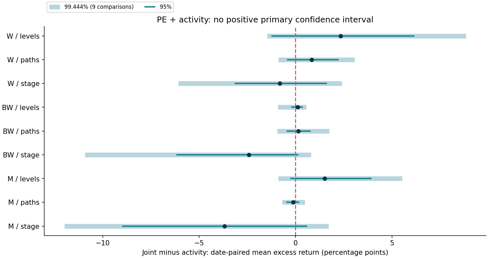

# EP32 完整实验报告：行业价格景气识别、经济价值与估值交易联合验证

报告日期：2026-11-09（Asia/Shanghai）。研究范围：EP32 初始观察至 V35，含 EP30 D2 V6 TTM PE 数据补充。本报告依据已有冻结代码、模型配置、预测收据和结果表整理；本次没有新增模型搜索、重训或改变验收标准。底层市场数据终点仍为 **2026-10-21**，不是报告日的实时行情。

## 摘要

现有成果是一套可以复核的**行业价格景气早期识别研究流程**，以及它的历史分类与收益评价。初始“未来一个月启动”的预测目标没有通过 30 轮实验验收；转向启动后前三个月识别并持续探索后，冻结方案在用户确认的汇总标准下达到 **precision 24.65%、周期 recall 44.39%**。这证明了特定历史样本中的筛选能力，尚未证明稳定的投资收益增量、盈利景气机制或独立前瞻有效性。

全部信号经济评价采用三级行业、15%转折、中证全指主口径，同一行业六个月观察段只计首次信号。周、双周、月度的六个月平均超额分别为 **6.32、5.63、8.09 个百分点**；相对同日同数量动量对照的日期配对改善区间全部跨零。成功命中的行情仍有较大事后上涨空间，但不能把该空间作为全部信号的收益。

最新“估值扩张＋交易活跃度扩张”实验补入历史 TTM PE，采用多个时间尺度和固定模型容量。九项主比较均未得到显著正的六个月收益增量，九组 Brier 概率误差全部上升，幅度约 **0.74%—1.30%**。联合特征暂不替换已有方案。共同完整特征样本只有约 11%—12%，且估值缺失集中于当前已退市证券，限制了结论的外推。

全项目仍标记为 **Historical-proxy（历史代理）**；严格 PIT 为 **BLOCKED_DATA**，独立前瞻为 **FORWARD_PENDING**。季度成熟标签约束降低了计算上的前视风险，但不能补足供应商历史版本证据，也不能消除反复探索同一段历史的选择偏差。

## 1. 研究问题、假设与目标演进

最初问题是：A 股是否存在持续约 12—18 个月的行业景气切换，行业当时总市值前三的公司是否会共同上涨，并持续较长时间？根据用户确认，行业细分到申万二级、三级，先检验价格轮动，再讨论基本面；“超过 BETA”在主口径中指**行业收益减同期市场基准收益**，不是先估计回归 beta 再计算 alpha。

随后将上涨阶段长度统一为 **6—18 个自然月**，由自然转折决定起止；超过 18 个月整段标记为超范围，不拆成多个合格阶段。研究对象一直是全部可形成有效价格路径的行业，半导体和光通信是筛选逻辑复核的案例，不是专门选出的实验母体。

|研究问题|可检验的含义|当前证据|
|---|---|---|
|是否存在中期行业相对行情|事后自然上涨段满足 6—18 月、自身上涨且跑赢同期基准|观察到此类阶段；上涨与期限部分来自定义，不能解释成预测成功|
|行业前三是否普遍共同受益|起点当时总市值前三的收益、三只共同上涨且跑赢比例|并非普遍成立；必须保留排名与终点未知|
|能否提前一个月预测启动|未来一个日历月内出现合格周期起点|RD-Agent 30 轮未达原验收|
|能否识别早期价格景气|观察时点位于合格周期低点之后前三个月|汇总历史分类目标达到，年度及频率存在明显退步|
|识别是否创造经济增量|全部信号后固定期限收益，相对简单对照|平均超额为正，稳健模型增量未确立|
|扩散、估值和交易是否支持机制|同容量增量、负对照、四格描述与基本面核查|局部线索存在；无稳定联合增量，盈利机制仍缺数据|

验收目标有明确变化：最初要求逐频率通过误差、两倍同期正例率及跨年稳定标准；之后用户接受以稳定优于原 RD 基线为主；再提出把主要候选 11.75% precision 翻倍至约 23.50%，并要求周期 recall 不低于 41.25%。最终用户在知悉年度和频率局限后，选择按**汇总门槛**验收。这些是不同研究合同，不能追溯声称最初的全部严格条件均已满足。[阶段研究与验收索引](#appendix-index)

## 2. 数据范围、行业池及 PIT 边界

### 2.1 价格和成员

冻结输入从 2017-01-03 至 2026-10-21，V5 重建读取 5,798 个证券日线分区、形成 767,515 条行业日线，45,347 条完整月份收益与 V4 对齐。证券分区数量不是每日股票池规模，行业日线数量也不是独立周期数。

行业篮子使用前一个完整月末固定的历史成员，当月等权起步、月内随价格漂移、月末重置。至少 5 名成员且至少 80% 价格端点可比较时才形成有效收益；缺口切断连续价格块，不补零。申万 SW2014 与 SW2021 分开处理，2021-12 分类断点不拼接。它是研究构造的行业篮子，不是官方申万行业指数，也不是实际投资组合。

@@INDUSTRY_COVERAGE@@

上表来自 V4 全行业清单，区分目录存在、成员可用和实际能形成路径。跨分类制度不能把同名行业直接相加作为独立行业；二级和三级存在上下级成员重叠。[行业覆盖源表](../../extensions/v4_all_industry_review/outputs/coverage_counts.csv)

主基准逐步固定为 **CSI_ALL＝中证全指**，另保留沪深300敏感性。中证全指不能简称为“全 A 等权收益”。行业超额是同期收益差；V31 另有回溯 beta 残差诊断，不能把该诊断替换为用户确认的主超额口径。

### 2.2 TTM PE 数据补充

D2 V6 查询 118 个月份，主源东方财富取得 2,133 个交易日、9,606,387 条证券日期记录，其中正 PE 7,742,153 条、负 PE 1,864,234 条；2017 年为空，保留缺口。BaoStock 的独立记录保留作交叉核验，V35 没有跨来源拼接。

@@PE_COVERAGE@@

覆盖分母是历史 Universe 的证券交易日，包含后来退市的股票。**2021—2024 缺失的证券交易日全部集中于当前已退市成员**，高覆盖率不意味着没有幸存者偏差。原 Universe 不因 PE 缺失缩小。负 PE 保留原值，但不参与正 PE 的 log 变化，也不被当作估值收缩。

`known_at` 仍为空，财务分母历史版本未认证。供应商今天提供某个历史日期的 PE，只能证明现在取得了该历史数值，不能证明当年首次披露时即可得到同一盈利分母。接口默认严格查询返回 UNKNOWN，显式 Historical-proxy 才允许回溯使用。[TTM PE 数据报告](../../../30_pit_data_foundation_v1/extensions/v6_ttm_pe/reports/ttm_pe_coverage.md)

### 2.3 四个不同的时间概念

|时间|用途|处理规则|
|---|---|---|
|市场观察日 t|形成特征、排名和报警|只使用截至当日收盘的价格信息|
|标签成熟日|决定一个历史训练标签何时可见|必须严格早于季度训练起点|
|供应商实际取得时间、财报 known_at|认证真实历史可得性|当前多数代理输入缺完整版本链，不能由标签隔离替代|
|研究配置冻结日|区分事前与事后探索|历史已经多轮使用，冻结收据不使其重新成为独立样本|

复权价格仍是历史价格推断，并非含全部现金分红、退市处置和实际成交的认证财富路径；行业成员、历史总市值和部分成交字段也继承代理边界。本报告结果是价格研究，不将其升级为总财富回报。

## 3. 景气标签、频率与统计样本

### 3.1 自然上涨段

对每个连续价格块，设置 10%、15%、20% 三套转折阈值。价格自候选低点上涨达到阈值时进入上涨状态；之后从运行高点回撤达到同一阈值，才确认此前高点为段末。低点和峰值均是未来才能确认的标签端点。一个合格段需要：低点至峰值 6—18 个自然月、行业价格上涨、同期收益大于指定基准。

左删失、未结束、缺口中断和超 18 个月分别保留。超范围不是“行业没有上涨”，负标签也不等于后续任何期限都亏损。V4 用月末路径观察，V5 起使用日线转折以支持周/双周更新，两个版本不是相同事件集合。

下表从 V4 月线 `EXACT` 政策记录按单一基准中证全指整理，三阈值、两层级分别报告。平均与中位数只描述**事后已确认且符合资格**的行业阶段；不将重复的市值报价政策作为额外事件。

@@DURATION_STATS@@

行业上涨且跑赢由筛选条件决定，表中涨幅不能回答事前能否选中。由于定义限定 6—18 个月，也不能用条件均值证明自然周期本来就集中于此。三阈值的长度分布、短于 6 月和超过 18 月部分须一起阅读。[全部自然阶段长度](../../extensions/v4_adaptive_6_18_months/reports/02_stage_duration_inventory.md)

@@NATURAL_COUNTS@@

这份库存尚未按“跑赢基准”筛选。10%阈值下已确认阶段的中位长度为4个月，15%下为6—7个月，20%下为14—15个月，表明测得的“周期长度”对转折阈值敏感；不能把任何一套条件统计称为客观且唯一的经济景气周期。左删失和未结束是状态标记，可能交叉，不宜与其他列简单相加。

### 3.2 预测任务和标签成熟

阶段 A 的正例：t 之后一个日历月内出现合格段的自然低点。阶段 B 的正例：t 位于合格段低点后前三个日历月内，且未超过峰值。阶段 B 是早期识别，不能称为启动前预测。

正例须等到段末回撤确认后才进入训练。负例需要同价格块中后续起点确认见证，并解决目标窗口内候选段；仅因“事件清单中查不到”不能记为 0。未成熟保留 UNKNOWN。

V5 原始外层回放从 2024 年开始。后来统一主评价为 **2021-01-01—2024-09-30**，每条观察只给 24 个月跟踪，24 个月内未解决的标签仍未知。因此虽然底层价格到 2026 年，主要可比较分类结果没有把 2025—2026 尚未完整成熟样本强行加入。24 个月是评价随访口径；训练的实际准入条件仍是标签在拟合时已经成熟，不能误写成每条训练记录统一延迟 24 个月。

周度使用完整交易周最后一日；双周以 2017-01-06 为固定锚隔周更新；月度使用完整交易月最后一日。三个频率改变观察密度，目标期限相同；都在收盘后生成分数。全分类体系有 **3 频率 × 3 转折阈值 × 2 市场基准 × 2 行业层级＝36 项任务**，任务之间共享行业和日期，不能当作 36 个独立试验。

### 3.3 行业前三的观察结果

前三按历史当时总市值排名，后续模型扩散特征以此前月末名单固定，不以事后涨幅或今天市值选龙头。排名不全、未解决成员或终点价格缺失分别报告。

@@TOP3@@

上表是 V4 的 15% 转折、中证全指、EXACT 口径。三只都上涨且跑赢并不是普遍现象；已知终点上的比例不能替代完整候选母体结果，更不能推出“三只龙头都会大涨并持续 9—12 个月”。当前研究也没有证明对应行业的营业收入、订单或利润在同一时期扩张。

## 4. 模型训练及可复现设计

### 4.1 RD-Agent 的使用范围

V5 使用固定版本 RD-Agent 原生研发循环和专用行业 Scenario：提出假设、生成受限特征表达式与模型配置、受控开发、训练评价、反馈；每轮只提交一个候选，保留失败。搜索空间为 23 项基础价格、风险、成交、行业宽度和市场特征，最多 8 项组合表达式，模型限逻辑回归与小容量 LightGBM。

阶段 A 完成 30 轮，未通过后阶段 B 再完成 30 轮。搜索反馈只取 2021—2022 年观察，搜索拟合使用 2021-01-01 前成熟标签，反馈标签须在 2024-01-01 前成熟；胜出配置冻结后，2024 年起按季度滚动回放，外层结果不反馈给 Agent。更早的 V4 已查看全历史，且 B 的方向选择用了 A 的失败结果，所以两者仍属于探索性研究。

@@RD_CONFIG@@

这两个是不同任务中的候选编号；不是当前验收规则的两棵树。后续 V18、V34、V35 是沿用环境的**固定候选训练**，没有新增 30 轮 LLM 搜索。项目累计探索统计截至 V28 为 51 个分数模型、803 项模型/政策配置，不能把这些配置计为 803 次独立确认。[原生循环及冻结配置](../../extensions/v5_rdagent_onset_forecast/reports/rdagent_observation.md)

### 4.2 当前双模型及联合实验的超参数

@@MODEL_PARAMS@@

共同设置为随机种子 32、确定性计算、单模型单线程、L2 正则 25；树直接处理缺失值。逻辑回归对照的中位数填补、缺失指示和标准化仅在训练集拟合。当前两棵树容量不同；V18 的容量消融另用**相同 240 棵树配置**分别训练 27 项和 38 项，以免把增加特征与增加容量混淆。

最新联合模型是在原 38 项基线上加变量，“仅 PE”意为**只额外加 PE**，不是不含价格、动量与原量比的 PE 单变量模型；“仅交易”同理。

### 4.3 每季度训练过程

1. 构造截至观察时点的特征，未来周期端点及收益仅存于标签或评价表。
2. 去除不同频率落在相同日期所造成的同一行业/日期/阈值/基准重复训练身份；共享模型池化行业、阈值和基准，保留阈值与基准编码。周、双周、月度是观察调度，并非各自另训一套独立模型。
3. 季度起点 q 的训练集要求 `date < q`、`label_available_at < q`、标签已知且 `state_eligible = 1`；采用扩展历史窗口，不用随机打散的交叉验证。
4. 样本权重为同一“日期×行业层级”样本数的倒数，再归一到均值 1，使行业数量多的日期/层级不会机械占更大权重。没有额外的正负类别平衡权重。
5. 按冻结参数拟合二分类器；对在线资格为真的记录输出分数，非资格记录分数为 0。树内拟合目标是二分类损失，模型研究评价用 Brier 等指标；分类分数尚未获独立前瞻校准，0.11 不应解释为认证的 11% 真实发生概率。
6. 季度预测先写入文件并保存哈希，再进行标签评分。不存在利用该季度结果做 early stopping 或挑选阈值的步骤；阈值历史探索的偏差另行保留。

V35 生成 773,934 行特征、404,274 行多任务分数，14 个非空季度 × 7 个新增模型＝98 个模型检查点，另有 14 份季度预测。2022Q1 原分类特征样本为空，保留空档；这些行数含任务维度，不能称独立股票或周期样本数。

@@FOLDS@@

上表来自实际预测收据。训练样本的正例比例因成熟速度和历史状态改变，未按未来结果再平衡；2022Q1 空档也不应解释成当季市场没有行业行情。V35 对原 38 项模型及 V34 三个交易模型的 2021Q1 预测均精确重放。[季度收据](../../extensions/v35_pe_activity_joint/outputs/prediction_receipt.json) · [训练实现](../../extensions/v35_pe_activity_joint/src/train35.py)

### 4.4 特征定义及经济解释

原 27 项由 19 项状态/价格/风险基础输入及 8 项风险尺度变换构成；扩散树再加 11 项。同业价格扩散对应“信息逐步进入价格”的可观察含义，风险尺度对应“短促反弹与可能持续的趋势”的区分。它们都是待验证的代理变量，不是实际利润增长。

@@FEATURE_GROUPS@@

风险尺度以 `h = -log(1 - 转折阈值)`、`s = 年化波动 / sqrt(252)` 为基础，例如 `risk_clock = log(1 + (h/s)^2)`，以及漂移相对噪声、到回撤线的标准化距离。`state_age` 是自然日数除以 90。在线状态从当时已知候选低点计算；上涨或下跌状态中候选低点仍可能符合早期资格，不要求未来已经证明是完整周期。起点未知的初始上涨状态排除，已不可能处于起点后三个月的记录排除。[状态实现](../../extensions/v7_online_stage/src/state7.py) · [风险公式](../../extensions/v12_duration_risk/src/risk12.py)

龙头来自此前月末历史总市值前三，其余成员作为不重叠同业组。相对收益、领先差、宽度变化及其交互全部回看；市场残差的 beta 由过去窗口估计并滞后一日。特征缺失保留 NaN，不因缺扩散数据删除行业。[扩散公式](../../extensions/v6_economic_diffusion/src/features6.py)

## 5. 信号选取、precision、recall 和延迟口径

### 5.1 已验收的 V28 历史规则

在完整周/双周/月观察日，满足在线早期资格，并同时满足：

```text
risk_tree >= 0.11
AND diffusion_tree >= 0.11
AND CSI_ALL_close(t) / CSI_ALL_close(t - 126个交易日) - 1 > 0
```

全部符合者入选，不固定取前 10%。市场条件不通过时不报警；即使标签基准采用沪深300，市场过滤仍是中证全指 126 日涨幅。二级、三级及各阈值、基准独立评价，未把全部名单混成一个交易组合。

### 5.2 指标分母

|指标|定义|容易混淆的地方|
|---|---|---|
|日期平均 precision|每个有已知标签报警的日期先计算 TP/(TP+FP)，再跨日期平均|不是把全部报警合并后相除；无已知报警日期无定义|
|36 任务汇总 precision|每任务的日期平均 precision 再等权平均|24.65% 属于此口径，不能直接比较单一三级行业任务|
|合并 precision|全部已知报警的 TP/(TP+FP)|大报警日期权重更高，CSV 单列|
|时点 recall|选中的已知正例时点/全部已知正例时点|频繁重复报警会提高时点数，不等于多捕捉周期|
|周期 recall|至少正确命中一次的周期/全部可评价周期|分母不因市场过滤缩小，同周期在单任务中只计一次|
|延迟|某成功周期首次正确报警日−事后低点日，自然日|仅对捕捉周期计算；漏检通过 recall 体现，不赋无限或零延迟|
|Brier|已知标签上的 (分数−标签)²，按既定日期/任务权重汇总|越低越好，改善率为 1−模型误差/对照误差|
|活跃日期比例|有报警日期/全部观察日期|提高 precision 可能伴随少发信号，须同时报告|

V28 的 46.75 天是**36 个任务各自延迟中位数的平均**，并非全部周期合并中位数。V35 主表的延迟则是单一任务内中位数。不同表的“中位数”不得互换。

未知标签不填 0；排名和选取在揭示未来标签之前确定，之后才以已知子集计算指标。价格结果已知但周期标签未知的记录，仍可进入固定期限收益评价。

### 5.3 三种“去重”

单任务周期 recall 对同一 `phase_id` 仅计一次；跨任务汇总还会出现不同阈值识别同一行情的重叠；经济评价则必须不依赖未来阶段来确定是否启动。因此三者分别处理，不能共用一个“独立机会次数”。V30 合并事后区间是描述性计数修正，V31 的六个月冷却是在线可执行的研究计数规则。

## 6. 初始预测、早期识别与最终分类结果

### 6.1 RD-Agent 的两阶段结果

@@RD_RESULTS@@

三个频率在阶段 A 均未通过，才进入 B；阶段 B 有有限误差改善，但未满足原完整标准。表中提升倍数是各细任务相对同期正例率的比值再汇总，不能用两列总体均值直接相除重建。V5 的样本时段与后来固定 24 月跟踪样本不同，不能把两个表的 precision 差全部解释成模型进步。

### 6.2 从简单过滤到风险和扩散

V6 的龙头先行、同业扩散、市场调整强势六项主检验均未通过预定多重校正；不能先把机制当真，再用模型命中率证明机制。V7 起引入在线早期过滤；V8 共享状态树、V9 市场上下文、V10 成熟延迟、V11 错误分解及 V12 风险尺度逐步形成对照。

在统一主样本中，原 RD 的前 10% precision 为 7.73%，简单过滤为 10.02%；V16 保留的 `risk_blend` 为 11.75%，周期 recall 45.83%，Brier 相对 RD 改善 5.44%。其中 67/69 个可评价任务年度优于 RD，两个退步保留；相对简单过滤的增量并未获得原累计校正支持。随后 V17—V27 继续检验排序、容量、扩散、持续确认、长周期上下文、事件权重、短期风险及市场过滤等，完整历史候选未删除。[V16 口径与结果](../../extensions/v16_relative_goal_decision/reports/relative_goal_decision.md)

### 6.3 V28 汇总验收

@@ACCEPTANCE@@

precision 从 11.75% 提高至 24.65%，为原值约 2.10 倍；周期 recall 保留约 96.86%，高于 41.25% 下限。代价是时点 recall 下降、报警日期减少、成功周期首次识别延迟增大。

@@FREQUENCY_ACCEPTANCE@@

周度 precision 22.27% 没有单独达到 23.50%；月度周期 recall 41.39% 接近汇总要求的下限。接受的是用户确认的汇总合同，不是三个频率分别通过所有条件。

@@ANNUAL_ACCEPTANCE@@

2023 年周期 recall 从 47.00% 降到 18.57%，是最明显局限。20,308 条任务报警中，11,841 条标签已知、8,467 条未知，占 41.69%。将未知全部置负/置正时，另一个包含全部报警日期的 precision 敏感性界限为 12.15%—59.03%；它不是置信区间，也不是 24.65% 同一已知子集上的区间。



图左：36 项任务等权指标；图右：年度周期召回。年度归属及频率相互重叠，不代表独立样本。[独立验收结果](../../extensions/v28_aggregate_acceptance/reports/accepted_method.md)

## 7. 捕捉次数、到峰值空间与全部信号回报

### 7.1 修正重复计数

V29 将相同起止的记录去重后得到 341 条，平均到峰值涨幅 41.05%、中位 31.87%，剩余时间平均 265.31 天、中位 213 天。但不同阈值下起止不完全相同的重叠行情仍被重复加权；这些数字只能保留为该旧口径的描述。

V30 在同一分类版本、层级、行业及连续价格块内合并重叠或相接区间。2021—2023 的 236 条记录修正为 **211 个重叠行情组，其中二级 64、三级 147**；两层存在成员重叠，211 不能称独立机会数。完整 2021—2024 年 9 月观察范围由 341 条修正为 311 组，未按合并后最高收益重写旧收益。[计数修正报告](../../extensions/v30_overlap_count_audit/reports/count_correction.md)

### 7.2 固定单一周期定义的成功捕捉空间

为避免跨任务混合，后续采用三级行业、15%阈值、中证全指，每个频率单独统计。分母均为 182 个可评价周期；一个周期只取该频率首次正确报警。

@@PEAK@@

涨幅从**信号日收盘**至该周期事后峰值，时间为自然日，只描述成功捕捉条件下尚余空间。实际信号在收盘后才产生，不能假设同收盘成交；最高点也是未来才知道的，未建立实时卖出规则。周/双周/月的捕捉集合重叠，105、97、100 不可相加。[单任务周期源表](../../extensions/v31_all_signal_economics/outputs/cycle_metrics.csv)

### 7.3 全部信号经济评价

主分析不按成败筛选。每行业、分类版本及连续价格块，从首次报警启动六个自然月观察段，**下一交易日收盘**起算，到六个月后的首个交易日收盘结束；期间重复报警不再启动，到期日收盘后新信号允许开启下一段。主收益为六个月，另报三个月、十二个月。十二个月观察仍沿用六个月启动时钟，可能重叠。

收益 `R = 终点净值/入场净值−1`；超额 `ER = R−同期基准收益`。未知价格路径单列，不补零；周期 UNKNOWN 不会自动排除固定期收益。每条已知观察段等权，不模拟资金、仓位和持仓重叠。

@@ECONOMICS@@

平均超额为正，但样本中存在明显下行风险，段内平均最大回撤约 −15.6% 至 −15.9%。最大回撤是每段运行峰值到随后低点的最大跌幅，再跨段平均；不是组合账户最大回撤。

@@HORIZONS@@

2021 分类断点使十二个月已知样本显著少于六个月，不能仅根据均值差决定最优持有期。价格结果也不包含完整的现金流和终端财富处理。

### 7.4 简单对照与年度表现

@@ECON_CONTROLS@@

同日全行业指原模型报警日的全部可用三级行业；早期＋市场池包含通过资格的全部行业；同 K 动量和模型对照匹配每个日期的原始报警数，再各自运行六个月启动规则。**原报警 K 相同不保证冷却后首次启动数和日期相同**。原38项扩散树同K排名与已验收双树固定阈值是两种政策，不可都简称为“当前模型”。

当前方案减同 K 动量，日期配对平均超额改善为周 +2.17、双周 +2.11、月 +1.78 个百分点，95%区间分别为 [−2.35,+11.59]、[−2.15,+8.69]、[−2.98,+5.84]，均跨零。该估计先按共同日期平均，再跨日期等权，与上表逐启动均值相减不同。V31 使用 12 个自然月时间块、1,000 次重采样，只有 23/15/8 个共同启动日期。

@@ECON_YEARS@@

2023 年三个频率行业平均绝对收益均为负、超额为正，说明信号可能只选到“跌得较少”的行业。CSV 另保留 50/100bp 总成本扣减、收益下侧分位、beta 残差；简单成本扣减不是真实换仓成本，不能据此声称已形成可部署净收益。[全部信号经济报告](../../extensions/v31_all_signal_economics/reports/all_signal_economics.md)

## 8. 经济机制与行业轮动核查

V32 用同容量模型比较有无扩散信息，并固定一次日期内行业对应打乱。真实扩散相对同容量无扩散的六个月收益增量在三个频率均无稳健正区间；相对一次打乱，在周/双周出现正向线索，月度没有。单次打乱不是完整置换分布，不能据此证明“龙头先行导致同业补涨”。

行业领先更替以同日三级行业过去 63 日相对收益前 20% 定义当前领先，未来三/六个月超额前 20% 定义未来领先。六个月当前领先者留存约 18.5%—18.9%，不高于本次日期内置换约 19.2%—19.9%。模型对未来新领先者的召回约 4%—5.5%，高于同 K 动量，但相对置换并非各频率一致更好。

因此现有证据支持“有行业相对行情及一定早期价格识别线索”，还不能支持“已发现可稳定预测的行业轮动次序”，更不能把横截面收益更替解释为已观察到真实资金从一个行业流入另一个行业。[机制与领先更替报告](../../extensions/v32_mechanism_rotation/reports/mechanism_rotation.md)

## 9. 多尺度交易活跃度与 PE 联合实验

### 9.1 假设与竞争解释

用户提出：行业扩张可能同时伴随 PE 扩张与交易活跃度扩张。可检验的价格含义是，预期重估与参与度提高能否提供**已有动量、风险和扩散信息之外**的早期识别及收益信息。竞争解释包括：价格已经上涨的机械关联、盈利下降抬高 PE、一般市场反弹、缺失模式和供应商幸存者覆盖。

这项假设不要求 PE 在真实盈利景气中必然上升。对正值且定义一致的个体序列，`Δlog(PE)=Δlog(P)−Δlog(EPS_TTM)`；盈利修复快于股价时 PE 可以下降，盈利恶化时 PE 也可能上升。该恒等关系只是解释为什么需区分分子分母，并未在本实验中反推财务事实；行业成员中位数聚合也不能机械套用这一个体分解。

### 9.2 特征与模型对照

@@EXPANSION_FEATURES@@

短期换手扩张是 `log(最近21日均值 / 此前63日均值)`，中期为 `log(最近63日均值 / 此前126日均值)`；成交股数同理。均值窗口至少 80% 有效；长期秩至少 75% 有效。行业成交额份额分母是当前可用股票池成交额代理，不是全市场资金净流入。

PE 变化为成员 `log(PE_t/PE_t-w)` 的行业中位数，要求 w+1 个交易日连续正 PE；504/756 日秩要求当前正值和窗口至少 75% 正 PE。行业聚合至少 5 名成员、至少 80% 完整历史成员可用，未解决成员计入分母。它不是“行业总市值÷行业总利润”的聚合 PE。

V34 三组交易候选分别添加至原38项基线；V35 再给每一家族加入同一组 7 项 PE，另训只加 PE，以及三组只加 PE 缺失指示的控制模型。没有把三类交易家族全部拼成一个最优模型，也没有看到结果后挑窗口、阈值或改成功标准。树可学习非线性交互，但这里不等于单独估计了“PE×成交”因果交互系数。

选择母体固定为在线早期且中证全指126日上涨；按每个观察日 V28 报警数量 K 取各模型前 K。共同完整样本诊断也对各模型使用相同母体、相同 K，不只给新模型删除缺失行。主训练保留缺失值，原训练母体与日期权重不变。

### 9.3 交易扩张单独加入的结果

@@ACTIVITY_RESULTS@@

只有双周水平/阶段的逐启动平均超额略高于原38项基线，其余下降；九项主比较经九重校正无正向收益增量。双周路径在未校正95%区间出现负向差异，完整结果保留。局部 Brier 改善不能替代经济收益结论。

V34 当时接入的封存 PE 表缺少主样本历史序列，因此没有完成联合检验。D2 V6 后补数据，V35 才做联合实验；旧 V34 的数据阻断与交易结果不被改写。先前“未接入 PE”也不等于本机从未存在任何其他来源的历史 PE 缓存。

### 9.4 PE 联合的主经济结果

先看四种模型的六个月平均超额（用交易水平家族展示完整消融）：

@@JOINT_ABLATION@@

再列全部三家族、三频率的预定主比较：

@@JOINT_MAIN@@

“加入PE”的六个月平均超额仅周度路径、周度阶段略提高，其余七项下降；仅新增 PE 相对原38项模型在三频率也没有均值优势。所有启动含误报及周期标签未知记录，未知未来收益不补零。[完整模型经济结果](../../extensions/v35_pe_activity_joint/outputs/economics_primary.csv)

@@JOINT_INTERVALS@@

主推断在两方法都有已知启动收益的日期配对，12 自然月块 bootstrap 5,000 次。95% 为描述性区间，九项主比较同时报告 Bonferroni 99.444% 区间。**0/9 有正向95%下界，0/9 有正向校正下界**；共同完整样本也是 0/9。只有 7—24 个配对日期，检验辨别力有限；没有支持效应不等于证明效应严格为零。

上述日期配对增量与逐启动平均增量的样本、权重不同，数值甚至方向可能不同。例如周度水平的启动均值差约 −0.01pp，而配对日期差 +2.34pp，不是计算冲突。解释时必须注明估计对象。



图为日期配对的六个月超额差；深线95%、浅线九重校正区间，零线为无增量。

### 9.5 分类、概率误差与覆盖

@@JOINT_CLASSIFICATION@@

这里只是三级、15%、中证全指主任务，不能拿月度 30% 以上 precision 与 V28 跨36任务的24.65%比较后宣称升级；不同家族 precision 局部提高，cycle recall 多数退步。

@@BRIER@@

九组概率误差全部变差，约0.74%—1.30%。分数排序变化与概率误差可以不同，不能只报其中更有利的一项。

@@JOINT_COVERAGE@@

共同完整候选只有约11%—12%。股票当天有 PE 并不意味着它有足够长的连续正 PE，更不意味着整个行业达到80%聚合门槛；因此高达96%—99%的“有 PE 记录覆盖”与很低的“联合特征完整率”可以同时存在。

只加缺失指示的对照检验了一部分缺失模式解释：周度、月度阶段联合模型相对该控制的配对95%区间有正向下界，但相对原交易阶段模型的主比较未通过。缺失指示也包含亏损和短历史，不是纯退市标签，不能用此对照宣布已消除幸存者偏差。未去重原始报警辅助口径中，周度水平有正向区间、月度路径有负向区间，未替代事前的六个月首次启动主口径。

### 9.6 双扩张四格及年度稳定性

以 PE21 变化>0 与短期换手扩张>0 分为 BOTH、PE_ONLY、ACTIVITY_ONLY、NEITHER，UNKNOWN 单列。先在未按模型分数排序的早期＋市场池上选首次六个月观察，再分四格；不是每格各自重启计数。这与模型选股母体不同。

@@FOUR_CELLS@@

双周、月度双扩张有正超额，但都低于“均不扩张”；周度双扩张仅20条已知收益，平均接近零。不同频率首次观察日期不同，进入四格的样本不同，不能把差异当成频率机制。四格命中率是已知标签启动的合并比例，不是日期平均 precision。

@@JOINT_ANNUAL@@

各年联合模型相对对应交易模型的六个月启动平均超额差，没有一家族跨频率、跨年份稳定改善。2024 仅至9月30日，覆盖及年度样本量见原始表。[完整联合实验报告](../../extensions/v35_pe_activity_joint/reports/pe_activity_joint.md)

## 10. 当前成果的经济学意义

**已观察到的现象**：在细分行业中存在持续数月、跑赢市场的价格阶段；部分被早期信号识别的已知周期，后面仍有较大上涨空间。风险尺度、在线阶段与市场背景能够在本段历史中改善分类选择性，尤其相较未过滤的原 RD 模型。

**尚不能成立的推论**：价格上涨不等于利润扩张；高 precision 不等于高收益；成功周期的最高点空间不等于可实现退出收益；同一行业重复报警不等于多个机会；显著优于某一个较弱对照不等于对所有简单基线有稳健增量。

当前模型更适合被理解为“在特定市场背景中筛选可能处于价格趋势早期的研究候选”。它还不是已验证的景气盈利预测器，也不是完整交易策略。PE 与成交共扩张的固定实验没有提供稳定的新证据，不能据此宣称理论被彻底否定；更直接的解释需要区分价格重估、盈利修复、交易参与度以及覆盖偏差。

## 11. 局限、未完成事项与后续研究边界

|局限|对当前结论的影响|继续验证所需条件|
|---|---|---|
|历史反复探索，V28 已累计803项配置|最终阈值有选择偏差；时间切分不再等同全新 holdout|配置冻结后真实新增观测、预先登记评价|
|2021分类断点及标签未知|已知样本可能非随机，收益期限间不可直接比较|保留断点、报告覆盖与未知敏感性|
|成员和财务版本 known_at 不完整|严格 PIT 不成立|原始成员版本、财报首次披露与更正链|
|PE 缺口集中于当前退市股|共同样本也不能消除幸存者覆盖选择|补退市历史和分母版本，保留完整历史池|
|长期正 PE 特征覆盖稀疏|联合实验低辨别力，效果外推有限|先审计可用性，再冻结新的分层或特征方案|
|全部信号未模拟组合仓位与成交约束|均值超额不等于账户收益|固定持仓、换仓、退出与成本模型后另做组合实验|
|财务面板仅2发行人、15条事实、3版本|不能验证全行业盈利改善机制|连续季度、代表性行业及对照行业的公告证据|
|前瞻新增预测为0|没有独立前瞻验证|具备真实当时输入、季度训练及不可覆盖发布流水线|

V33 已提供追加式前瞻记录器和冻结契约，但记录器只检查提交证据与时点一致性，不自行认证来源、训练或生成预测。V33 在2026-11-08审计时使用2026-10-21行情；本次只是整理报告，没有更新行情或补造11月信号。严格 PIT 仍 BLOCKED_DATA，真实前瞻仍 FORWARD_PENDING。[前瞻准备与基本面审计](../../extensions/v33_pit_forward_readiness/reports/readiness.md)

若继续讨论改进，优先把“利润改善”和“估值重估”拆开，以带首次披露时间的盈利证据验证；保留同容量、同母体、同数量简单对照，并预先固定主要评价为分类还是经济收益。本报告不据历史结果追加窗口搜索，也不把这段建议视为已经执行的新实验。

## 12. 复核、数据制品及复现方法

本报告从已封存 CSV/JSON 提取主要表格；月线阶段均值是对原已筛选记录的描述性重汇总，并单独保存来源与分组结果。训练参数从冻结配置和实际训练代码核对，而非仅抄报告文字。正文图由对应表生成，没有重训任何旧模型。

已有实验验证：D2 V6 的37项语义测试及15项封存检查通过；V31 独立核对180条原始价格路径；V34 的179项检查通过；V35 的245项检查通过，含71项公式/时点检查及原基线、三个交易家族2021Q1精确重放。**这些是各轮已保存的验证结果，本次没有将它们重新运行或称为新增测试。** 本次单独核对报告表格、引用路径、季度成熟时间与源文件未修改。

@@AUDIT_TABLE@@

私有原始数据和大面板在 `/home/xiaolv/.cache/a_share/ep32`；最新联合实验在 `joint_pe_v35`，包含季度模型和预测。D2 V6 封存发布 ID 为 `c7fd4a250c8a8558f0b8085e7798a4bf4f411b7573bee21eb1c516674d659b93`，完整发布包含4,002文件。仓库中的报告、摘要、参数和哈希不是原始数据的替代品。

本次报告目录包含：`report.md`、可在浏览器离线阅读的 `report.html`、图表、表格CSV附录、`sources.json` 来源哈希、`validation.json` 报告复核结果、`manifest.json` 本次制品清单，以及 `build_report.py` 和本模板。HTML 嵌入图像，正文可独立阅读；原始证据链接仍需保留仓库相对目录。

仅重建此汇总报告（不获取数据、不训练模型）：

```bash
topics/02_AFML_BIG_WINNER/.venv/bin/python topics/02_AFML_BIG_WINNER/experiments/pending/32_industry_rotation_cycle_observation/reports/consolidated_20261109/build_report.py
```

复现训练需已有私有冻结输入和 RD-Agent 环境。V35 流程是 `build35.py → validate35.py（特征核验）→ train35.py → evaluate35.py → seal35.py（总核验）→ report35.py`；各脚本的冻结输入和验证收据见原目录。已封存实验不能原地重跑覆盖，应复制到新版本并固定引用后执行。不要重新请求已被停止的数据供应商来生成这份报告。

<a id="appendix-index"></a>
## 附录 A：研究版本与证据导航

以下索引保留各阶段原报告，包括失败、未通过、口径纠正和数据阻断；旧结论须按各自样本和截止时点理解。V35 完成 PE 联合实验不撤销 V34 当时的数据缺口结论。

@@REPORT_INDEX@@

## 附录 B：完整特征清单、训练配置与结果表

每个 V35 模型使用第4.4节逐项列出的38项基础输入，再添加下表对应字段；表内总维度包括基础输入。

@@FULL_FEATURE_LIST@@

@@ATTACHMENTS@@

附录文件保留原始小数单位；收益0.01表示1%，两个收益之差0.01表示1个百分点。未知值为空，不是0。各表所用单位、母体、时间范围及权重以正文定义和相应原始报告为准。
