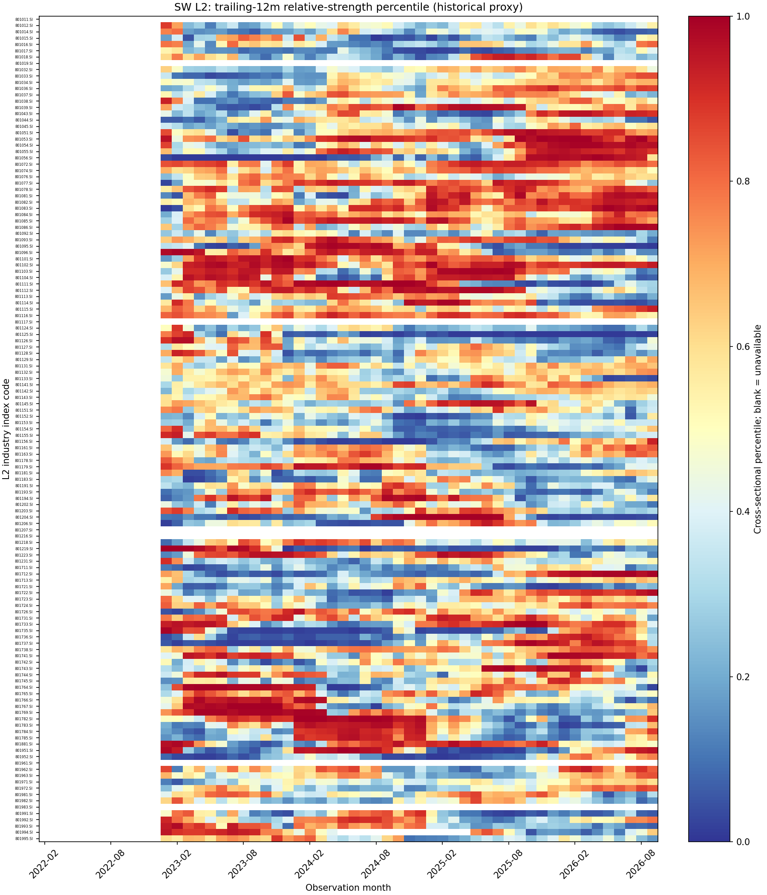
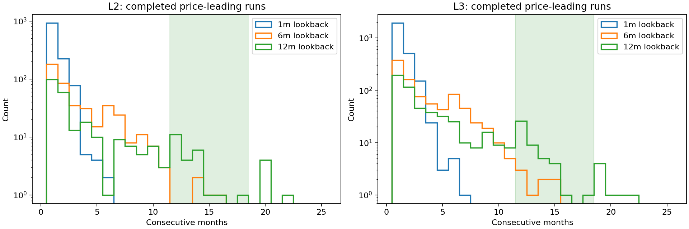
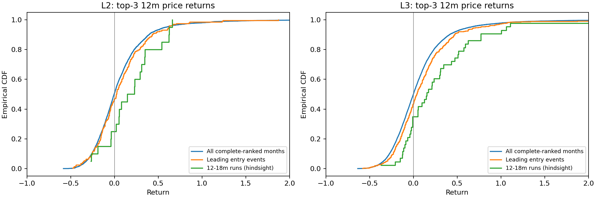

# EP32 第一阶段观察

研究已启动，采用**申万二级和三级**，按当时总市值前三固定标的，先观察价格现象。**当前不能据此声称已由严格PIT证实12—18月景气轮动及前三持续9—12月普涨。**

数据质量为 **Historical-proxy**；严格 PIT 为 **BLOCKED_DATA**。行业纳入/剔除日期是回溯供应商记录，没有首次发布/修订存证；总股本 known_at 缺失。当前下载的2021分类字典也没有逐次历史版本。股价采用封存前复权价格变化推断，不是实际可执行或现金权益结算收益。元数据包含历史退出身份，但全市场每日资格仍未认证。

观察月份：2022-01—2026-09，共57个月。2021体系不回填到更早历史；前12个月只积累状态，随后才产生完整领先判断。本轮完整使用在列和已剔除成员，不用当前成员反填历史。

- L2：12月强度领先的完整持续段 259 段，中位 2.0 个月；其中12—18月 24 段。进入后9个月有 219 个成熟事件，217 个三股终点完整；三股均涨 24.0%，组合中位收益 0.4%，最差股中位收益 -14.4%。
- L2：12月强度领先的完整持续段 259 段，中位 2.0 个月；其中12—18月 24 段。进入后12个月有 205 个成熟事件，203 个三股终点完整；三股均涨 26.6%，组合中位收益 2.1%，最差股中位收益 -14.9%。
- L3：12月强度领先的完整持续段 554 段，中位 2.0 个月；其中12—18月 46 段。进入后9个月有 500 个成熟事件，497 个三股终点完整；三股均涨 23.7%，组合中位收益 0.0%，最差股中位收益 -16.9%。
- L3：12月强度领先的完整持续段 554 段，中位 2.0 个月；其中12—18月 46 段。进入后12个月有 459 个成熟事件，457 个三股终点完整；三股均涨 25.6%，组合中位收益 3.7%，最差股中位收益 -16.0%。

|层级|期限/月|成熟事件|已知/未知|三股均涨|组合中位涨幅|最差股中位涨幅|中位超额/市场|三股共同盈利最长段中位/月|
|---|---|---|---|---|---|---|---|---|
|L2|9|219|217/2|24.0%|0.4%|-14.4%|-8.7%|0.0|
|L2|12|205|203/2|26.6%|2.1%|-14.9%|-11.4%|0.0|
|L3|9|500|497/3|23.7%|0.0%|-16.9%|-7.3%|0.0|
|L3|12|459|457/2|25.6%|3.7%|-16.0%|-10.3%|0.0|

|层级|过去窗口/月|完整段|左/右删失|完整段中位/月|完整段12—18月|
|---|---|---|---|---|---|
|L2|1|1240|31/31|1.0|0|
|L2|6|439|32/31|2.0|4|
|L2|12|259|31/31|2.0|24|
|L3|1|2622|70/68|1.0|0|
|L3|6|907|72/68|2.0|8|
|L3|12|554|65/67|2.0|46|

以上为探索性样本描述。没有设“不错”的成功阈值，也没有进行预测模型拟合或独立确认。按行业月观察有高度重叠，不把事件数当独立宏观周期数；同月非领先对照和行业其他成员对照均保留。

阅读：[轮动长度](01_rotation_duration.md)、[前三涨幅](02_top3_returns.md)、[持续性](03_return_persistence.md)、[景气缺口](04_business_cycle_gap.md)。

证据：[来源核验](../outputs/audits/input_verification.json)、[行业采集](../outputs/audits/industry_acquisition.json)、[月度成员覆盖](../outputs/audits/monthly_membership.csv)、[观察覆盖](../outputs/audits/observation_coverage.csv)、[全部汇总](../outputs/metrics/outcome_summary.csv)。

追加观察A01：[事后12—18月长段与前三的全部案例](05_retrospective_long_segments.md)。该分组含未来选择，只用于描述现象。

|层级|期限/月|已结束12—18月段|排名完整段|终点已知段|三股均涨|组合涨幅中位|最差股涨幅中位|共同盈利≥9月|
|---|---|---|---|---|---|---|---|---|
|L2|9|24|20|20|35.0%|11.0%|-6.7%|15.0%|
|L2|12|24|20|20|35.0%|18.8%|-6.0%|20.0%|
|L3|9|46|44|44|38.6%|11.9%|-10.1%|11.6%|
|L3|12|46|44|43|37.2%|15.3%|-9.9%|16.7%|

