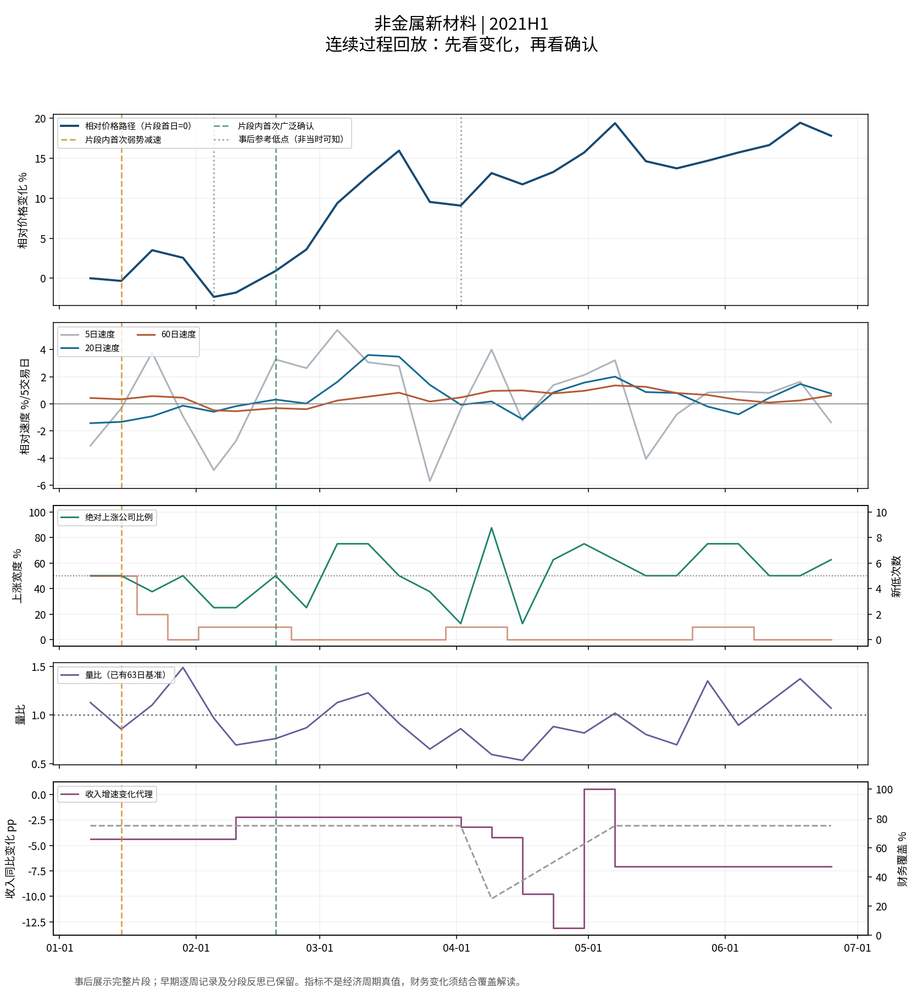
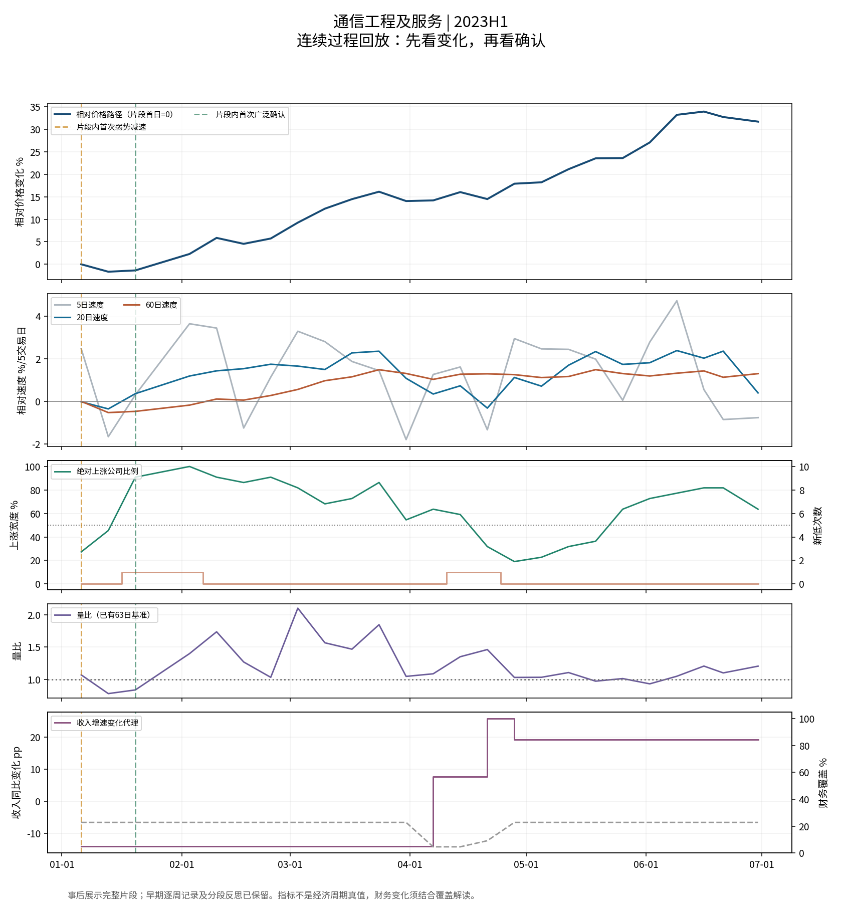
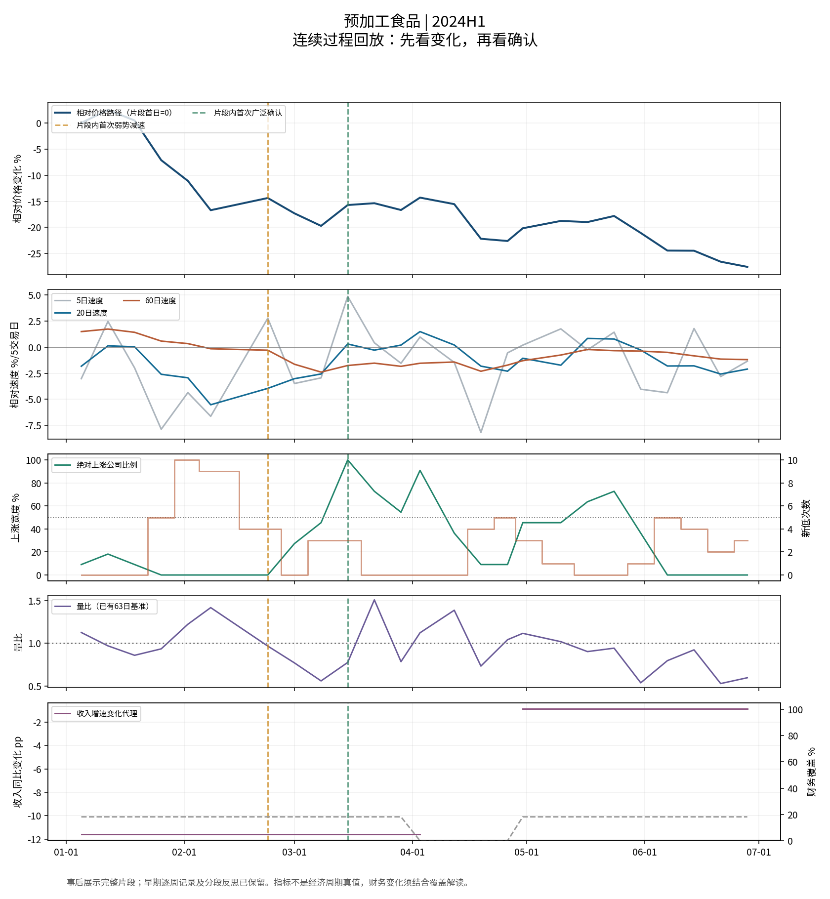
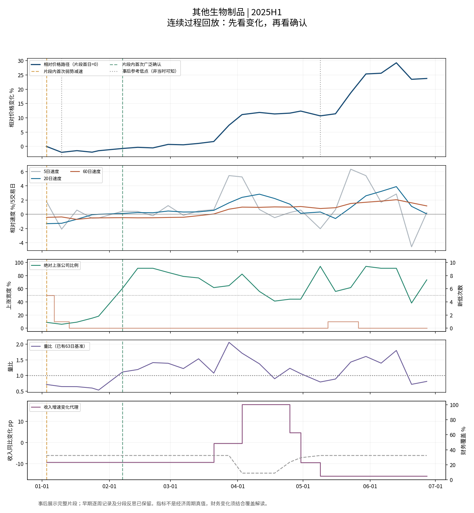

# EP33 连续变化过程档案

R06按入口信息抽样，记录为模拟遮蔽回放，不是历史真实发布信号。首次出现均指片段内首次，不是该行业一生中首次。事后参考只用于评价，不回写观察。

## 2021H1_1_850523.SI：非金属新材料

入口：2021-01-08；片段结束：2021-06-30；入口状态：READY。

| 入口状态   | 观察周   | 缺失周   | 不完整周   | 首次弱势减速   | 首次广泛确认   | 首次长周期确认   | 事后参考低点           |
|:-----------|:---------|:---------|:-----------|:---------------|:---------------|:-----------------|:-----------------------|
| READY      | 25       | 0        | 0          | 2021-01-15     | 2021-02-19     | 2021-03-05       | 2021-02-05、2021-04-02 |

| 观察日     | 状态       | 20日速度   | 速度变化   | 新低次数   | 宽度   | 财务覆盖   | 当周解释                                             |
|:-----------|:-----------|:-----------|:-----------|:-----------|:-------|:-----------|:-----------------------------------------------------|
| 2021-01-08 | OBSERVABLE | -0.014     | -0.007     | 5.000      | 0.500  | 0.750      | 中期恶化未见速度改善；不制造起点信号。               |
| 2021-01-15 | OBSERVABLE | -0.013     | 0.001      | 5.000      | 0.500  | 0.750      | 中期仍弱但恶化速度在收窄；可疑减速，尚不能认定转向。 |
| 2021-01-22 | OBSERVABLE | -0.009     | 0.004      | 2.000      | 0.375  | 0.750      | 中期仍弱但恶化速度在收窄；可疑减速，尚不能认定转向。 |
| 2021-01-29 | OBSERVABLE | -0.001     | 0.008      | 0.000      | 0.500  | 0.750      | 中期仍弱但恶化速度在收窄；可疑减速，尚不能认定转向。 |
| 2021-02-05 | OBSERVABLE | -0.006     | -0.004     | 1.000      | 0.250  | 0.750      | 中期恶化未见速度改善；不制造起点信号。               |
| 2021-02-10 | OBSERVABLE | -0.002     | 0.000      | 1.000      | 0.250  | 0.750      | 中期仍弱但恶化速度在收窄；可疑减速，尚不能认定转向。 |
| 2021-02-19 | OBSERVABLE | 0.003      | 0.009      | 1.000      | 0.500  | 0.750      | 中期改善速度增加；需区分变化刚发生与既有趋势延续。   |
| 2021-02-26 | OBSERVABLE | 0.000      | -0.003     | 0.000      | 0.250  | 0.750      | 中期仍改善但速度回落；不因当前仍强就忽略减速。       |
| 2021-03-05 | OBSERVABLE | 0.016      | 0.016      | 0.000      | 0.750  | 0.750      | 中期改善速度增加；需区分变化刚发生与既有趋势延续。   |
| 2021-03-12 | OBSERVABLE | 0.036      | 0.020      | 0.000      | 0.750  | 0.750      | 中期改善速度增加；需区分变化刚发生与既有趋势延续。   |
| 2021-03-19 | OBSERVABLE | 0.035      | -0.001     | 0.000      | 0.500  | 0.750      | 中期仍改善但速度回落；不因当前仍强就忽略减速。       |
| 2021-03-26 | OBSERVABLE | 0.014      | -0.021     | 0.000      | 0.375  | 0.750      | 中期仍改善但速度回落；不因当前仍强就忽略减速。       |
| 2021-04-02 | OBSERVABLE | -0.001     | -0.015     | 1.000      | 0.125  | 0.750      | 中期恶化未见速度改善；不制造起点信号。               |
| 2021-04-09 | OBSERVABLE | 0.002      | 0.006      | 1.000      | 0.875  | 0.250      | 中期改善速度增加；需区分变化刚发生与既有趋势延续。   |
| 2021-04-16 | OBSERVABLE | -0.011     | -0.013     | 0.000      | 0.125  | 0.375      | 中期恶化未见速度改善；不制造起点信号。               |
| 2021-04-23 | OBSERVABLE | 0.008      | 0.020      | 0.000      | 0.625  | 0.500      | 中期改善速度增加；需区分变化刚发生与既有趋势延续。   |
| 2021-04-30 | OBSERVABLE | 0.016      | 0.007      | 0.000      | 0.750  | 0.625      | 中期改善速度增加；需区分变化刚发生与既有趋势延续。   |
| 2021-05-07 | OBSERVABLE | 0.020      | 0.008      | 0.000      | 0.625  | 0.750      | 中期改善速度增加；需区分变化刚发生与既有趋势延续。   |
| 2021-05-14 | OBSERVABLE | 0.009      | -0.011     | 0.000      | 0.500  | 0.750      | 中期仍改善但速度回落；不因当前仍强就忽略减速。       |
| 2021-05-21 | OBSERVABLE | 0.008      | -0.001     | 0.000      | 0.500  | 0.750      | 中期仍改善但速度回落；不因当前仍强就忽略减速。       |
| 2021-05-28 | OBSERVABLE | -0.002     | -0.010     | 1.000      | 0.750  | 0.750      | 中期恶化未见速度改善；不制造起点信号。               |
| 2021-06-04 | OBSERVABLE | -0.008     | -0.006     | 1.000      | 0.750  | 0.750      | 中期恶化未见速度改善；不制造起点信号。               |
| 2021-06-11 | OBSERVABLE | 0.004      | 0.012      | 0.000      | 0.500  | 0.750      | 中期改善速度增加；需区分变化刚发生与既有趋势延续。   |
| 2021-06-18 | OBSERVABLE | 0.015      | 0.012      | 0.000      | 0.500  | 0.750      | 中期改善速度增加；需区分变化刚发生与既有趋势延续。   |
| 2021-06-25 | OBSERVABLE | 0.008      | -0.007     | 0.000      | 0.625  | 0.750      | 中期仍改善但速度回落；不因当前仍强就忽略减速。       |

## 2021H1_2_850373.SI：玻纤

入口：2021-01-08；片段结束：2021-06-30；入口状态：INSUFFICIENT_AT_ENTRY。

| 入口状态              | 观察周   | 缺失周   | 不完整周   | 首次弱势减速   | 首次广泛确认   | 首次长周期确认   | 事后参考低点   |
|:----------------------|:---------|:---------|:-----------|:---------------|:---------------|:-----------------|:---------------|
| INSUFFICIENT_AT_ENTRY | 25       | 0        | 11         | 2021-04-09     | 2021-01-22     | 2021-04-23       | 2021-04-02     |

| 观察日     | 状态       | 20日速度   | 速度变化   | 新低次数   | 宽度   | 财务覆盖   | 当周解释                                             |
|:-----------|:-----------|:-----------|:-----------|:-----------|:-------|:-----------|:-----------------------------------------------------|
| 2021-01-08 | PARTIAL    | 未知       | 未知       | 未知       | 未知   | 0.571      | 连续历史不足，暂不命名趋势或二阶变化。               |
| 2021-01-15 | PARTIAL    | -0.004     | 未知       | 未知       | 0.571  | 0.571      | 连续历史不足，暂不命名趋势或二阶变化。               |
| 2021-01-22 | PARTIAL    | 0.006      | 0.011      | 未知       | 0.571  | 0.571      | 中期改善速度增加；需区分变化刚发生与既有趋势延续。   |
| 2021-01-29 | PARTIAL    | 0.005      | -0.002     | 0.000      | 0.571  | 0.571      | 中期仍改善但速度回落；不因当前仍强就忽略减速。       |
| 2021-02-05 | PARTIAL    | 0.006      | 0.001      | 0.000      | 0.571  | 0.571      | 中期改善速度增加；需区分变化刚发生与既有趋势延续。   |
| 2021-02-10 | PARTIAL    | 0.022      | 0.006      | 0.000      | 0.714  | 0.571      | 中期改善速度增加；需区分变化刚发生与既有趋势延续。   |
| 2021-02-19 | PARTIAL    | 0.026      | 0.020      | 0.000      | 1.000  | 0.571      | 中期改善速度增加；需区分变化刚发生与既有趋势延续。   |
| 2021-02-26 | PARTIAL    | 0.019      | -0.007     | 0.000      | 0.571  | 0.571      | 中期仍改善但速度回落；不因当前仍强就忽略减速。       |
| 2021-03-05 | PARTIAL    | 0.012      | -0.008     | 0.000      | 0.429  | 0.571      | 中期仍改善但速度回落；不因当前仍强就忽略减速。       |
| 2021-03-12 | PARTIAL    | 0.014      | 0.003      | 0.000      | 0.571  | 0.571      | 中期改善速度增加；需区分变化刚发生与既有趋势延续。   |
| 2021-03-19 | PARTIAL    | 0.006      | -0.009     | 0.000      | 0.286  | 0.571      | 中期仍改善但速度回落；不因当前仍强就忽略减速。       |
| 2021-03-26 | OBSERVABLE | -0.009     | -0.014     | 1.000      | 0.143  | 0.571      | 中期恶化未见速度改善；不制造起点信号。               |
| 2021-04-02 | OBSERVABLE | -0.011     | -0.002     | 4.000      | 0.000  | 0.571      | 中期恶化未见速度改善；不制造起点信号。               |
| 2021-04-09 | OBSERVABLE | -0.006     | 0.008      | 3.000      | 0.286  | 0.286      | 中期仍弱但恶化速度在收窄；可疑减速，尚不能认定转向。 |
| 2021-04-16 | OBSERVABLE | -0.006     | -0.000     | 0.000      | 0.286  | 0.286      | 中期恶化未见速度改善；不制造起点信号。               |
| 2021-04-23 | OBSERVABLE | 0.004      | 0.010      | 0.000      | 0.714  | 0.286      | 中期改善速度增加；需区分变化刚发生与既有趋势延续。   |
| 2021-04-30 | OBSERVABLE | 0.009      | 0.005      | 0.000      | 0.571  | 0.429      | 中期改善速度增加；需区分变化刚发生与既有趋势延续。   |
| 2021-05-07 | OBSERVABLE | 0.014      | 0.006      | 0.000      | 0.571  | 0.429      | 中期改善速度增加；需区分变化刚发生与既有趋势延续。   |
| 2021-05-14 | OBSERVABLE | -0.007     | -0.020     | 4.000      | 0.571  | 0.429      | 中期恶化未见速度改善；不制造起点信号。               |
| 2021-05-21 | OBSERVABLE | -0.005     | 0.001      | 4.000      | 0.286  | 0.571      | 中期仍弱但恶化速度在收窄；可疑减速，尚不能认定转向。 |
| 2021-05-28 | OBSERVABLE | -0.005     | 0.000      | 0.000      | 0.286  | 0.571      | 中期仍弱但恶化速度在收窄；可疑减速，尚不能认定转向。 |
| 2021-06-04 | OBSERVABLE | -0.005     | -0.000     | 0.000      | 0.571  | 0.571      | 中期恶化未见速度改善；不制造起点信号。               |
| 2021-06-11 | OBSERVABLE | 0.012      | 0.017      | 0.000      | 0.714  | 0.571      | 中期改善速度增加；需区分变化刚发生与既有趋势延续。   |
| 2021-06-18 | OBSERVABLE | 0.015      | 0.005      | 0.000      | 0.429  | 0.571      | 中期改善速度增加；需区分变化刚发生与既有趋势延续。   |
| 2021-06-25 | OBSERVABLE | 0.012      | -0.003     | 0.000      | 0.429  | 0.571      | 中期仍改善但速度回落；不因当前仍强就忽略减速。       |

## 2021H2_1_857344.SI：线缆部件及其他

入口：2021-07-02；片段结束：2021-12-31；入口状态：READY。

| 入口状态   | 观察周   | 缺失周   | 不完整周   | 首次弱势减速   | 首次广泛确认   | 首次长周期确认   | 事后参考低点   |
|:-----------|:---------|:---------|:-----------|:---------------|:---------------|:-----------------|:---------------|
| READY      | 27       | 5        | 0          | 2021-10-29     | 2021-07-16     | 2021-07-16       | 未识别         |

| 观察日     | 状态       | 20日速度   | 速度变化   | 新低次数   | 宽度   | 财务覆盖   | 当周解释                                             |
|:-----------|:-----------|:-----------|:-----------|:-----------|:-------|:-----------|:-----------------------------------------------------|
| 2021-07-02 | OBSERVABLE | 0.002      | -0.004     | 1.000      | 0.355  | 0.161      | 中期仍改善但速度回落；不因当前仍强就忽略减速。       |
| 2021-07-09 | OBSERVABLE | 0.010      | 0.007      | 1.000      | 0.452  | 0.161      | 中期改善速度增加；需区分变化刚发生与既有趋势延续。   |
| 2021-07-16 | OBSERVABLE | 0.006      | -0.004     | 0.000      | 0.581  | 0.161      | 中期仍改善但速度回落；不因当前仍强就忽略减速。       |
| 2021-07-23 | OBSERVABLE | 0.013      | 0.007      | 0.000      | 0.484  | 0.161      | 中期改善速度增加；需区分变化刚发生与既有趋势延续。   |
| 2021-07-30 | OBSERVABLE | 0.024      | 0.012      | 0.000      | 0.581  | 0.161      | 中期改善速度增加；需区分变化刚发生与既有趋势延续。   |
| 2021-08-06 | OBSERVABLE | 0.025      | 0.000      | 0.000      | 0.719  | 0.156      | 中期改善速度增加；需区分变化刚发生与既有趋势延续。   |
| 2021-08-13 | OBSERVABLE | 0.039      | 0.015      | 0.000      | 0.844  | 0.156      | 中期改善速度增加；需区分变化刚发生与既有趋势延续。   |
| 2021-08-20 | OBSERVABLE | 0.042      | 0.003      | 0.000      | 0.781  | 0.156      | 中期改善速度增加；需区分变化刚发生与既有趋势延续。   |
| 2021-08-27 | OBSERVABLE | 0.030      | -0.012     | 0.000      | 0.906  | 0.156      | 中期仍改善但速度回落；不因当前仍强就忽略减速。       |
| 2021-09-03 | OBSERVABLE | 0.028      | -0.002     | 0.000      | 0.875  | 0.188      | 中期仍改善但速度回落；不因当前仍强就忽略减速。       |
| 2021-09-10 | OBSERVABLE | 0.012      | -0.016     | 0.000      | 0.781  | 0.188      | 中期仍改善但速度回落；不因当前仍强就忽略减速。       |
| 2021-09-17 | OBSERVABLE | 0.008      | -0.003     | 0.000      | 0.719  | 0.188      | 中期仍改善但速度回落；不因当前仍强就忽略减速。       |
| 2021-09-24 | OBSERVABLE | 0.011      | 0.005      | 0.000      | 0.688  | 0.188      | 中期改善速度增加；需区分变化刚发生与既有趋势延续。   |
| 2021-09-30 | OBSERVABLE | 0.012      | -0.005     | 0.000      | 0.594  | 0.188      | 中期仍改善但速度回落；不因当前仍强就忽略减速。       |
| 2021-10-08 | OBSERVABLE | 0.015      | 0.004      | 0.000      | 0.625  | 0.188      | 中期改善速度增加；需区分变化刚发生与既有趋势延续。   |
| 2021-10-15 | OBSERVABLE | -0.003     | -0.018     | 1.000      | 0.312  | 0.188      | 中期恶化未见速度改善；不制造起点信号。               |
| 2021-10-22 | OBSERVABLE | -0.012     | -0.009     | 1.000      | 0.290  | 0.188      | 中期恶化未见速度改善；不制造起点信号。               |
| 2021-10-29 | OBSERVABLE | -0.001     | 0.010      | 0.000      | 0.387  | 0.188      | 中期仍弱但恶化速度在收窄；可疑减速，尚不能认定转向。 |
| 2021-11-05 | OBSERVABLE | 0.013      | 0.014      | 0.000      | 0.500  | 0.188      | 中期改善速度增加；需区分变化刚发生与既有趋势延续。   |
| 2021-11-12 | OBSERVABLE | 0.031      | 0.018      | 0.000      | 0.688  | 0.188      | 中期改善速度增加；需区分变化刚发生与既有趋势延续。   |
| 2021-11-19 | OBSERVABLE | 0.045      | 0.014      | 0.000      | 0.935  | 0.188      | 中期改善速度增加；需区分变化刚发生与既有趋势延续。   |
| 2021-11-26 | OBSERVABLE | 0.040      | -0.004     | 0.000      | 0.935  | 0.188      | 中期仍改善但速度回落；不因当前仍强就忽略减速。       |
| 2021-12-03 | MISSING    | 未知       | 未知       | 未知       | 未知   | 未知       | 本周路径缺失，不能判断变化；不填零或补写状态。       |
| 2021-12-10 | MISSING    | 未知       | 未知       | 未知       | 未知   | 未知       | 本周路径缺失，不能判断变化；不填零或补写状态。       |
| 2021-12-17 | MISSING    | 未知       | 未知       | 未知       | 未知   | 未知       | 本周路径缺失，不能判断变化；不填零或补写状态。       |
| 2021-12-24 | MISSING    | 未知       | 未知       | 未知       | 未知   | 未知       | 本周路径缺失，不能判断变化；不填零或补写状态。       |
| 2021-12-31 | MISSING    | 未知       | 未知       | 未知       | 未知   | 未知       | 本周路径缺失，不能判断变化；不填零或补写状态。       |

## 2021H2_2_850222.SI：焦炭加工

入口：2021-07-02；片段结束：2021-12-31；入口状态：INSUFFICIENT_AT_ENTRY。

| 入口状态              | 观察周   | 缺失周   | 不完整周   | 首次弱势减速   | 首次广泛确认   | 首次长周期确认   | 事后参考低点   |
|:----------------------|:---------|:---------|:-----------|:---------------|:---------------|:-----------------|:---------------|
| INSUFFICIENT_AT_ENTRY | 27       | 5        | 13         | 2021-10-29     | 2021-08-06     | 未观察到         | 未识别         |

| 观察日     | 状态       | 20日速度   | 速度变化   | 新低次数   | 宽度   | 财务覆盖   | 当周解释                                             |
|:-----------|:-----------|:-----------|:-----------|:-----------|:-------|:-----------|:-----------------------------------------------------|
| 2021-07-02 | PARTIAL    | 未知       | 未知       | 未知       | 0.286  | 0.500      | 连续历史不足，暂不命名趋势或二阶变化。               |
| 2021-07-09 | PARTIAL    | 未知       | 未知       | 未知       | 0.250  | 0.375      | 连续历史不足，暂不命名趋势或二阶变化。               |
| 2021-07-16 | PARTIAL    | 未知       | 未知       | 未知       | 0.250  | 0.375      | 连续历史不足，暂不命名趋势或二阶变化。               |
| 2021-07-23 | PARTIAL    | 未知       | 未知       | 未知       | 0.375  | 0.375      | 连续历史不足，暂不命名趋势或二阶变化。               |
| 2021-07-30 | PARTIAL    | 0.011      | 未知       | 未知       | 0.286  | 0.375      | 连续历史不足，暂不命名趋势或二阶变化。               |
| 2021-08-06 | PARTIAL    | 0.021      | 0.011      | 未知       | 0.750  | 0.375      | 中期改善速度增加；需区分变化刚发生与既有趋势延续。   |
| 2021-08-13 | PARTIAL    | 0.037      | 0.015      | 0.000      | 1.000  | 0.375      | 中期改善速度增加；需区分变化刚发生与既有趋势延续。   |
| 2021-08-20 | PARTIAL    | 0.031      | -0.006     | 0.000      | 1.000  | 0.375      | 中期仍改善但速度回落；不因当前仍强就忽略减速。       |
| 2021-08-27 | PARTIAL    | 0.058      | 0.027      | 0.000      | 1.000  | 0.375      | 中期改善速度增加；需区分变化刚发生与既有趋势延续。   |
| 2021-09-03 | PARTIAL    | 0.049      | -0.009     | 0.000      | 1.000  | 0.375      | 中期仍改善但速度回落；不因当前仍强就忽略减速。       |
| 2021-09-10 | PARTIAL    | 0.060      | 0.011      | 0.000      | 1.000  | 0.375      | 中期改善速度增加；需区分变化刚发生与既有趋势延续。   |
| 2021-09-17 | PARTIAL    | 0.053      | -0.007     | 0.000      | 0.750  | 0.375      | 中期仍改善但速度回落；不因当前仍强就忽略减速。       |
| 2021-09-24 | PARTIAL    | 0.019      | -0.035     | 0.000      | 0.750  | 0.375      | 中期仍改善但速度回落；不因当前仍强就忽略减速。       |
| 2021-09-30 | OBSERVABLE | -0.007     | -0.048     | 2.000      | 0.375  | 0.375      | 中期恶化未见速度改善；不制造起点信号。               |
| 2021-10-08 | OBSERVABLE | 0.002      | -0.017     | 2.000      | 0.375  | 0.375      | 中期仍改善但速度回落；不因当前仍强就忽略减速。       |
| 2021-10-15 | OBSERVABLE | -0.032     | -0.034     | 2.000      | 0.125  | 0.375      | 中期恶化未见速度改善；不制造起点信号。               |
| 2021-10-22 | OBSERVABLE | -0.045     | -0.013     | 1.000      | 0.125  | 0.375      | 中期恶化未见速度改善；不制造起点信号。               |
| 2021-10-29 | OBSERVABLE | -0.036     | 0.008      | 3.000      | 0.000  | 0.375      | 中期仍弱但恶化速度在收窄；可疑减速，尚不能认定转向。 |
| 2021-11-05 | OBSERVABLE | -0.041     | -0.005     | 5.000      | 0.125  | 0.375      | 中期恶化未见速度改善；不制造起点信号。               |
| 2021-11-12 | OBSERVABLE | -0.045     | -0.004     | 6.000      | 0.125  | 0.375      | 中期恶化未见速度改善；不制造起点信号。               |
| 2021-11-19 | OBSERVABLE | -0.025     | 0.021      | 5.000      | 0.125  | 0.375      | 中期仍弱但恶化速度在收窄；可疑减速，尚不能认定转向。 |
| 2021-11-26 | OBSERVABLE | -0.004     | 0.020      | 2.000      | 0.500  | 0.375      | 中期仍弱但恶化速度在收窄；可疑减速，尚不能认定转向。 |
| 2021-12-03 | MISSING    | 未知       | 未知       | 未知       | 未知   | 未知       | 本周路径缺失，不能判断变化；不填零或补写状态。       |
| 2021-12-10 | MISSING    | 未知       | 未知       | 未知       | 未知   | 未知       | 本周路径缺失，不能判断变化；不填零或补写状态。       |
| 2021-12-17 | MISSING    | 未知       | 未知       | 未知       | 未知   | 未知       | 本周路径缺失，不能判断变化；不填零或补写状态。       |
| 2021-12-24 | MISSING    | 未知       | 未知       | 未知       | 未知   | 未知       | 本周路径缺失，不能判断变化；不填零或补写状态。       |
| 2021-12-31 | MISSING    | 未知       | 未知       | 未知       | 未知   | 未知       | 本周路径缺失，不能判断变化；不填零或补写状态。       |

## 2022H2_1_850135.SI：食品及饲料添加剂

入口：2022-07-01；片段结束：2022-12-31；入口状态：READY。

| 入口状态   | 观察周   | 缺失周   | 不完整周   | 首次弱势减速   | 首次广泛确认             | 首次长周期确认           | 事后参考低点   |
|:-----------|:---------|:---------|:-----------|:---------------|:-------------------------|:-------------------------|:---------------|
| READY      | 26       | 0        | 0          | 2022-09-30     | 2022-07-01（入口已满足） | 2022-07-01（入口已满足） | 2022-09-23     |

| 观察日     | 状态       | 20日速度   | 速度变化   | 新低次数   | 宽度   | 财务覆盖   | 当周解释                                             |
|:-----------|:-----------|:-----------|:-----------|:-----------|:-------|:-----------|:-----------------------------------------------------|
| 2022-07-01 | OBSERVABLE | 0.005      | 0.007      | 2.000      | 1.000  | 0.125      | 中期改善速度增加；需区分变化刚发生与既有趋势延续。   |
| 2022-07-08 | OBSERVABLE | -0.002     | -0.008     | 1.000      | 0.929  | 0.125      | 中期恶化未见速度改善；不制造起点信号。               |
| 2022-07-15 | OBSERVABLE | 0.003      | 0.006      | 0.000      | 0.429  | 0.125      | 中期改善速度增加；需区分变化刚发生与既有趋势延续。   |
| 2022-07-22 | OBSERVABLE | 0.011      | 0.007      | 0.000      | 0.625  | 0.125      | 中期改善速度增加；需区分变化刚发生与既有趋势延续。   |
| 2022-07-29 | OBSERVABLE | 0.002      | -0.008     | 0.000      | 0.188  | 0.125      | 中期仍改善但速度回落；不因当前仍强就忽略减速。       |
| 2022-08-05 | OBSERVABLE | 0.012      | 0.010      | 0.000      | 0.438  | 0.118      | 中期改善速度增加；需区分变化刚发生与既有趋势延续。   |
| 2022-08-12 | OBSERVABLE | 0.012      | -0.000     | 0.000      | 0.765  | 0.118      | 中期仍改善但速度回落；不因当前仍强就忽略减速。       |
| 2022-08-19 | OBSERVABLE | 0.007      | -0.005     | 0.000      | 0.412  | 0.118      | 中期仍改善但速度回落；不因当前仍强就忽略减速。       |
| 2022-08-26 | OBSERVABLE | 0.010      | 0.003      | 0.000      | 0.471  | 0.118      | 中期改善速度增加；需区分变化刚发生与既有趋势延续。   |
| 2022-09-02 | OBSERVABLE | 0.008      | -0.002     | 0.000      | 0.600  | 0.150      | 中期仍改善但速度回落；不因当前仍强就忽略减速。       |
| 2022-09-09 | OBSERVABLE | -0.003     | -0.012     | 2.000      | 0.200  | 0.150      | 中期恶化未见速度改善；不制造起点信号。               |
| 2022-09-16 | OBSERVABLE | -0.005     | -0.001     | 2.000      | 0.150  | 0.150      | 中期恶化未见速度改善；不制造起点信号。               |
| 2022-09-23 | OBSERVABLE | -0.010     | -0.006     | 3.000      | 0.050  | 0.150      | 中期恶化未见速度改善；不制造起点信号。               |
| 2022-09-30 | OBSERVABLE | -0.006     | 0.004      | 3.000      | 0.050  | 0.150      | 中期仍弱但恶化速度在收窄；可疑减速，尚不能认定转向。 |
| 2022-10-14 | OBSERVABLE | 0.003      | 0.009      | 1.000      | 0.100  | 0.150      | 中期改善速度增加；需区分变化刚发生与既有趋势延续。   |
| 2022-10-21 | OBSERVABLE | 0.002      | -0.001     | 0.000      | 0.200  | 0.150      | 中期仍改善但速度回落；不因当前仍强就忽略减速。       |
| 2022-10-28 | OBSERVABLE | 0.007      | 0.004      | 0.000      | 0.200  | 0.150      | 中期改善速度增加；需区分变化刚发生与既有趋势延续。   |
| 2022-11-04 | OBSERVABLE | 0.001      | -0.006     | 0.000      | 0.600  | 0.150      | 中期仍改善但速度回落；不因当前仍强就忽略减速。       |
| 2022-11-11 | OBSERVABLE | -0.003     | -0.004     | 1.000      | 0.750  | 0.150      | 中期恶化未见速度改善；不制造起点信号。               |
| 2022-11-18 | OBSERVABLE | 0.004      | 0.007      | 2.000      | 0.700  | 0.150      | 中期改善速度增加；需区分变化刚发生与既有趋势延续。   |
| 2022-11-25 | OBSERVABLE | 0.000      | -0.004     | 1.000      | 0.500  | 0.150      | 中期仍改善但速度回落；不因当前仍强就忽略减速。       |
| 2022-12-02 | OBSERVABLE | 0.002      | 0.001      | 1.000      | 0.895  | 0.150      | 中期改善速度增加；需区分变化刚发生与既有趋势延续。   |
| 2022-12-09 | OBSERVABLE | 0.003      | 0.001      | 1.000      | 0.800  | 0.150      | 中期改善速度增加；需区分变化刚发生与既有趋势延续。   |
| 2022-12-16 | OBSERVABLE | -0.003     | -0.006     | 0.000      | 0.400  | 0.150      | 中期恶化未见速度改善；不制造起点信号。               |
| 2022-12-23 | OBSERVABLE | -0.007     | -0.003     | 2.000      | 0.100  | 0.150      | 中期恶化未见速度改善；不制造起点信号。               |
| 2022-12-30 | OBSERVABLE | -0.005     | 0.001      | 4.000      | 0.200  | 0.150      | 中期仍弱但恶化速度在收窄；可疑减速，尚不能认定转向。 |

## 2022H2_2_850122.SI：水产养殖

入口：2022-07-01；片段结束：2022-12-31；入口状态：INSUFFICIENT_AT_ENTRY。

| 入口状态              | 观察周   | 缺失周   | 不完整周   | 首次弱势减速             | 首次广泛确认   | 首次长周期确认   | 事后参考低点   |
|:----------------------|:---------|:---------|:-----------|:-------------------------|:---------------|:-----------------|:---------------|
| INSUFFICIENT_AT_ENTRY | 26       | 21       | 5          | 2022-07-01（入口已满足） | 2022-07-08     | 未观察到         | 未识别         |

| 观察日     | 状态    | 20日速度   | 速度变化   | 新低次数   | 宽度   | 财务覆盖   | 当周解释                                             |
|:-----------|:--------|:-----------|:-----------|:-----------|:-------|:-----------|:-----------------------------------------------------|
| 2022-07-01 | PARTIAL | -0.018     | 0.011      | 3.000      | 0.333  | 0.000      | 中期仍弱但恶化速度在收窄；可疑减速，尚不能认定转向。 |
| 2022-07-08 | PARTIAL | 0.011      | 0.029      | 3.000      | 0.667  | 0.000      | 中期改善速度增加；需区分变化刚发生与既有趋势延续。   |
| 2022-07-15 | PARTIAL | 0.005      | -0.007     | 0.000      | 0.333  | 0.000      | 中期仍改善但速度回落；不因当前仍强就忽略减速。       |
| 2022-07-22 | PARTIAL | 0.026      | 0.021      | 0.000      | 0.667  | 0.000      | 中期改善速度增加；需区分变化刚发生与既有趋势延续。   |
| 2022-07-29 | PARTIAL | 0.022      | -0.004     | 0.000      | 0.500  | 0.000      | 中期仍改善但速度回落；不因当前仍强就忽略减速。       |
| 2022-08-05 | MISSING | 未知       | 未知       | 未知       | 未知   | 0.000      | 本周路径缺失，不能判断变化；不填零或补写状态。       |
| 2022-08-12 | MISSING | 未知       | 未知       | 未知       | 未知   | 0.000      | 本周路径缺失，不能判断变化；不填零或补写状态。       |
| 2022-08-19 | MISSING | 未知       | 未知       | 未知       | 未知   | 0.000      | 本周路径缺失，不能判断变化；不填零或补写状态。       |
| 2022-08-26 | MISSING | 未知       | 未知       | 未知       | 未知   | 0.250      | 本周路径缺失，不能判断变化；不填零或补写状态。       |
| 2022-09-02 | MISSING | 未知       | 未知       | 未知       | 未知   | 0.250      | 本周路径缺失，不能判断变化；不填零或补写状态。       |
| 2022-09-09 | MISSING | 未知       | 未知       | 未知       | 未知   | 0.250      | 本周路径缺失，不能判断变化；不填零或补写状态。       |
| 2022-09-16 | MISSING | 未知       | 未知       | 未知       | 未知   | 0.250      | 本周路径缺失，不能判断变化；不填零或补写状态。       |
| 2022-09-23 | MISSING | 未知       | 未知       | 未知       | 未知   | 0.250      | 本周路径缺失，不能判断变化；不填零或补写状态。       |
| 2022-09-30 | MISSING | 未知       | 未知       | 未知       | 未知   | 0.250      | 本周路径缺失，不能判断变化；不填零或补写状态。       |
| 2022-10-14 | MISSING | 未知       | 未知       | 未知       | 未知   | 0.250      | 本周路径缺失，不能判断变化；不填零或补写状态。       |
| 2022-10-21 | MISSING | 未知       | 未知       | 未知       | 未知   | 0.250      | 本周路径缺失，不能判断变化；不填零或补写状态。       |
| 2022-10-28 | MISSING | 未知       | 未知       | 未知       | 未知   | 0.250      | 本周路径缺失，不能判断变化；不填零或补写状态。       |
| 2022-11-04 | MISSING | 未知       | 未知       | 未知       | 未知   | 0.250      | 本周路径缺失，不能判断变化；不填零或补写状态。       |
| 2022-11-11 | MISSING | 未知       | 未知       | 未知       | 未知   | 0.250      | 本周路径缺失，不能判断变化；不填零或补写状态。       |
| 2022-11-18 | MISSING | 未知       | 未知       | 未知       | 未知   | 0.250      | 本周路径缺失，不能判断变化；不填零或补写状态。       |
| 2022-11-25 | MISSING | 未知       | 未知       | 未知       | 未知   | 0.250      | 本周路径缺失，不能判断变化；不填零或补写状态。       |
| 2022-12-02 | MISSING | 未知       | 未知       | 未知       | 未知   | 0.250      | 本周路径缺失，不能判断变化；不填零或补写状态。       |
| 2022-12-09 | MISSING | 未知       | 未知       | 未知       | 未知   | 0.250      | 本周路径缺失，不能判断变化；不填零或补写状态。       |
| 2022-12-16 | MISSING | 未知       | 未知       | 未知       | 未知   | 0.250      | 本周路径缺失，不能判断变化；不填零或补写状态。       |
| 2022-12-23 | MISSING | 未知       | 未知       | 未知       | 未知   | 0.250      | 本周路径缺失，不能判断变化；不填零或补写状态。       |
| 2022-12-30 | MISSING | 未知       | 未知       | 未知       | 未知   | 0.250      | 本周路径缺失，不能判断变化；不填零或补写状态。       |

## 2023H1_1_852213.SI：通信工程及服务

入口：2023-01-06；片段结束：2023-06-30；入口状态：READY。

| 入口状态   | 观察周   | 缺失周   | 不完整周   | 首次弱势减速             | 首次广泛确认   | 首次长周期确认   | 事后参考低点   |
|:-----------|:---------|:---------|:-----------|:-------------------------|:---------------|:-----------------|:---------------|
| READY      | 25       | 0        | 0          | 2023-01-06（入口已满足） | 2023-01-20     | 2023-02-10       | 未识别         |

| 观察日     | 状态       | 20日速度   | 速度变化   | 新低次数   | 宽度   | 财务覆盖   | 当周解释                                             |
|:-----------|:-----------|:-----------|:-----------|:-----------|:-------|:-----------|:-----------------------------------------------------|
| 2023-01-06 | OBSERVABLE | -0.000     | 0.011      | 0.000      | 0.273  | 0.227      | 中期仍弱但恶化速度在收窄；可疑减速，尚不能认定转向。 |
| 2023-01-13 | OBSERVABLE | -0.004     | -0.003     | 0.000      | 0.455  | 0.227      | 中期恶化未见速度改善；不制造起点信号。               |
| 2023-01-20 | OBSERVABLE | 0.004      | 0.007      | 1.000      | 0.909  | 0.227      | 中期改善速度增加；需区分变化刚发生与既有趋势延续。   |
| 2023-02-03 | OBSERVABLE | 0.012      | 0.008      | 1.000      | 1.000  | 0.227      | 中期改善速度增加；需区分变化刚发生与既有趋势延续。   |
| 2023-02-10 | OBSERVABLE | 0.014      | 0.002      | 0.000      | 0.909  | 0.227      | 中期改善速度增加；需区分变化刚发生与既有趋势延续。   |
| 2023-02-17 | OBSERVABLE | 0.015      | 0.001      | 0.000      | 0.864  | 0.227      | 中期改善速度增加；需区分变化刚发生与既有趋势延续。   |
| 2023-02-24 | OBSERVABLE | 0.017      | 0.002      | 0.000      | 0.909  | 0.227      | 中期改善速度增加；需区分变化刚发生与既有趋势延续。   |
| 2023-03-03 | OBSERVABLE | 0.016      | -0.001     | 0.000      | 0.818  | 0.227      | 中期仍改善但速度回落；不因当前仍强就忽略减速。       |
| 2023-03-10 | OBSERVABLE | 0.015      | -0.002     | 0.000      | 0.682  | 0.227      | 中期仍改善但速度回落；不因当前仍强就忽略减速。       |
| 2023-03-17 | OBSERVABLE | 0.023      | 0.008      | 0.000      | 0.727  | 0.227      | 中期改善速度增加；需区分变化刚发生与既有趋势延续。   |
| 2023-03-24 | OBSERVABLE | 0.023      | 0.001      | 0.000      | 0.864  | 0.227      | 中期改善速度增加；需区分变化刚发生与既有趋势延续。   |
| 2023-03-31 | OBSERVABLE | 0.011      | -0.013     | 0.000      | 0.545  | 0.227      | 中期仍改善但速度回落；不因当前仍强就忽略减速。       |
| 2023-04-07 | OBSERVABLE | 0.003      | -0.002     | 0.000      | 0.636  | 0.045      | 中期仍改善但速度回落；不因当前仍强就忽略减速。       |
| 2023-04-14 | OBSERVABLE | 0.007      | 0.004      | 1.000      | 0.591  | 0.045      | 中期改善速度增加；需区分变化刚发生与既有趋势延续。   |
| 2023-04-21 | OBSERVABLE | -0.003     | -0.010     | 1.000      | 0.318  | 0.091      | 中期恶化未见速度改善；不制造起点信号。               |
| 2023-04-28 | OBSERVABLE | 0.011      | 0.014      | 0.000      | 0.190  | 0.227      | 中期改善速度增加；需区分变化刚发生与既有趋势延续。   |
| 2023-05-05 | OBSERVABLE | 0.007      | 0.012      | 0.000      | 0.227  | 0.227      | 中期改善速度增加；需区分变化刚发生与既有趋势延续。   |
| 2023-05-12 | OBSERVABLE | 0.017      | 0.010      | 0.000      | 0.318  | 0.227      | 中期改善速度增加；需区分变化刚发生与既有趋势延续。   |
| 2023-05-19 | OBSERVABLE | 0.023      | 0.006      | 0.000      | 0.364  | 0.227      | 中期改善速度增加；需区分变化刚发生与既有趋势延续。   |
| 2023-05-26 | OBSERVABLE | 0.017      | -0.006     | 0.000      | 0.636  | 0.227      | 中期仍改善但速度回落；不因当前仍强就忽略减速。       |
| 2023-06-02 | OBSERVABLE | 0.018      | 0.001      | 0.000      | 0.727  | 0.227      | 中期改善速度增加；需区分变化刚发生与既有趋势延续。   |
| 2023-06-09 | OBSERVABLE | 0.024      | 0.006      | 0.000      | 0.773  | 0.227      | 中期改善速度增加；需区分变化刚发生与既有趋势延续。   |
| 2023-06-16 | OBSERVABLE | 0.020      | -0.004     | 0.000      | 0.818  | 0.227      | 中期仍改善但速度回落；不因当前仍强就忽略减速。       |
| 2023-06-21 | OBSERVABLE | 0.023      | -0.004     | 0.000      | 0.818  | 0.227      | 中期仍改善但速度回落；不因当前仍强就忽略减速。       |
| 2023-06-30 | OBSERVABLE | 0.004      | -0.020     | 0.000      | 0.636  | 0.227      | 中期仍改善但速度回落；不因当前仍强就忽略减速。       |

## 2023H1_2_851812.SI：商业地产

入口：2023-01-06；片段结束：2023-06-30；入口状态：INSUFFICIENT_AT_ENTRY。

| 入口状态              | 观察周   | 缺失周   | 不完整周   | 首次弱势减速   | 首次广泛确认   | 首次长周期确认   | 事后参考低点           |
|:----------------------|:---------|:---------|:-----------|:---------------|:---------------|:-----------------|:-----------------------|
| INSUFFICIENT_AT_ENTRY | 25       | 0        | 10         | 2023-02-03     | 2023-03-03     | 未观察到         | 2023-03-31、2023-06-21 |

| 观察日     | 状态       | 20日速度   | 速度变化   | 新低次数   | 宽度   | 财务覆盖   | 当周解释                                             |
|:-----------|:-----------|:-----------|:-----------|:-----------|:-------|:-----------|:-----------------------------------------------------|
| 2023-01-06 | PARTIAL    | 未知       | 未知       | 未知       | 未知   | 0.778      | 连续历史不足，暂不命名趋势或二阶变化。               |
| 2023-01-13 | PARTIAL    | 未知       | 未知       | 未知       | 未知   | 0.778      | 连续历史不足，暂不命名趋势或二阶变化。               |
| 2023-01-20 | PARTIAL    | -0.019     | 未知       | 未知       | 0.444  | 0.778      | 连续历史不足，暂不命名趋势或二阶变化。               |
| 2023-02-03 | PARTIAL    | -0.016     | 0.003      | 7.000      | 0.333  | 0.778      | 中期仍弱但恶化速度在收窄；可疑减速，尚不能认定转向。 |
| 2023-02-10 | PARTIAL    | -0.014     | 0.002      | 5.000      | 0.333  | 0.778      | 中期仍弱但恶化速度在收窄；可疑减速，尚不能认定转向。 |
| 2023-02-17 | PARTIAL    | -0.011     | 0.003      | 1.000      | 0.556  | 0.778      | 中期仍弱但恶化速度在收窄；可疑减速，尚不能认定转向。 |
| 2023-02-24 | PARTIAL    | -0.004     | 0.007      | 0.000      | 0.556  | 0.778      | 中期仍弱但恶化速度在收窄；可疑减速，尚不能认定转向。 |
| 2023-03-03 | PARTIAL    | 0.004      | 0.008      | 0.000      | 0.556  | 0.778      | 中期改善速度增加；需区分变化刚发生与既有趋势延续。   |
| 2023-03-10 | PARTIAL    | -0.005     | -0.009     | 1.000      | 0.111  | 0.778      | 中期恶化未见速度改善；不制造起点信号。               |
| 2023-03-17 | PARTIAL    | -0.004     | 0.001      | 3.000      | 0.222  | 0.778      | 中期仍弱但恶化速度在收窄；可疑减速，尚不能认定转向。 |
| 2023-03-24 | OBSERVABLE | -0.007     | -0.003     | 4.000      | 0.333  | 0.778      | 中期恶化未见速度改善；不制造起点信号。               |
| 2023-03-31 | OBSERVABLE | -0.019     | -0.013     | 7.000      | 0.000  | 0.778      | 中期恶化未见速度改善；不制造起点信号。               |
| 2023-04-07 | OBSERVABLE | -0.009     | 0.008      | 7.000      | 0.333  | 0.556      | 中期仍弱但恶化速度在收窄；可疑减速，尚不能认定转向。 |
| 2023-04-14 | OBSERVABLE | -0.004     | 0.005      | 3.000      | 0.667  | 0.556      | 中期仍弱但恶化速度在收窄；可疑减速，尚不能认定转向。 |
| 2023-04-21 | OBSERVABLE | 0.001      | 0.005      | 0.000      | 0.444  | 0.556      | 中期改善速度增加；需区分变化刚发生与既有趋势延续。   |
| 2023-04-28 | OBSERVABLE | 0.001      | 0.000      | 0.000      | 0.556  | 0.667      | 中期改善速度增加；需区分变化刚发生与既有趋势延续。   |
| 2023-05-05 | OBSERVABLE | 0.011      | 0.011      | 0.000      | 0.667  | 0.778      | 中期改善速度增加；需区分变化刚发生与既有趋势延续。   |
| 2023-05-12 | OBSERVABLE | 0.005      | -0.006     | 0.000      | 0.333  | 0.778      | 中期仍改善但速度回落；不因当前仍强就忽略减速。       |
| 2023-05-19 | OBSERVABLE | -0.004     | -0.009     | 0.000      | 0.111  | 0.778      | 中期恶化未见速度改善；不制造起点信号。               |
| 2023-05-26 | OBSERVABLE | -0.001     | 0.002      | 2.000      | 0.333  | 0.778      | 中期仍弱但恶化速度在收窄；可疑减速，尚不能认定转向。 |
| 2023-06-02 | OBSERVABLE | -0.005     | -0.003     | 2.000      | 0.111  | 0.778      | 中期恶化未见速度改善；不制造起点信号。               |
| 2023-06-09 | OBSERVABLE | -0.001     | 0.003      | 0.000      | 0.222  | 0.778      | 中期仍弱但恶化速度在收窄；可疑减速，尚不能认定转向。 |
| 2023-06-16 | OBSERVABLE | 0.004      | 0.005      | 0.000      | 0.667  | 0.778      | 中期改善速度增加；需区分变化刚发生与既有趋势延续。   |
| 2023-06-21 | OBSERVABLE | -0.002     | -0.002     | 1.000      | 0.333  | 0.778      | 中期恶化未见速度改善；不制造起点信号。               |
| 2023-06-30 | OBSERVABLE | -0.002     | 0.000      | 2.000      | 0.556  | 0.778      | 中期仍弱但恶化速度在收窄；可疑减速，尚不能认定转向。 |

## 2023H2_1_851331.SI：钟表珠宝

入口：2023-07-07；片段结束：2023-12-31；入口状态：READY。

| 入口状态   | 观察周   | 缺失周   | 不完整周   | 首次弱势减速   | 首次广泛确认             | 首次长周期确认           | 事后参考低点           |
|:-----------|:---------|:---------|:-----------|:---------------|:-------------------------|:-------------------------|:-----------------------|
| READY      | 25       | 0        | 0          | 2023-08-18     | 2023-07-07（入口已满足） | 2023-07-07（入口已满足） | 2023-08-04、2023-11-10 |

| 观察日     | 状态       | 20日速度   | 速度变化   | 新低次数   | 宽度   | 财务覆盖   | 当周解释                                             |
|:-----------|:-----------|:-----------|:-----------|:-----------|:-------|:-----------|:-----------------------------------------------------|
| 2023-07-07 | OBSERVABLE | 0.006      | -0.009     | 0.000      | 0.643  | 0.286      | 中期仍改善但速度回落；不因当前仍强就忽略减速。       |
| 2023-07-14 | OBSERVABLE | 0.008      | 0.001      | 0.000      | 0.643  | 0.286      | 中期改善速度增加；需区分变化刚发生与既有趋势延续。   |
| 2023-07-21 | OBSERVABLE | 0.019      | 0.011      | 0.000      | 0.786  | 0.286      | 中期改善速度增加；需区分变化刚发生与既有趋势延续。   |
| 2023-07-28 | OBSERVABLE | -0.007     | -0.026     | 1.000      | 0.643  | 0.286      | 中期恶化未见速度改善；不制造起点信号。               |
| 2023-08-04 | OBSERVABLE | -0.009     | -0.002     | 3.000      | 0.429  | 0.286      | 中期恶化未见速度改善；不制造起点信号。               |
| 2023-08-11 | OBSERVABLE | -0.009     | -0.001     | 3.000      | 0.143  | 0.286      | 中期恶化未见速度改善；不制造起点信号。               |
| 2023-08-18 | OBSERVABLE | -0.009     | 0.001      | 1.000      | 0.000  | 0.286      | 中期仍弱但恶化速度在收窄；可疑减速，尚不能认定转向。 |
| 2023-08-25 | OBSERVABLE | 0.003      | 0.012      | 0.000      | 0.071  | 0.286      | 中期改善速度增加；需区分变化刚发生与既有趋势延续。   |
| 2023-09-01 | OBSERVABLE | 0.011      | 0.008      | 0.000      | 0.286  | 0.286      | 中期改善速度增加；需区分变化刚发生与既有趋势延续。   |
| 2023-09-08 | OBSERVABLE | 0.011      | 0.000      | 0.000      | 0.500  | 0.286      | 中期改善速度增加；需区分变化刚发生与既有趋势延续。   |
| 2023-09-15 | OBSERVABLE | 0.013      | 0.002      | 0.000      | 0.571  | 0.286      | 中期改善速度增加；需区分变化刚发生与既有趋势延续。   |
| 2023-09-22 | OBSERVABLE | 0.002      | -0.011     | 0.000      | 0.643  | 0.286      | 中期仍改善但速度回落；不因当前仍强就忽略减速。       |
| 2023-09-28 | OBSERVABLE | 0.002      | 0.001      | 0.000      | 0.429  | 0.286      | 中期改善速度增加；需区分变化刚发生与既有趋势延续。   |
| 2023-10-13 | OBSERVABLE | -0.014     | -0.017     | 3.000      | 0.143  | 0.286      | 中期恶化未见速度改善；不制造起点信号。               |
| 2023-10-20 | OBSERVABLE | -0.011     | 0.003      | 3.000      | 0.071  | 0.286      | 中期仍弱但恶化速度在收窄；可疑减速，尚不能认定转向。 |
| 2023-10-27 | OBSERVABLE | -0.010     | 0.001      | 1.000      | 0.071  | 0.286      | 中期仍弱但恶化速度在收窄；可疑减速，尚不能认定转向。 |
| 2023-11-03 | OBSERVABLE | -0.011     | -0.001     | 1.000      | 0.143  | 0.286      | 中期恶化未见速度改善；不制造起点信号。               |
| 2023-11-10 | OBSERVABLE | -0.003     | 0.008      | 3.000      | 0.357  | 0.286      | 中期仍弱但恶化速度在收窄；可疑减速，尚不能认定转向。 |
| 2023-11-17 | OBSERVABLE | -0.006     | -0.003     | 4.000      | 0.714  | 0.286      | 中期恶化未见速度改善；不制造起点信号。               |
| 2023-11-24 | OBSERVABLE | -0.007     | -0.000     | 3.000      | 0.714  | 0.286      | 中期恶化未见速度改善；不制造起点信号。               |
| 2023-12-01 | OBSERVABLE | 0.001      | 0.008      | 2.000      | 0.571  | 0.286      | 中期改善速度增加；需区分变化刚发生与既有趋势延续。   |
| 2023-12-08 | OBSERVABLE | 0.003      | 0.001      | 0.000      | 0.357  | 0.286      | 中期改善速度增加；需区分变化刚发生与既有趋势延续。   |
| 2023-12-15 | OBSERVABLE | 0.008      | 0.005      | 0.000      | 0.462  | 0.286      | 中期改善速度增加；需区分变化刚发生与既有趋势延续。   |
| 2023-12-22 | OBSERVABLE | 0.001      | -0.007     | 0.000      | 0.286  | 0.286      | 中期仍改善但速度回落；不因当前仍强就忽略减速。       |
| 2023-12-29 | OBSERVABLE | -0.007     | -0.008     | 2.000      | 0.214  | 0.286      | 中期恶化未见速度改善；不制造起点信号。               |

## 2023H2_2_850321.SI：纯碱

入口：2023-07-07；片段结束：2023-12-31；入口状态：INSUFFICIENT_AT_ENTRY。

| 入口状态              | 观察周   | 缺失周   | 不完整周   | 首次弱势减速   | 首次广泛确认             | 首次长周期确认   | 事后参考低点   |
|:----------------------|:---------|:---------|:-----------|:---------------|:-------------------------|:-----------------|:---------------|
| INSUFFICIENT_AT_ENTRY | 25       | 0        | 4          | 2023-09-28     | 2023-07-07（入口已满足） | 2023-07-28       | 2023-10-20     |

| 观察日     | 状态       | 20日速度   | 速度变化   | 新低次数   | 宽度   | 财务覆盖   | 当周解释                                             |
|:-----------|:-----------|:-----------|:-----------|:-----------|:-------|:-----------|:-----------------------------------------------------|
| 2023-07-07 | PARTIAL    | 0.015      | -0.004     | 0.000      | 1.000  | 0.400      | 中期仍改善但速度回落；不因当前仍强就忽略减速。       |
| 2023-07-14 | PARTIAL    | 0.009      | -0.006     | 0.000      | 1.000  | 0.400      | 中期仍改善但速度回落；不因当前仍强就忽略减速。       |
| 2023-07-21 | PARTIAL    | 0.017      | 0.008      | 0.000      | 0.800  | 0.400      | 中期改善速度增加；需区分变化刚发生与既有趋势延续。   |
| 2023-07-28 | PARTIAL    | 0.006      | -0.011     | 0.000      | 0.800  | 0.400      | 中期仍改善但速度回落；不因当前仍强就忽略减速。       |
| 2023-08-04 | OBSERVABLE | -0.002     | -0.008     | 1.000      | 0.800  | 0.400      | 中期恶化未见速度改善；不制造起点信号。               |
| 2023-08-11 | OBSERVABLE | -0.003     | -0.002     | 2.000      | 0.200  | 0.400      | 中期恶化未见速度改善；不制造起点信号。               |
| 2023-08-18 | OBSERVABLE | 0.002      | 0.005      | 1.000      | 0.400  | 0.400      | 中期改善速度增加；需区分变化刚发生与既有趋势延续。   |
| 2023-08-25 | OBSERVABLE | 0.026      | 0.024      | 0.000      | 0.200  | 0.400      | 中期改善速度增加；需区分变化刚发生与既有趋势延续。   |
| 2023-09-01 | OBSERVABLE | 0.019      | -0.007     | 0.000      | 0.400  | 0.400      | 中期仍改善但速度回落；不因当前仍强就忽略减速。       |
| 2023-09-08 | OBSERVABLE | 0.012      | -0.007     | 0.000      | 0.600  | 0.400      | 中期仍改善但速度回落；不因当前仍强就忽略减速。       |
| 2023-09-15 | OBSERVABLE | 0.003      | -0.009     | 0.000      | 0.400  | 0.400      | 中期仍改善但速度回落；不因当前仍强就忽略减速。       |
| 2023-09-22 | OBSERVABLE | -0.022     | -0.025     | 0.000      | 0.400  | 0.400      | 中期恶化未见速度改善；不制造起点信号。               |
| 2023-09-28 | OBSERVABLE | -0.004     | 0.016      | 2.000      | 0.200  | 0.400      | 中期仍弱但恶化速度在收窄；可疑减速，尚不能认定转向。 |
| 2023-10-13 | OBSERVABLE | -0.013     | -0.008     | 5.000      | 0.000  | 0.400      | 中期恶化未见速度改善；不制造起点信号。               |
| 2023-10-20 | OBSERVABLE | -0.016     | -0.004     | 7.000      | 0.000  | 0.400      | 中期恶化未见速度改善；不制造起点信号。               |
| 2023-10-27 | OBSERVABLE | -0.017     | -0.000     | 5.000      | 0.000  | 0.400      | 中期恶化未见速度改善；不制造起点信号。               |
| 2023-11-03 | OBSERVABLE | -0.004     | 0.013      | 1.000      | 0.000  | 0.400      | 中期仍弱但恶化速度在收窄；可疑减速，尚不能认定转向。 |
| 2023-11-10 | OBSERVABLE | 0.003      | 0.007      | 0.000      | 0.400  | 0.400      | 中期改善速度增加；需区分变化刚发生与既有趋势延续。   |
| 2023-11-17 | OBSERVABLE | 0.001      | -0.002     | 0.000      | 0.800  | 0.400      | 中期仍改善但速度回落；不因当前仍强就忽略减速。       |
| 2023-11-24 | OBSERVABLE | 0.006      | 0.004      | 0.000      | 1.000  | 0.400      | 中期改善速度增加；需区分变化刚发生与既有趋势延续。   |
| 2023-12-01 | OBSERVABLE | 0.005      | -0.000     | 0.000      | 0.600  | 0.400      | 中期仍改善但速度回落；不因当前仍强就忽略减速。       |
| 2023-12-08 | OBSERVABLE | 0.012      | 0.007      | 0.000      | 0.800  | 0.400      | 中期改善速度增加；需区分变化刚发生与既有趋势延续。   |
| 2023-12-15 | OBSERVABLE | 0.012      | -0.000     | 0.000      | 0.600  | 0.400      | 中期仍改善但速度回落；不因当前仍强就忽略减速。       |
| 2023-12-22 | OBSERVABLE | 0.003      | -0.009     | 0.000      | 0.000  | 0.400      | 中期仍改善但速度回落；不因当前仍强就忽略减速。       |
| 2023-12-29 | OBSERVABLE | -0.002     | -0.005     | 1.000      | 0.200  | 0.400      | 中期恶化未见速度改善；不制造起点信号。               |

## 2024H1_1_851246.SI：预加工食品

入口：2024-01-05；片段结束：2024-06-30；入口状态：READY。

| 入口状态   | 观察周   | 缺失周   | 不完整周   | 首次弱势减速   | 首次广泛确认   | 首次长周期确认   | 事后参考低点   |
|:-----------|:---------|:---------|:-----------|:---------------|:---------------|:-----------------|:---------------|
| READY      | 25       | 0        | 0          | 2024-02-23     | 2024-03-15     | 未观察到         | 未识别         |

| 观察日     | 状态       | 20日速度   | 速度变化   | 新低次数   | 宽度   | 财务覆盖   | 当周解释                                             |
|:-----------|:-----------|:-----------|:-----------|:-----------|:-------|:-----------|:-----------------------------------------------------|
| 2024-01-05 | OBSERVABLE | -0.018     | -0.017     | 0.000      | 0.091  | 0.182      | 中期恶化未见速度改善；不制造起点信号。               |
| 2024-01-12 | OBSERVABLE | 0.001      | 0.020      | 0.000      | 0.182  | 0.182      | 中期改善速度增加；需区分变化刚发生与既有趋势延续。   |
| 2024-01-19 | OBSERVABLE | 0.000      | -0.001     | 0.000      | 0.091  | 0.182      | 中期仍改善但速度回落；不因当前仍强就忽略减速。       |
| 2024-01-26 | OBSERVABLE | -0.026     | -0.026     | 5.000      | 0.000  | 0.182      | 中期恶化未见速度改善；不制造起点信号。               |
| 2024-02-02 | OBSERVABLE | -0.029     | -0.003     | 10.000     | 0.000  | 0.182      | 中期恶化未见速度改善；不制造起点信号。               |
| 2024-02-08 | OBSERVABLE | -0.055     | -0.024     | 9.000      | 0.000  | 0.182      | 中期恶化未见速度改善；不制造起点信号。               |
| 2024-02-23 | OBSERVABLE | -0.040     | 0.016      | 4.000      | 0.000  | 0.182      | 中期仍弱但恶化速度在收窄；可疑减速，尚不能认定转向。 |
| 2024-03-01 | OBSERVABLE | -0.030     | 0.009      | 0.000      | 0.273  | 0.182      | 中期仍弱但恶化速度在收窄；可疑减速，尚不能认定转向。 |
| 2024-03-08 | OBSERVABLE | -0.026     | 0.005      | 3.000      | 0.455  | 0.182      | 中期仍弱但恶化速度在收窄；可疑减速，尚不能认定转向。 |
| 2024-03-15 | OBSERVABLE | 0.003      | 0.029      | 3.000      | 1.000  | 0.182      | 中期改善速度增加；需区分变化刚发生与既有趋势延续。   |
| 2024-03-22 | OBSERVABLE | -0.003     | -0.006     | 0.000      | 0.727  | 0.182      | 中期恶化未见速度改善；不制造起点信号。               |
| 2024-03-29 | OBSERVABLE | 0.002      | 0.005      | 0.000      | 0.545  | 0.182      | 中期改善速度增加；需区分变化刚发生与既有趋势延续。   |
| 2024-04-03 | OBSERVABLE | 0.015      | 0.013      | 0.000      | 0.909  | 0.000      | 中期改善速度增加；需区分变化刚发生与既有趋势延续。   |
| 2024-04-12 | OBSERVABLE | 0.002      | -0.013     | 0.000      | 0.364  | 0.000      | 中期仍改善但速度回落；不因当前仍强就忽略减速。       |
| 2024-04-19 | OBSERVABLE | -0.018     | -0.020     | 4.000      | 0.091  | 0.000      | 中期恶化未见速度改善；不制造起点信号。               |
| 2024-04-26 | OBSERVABLE | -0.023     | -0.005     | 5.000      | 0.091  | 0.000      | 中期恶化未见速度改善；不制造起点信号。               |
| 2024-04-30 | OBSERVABLE | -0.011     | 0.004      | 3.000      | 0.455  | 0.182      | 中期仍弱但恶化速度在收窄；可疑减速，尚不能认定转向。 |
| 2024-05-10 | OBSERVABLE | -0.017     | -0.007     | 1.000      | 0.455  | 0.182      | 中期恶化未见速度改善；不制造起点信号。               |
| 2024-05-17 | OBSERVABLE | 0.008      | 0.026      | 0.000      | 0.636  | 0.182      | 中期改善速度增加；需区分变化刚发生与既有趋势延续。   |
| 2024-05-24 | OBSERVABLE | 0.008      | -0.001     | 0.000      | 0.727  | 0.182      | 中期仍改善但速度回落；不因当前仍强就忽略减速。       |
| 2024-05-31 | OBSERVABLE | -0.003     | -0.011     | 1.000      | 0.364  | 0.182      | 中期恶化未见速度改善；不制造起点信号。               |
| 2024-06-07 | OBSERVABLE | -0.018     | -0.015     | 5.000      | 0.000  | 0.182      | 中期恶化未见速度改善；不制造起点信号。               |
| 2024-06-14 | OBSERVABLE | -0.018     | 0.005      | 4.000      | 0.000  | 0.182      | 中期仍弱但恶化速度在收窄；可疑减速，尚不能认定转向。 |
| 2024-06-21 | OBSERVABLE | -0.026     | -0.008     | 2.000      | 0.000  | 0.182      | 中期恶化未见速度改善；不制造起点信号。               |
| 2024-06-28 | OBSERVABLE | -0.021     | 0.005      | 3.000      | 0.000  | 0.182      | 中期仍弱但恶化速度在收窄；可疑减速，尚不能认定转向。 |

## 2024H1_2_859812.SI：洗护用品

入口：2024-01-05；片段结束：2024-06-30；入口状态：INSUFFICIENT_AT_ENTRY。

| 入口状态              | 观察周   | 缺失周   | 不完整周   | 首次弱势减速   | 首次广泛确认   | 首次长周期确认   | 事后参考低点   |
|:----------------------|:---------|:---------|:-----------|:---------------|:---------------|:-----------------|:---------------|
| INSUFFICIENT_AT_ENTRY | 25       | 0        | 4          | 2024-02-23     | 2024-03-15     | 2024-05-17       | 2024-03-08     |

| 观察日     | 状态       | 20日速度   | 速度变化   | 新低次数   | 宽度   | 财务覆盖   | 当周解释                                             |
|:-----------|:-----------|:-----------|:-----------|:-----------|:-------|:-----------|:-----------------------------------------------------|
| 2024-01-05 | PARTIAL    | 0.001      | -0.004     | 0.000      | 0.200  | 0.000      | 中期仍改善但速度回落；不因当前仍强就忽略减速。       |
| 2024-01-12 | PARTIAL    | 0.001      | -0.000     | 0.000      | 0.400  | 0.000      | 中期仍改善但速度回落；不因当前仍强就忽略减速。       |
| 2024-01-19 | PARTIAL    | 0.004      | 0.004      | 0.000      | 0.400  | 0.000      | 中期改善速度增加；需区分变化刚发生与既有趋势延续。   |
| 2024-01-26 | PARTIAL    | 0.007      | 0.003      | 0.000      | 0.400  | 0.000      | 中期改善速度增加；需区分变化刚发生与既有趋势延续。   |
| 2024-02-02 | OBSERVABLE | -0.013     | -0.020     | 2.000      | 0.000  | 0.000      | 中期恶化未见速度改善；不制造起点信号。               |
| 2024-02-08 | OBSERVABLE | -0.044     | -0.034     | 5.000      | 0.000  | 0.000      | 中期恶化未见速度改善；不制造起点信号。               |
| 2024-02-23 | OBSERVABLE | -0.037     | 0.006      | 4.000      | 0.000  | 0.000      | 中期仍弱但恶化速度在收窄；可疑减速，尚不能认定转向。 |
| 2024-03-01 | OBSERVABLE | -0.028     | 0.009      | 0.000      | 0.400  | 0.000      | 中期仍弱但恶化速度在收窄；可疑减速，尚不能认定转向。 |
| 2024-03-08 | OBSERVABLE | -0.030     | -0.001     | 0.000      | 0.400  | 0.000      | 中期恶化未见速度改善；不制造起点信号。               |
| 2024-03-15 | OBSERVABLE | 0.008      | 0.037      | 0.000      | 1.000  | 0.000      | 中期改善速度增加；需区分变化刚发生与既有趋势延续。   |
| 2024-03-22 | OBSERVABLE | -0.000     | -0.008     | 0.000      | 1.000  | 0.000      | 中期恶化未见速度改善；不制造起点信号。               |
| 2024-03-29 | OBSERVABLE | 0.005      | 0.005      | 0.000      | 0.600  | 0.000      | 中期改善速度增加；需区分变化刚发生与既有趋势延续。   |
| 2024-04-03 | OBSERVABLE | 0.011      | 0.007      | 0.000      | 0.800  | 0.000      | 中期改善速度增加；需区分变化刚发生与既有趋势延续。   |
| 2024-04-12 | OBSERVABLE | 0.013      | 0.002      | 0.000      | 0.600  | 0.000      | 中期改善速度增加；需区分变化刚发生与既有趋势延续。   |
| 2024-04-19 | OBSERVABLE | -0.002     | -0.015     | 1.000      | 0.200  | 0.000      | 中期恶化未见速度改善；不制造起点信号。               |
| 2024-04-26 | OBSERVABLE | 0.008      | 0.010      | 1.000      | 0.400  | 0.000      | 中期改善速度增加；需区分变化刚发生与既有趋势延续。   |
| 2024-04-30 | OBSERVABLE | 0.010      | 0.003      | 0.000      | 0.800  | 0.000      | 中期改善速度增加；需区分变化刚发生与既有趋势延续。   |
| 2024-05-10 | OBSERVABLE | 0.006      | -0.003     | 0.000      | 0.600  | 0.000      | 中期仍改善但速度回落；不因当前仍强就忽略减速。       |
| 2024-05-17 | OBSERVABLE | 0.030      | 0.023      | 0.000      | 1.000  | 0.000      | 中期改善速度增加；需区分变化刚发生与既有趋势延续。   |
| 2024-05-24 | OBSERVABLE | 0.011      | -0.018     | 0.000      | 1.000  | 0.000      | 中期仍改善但速度回落；不因当前仍强就忽略减速。       |
| 2024-05-31 | OBSERVABLE | 0.011      | -0.000     | 0.000      | 0.400  | 0.000      | 中期仍改善但速度回落；不因当前仍强就忽略减速。       |
| 2024-06-07 | OBSERVABLE | -0.008     | -0.019     | 2.000      | 0.000  | 0.000      | 中期恶化未见速度改善；不制造起点信号。               |
| 2024-06-14 | OBSERVABLE | -0.016     | 0.001      | 2.000      | 0.000  | 0.000      | 中期仍弱但恶化速度在收窄；可疑减速，尚不能认定转向。 |
| 2024-06-21 | OBSERVABLE | -0.017     | -0.001     | 2.000      | 0.000  | 0.000      | 中期恶化未见速度改善；不制造起点信号。               |
| 2024-06-28 | OBSERVABLE | -0.012     | 0.006      | 3.000      | 0.200  | 0.000      | 中期仍弱但恶化速度在收窄；可疑减速，尚不能认定转向。 |

## 2024H2_1_851424.SI：塑料包装

入口：2024-07-05；片段结束：2024-12-31；入口状态：READY。

| 入口状态   | 观察周   | 缺失周   | 不完整周   | 首次弱势减速   | 首次广泛确认   | 首次长周期确认   | 事后参考低点   |
|:-----------|:---------|:---------|:-----------|:---------------|:---------------|:-----------------|:---------------|
| READY      | 26       | 0        | 0          | 2024-10-18     | 2024-08-16     | 2024-08-16       | 2024-10-11     |

| 观察日     | 状态       | 20日速度   | 速度变化   | 新低次数   | 宽度   | 财务覆盖   | 当周解释                                             |
|:-----------|:-----------|:-----------|:-----------|:-----------|:-------|:-----------|:-----------------------------------------------------|
| 2024-07-05 | OBSERVABLE | 0.009      | 0.017      | 0.000      | 0.250  | 0.000      | 中期改善速度增加；需区分变化刚发生与既有趋势延续。   |
| 2024-07-12 | OBSERVABLE | 0.003      | -0.006     | 1.000      | 0.125  | 0.000      | 中期仍改善但速度回落；不因当前仍强就忽略减速。       |
| 2024-07-19 | OBSERVABLE | -0.008     | -0.011     | 1.000      | 0.250  | 0.000      | 中期恶化未见速度改善；不制造起点信号。               |
| 2024-07-26 | OBSERVABLE | 0.007      | 0.014      | 0.000      | 0.250  | 0.000      | 中期改善速度增加；需区分变化刚发生与既有趋势延续。   |
| 2024-08-02 | OBSERVABLE | 0.017      | 0.011      | 0.000      | 0.375  | 0.000      | 中期改善速度增加；需区分变化刚发生与既有趋势延续。   |
| 2024-08-09 | OBSERVABLE | 0.009      | -0.008     | 0.000      | 0.375  | 0.000      | 中期仍改善但速度回落；不因当前仍强就忽略减速。       |
| 2024-08-16 | OBSERVABLE | 0.019      | 0.010      | 0.000      | 0.500  | 0.000      | 中期改善速度增加；需区分变化刚发生与既有趋势延续。   |
| 2024-08-23 | OBSERVABLE | 0.001      | -0.018     | 0.000      | 0.500  | 0.000      | 中期仍改善但速度回落；不因当前仍强就忽略减速。       |
| 2024-08-30 | OBSERVABLE | -0.001     | -0.002     | 0.000      | 0.375  | 0.000      | 中期恶化未见速度改善；不制造起点信号。               |
| 2024-09-06 | OBSERVABLE | 0.008      | 0.009      | 0.000      | 0.375  | 0.000      | 中期改善速度增加；需区分变化刚发生与既有趋势延续。   |
| 2024-09-13 | OBSERVABLE | 0.006      | -0.002     | 0.000      | 0.125  | 0.000      | 中期仍改善但速度回落；不因当前仍强就忽略减速。       |
| 2024-09-20 | OBSERVABLE | 0.006      | -0.002     | 0.000      | 0.375  | 0.000      | 中期仍改善但速度回落；不因当前仍强就忽略减速。       |
| 2024-09-27 | OBSERVABLE | 0.007      | 0.001      | 0.000      | 1.000  | 0.000      | 中期改善速度增加；需区分变化刚发生与既有趋势延续。   |
| 2024-09-30 | OBSERVABLE | 0.011      | 0.001      | 0.000      | 1.000  | 0.000      | 中期改善速度增加；需区分变化刚发生与既有趋势延续。   |
| 2024-10-11 | OBSERVABLE | -0.010     | -0.017     | 3.000      | 1.000  | 0.000      | 中期恶化未见速度改善；不制造起点信号。               |
| 2024-10-18 | OBSERVABLE | -0.009     | 0.002      | 4.000      | 1.000  | 0.000      | 中期仍弱但恶化速度在收窄；可疑减速，尚不能认定转向。 |
| 2024-10-25 | OBSERVABLE | 0.013      | 0.022      | 1.000      | 1.000  | 0.000      | 中期改善速度增加；需区分变化刚发生与既有趋势延续。   |
| 2024-11-01 | OBSERVABLE | 0.083      | 0.070      | 0.000      | 0.875  | 0.000      | 中期改善速度增加；需区分变化刚发生与既有趋势延续。   |
| 2024-11-08 | OBSERVABLE | 0.105      | 0.022      | 0.000      | 1.000  | 0.000      | 中期改善速度增加；需区分变化刚发生与既有趋势延续。   |
| 2024-11-15 | OBSERVABLE | 0.098      | -0.008     | 0.000      | 1.000  | 0.000      | 中期仍改善但速度回落；不因当前仍强就忽略减速。       |
| 2024-11-22 | OBSERVABLE | 0.084      | -0.014     | 0.000      | 1.000  | 0.000      | 中期仍改善但速度回落；不因当前仍强就忽略减速。       |
| 2024-11-29 | OBSERVABLE | 0.010      | -0.074     | 0.000      | 0.750  | 0.000      | 中期仍改善但速度回落；不因当前仍强就忽略减速。       |
| 2024-12-06 | OBSERVABLE | 0.004      | -0.006     | 0.000      | 0.375  | 0.000      | 中期仍改善但速度回落；不因当前仍强就忽略减速。       |
| 2024-12-13 | OBSERVABLE | 0.015      | 0.011      | 0.000      | 0.500  | 0.000      | 中期改善速度增加；需区分变化刚发生与既有趋势延续。   |
| 2024-12-20 | OBSERVABLE | -0.006     | -0.021     | 1.000      | 0.500  | 0.000      | 中期恶化未见速度改善；不制造起点信号。               |
| 2024-12-27 | OBSERVABLE | -0.015     | -0.009     | 3.000      | 0.375  | 0.000      | 中期恶化未见速度改善；不制造起点信号。               |

## 2024H2_2_859852.SI：培训教育

入口：2024-07-05；片段结束：2024-12-31；入口状态：INSUFFICIENT_AT_ENTRY。

| 入口状态              | 观察周   | 缺失周   | 不完整周   | 首次弱势减速   | 首次广泛确认   | 首次长周期确认   | 事后参考低点   |
|:----------------------|:---------|:---------|:-----------|:---------------|:---------------|:-----------------|:---------------|
| INSUFFICIENT_AT_ENTRY | 26       | 0        | 8          | 2024-10-18     | 2024-08-02     | 2024-09-20       | 2024-10-11     |

| 观察日     | 状态       | 20日速度   | 速度变化   | 新低次数   | 宽度   | 财务覆盖   | 当周解释                                             |
|:-----------|:-----------|:-----------|:-----------|:-----------|:-------|:-----------|:-----------------------------------------------------|
| 2024-07-05 | PARTIAL    | 0.025      | 未知       | 未知       | 0.417  | 0.308      | 连续历史不足，暂不命名趋势或二阶变化。               |
| 2024-07-12 | PARTIAL    | -0.009     | -0.035     | 未知       | 0.250  | 0.308      | 中期恶化未见速度改善；不制造起点信号。               |
| 2024-07-19 | PARTIAL    | 0.002      | 0.012      | 2.000      | 0.167  | 0.308      | 中期改善速度增加；需区分变化刚发生与既有趋势延续。   |
| 2024-07-26 | PARTIAL    | 0.007      | 0.004      | 1.000      | 0.333  | 0.308      | 中期改善速度增加；需区分变化刚发生与既有趋势延续。   |
| 2024-08-02 | PARTIAL    | 0.018      | 0.012      | 0.000      | 0.545  | 0.250      | 中期改善速度增加；需区分变化刚发生与既有趋势延续。   |
| 2024-08-09 | PARTIAL    | 0.052      | 0.034      | 0.000      | 0.727  | 0.250      | 中期改善速度增加；需区分变化刚发生与既有趋势延续。   |
| 2024-08-16 | PARTIAL    | 0.030      | -0.022     | 0.000      | 0.636  | 0.250      | 中期仍改善但速度回落；不因当前仍强就忽略减速。       |
| 2024-08-23 | PARTIAL    | 0.033      | 0.003      | 0.000      | 0.909  | 0.250      | 中期改善速度增加；需区分变化刚发生与既有趋势延续。   |
| 2024-08-30 | OBSERVABLE | 0.012      | -0.021     | 0.000      | 0.455  | 0.250      | 中期仍改善但速度回落；不因当前仍强就忽略减速。       |
| 2024-09-06 | OBSERVABLE | 0.007      | -0.005     | 0.000      | 0.273  | 0.273      | 中期仍改善但速度回落；不因当前仍强就忽略减速。       |
| 2024-09-13 | OBSERVABLE | 0.005      | -0.002     | 0.000      | 0.182  | 0.273      | 中期仍改善但速度回落；不因当前仍强就忽略减速。       |
| 2024-09-20 | OBSERVABLE | 0.001      | -0.005     | 0.000      | 0.545  | 0.273      | 中期仍改善但速度回落；不因当前仍强就忽略减速。       |
| 2024-09-27 | OBSERVABLE | 0.003      | 0.002      | 0.000      | 0.909  | 0.273      | 中期改善速度增加；需区分变化刚发生与既有趋势延续。   |
| 2024-09-30 | OBSERVABLE | 0.002      | -0.005     | 0.000      | 0.909  | 0.273      | 中期仍改善但速度回落；不因当前仍强就忽略减速。       |
| 2024-10-11 | OBSERVABLE | -0.024     | -0.027     | 2.000      | 0.818  | 0.273      | 中期恶化未见速度改善；不制造起点信号。               |
| 2024-10-18 | OBSERVABLE | -0.001     | 0.022      | 2.000      | 0.818  | 0.273      | 中期仍弱但恶化速度在收窄；可疑减速，尚不能认定转向。 |
| 2024-10-25 | OBSERVABLE | 0.004      | 0.005      | 0.000      | 0.909  | 0.273      | 中期改善速度增加；需区分变化刚发生与既有趋势延续。   |
| 2024-11-01 | OBSERVABLE | 0.034      | 0.030      | 0.000      | 0.818  | 0.273      | 中期改善速度增加；需区分变化刚发生与既有趋势延续。   |
| 2024-11-08 | OBSERVABLE | 0.041      | 0.007      | 0.000      | 0.727  | 0.273      | 中期改善速度增加；需区分变化刚发生与既有趋势延续。   |
| 2024-11-15 | OBSERVABLE | 0.042      | 0.001      | 0.000      | 0.727  | 0.273      | 中期改善速度增加；需区分变化刚发生与既有趋势延续。   |
| 2024-11-22 | OBSERVABLE | 0.023      | -0.019     | 0.000      | 0.455  | 0.273      | 中期仍改善但速度回落；不因当前仍强就忽略减速。       |
| 2024-11-29 | OBSERVABLE | -0.002     | -0.026     | 0.000      | 0.455  | 0.273      | 中期恶化未见速度改善；不制造起点信号。               |
| 2024-12-06 | OBSERVABLE | 0.013      | 0.015      | 0.000      | 0.700  | 0.273      | 中期改善速度增加；需区分变化刚发生与既有趋势延续。   |
| 2024-12-13 | OBSERVABLE | 0.004      | -0.009     | 0.000      | 0.700  | 0.273      | 中期仍改善但速度回落；不因当前仍强就忽略减速。       |
| 2024-12-20 | OBSERVABLE | 0.020      | 0.016      | 0.000      | 0.727  | 0.273      | 中期改善速度增加；需区分变化刚发生与既有趋势延续。   |
| 2024-12-27 | OBSERVABLE | 0.003      | -0.017     | 1.000      | 0.636  | 0.273      | 中期仍改善但速度回落；不因当前仍强就忽略减速。       |

## 2025H1_1_851524.SI：其他生物制品

入口：2025-01-03；片段结束：2025-06-30；入口状态：READY。

| 入口状态   | 观察周   | 缺失周   | 不完整周   | 首次弱势减速             | 首次广泛确认   | 首次长周期确认   | 事后参考低点           |
|:-----------|:---------|:---------|:-----------|:-------------------------|:---------------|:-----------------|:-----------------------|
| READY      | 26       | 0        | 0          | 2025-01-03（入口已满足） | 2025-02-07     | 2025-03-21       | 2025-01-10、2025-05-09 |

| 观察日     | 状态       | 20日速度   | 速度变化   | 新低次数   | 宽度   | 财务覆盖   | 当周解释                                             |
|:-----------|:-----------|:-----------|:-----------|:-----------|:-------|:-----------|:-----------------------------------------------------|
| 2025-01-03 | OBSERVABLE | -0.013     | 0.007      | 5.000      | 0.088  | 0.324      | 中期仍弱但恶化速度在收窄；可疑减速，尚不能认定转向。 |
| 2025-01-10 | OBSERVABLE | -0.013     | 0.001      | 1.000      | 0.059  | 0.324      | 中期仍弱但恶化速度在收窄；可疑减速，尚不能认定转向。 |
| 2025-01-17 | OBSERVABLE | -0.007     | 0.006      | 0.000      | 0.091  | 0.324      | 中期仍弱但恶化速度在收窄；可疑减速，尚不能认定转向。 |
| 2025-01-24 | OBSERVABLE | -0.001     | 0.006      | 0.000      | 0.152  | 0.324      | 中期仍弱但恶化速度在收窄；可疑减速，尚不能认定转向。 |
| 2025-01-27 | OBSERVABLE | 0.000      | 0.006      | 0.000      | 0.182  | 0.324      | 中期改善速度增加；需区分变化刚发生与既有趋势延续。   |
| 2025-02-07 | OBSERVABLE | 0.001      | 0.000      | 0.000      | 0.606  | 0.324      | 中期改善速度增加；需区分变化刚发生与既有趋势延续。   |
| 2025-02-14 | OBSERVABLE | 0.002      | 0.001      | 0.000      | 0.912  | 0.324      | 中期改善速度增加；需区分变化刚发生与既有趋势延续。   |
| 2025-02-21 | OBSERVABLE | 0.002      | -0.000     | 0.000      | 0.912  | 0.324      | 中期仍改善但速度回落；不因当前仍强就忽略减速。       |
| 2025-02-28 | OBSERVABLE | 0.005      | 0.002      | 0.000      | 0.848  | 0.324      | 中期改善速度增加；需区分变化刚发生与既有趋势延续。   |
| 2025-03-07 | OBSERVABLE | 0.003      | -0.001     | 0.000      | 0.788  | 0.324      | 中期仍改善但速度回落；不因当前仍强就忽略减速。       |
| 2025-03-14 | OBSERVABLE | 0.003      | 0.000      | 0.000      | 0.765  | 0.324      | 中期改善速度增加；需区分变化刚发生与既有趋势延续。   |
| 2025-03-21 | OBSERVABLE | 0.006      | 0.002      | 0.000      | 0.618  | 0.324      | 中期改善速度增加；需区分变化刚发生与既有趋势延续。   |
| 2025-03-28 | OBSERVABLE | 0.016      | 0.011      | 0.000      | 0.647  | 0.324      | 中期改善速度增加；需区分变化刚发生与既有趋势延续。   |
| 2025-04-03 | OBSERVABLE | 0.024      | 0.013      | 0.000      | 0.824  | 0.088      | 中期改善速度增加；需区分变化刚发生与既有趋势延续。   |
| 2025-04-11 | OBSERVABLE | 0.028      | 0.004      | 0.000      | 0.559  | 0.088      | 中期改善速度增加；需区分变化刚发生与既有趋势延续。   |
| 2025-04-18 | OBSERVABLE | 0.022      | -0.006     | 0.000      | 0.412  | 0.088      | 中期仍改善但速度回落；不因当前仍强就忽略减速。       |
| 2025-04-25 | OBSERVABLE | 0.014      | -0.008     | 0.000      | 0.441  | 0.235      | 中期仍改善但速度回落；不因当前仍强就忽略减速。       |
| 2025-04-30 | OBSERVABLE | 0.001      | -0.020     | 0.000      | 0.441  | 0.294      | 中期仍改善但速度回落；不因当前仍强就忽略减速。       |
| 2025-05-09 | OBSERVABLE | 0.003      | -0.010     | 0.000      | 0.941  | 0.324      | 中期仍改善但速度回落；不因当前仍强就忽略减速。       |
| 2025-05-16 | OBSERVABLE | -0.006     | -0.009     | 1.000      | 0.559  | 0.324      | 中期恶化未见速度改善；不制造起点信号。               |
| 2025-05-23 | OBSERVABLE | 0.009      | 0.015      | 1.000      | 0.618  | 0.324      | 中期改善速度增加；需区分变化刚发生与既有趋势延续。   |
| 2025-05-30 | OBSERVABLE | 0.026      | 0.017      | 0.000      | 0.941  | 0.324      | 中期改善速度增加；需区分变化刚发生与既有趋势延续。   |
| 2025-06-06 | OBSERVABLE | 0.032      | 0.009      | 0.000      | 0.912  | 0.324      | 中期改善速度增加；需区分变化刚发生与既有趋势延续。   |
| 2025-06-13 | OBSERVABLE | 0.039      | 0.007      | 0.000      | 0.912  | 0.324      | 中期改善速度增加；需区分变化刚发生与既有趋势延续。   |
| 2025-06-20 | OBSERVABLE | 0.011      | -0.028     | 0.000      | 0.382  | 0.324      | 中期仍改善但速度回落；不因当前仍强就忽略减速。       |
| 2025-06-27 | OBSERVABLE | 0.001      | -0.011     | 0.000      | 0.735  | 0.324      | 中期仍改善但速度回落；不因当前仍强就忽略减速。       |

## 2025H1_2_850771.SI：工程机械整机

入口：2025-01-03；片段结束：2025-06-30；入口状态：READY。

| 入口状态   | 观察周   | 缺失周   | 不完整周   | 首次弱势减速             | 首次广泛确认   | 首次长周期确认   | 事后参考低点   |
|:-----------|:---------|:---------|:-----------|:-------------------------|:---------------|:-----------------|:---------------|
| READY      | 26       | 0        | 0          | 2025-01-03（入口已满足） | 2025-02-07     | 2025-02-07       | 2025-04-11     |

| 观察日     | 状态       | 20日速度   | 速度变化   | 新低次数   | 宽度   | 财务覆盖   | 当周解释                                             |
|:-----------|:-----------|:-----------|:-----------|:-----------|:-------|:-----------|:-----------------------------------------------------|
| 2025-01-03 | OBSERVABLE | -0.007     | 0.002      | 3.000      | 0.200  | 0.318      | 中期仍弱但恶化速度在收窄；可疑减速，尚不能认定转向。 |
| 2025-01-10 | OBSERVABLE | -0.004     | 0.003      | 0.000      | 0.095  | 0.318      | 中期仍弱但恶化速度在收窄；可疑减速，尚不能认定转向。 |
| 2025-01-17 | OBSERVABLE | 0.005      | 0.009      | 0.000      | 0.286  | 0.318      | 中期改善速度增加；需区分变化刚发生与既有趋势延续。   |
| 2025-01-24 | OBSERVABLE | 0.004      | -0.001     | 0.000      | 0.364  | 0.318      | 中期仍改善但速度回落；不因当前仍强就忽略减速。       |
| 2025-01-27 | OBSERVABLE | 0.005      | -0.002     | 0.000      | 0.318  | 0.318      | 中期仍改善但速度回落；不因当前仍强就忽略减速。       |
| 2025-02-07 | OBSERVABLE | 0.002      | -0.006     | 0.000      | 0.591  | 0.318      | 中期仍改善但速度回落；不因当前仍强就忽略减速。       |
| 2025-02-14 | OBSERVABLE | -0.003     | -0.005     | 0.000      | 0.727  | 0.318      | 中期恶化未见速度改善；不制造起点信号。               |
| 2025-02-21 | OBSERVABLE | -0.008     | -0.005     | 0.000      | 0.727  | 0.318      | 中期恶化未见速度改善；不制造起点信号。               |
| 2025-02-28 | OBSERVABLE | 0.016      | 0.024      | 0.000      | 0.864  | 0.318      | 中期改善速度增加；需区分变化刚发生与既有趋势延续。   |
| 2025-03-07 | OBSERVABLE | 0.023      | 0.006      | 0.000      | 0.864  | 0.318      | 中期改善速度增加；需区分变化刚发生与既有趋势延续。   |
| 2025-03-14 | OBSERVABLE | 0.018      | -0.005     | 0.000      | 0.818  | 0.318      | 中期仍改善但速度回落；不因当前仍强就忽略减速。       |
| 2025-03-21 | OBSERVABLE | 0.021      | 0.003      | 0.000      | 0.864  | 0.318      | 中期改善速度增加；需区分变化刚发生与既有趋势延续。   |
| 2025-03-28 | OBSERVABLE | -0.005     | -0.027     | 1.000      | 0.273  | 0.318      | 中期恶化未见速度改善；不制造起点信号。               |
| 2025-04-03 | OBSERVABLE | -0.012     | -0.013     | 3.000      | 0.091  | 0.045      | 中期恶化未见速度改善；不制造起点信号。               |
| 2025-04-11 | OBSERVABLE | -0.009     | 0.003      | 5.000      | 0.000  | 0.045      | 中期仍弱但恶化速度在收窄；可疑减速，尚不能认定转向。 |
| 2025-04-18 | OBSERVABLE | -0.006     | 0.003      | 2.000      | 0.091  | 0.091      | 中期仍弱但恶化速度在收窄；可疑减速，尚不能认定转向。 |
| 2025-04-25 | OBSERVABLE | -0.002     | 0.004      | 0.000      | 0.227  | 0.273      | 中期仍弱但恶化速度在收窄；可疑减速，尚不能认定转向。 |
| 2025-04-30 | OBSERVABLE | 0.001      | 0.007      | 0.000      | 0.318  | 0.318      | 中期改善速度增加；需区分变化刚发生与既有趋势延续。   |
| 2025-05-09 | OBSERVABLE | 0.014      | 0.012      | 0.000      | 0.909  | 0.318      | 中期改善速度增加；需区分变化刚发生与既有趋势延续。   |
| 2025-05-16 | OBSERVABLE | 0.004      | -0.011     | 0.000      | 0.727  | 0.318      | 中期仍改善但速度回落；不因当前仍强就忽略减速。       |
| 2025-05-23 | OBSERVABLE | 0.004      | 0.001      | 0.000      | 0.545  | 0.318      | 中期改善速度增加；需区分变化刚发生与既有趋势延续。   |
| 2025-05-30 | OBSERVABLE | 0.008      | 0.004      | 0.000      | 0.682  | 0.318      | 中期改善速度增加；需区分变化刚发生与既有趋势延续。   |
| 2025-06-06 | OBSERVABLE | 0.004      | -0.006     | 0.000      | 0.636  | 0.318      | 中期仍改善但速度回落；不因当前仍强就忽略减速。       |
| 2025-06-13 | OBSERVABLE | 0.003      | -0.001     | 0.000      | 0.409  | 0.318      | 中期仍改善但速度回落；不因当前仍强就忽略减速。       |
| 2025-06-20 | OBSERVABLE | 0.002      | -0.001     | 0.000      | 0.318  | 0.318      | 中期仍改善但速度回落；不因当前仍强就忽略减速。       |
| 2025-06-27 | OBSERVABLE | -0.003     | -0.005     | 1.000      | 0.545  | 0.318      | 中期恶化未见速度改善；不制造起点信号。               |

## 2025H2_1_850823.SI：被动元件

入口：2025-07-04；片段结束：2025-12-31；入口状态：READY。

| 入口状态   | 观察周   | 缺失周   | 不完整周   | 首次弱势减速   | 首次广泛确认             | 首次长周期确认           | 事后参考低点           |
|:-----------|:---------|:---------|:-----------|:---------------|:-------------------------|:-------------------------|:-----------------------|
| READY      | 27       | 0        | 0          | 2025-08-01     | 2025-07-04（入口已满足） | 2025-07-04（入口已满足） | 2025-07-25、2025-12-19 |

| 观察日     | 状态       | 20日速度   | 速度变化   | 新低次数   | 宽度   | 财务覆盖   | 当周解释                                             |
|:-----------|:-----------|:-----------|:-----------|:-----------|:-------|:-----------|:-----------------------------------------------------|
| 2025-07-04 | OBSERVABLE | 0.003      | -0.000     | 0.000      | 0.722  | 0.222      | 中期仍改善但速度回落；不因当前仍强就忽略减速。       |
| 2025-07-11 | OBSERVABLE | 0.002      | -0.002     | 0.000      | 0.778  | 0.222      | 中期仍改善但速度回落；不因当前仍强就忽略减速。       |
| 2025-07-18 | OBSERVABLE | 0.004      | 0.002      | 0.000      | 0.889  | 0.222      | 中期改善速度增加；需区分变化刚发生与既有趋势延续。   |
| 2025-07-25 | OBSERVABLE | -0.009     | -0.013     | 3.000      | 0.722  | 0.222      | 中期恶化未见速度改善；不制造起点信号。               |
| 2025-08-01 | OBSERVABLE | -0.002     | 0.007      | 3.000      | 0.556  | 0.222      | 中期仍弱但恶化速度在收窄；可疑减速，尚不能认定转向。 |
| 2025-08-08 | OBSERVABLE | 0.006      | 0.008      | 0.000      | 0.833  | 0.222      | 中期改善速度增加；需区分变化刚发生与既有趋势延续。   |
| 2025-08-15 | OBSERVABLE | 0.006      | -0.000     | 0.000      | 0.778  | 0.222      | 中期仍改善但速度回落；不因当前仍强就忽略减速。       |
| 2025-08-22 | OBSERVABLE | 0.012      | 0.006      | 0.000      | 0.944  | 0.222      | 中期改善速度增加；需区分变化刚发生与既有趋势延续。   |
| 2025-08-29 | OBSERVABLE | 0.004      | -0.008     | 0.000      | 0.889  | 0.222      | 中期仍改善但速度回落；不因当前仍强就忽略减速。       |
| 2025-09-05 | OBSERVABLE | -0.003     | -0.008     | 3.000      | 0.611  | 0.278      | 中期恶化未见速度改善；不制造起点信号。               |
| 2025-09-12 | OBSERVABLE | -0.011     | -0.007     | 4.000      | 0.667  | 0.278      | 中期恶化未见速度改善；不制造起点信号。               |
| 2025-09-19 | OBSERVABLE | -0.007     | 0.004      | 1.000      | 0.389  | 0.278      | 中期仍弱但恶化速度在收窄；可疑减速，尚不能认定转向。 |
| 2025-09-26 | OBSERVABLE | -0.007     | -0.000     | 0.000      | 0.333  | 0.278      | 中期恶化未见速度改善；不制造起点信号。               |
| 2025-09-30 | OBSERVABLE | -0.005     | 0.002      | 2.000      | 0.389  | 0.278      | 中期仍弱但恶化速度在收窄；可疑减速，尚不能认定转向。 |
| 2025-10-10 | OBSERVABLE | -0.004     | 0.003      | 2.000      | 0.667  | 0.278      | 中期仍弱但恶化速度在收窄；可疑减速，尚不能认定转向。 |
| 2025-10-17 | OBSERVABLE | -0.013     | -0.008     | 5.000      | 0.222  | 0.278      | 中期恶化未见速度改善；不制造起点信号。               |
| 2025-10-24 | OBSERVABLE | 0.000      | 0.013      | 3.000      | 0.500  | 0.278      | 中期改善速度增加；需区分变化刚发生与既有趋势延续。   |
| 2025-10-31 | OBSERVABLE | -0.004     | -0.004     | 0.000      | 0.444  | 0.278      | 中期恶化未见速度改善；不制造起点信号。               |
| 2025-11-07 | OBSERVABLE | 0.002      | 0.006      | 0.000      | 0.389  | 0.278      | 中期改善速度增加；需区分变化刚发生与既有趋势延续。   |
| 2025-11-14 | OBSERVABLE | -0.002     | -0.005     | 2.000      | 0.444  | 0.278      | 中期恶化未见速度改善；不制造起点信号。               |
| 2025-11-21 | OBSERVABLE | -0.013     | -0.010     | 2.000      | 0.222  | 0.278      | 中期恶化未见速度改善；不制造起点信号。               |
| 2025-11-28 | OBSERVABLE | -0.005     | 0.008      | 0.000      | 0.278  | 0.278      | 中期仍弱但恶化速度在收窄；可疑减速，尚不能认定转向。 |
| 2025-12-05 | OBSERVABLE | -0.009     | -0.004     | 0.000      | 0.222  | 0.278      | 中期恶化未见速度改善；不制造起点信号。               |
| 2025-12-12 | OBSERVABLE | 0.002      | 0.011      | 0.000      | 0.222  | 0.278      | 中期改善速度增加；需区分变化刚发生与既有趋势延续。   |
| 2025-12-19 | OBSERVABLE | -0.005     | -0.006     | 3.000      | 0.222  | 0.278      | 中期恶化未见速度改善；不制造起点信号。               |
| 2025-12-26 | OBSERVABLE | -0.005     | 0.000      | 4.000      | 0.778  | 0.278      | 中期仍弱但恶化速度在收窄；可疑减速，尚不能认定转向。 |
| 2025-12-31 | OBSERVABLE | -0.002     | 0.002      | 3.000      | 0.667  | 0.278      | 中期仍弱但恶化速度在收窄；可疑减速，尚不能认定转向。 |

## 2025H2_2_850616.SI：管材

入口：2025-07-04；片段结束：2025-12-31；入口状态：READY。

| 入口状态   | 观察周   | 缺失周   | 不完整周   | 首次弱势减速   | 首次广泛确认   | 首次长周期确认   | 事后参考低点           |
|:-----------|:---------|:---------|:-----------|:---------------|:---------------|:-----------------|:-----------------------|
| READY      | 27       | 0        | 0          | 2025-07-11     | 2025-10-24     | 未观察到         | 2025-09-30、2025-12-26 |

| 观察日     | 状态       | 20日速度   | 速度变化   | 新低次数   | 宽度   | 财务覆盖   | 当周解释                                             |
|:-----------|:-----------|:-----------|:-----------|:-----------|:-------|:-----------|:-----------------------------------------------------|
| 2025-07-04 | OBSERVABLE | -0.011     | -0.005     | 4.000      | 0.571  | 0.571      | 中期恶化未见速度改善；不制造起点信号。               |
| 2025-07-11 | OBSERVABLE | -0.005     | 0.006      | 3.000      | 0.571  | 0.571      | 中期仍弱但恶化速度在收窄；可疑减速，尚不能认定转向。 |
| 2025-07-18 | OBSERVABLE | -0.011     | -0.006     | 2.000      | 0.714  | 0.571      | 中期恶化未见速度改善；不制造起点信号。               |
| 2025-07-25 | OBSERVABLE | -0.010     | 0.000      | 3.000      | 0.714  | 0.571      | 中期仍弱但恶化速度在收窄；可疑减速，尚不能认定转向。 |
| 2025-08-01 | OBSERVABLE | -0.008     | 0.003      | 3.000      | 0.429  | 0.571      | 中期仍弱但恶化速度在收窄；可疑减速，尚不能认定转向。 |
| 2025-08-08 | OBSERVABLE | -0.020     | -0.013     | 6.000      | 0.143  | 0.571      | 中期恶化未见速度改善；不制造起点信号。               |
| 2025-08-15 | OBSERVABLE | -0.016     | 0.004      | 7.000      | 0.429  | 0.571      | 中期仍弱但恶化速度在收窄；可疑减速，尚不能认定转向。 |
| 2025-08-22 | OBSERVABLE | -0.020     | -0.004     | 5.000      | 0.286  | 0.571      | 中期恶化未见速度改善；不制造起点信号。               |
| 2025-08-29 | OBSERVABLE | -0.033     | -0.013     | 6.000      | 0.286  | 0.571      | 中期恶化未见速度改善；不制造起点信号。               |
| 2025-09-05 | OBSERVABLE | -0.029     | 0.004      | 6.000      | 0.000  | 0.571      | 中期仍弱但恶化速度在收窄；可疑减速，尚不能认定转向。 |
| 2025-09-12 | OBSERVABLE | -0.023     | 0.006      | 2.000      | 0.286  | 0.571      | 中期仍弱但恶化速度在收窄；可疑减速，尚不能认定转向。 |
| 2025-09-19 | OBSERVABLE | -0.012     | 0.011      | 2.000      | 0.143  | 0.571      | 中期仍弱但恶化速度在收窄；可疑减速，尚不能认定转向。 |
| 2025-09-26 | OBSERVABLE | -0.009     | 0.003      | 4.000      | 0.143  | 0.571      | 中期仍弱但恶化速度在收窄；可疑减速，尚不能认定转向。 |
| 2025-09-30 | OBSERVABLE | -0.014     | 0.003      | 5.000      | 0.143  | 0.571      | 中期仍弱但恶化速度在收窄；可疑减速，尚不能认定转向。 |
| 2025-10-10 | OBSERVABLE | -0.015     | -0.001     | 5.000      | 0.571  | 0.571      | 中期恶化未见速度改善；不制造起点信号。               |
| 2025-10-17 | OBSERVABLE | -0.007     | 0.008      | 3.000      | 0.286  | 0.571      | 中期仍弱但恶化速度在收窄；可疑减速，尚不能认定转向。 |
| 2025-10-24 | OBSERVABLE | 0.002      | 0.009      | 0.000      | 0.571  | 0.571      | 中期改善速度增加；需区分变化刚发生与既有趋势延续。   |
| 2025-10-31 | OBSERVABLE | 0.004      | 0.002      | 0.000      | 0.429  | 0.571      | 中期改善速度增加；需区分变化刚发生与既有趋势延续。   |
| 2025-11-07 | OBSERVABLE | 0.010      | 0.006      | 0.000      | 1.000  | 0.571      | 中期改善速度增加；需区分变化刚发生与既有趋势延续。   |
| 2025-11-14 | OBSERVABLE | 0.017      | 0.007      | 0.000      | 1.000  | 0.571      | 中期改善速度增加；需区分变化刚发生与既有趋势延续。   |
| 2025-11-21 | OBSERVABLE | 0.007      | -0.010     | 0.000      | 0.714  | 0.571      | 中期仍改善但速度回落；不因当前仍强就忽略减速。       |
| 2025-11-28 | OBSERVABLE | 0.010      | 0.003      | 0.000      | 0.429  | 0.571      | 中期改善速度增加；需区分变化刚发生与既有趋势延续。   |
| 2025-12-05 | OBSERVABLE | 0.003      | -0.008     | 0.000      | 0.429  | 0.571      | 中期仍改善但速度回落；不因当前仍强就忽略减速。       |
| 2025-12-12 | OBSERVABLE | -0.019     | -0.022     | 4.000      | 0.000  | 0.571      | 中期恶化未见速度改善；不制造起点信号。               |
| 2025-12-19 | OBSERVABLE | -0.010     | 0.009      | 4.000      | 0.000  | 0.571      | 中期仍弱但恶化速度在收窄；可疑减速，尚不能认定转向。 |
| 2025-12-26 | OBSERVABLE | -0.016     | -0.006     | 2.000      | 0.571  | 0.571      | 中期恶化未见速度改善；不制造起点信号。               |
| 2025-12-31 | OBSERVABLE | -0.013     | 0.000      | 3.000      | 0.429  | 0.571      | 中期仍弱但恶化速度在收窄；可疑减速，尚不能认定转向。 |

