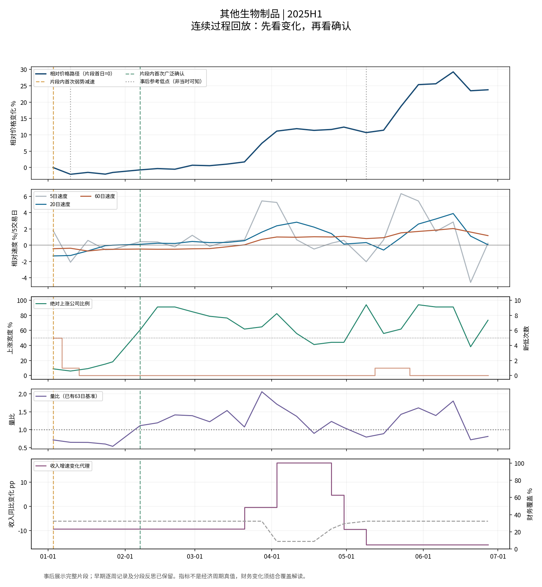

# EP33：变化如何开始——R06至R08过程研究

日期：2026-11-11。**本轮执行已完成，原始研究目标仍保持开放。** 当前建立了可复核的变化过程档案及提示/确认代价证据，尚未找到稳定的统一二阶起点指标，也没有证明经济景气的因果机制。只用现有数据，允许Historical-proxy和部分缺失；没有新增采集、训练收益排名模型、部署或提交Git。

## 1. 这次实际研究了什么

主问题是：原状态如何开始不同，当时最先能观察什么，后续证据怎样确认或推翻它。R06先抽连续片段逐段回放；R07将案例形成的过程假说扩展到全行业；R08用共同终点拆分等待确认的收益与代价。收益直到反思完成才写入附表，没有据此调整方法。

抽样覆盖2021H1–2025H2的10个半年入口，登记3230个行业×入口记录。实际抽中18片段、保存464条逐周哈希链记录；2022H1入口没有数据，保留空层，不事后替换。记录状态为{'OBSERVABLE': 378, 'PARTIAL': 55, 'MISSING': 31}。4个深读案例按4/8/12/18/26周推进，在下一段打开前写出解释与反证预期，其余14个同样保留全轨迹。最终完整性审计补齐部分半年第27周，旧记录不回写，补齐发生在面板结果已查看后，详见rounds/r06_tail_audit_note.md。历史已被研究过，因此是模拟遮蔽回放，不能声称独立盲测。

[全部过程档案](onset_casebook.md) · [R06分段反思](../rounds/r06_checkpoint_04.md) · [R07反思](../rounds/r07_reflection.md) · [R08反思](../rounds/r08_reflection.md)

## 2. 案例使我们改变了什么认识

- **非金属新材料（2021H1）：**1月减速后又走弱，2–3月才先后出现方向和扩散，随后反复。不能事后只选3月，抹掉早先失效的提示。
- **通信工程及服务（2023H1）：**短中期改善先出现，长尺度后转正；加速度回落时趋势仍可延续。4/5月绝对上涨宽度低，相对表现却仍改善，说明绝对扩散与行业相对变化不同。
- **预加工食品（2024H1）：**1月短暂反弹、3/4月广泛上涨又回到恶化，是需要保留的反例。“多数公司开始上涨”也会产生假确认。
- **其他生物制品（2025H1）：**1月下行延续减弱，2月扩散，3月长周期转正，几层证据相隔数周。4月财务聚合突然变好时覆盖却骤降，不能把它说成经营拐点确认。

图中相对价格是行业NAV/市场指数的比值变化，不是持有期收益差。虚线提示可由当时数据观察，灰色参考低点使用未来路径，只出现在事后评价。首次提示若发生于片段入口，只能称左侧未完整观察的片段内首次。

## 3. 提示通常在哪里出现

描述指标使用5/20/60日相对对数变化（折算每5交易日速度）；20日速度相比5日前改善称减速/加速迹象。`slowdown`是中期仍负但速度改善；`pressure_easing`再要求近10日创20日相对新低次数减少。这些是可推翻的观测代理，不是经济拐点定义。

全行业2021–2025年共产生3036次pressure_easing提示，其中2914次后8周完整、122次未知。已知者中30.54%在后8周至少6周20日速度为正；1865次短暂/尚未持续、159次未出现正速度。这不是永久失败率，也不是投资胜率。

**74.1%的pressure_easing提示出现时，5日相对速度已经为正。** 它往往已在短期反弹之后，而不是预测低点。以下以事后前后4周局部低点、前段下降且后8周多数时间处于低点之上作为操作性参考，匹配区间为参考点±4周：

| 提示               | 参考点数   | 匹配数   | 覆盖率%   | 相对参考滞后周数   |
|:-------------------|:-----------|:---------|:----------|:-------------------|
| broad_confirmation | 2996       | 2473     | 82.543    | 3.000              |
| long_confirmation  | 2996       | 1514     | 50.534    | 2.000              |
| old_top10          | 2996       | 429      | 14.319    | 3.000              |
| pressure_easing    | 2996       | 1941     | 64.786    | 1.000              |
| slowdown           | 2996       | 2333     | 77.870    | 0.000              |

简单短期反弹基线的覆盖率77.94%、中位滞后1周；pressure_easing为64.79%、1周。增加“新低减少”未提高早期性，但未匹配此参考的提示比例从单纯减速的41.18%降到33.77%。这是少提示与多遗漏之间的取舍，不是全面提升。参考是用未来价格定义的局部状态，不能将未匹配当作真实无效，也不能当独立经济周期数。

参考定义敏感性：对pressure_easing，局部窗口2周/4周且匹配±4周时覆盖分别约63.6%/64.8%；将匹配宽至±8周，覆盖约74.9%/75.4%，中位滞后改为0。说明“找到起点”的数字显著依赖允许多宽的区间，不能只展示最好口径。

## 4. 等待确认的代价：必须使用同一终点

R07曾观察到不同提示之后的8周持续比例不同，但它们起算时点不同，不能直接比较。R08固定同一批2914个pressure_easing事件，以提示后第5–8周至少3周中期相对速度为正作为共同发展状态；等待方案只接受最初4周内发生的确认。

| 方式              | 共同事件   | 接受提示   | 保留持续事件   | 遗漏持续事件   | 持续事件保留率%   | 接受后未持续比例%   | 等待中位周数   |
|:------------------|:-----------|:-----------|:---------------|:---------------|:------------------|:--------------------|:---------------|
| 先提示调查        | 2914       | 2914       | 1484           | 0              | 100.000           | 49.073              | 0.000          |
| 4周内等广泛确认   | 2914       | 1900       | 1024           | 460            | 69.003            | 46.105              | 2.000          |
| 4周内等长周期确认 | 2914       | 1062       | 558            | 926            | 37.601            | 47.458              | 2.000          |
| 4周内等旧10名名单 | 2914       | 323        | 188            | 1296           | 12.668            | 41.796              | 3.000          |

**等广泛确认，未持续比例仅减少约2.97个百分点，却漏掉31.0%的最终持续事件，并多等约2周。** 等长周期确认保留37.6%；旧10名名单仅保留12.7%。这解释了旧收益筛选为什么可能不适合作为“开始值得调查”的门槛。

这里“未持续”只指共同第5–8周的操作性状态；分母包括所有可评价早提示，没有把未确认者删去。比较是历史观察性分组，不是因果或独立预测结论。2021/2022年广泛确认的未持续比例反而略高，2025年改善较明显，不能声称每年稳定获益。移除原18片段后的保留率约69.1%，结果并非仅来自深读案例，但仍是已见历史上的扩展。

从全部3036次提示看，8周内观察到广泛确认2664次、长周期确认1574次、旧名单567次；确认者的中位延迟分别3、3、4个市场周。没确认或缺后续数据的分母同时保留。确认前相对价格已发生变化，详表在`outputs/r07/pressure_confirmation_delays.csv`，不能把该期间变化叫作可兑现利润。

## 5. 改善加速与二阶转负是另一类过程

对“前4周正斜率、后4周斜率更高且后8周持续向上”的事后加速参考：

| method                   | references   | matched   | recall   | median_delay   |
|:-------------------------|:-------------|:----------|:---------|:---------------|
| broad_confirmation       | 2308         | 1939      | 84.012   | 1.000          |
| improvement_acceleration | 2308         | 2171      | 94.064   | 0.000          |
| old_top10                | 2308         | 601       | 26.040   | 2.000          |
| positive_but_slowing     | 2308         | 1858      | 80.503   | 2.000          |

已有正趋势的加速提示常在该参考附近，旧排名名单偏晚且覆盖较低；这不是启动前预测。尤其是正20日速度但速度变化为负的4076个已知事件中，31.67%后8周仍有至少6周正速度。因此二阶转负不能直接命名为趋势结束；速度水平、速度变化和整个过程所处位置必须分开。

## 6. 证据为何会不同步

- 27.20%的正相对速度行业周，绝对上涨宽度仍低于一半。不能要求绝对宽度与相对强弱同步。
- 有同周市场背景可比较的广泛确认中，50.96%处于至少70%行业同时宽度上升的周，可能包含市场共振。
- 已有财务代理全覆盖期（2021年至2026-10-16）有1817次收入加速度由非正转正，其中341次同时财务覆盖变动至少10个百分点。不能据此断言由缺失造成，但必须阻止未经核实的基本面确认叙事。
- 财务日期是公告/更新依赖后的可用日期，报告期与可用时间不同；缺失和成员改变使行业聚合进一步不同步。

## 7. 当前答案与下一步问题

本轮更支持把研究介入组织成一段**可修正的过程记录**：原有状态 → 首次可疑偏离 → 假设与竞争解释 → 后续证据 → 确认/撤回/继续未知。不能用一个“全部条件满足”的时点代替起点，也不能因为提示后来失败就将其从历史叙事中删除。

我们已经得到关于时机与取舍的证据，但**还没有找到稳定的统一二阶起点指标，更没有解释真实供需/盈利变化如何导致这些价格过程**。这两点保留为未解决问题，不将本轮完成再次等同于原目标完全完成。

后续值得检验的具体问题：
1. 同业相对市场的扩散能否区别行业新变化与全市场反弹，而不显著拖延提示？
2. 速度改善来自新的价格行为，还是旧冲击移出滚动窗口？如何在当时区分？
3. 当基本面覆盖不足时，哪些证据足以提出研究假设，哪些只能保持未知？

这些问题应分别经历假设—实验—反思循环，不能通过搜索未来收益最优窗口替代。

## 8. 附属配置价值与复核

收益只在本轮过程反思写完后，用已有126交易日标签生成一次[描述附表](../outputs/r08/secondary_payoff_appendix.csv)，未用于选择案例、修改阈值或排序方法。它不是主结论，也没有消除重叠和非随机缺失。

复核包括抽样身份、464条逐周记录的前缀哈希链、所有checkpoint前缀不被回写、未来数据扰动不改变旧特征/提示身份、路径缺口不能当失败、参考点必须有足够未来、共同终点表独立重算。结果见`outputs/onset_validation.json`。具体股票/行业历史版本仍为代理，已有历史被反复观察，参考点和窗口均是操作性定义，数千行业周不是数千独立机会。

原R00–R05收益实验完整保留。原目标未被改写为更易完成的收益任务；下一轮方案需继续围绕上述未解问题，而不是恢复收益筛选优化。
