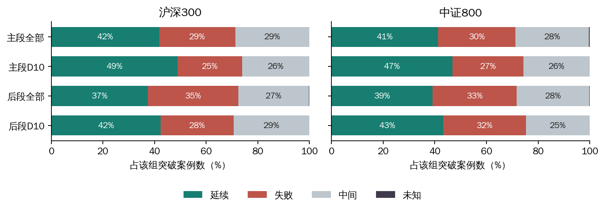

# 突破案例册

哪一种突破能让次日开盘买入的人赚到钱？这里把“突破后还站在前高之上”和“次日开盘买入后的十日收益”分别记录。一只股票在收盘时发出信号，两项结果都要到后来才能看到。

沪深300有2,076个突破股票日，其中839个延续、648个失败；中证800有5,229个，其中2,122个延续、1,610个失败。案例包含相似突破在后来走向两端的记录；能否提前区分它们，需要在后续冻结训练和完整账户中检验。

## 入册与标签

逐个历史信号日，在当期合格成分中选出信号日收盘价严格高于此前20个交易日最高价的股票。前高用前复权最高价，窗口截至前一交易日。突破幅度等于信号收盘价除以前高再减一。同一证券在不同日期可以多次出现，同日同时属于两池的证券分别记录其池内分位和D10席位。

信号后第1个交易日为入场日，随后第10个持有日收盘后，在第11个交易日开盘计退出。十日站稳天数是这10个持有日的收盘价大于或等于原前高的天数。十日收益按复权开盘报价计算。6至10天站稳且收益为正，标为**延续**；0至4天站稳且收益为负，标为**失败**。5天站稳、收益为零、形态与收益方向矛盾等情况记为**中间**。开盘收益缺失或十日收盘路径不全记为**未知**。这是本册为区分清晰两端设定的操作定义，尚待后续时期检验。

次日开盘跳空属于事后观察。入场买入和退出卖出的门控另外保存，遇到封板或停牌时仍保留报价案例。实付费、等待成交和组合现金需要单独重放账户。

## 完整样本

| 池和区间 | 样本 | 股票日 | 信号日 | 不同股票 | 延续 | 失败 | 中间 | 未知 |
|---|---|---:|---:|---:|---:|---:|---:|---:|
| 沪深300·主段 | 全部 | 1413 | 96 | 364 | 591 | 416 | 404 | 2 |
| 沪深300·主段 | D10 | 176 | 51 | 80 | 86 | 44 | 46 | 0 |
| 沪深300·后段 | 全部 | 663 | 39 | 280 | 248 | 232 | 182 | 1 |
| 沪深300·后段 | D10 | 92 | 30 | 68 | 39 | 26 | 27 | 0 |
| 中证800·主段 | 全部 | 3468 | 100 | 953 | 1432 | 1037 | 988 | 11 |
| 中证800·主段 | D10 | 350 | 72 | 188 | 164 | 96 | 90 | 0 |
| 中证800·后段 | 全部 | 1761 | 39 | 744 | 690 | 573 | 495 | 3 |
| 中证800·后段 | D10 | 190 | 33 | 144 | 82 | 61 | 47 | 0 |

主段为100个原时钟窗口，后段为39个。表中信号日只统计该组至少有一个突破的日期，所有百分比按股票日计算。D10是信号日原评分选入的股票。两池重叠、同一证券重复出现、同日个股共同受市场影响，都需要在后续验证中保留。

## 同日、相近评分与相近突破幅度的对照

在每个池、信号日、D10身份内，对延续与失败案例作一对一匹配。原模型池内分位相差至多10个百分点，突破幅度相差至多2个百分点。先最大化可配对数量，再最小化两项差值分别除以上限后的总和。并列时按证券代码排序后进行匹配。该步骤使用到期后的标签，只用于对读案例。配对不控制行业，判读时保留行业名称。

| 股票池 | 区间 | 全部配对 | D10配对 |
|---|---|---:|---:|
| 沪深300 | 主段 | 177 | 19 |
| 沪深300 | 后段 | 81 | 13 |
| 中证800 | 主段 | 558 | 43 |
| 中证800 | 后段 | 297 | 34 |

每个区间优先展示真实D10决策中差距最小的一对，跨池展示时优先取未展示过的证券对。读者可用相同规则从完整配对表重建本页。以下“信号收盘／前高”均为前复权档案报价。

### 沪深300 · 主段 · 2023-12-27

两只股票均进入D10。原分位相差0.68个百分点，突破幅度相差0.07个百分点。先读下表中的信号日信息。

| 股票 | 行业 | 信号收盘／前高 | 突破幅度 | 原分位 | 近5日收益 | 量比（20日） |
|---|---|---:|---:|---:|---:|---:|
| 双汇发展 SZ000895 | 食品饮料 | 23.088／23.000 | +0.38% | 98.3% | +4.75% | 1.16 |
| 华能水电 SH600025 | 公用事业 | 8.453／8.415 | +0.45% | 99.0% | +3.82% | 0.97 |

取2023-12-28与2024-01-12两个开盘报价计算收益。

| 股票 | 次日开盘跳空 | 站稳天数／10 | 十日毛收益 | 较本池等权（百分点） | 入场买／退出卖 | 结果 |
|---|---:|---:|---:|---:|---|---|
| 双汇发展 SZ000895 | +0.00% | 10 | +0.45% | +1.67 | 可／可 | 延续 |
| 华能水电 SH600025 | +0.33% | 0 | -6.44% | -5.22 | 可／可 | 失败 |

[两组配对的实际价格路径](results/example_paths.png)

### 沪深300 · 后段 · 2025-03-14

两只股票均进入D10。原分位相差0.34个百分点，突破幅度相差0.22个百分点。先读下表中的信号日信息。

| 股票 | 行业 | 信号收盘／前高 | 突破幅度 | 原分位 | 近5日收益 | 量比（20日） |
|---|---|---:|---:|---:|---:|---:|
| 紫金矿业 SH601899 | 有色金属 | 16.640／16.506 | +0.81% | 95.6% | +6.39% | 1.71 |
| 顺丰控股 SZ002352 | 交通运输 | 42.042／41.613 | +1.03% | 95.2% | +4.65% | 1.34 |

取2025-03-17与2025-03-31两个开盘报价计算收益。

| 股票 | 次日开盘跳空 | 站稳天数／10 | 十日毛收益 | 较本池等权（百分点） | 入场买／退出卖 | 结果 |
|---|---:|---:|---:|---:|---|---|
| 紫金矿业 SH601899 | +0.06% | 9 | +3.32% | +6.19 | 可／可 | 延续 |
| 顺丰控股 SZ002352 | +0.68% | 1 | -4.89% | -2.02 | 可／可 | 失败 |

### 中证800 · 主段 · 2024-07-29

两只股票均进入D10。原分位相差0.38个百分点，突破幅度相差0.00个百分点。先读下表中的信号日信息。

| 股票 | 行业 | 信号收盘／前高 | 突破幅度 | 原分位 | 近5日收益 | 量比（20日） |
|---|---|---:|---:|---:|---:|---:|
| 隧道股份 SH600820 | 建筑装饰 | 6.099／6.072 | +0.44% | 92.8% | +4.55% | 1.20 |
| 上海建工 SH600170 | 建筑装饰 | 2.220／2.210 | +0.43% | 92.4% | +5.48% | 1.44 |

取2024-07-30与2024-08-13两个开盘报价计算收益。

| 股票 | 次日开盘跳空 | 站稳天数／10 | 十日毛收益 | 较本池等权（百分点） | 入场买／退出卖 | 结果 |
|---|---:|---:|---:|---:|---|---|
| 隧道股份 SH600820 | -0.14% | 10 | +1.45% | +1.32 | 可／可 | 延续 |
| 上海建工 SH600170 | -0.43% | 4 | -4.35% | -4.48 | 可／可 | 失败 |

### 中证800 · 后段 · 2025-10-27

两只股票均进入D10。原分位相差0.38个百分点，突破幅度相差0.00个百分点。先读下表中的信号日信息。

| 股票 | 行业 | 信号收盘／前高 | 突破幅度 | 原分位 | 近5日收益 | 量比（20日） |
|---|---|---:|---:|---:|---:|---:|
| 工商银行 SH601398 | 银行 | 7.460／7.442 | +0.25% | 98.6% | +3.94% | 0.99 |
| 中交设计 SH600720 | 建筑装饰 | 7.634／7.614 | +0.26% | 99.0% | +3.15% | 1.75 |

取2025-10-28与2025-11-11两个开盘报价计算收益。

| 股票 | 次日开盘跳空 | 站稳天数／10 | 十日毛收益 | 较本池等权（百分点） | 入场买／退出卖 | 结果 |
|---|---:|---:|---:|---:|---|---|
| 工商银行 SH601398 | -0.13% | 7 | +2.53% | +1.01 | 可／可 | 延续 |
| 中交设计 SH600720 | +0.00% | 1 | -1.91% | -3.43 | 可／可 | 失败 |

## 两端之外的案例

同一规则也会遇到以下情形。每类取档案中最早的信号日，再按池和代码选首例。空缺用“未知”表示。

| 情形 | 股票池 | 信号日 | 股票 | 突破幅度 | 站稳天数 | 十日毛收益 |
|---|---|---|---|---:|---:|---:|
| 站稳但开盘买入后亏损 | 沪深300 | 2021-01-08 | 中国石化 SH600028 | +1.45% | 8 | -3.10% |
| 站稳不足五天但开盘买入后盈利 | 沪深300 | 2021-01-08 | 甘李药业 SH603087 | +4.62% | 4 | +1.56% |
| 结果未知 | 沪深300 | 2021-07-23 | 红塔证券 SH601236 | +0.21% | 未知 | -3.65% |

信号日信息不足以判断是否突破的股票日为0个（两池相加）。入册后十日路径不全的记录为17个，进出开盘端点缺失为10个，两种缺口可能重合。

[完整突破案例 CSV](results/breakout_cases.csv.gz) · [全部一对一配对 CSV](results/breakout_pairs.csv.gz) · [分组统计](results/breakout_summary.csv) · [生成程序](breakout.py)
