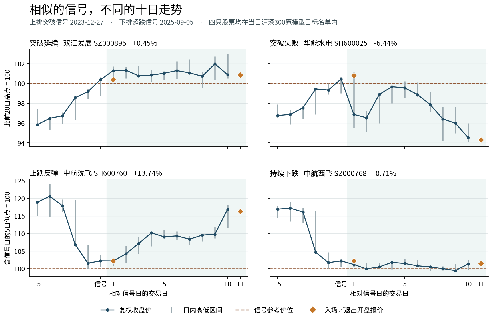

# EP39　相同突破与超跌信号的真实案例

2026-11-24。首轮已完成23季、299次拟合，并在沪深300和中证800按相同系数回放。两种精选模型的全池账户均落后于全量训练，也落后于同日、同形态、等量随机训练的平均值。沪深300后段的突破股内部排序一度改善，迁移到中证800时方向反转。[训练与测试报告](TRAINING_REPORT.md) · [触发股内排序](training/LOCAL_TRIGGER_RESULTS.md) · [各段账户与回撤](training/ACCOUNT_DETAILS.md)

两本案例册回答两个选股问题。同样突破前高，哪些股票在次日开盘买入后还能继续上涨？同样已经超跌，哪些股票会继续下探，哪些会反弹？各册先列出当时可见的信息，再逐例揭示未来十个交易日的路径和收益。[实验构思](EXPERIMENT_DESIGN.md)

| 案例册 | 沪深300触发股票日 | 其中原D10 | 同日成败配对 | 中证800触发股票日 | 其中迁移模型D10 | 同日成败配对 |
|---|---:|---:|---:|---:|---:|---:|
| [突破后能否延续](BREAKOUT_CASEBOOK.md) | 2,076 | 268 | 258 | 5,229 | 540 | 855 |
| [超跌后会否续跌](OVERSOLD_CASEBOOK.md) | 3,987 | 413 | 427 | 10,667 | 1,268 | 1,205 |

**先看一对突破。** 2023-12-27，双汇发展和华能水电分别高于此前20日高点0.38%和0.45%，都在沪深300模型目标名单的前10%。随后的10个持有日，双汇发展每天收盘都站在原前高之上，但次日开盘买入后到期毛收益仅为+0.45%。华能水电没有一天收盘站稳，开盘到开盘收益为−6.44%。同样的突破幅度，形态延续天数和实际收益可以很不一样。

**再看一对超跌。** 2025-09-05，同属国防军工的中航沈飞和中航西飞，过去5日分别下跌13.98%和12.57%，也都在原沪深300模型的目标名单内。随后中航沈飞守住近5日低点，十日毛收益+13.74%；中航西飞盘中跌破原低点，十日毛收益−0.71%。在沪深300全部413个超跌目标席位中，206个持有到期仍盈利，其中134个盘中曾破低。册中给出了逐席替补，便于核对回避续跌所付出的机会成本。



## 观察范围和读法

- 两池均沿用EP38的139个H10信号日，首个信号为2021-01-08，最后一个完整窗口退出于2026-10-12。主段100期，后段39期。沪深300共40,756个合格股票日，中证800共108,303个。去掉两池重复后有108,359个不同股票日。
- 沪深300使用原78项模型的封存评分，中证800使用相同300系数的迁移评分。D10是信号收盘时池内前10%的目标名单。两池重叠的同一只股票，形态可以相同，收益分位与入选状态可以不同。成分、价格和行业均为回溯档案。证券代码用于关联，展示简称沿用行业档案，不用于训练。
- 案例划分是这次读册用的初版定义。突破是否站稳按持有期收盘观察，超跌是否再破低按持有期盘中最低观察。两者都从下一开盘至十个交易日后的开盘计算收益。形态结果、收益端点与交易资格分别记录；报价未知不记零。配对利用已到期结局找到反例，不能把配对双方的收益差当作可预测收益。
- 现成的[完整面板](results/panel.parquet)兼有信号列和事后列。用于研究时，先按下表分列。展示用的复权价格来自同一份历史档案，只用比率比较各自前高或前低，不能当作当日真实委托报价。

| 可用时点 | 关键字段 | 含义 |
|---|---|---|
| 信号收盘 | score、score_pct、selected | 原模型分数、所在池的分位、D10目标身份 |
| 信号收盘 | close、prior_high20、breakout_pct、breakout、prior_low5、ret5、ret5_pct、oversold | 收盘及历史价格参照，过去5日收益和当日截面分位，两个触发标记 |
| 信号收盘 | vol20、volume_rel20、industry、in_legacy300 | 20日日收益总体标准差、成交量相对20日均量、当期申万一级行业、原300成分档案归属 |
| 次日开盘 | entry_open、entry_gap、entry_buy | 入场开盘报价、相对信号收盘跳空、该开盘是否满足买入门控 |
| 十日窗口到期 | above_high_days、hold_low10、mae10、ret10、relative_ret10、ret10_rank_pct、exit_sell | 站稳天数、持有期最低价、最低价相对入场价的变化、毛收益及相对池内等权的差和秩、退出开盘卖出资格 |

两册都有完整CSV清单、配对及展示规则，可从案例追溯到股票和日期。[突破全案例](results/breakout_cases.csv.gz) · [超跌全案例](results/oversold_cases.csv.gz) · [超跌替补席位](results/oversold_replacements.csv.gz) · [数据来源与哈希](results/panel_receipt.json) · [交付核验](results/verification.json)

## 本地复算

在本目录依次运行以下脚本。使用EP36的成分及行业档案、EP38三线结果和中证800行情缓存。默认缓存为用户目录下的 `.cache/a_share/ep38_three_track/market`，可通过 `EP39_MARKET` 指向相同版本的目录。

```bash
python common.py
python breakout.py
python oversold.py
python example_paths.py
python verify.py
```

使用同版本的EP37原78项特征、周频训练档案和EP38执行器。先重建训练面板、拟合并回放，再核验账户、触发和换股结果。将BLAS设为单线程可减少小矩阵求解的线程开销。

```bash
export OPENBLAS_NUM_THREADS=1 OMP_NUM_THREADS=1 MKL_NUM_THREADS=1
python training/weekly.py
python training/fit.py
python training/accounts_replay.py
python training/decisions.py
python training/compare.py
python training/local_trigger.py
python training/context_review.py
python training/report_tables.py
python training/validate.py
```

[训练成员](results/training_fit/training_membership.parquet) · [全模型逐股评分](results/training_fit/scores.parquet) · [完整目标持仓](results/training_accounts/targets.parquet) · [实付净订单](results/training_accounts/orders.parquet) · [训练与账户核验](results/training_review/verification.json)
