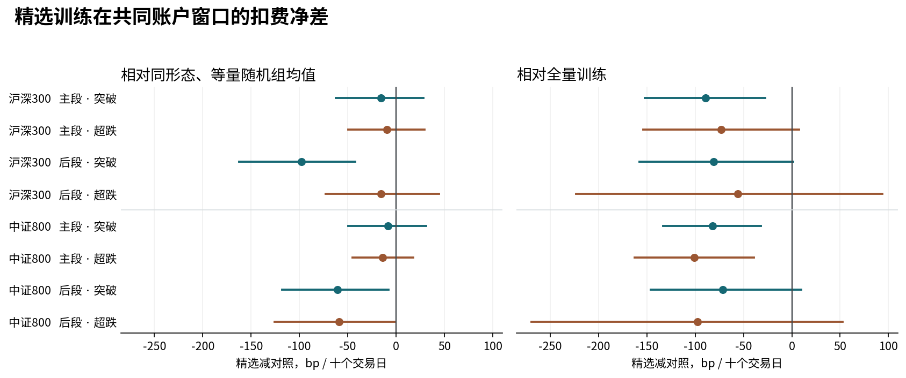

# EP39　精选真实案例训练后，能否选对突破和超跌股？

2026-11-24。用沪深300历史上的相似突破与超跌案例训练两个模型，按季冻结系数，再分别应用到沪深300和中证800。**两种精选模型用于全池选前10%时，在两个池、两个历史区间均落后于等量随机训练，也均落后于原全量模型。** 把比较缩小到当天触发形态的股票，超跌精选确实更常分对一对极端正反例，但在自然发生的全部超跌股中，这个优势未转化为稳定的收益排序。

## 全池选股，扣费后差多少

每个数是同一股票池、同一交易窗口内，**精选账户减对照账户**的净收益差，再对十交易日窗口等权平均。1 bp 等于0.01个百分点。随机对照包含五个独立训练和执行的账户，按期取五个账户收益的均值。另一组对照是原78特征全量训练模型。买入成本10 bp、卖出成本20 bp。

| 股票池 | 区间 | 可比期数 | 突破相对随机 bp | 突破相对全量 bp | 超跌相对随机 bp | 超跌相对全量 bp |
|---|---|---:|---:|---:|---:|---:|
| 沪深300 | 主段 | 100 | −15.41 | −89.41 | −9.59 | −73.16 |
| 沪深300 | 后段 | 39 | −98.07 | −81.17 | −15.90 | −56.03 |
| 中证800 | 主段 | 98 | −8.17 | −81.99 | −14.00 | −101.18 |
| 中证800 | 后段 | 39 | −60.61 | −71.53 | −58.78 | −97.82 |

横线为按时间分块得到的描述性95%区间。主段相对随机的四个区间都跨零。后段相对随机，突破在沪深300为 **−98.07 bp［−162.32，−42.13］**，中证800为 **−60.61 bp［−117.68，−7.65］**；超跌在沪深300为 **−15.90 bp［−72.83，+44.42］**，中证800为 **−58.78 bp［−125.65，−1.54］**。两种费率敏感性重放（零费和双倍费）中，表内16个平均净差也均为负。各池与各对照共享日期、成分和训练样本，这些区间用于描述历史读数的波动。[逐段、逐费率、逐种子及区间](results/training_review/paired_summary.csv)

绝对收益也有同样的落差。沪深300后段，全量、突破精选、超跌精选的净年化依次为 **+7.41%、−12.6%、−8.5%**，对应最大回撤 **−14.9%、−23.9%、−28.6%**。中证800后段三者的净年化分别约 **+16.0%、−3.2%、−11.3%**。中证800主段按35、22、41期分别核算年化与回撤。[独立账段、换手、费用及月度分布](training/ACCOUNT_DETAILS.md)

## 同样突破，精选能选出延续者吗？

在沪深300后段，原模型前10%名单出现92个突破席位，突破精选只留下4个原席位，另增17个。被挤出的88个原席位中，事后有36次突破延续、25次失败。把所有发生变化的股票一起看，1,095对换股中有1,090对在两端都能成交，等额换入股票相对换出股票平均少赚 **79.15 bp**。后段精选相对随机的毛差为−98.49 bp，实付费还少0.42 bp，差距主要出在换入的股票。[席位明细](results/training_review/changed_seats.parquet) · [形态及去留统计](results/training_review/trigger_decisions.csv)

案例册原有一对可回看当日的名次。2023-12-27，沪深300共有295只合格股票、29个目标席位。原模型把华能水电列第4、双汇发展列第6；突破精选把双汇发展列第207、华能水电列第263。后来双汇发展十日毛收益+0.45%，华能水电−6.44%。精选在这两只之间分对了高低，却把两只都排出了可买名单。[原案例](BREAKOUT_CASEBOOK.md) · [当日完整评分](results/training_fit/scores.parquet)

再限定为**只在当天突破股中排名**，将评分最高和最低各20%的十日毛收益相减。沪深300后段22个可比日期，精选的头尾差为 **+137.6 bp**，随机均值为+66.2 bp，全量为−14.2 bp。迁移到中证800后段34个可比日期，精选的头尾差变为 **−157.3 bp**，随机为+55.2 bp。主段两个池的精选均落后两类对照。同样突破中可能有阶段性的区分能力，现有结果不足以支持跨池复用。[触发股内排序、覆盖和区间](training/LOCAL_TRIGGER_RESULTS.md)

## 同样超跌，精选能避开续跌且保住反弹吗？

如果只给模型一对当日形态接近、原D10身份相同、已知结局相反的股票，让它给“守低反弹”一方更高的分数，超跌精选在沪深300主段／后段分对 **64.6%／59.8%**（305／122对），全量为53.8%／55.7%。中证800精选分对 **62.4%／60.2%**（868／337对），全量为49.0%／48.4%。这些对均按事后结局筛出，许多普通反弹、中间结果和先破低后反弹都没有进入这项正确率，配对本身还约束了原模型分位。[同日配对逐日结果](results/training_review/matched_case_accuracy.parquet) · [超跌案例册](OVERSOLD_CASEBOOK.md)

把模型放回实际选择，沪深300后段原D10中有105个超跌席位，精选最终只选2个超跌席位，其中1个与原模型重合。被剔除的104个中，有 **52个继续破低且期末下跌，也有50个期末盈利**，其中36个盘中破低后仍收涨。中航沈飞与中航西飞就是册中一对。2025-09-05，原模型将两只列第18和第11，两只均入选；超跌精选将两只列第243和第212，两只均被排除。随后十日两只分别上涨13.74%、下跌0.71%。回避一次下跌的同时，账户放弃了一次幅度更大的反弹。[全部换入换出股票](results/training_review/changed_seats.parquet) · [当日完整目标](results/training_accounts/targets.parquet)

在自然发生的超跌股中，只在当天至少10只触发时比较高低评分两端。沪深300后段38个可比日期，精选的头尾差 **−160.6 bp**，随机−17.3 bp，全量+6.1 bp。中证800后段37日，精选 **−15.8 bp**，随机−18.7 bp，全量+28.8 bp。两任务、两池、两段合计八项触发内精选相对随机的差值区间全部跨零。这里的头尾差是复权报价毛收益，用于评价排序。[触发内各组毛收益](training/LOCAL_TRIGGER_RESULTS.md)

## 差距来自哪些决定

训练数量和适用范围一起改变了。最后一折全量组有136,165个股票日，突破精选有1,238个，超跌精选有2,938个。随机组与对应精选组控制同日、同形态、同原D10身份和样本数，仍然可以比较“精挑极端案例”带来的增量。只有全量组保留了大量普通状态。用极端案例拟合后再给所有股票打分，模型的大部分选股决定发生在训练形态之外。这与观察到的持仓变化一致，现有对照无法将样本量、形态限制及折内特征尺度的作用分别量化。[训练覆盖与筛选率](training/ACCOUNT_DETAILS.md)

- **新名单与原名单相差很大。** 沪深300后段，突破精选与全量的D10平均只重合3.0%，超跌精选重合8.8%。突破股在突破精选目标席位中占1.9%，超跌股在超跌精选中占0.2%，原模型对应占比为8.1%、9.3%。此时超跌精选的目标席位反倒有36.8%是突破股。中证800后段也有相同方向的变化。[每日排序和重合率](results/training_fit/ranking_by_date.parquet) · [完整目标席位](results/training_accounts/targets.parquet)
- **800新增持仓承担了一部分损失。** 后段，原300以外持仓的净贡献相对随机均值，突破精选少20.80 bp，约占整组合60.61 bp落后的三分之一；超跌精选少40.51 bp，约占58.78 bp落后的七成。分母均为整个账户期初净值。这个分解能定位损益，不能单独识别某种规模或行业的因果作用。[逐窗口持仓贡献](results/training_accounts/windows.parquet)
- **落后也出现在上涨市场。** 以信号收盘时沪深300过去20个交易日的涨跌分组，沪深300后段突破在上涨的24期平均落后随机56.48 bp，在持平或下跌的15期平均落后164.62 bp。两个池的突破精选均提高非银金融目标权重。行业数据用于说明持仓偏好。[市场状态和行业核对](training/CONTEXT_RESULTS.md)

## 训练、账户与证据边界

1. **怎样训练。** 重建2017-04-07至2026-06-26的472个沪深300周频截面。23个部署季度从2021Q1至2026Q3。每季拟合一个全量模型、两个精选模型和十个等量随机模型，共299次。五个种子为39、139、239、339、439。每组均使用原78项输入、Ridge正则强度10和完整母池同日的H10收益秩；各组在本折自己的训练行上拟合预处理。最后一折突破采用619对，超跌1,469对。历史案例训练按股票日计数，同一家公司可以在不同日期重复入训。[执行口径](training/PROTOCOL.md) · [季度系数](results/training_fit/models.json) · [每折样本](results/training_fit/folds.csv)
2. **模型当时能看到什么。** 每季只使用季度开始前已到期的标签。历史配对使用更早季度模型给出的当日分数，最初3,312个无折外分数的预热股票日只可进入全量训练中有成熟标签的部分。事后结局用于历史训练样本选择和事后评价，验证日的池内排序只输入当时的特征。两池共1,937,767条折外评分，原全量预测与封存档案的最大绝对误差约为7.22×10⁻¹⁶，两池原目标名单逐日吻合。[周频重建](results/training_weekly/receipt.json) · [基线评分比对](results/training_fit/full_score_parity.csv)
3. **怎样交易。** 每个模型用同一套季度系数分别给当时的两个池打分，收盘取池内前10%，次日开盘执行，十交易日调仓。使用可交易报价、涨跌停、停牌、公司行动与现金记录。主段首次入场2021-01-11，结束于2025-03-03；后段从2025-03-03至2026-10-12独立记账。沪深300主段100期、中证800主段98期可比；后段各39期。中证800持仓在2022-06-30（SZ002670）及2023-06-16（SZ000540）遇估值缺口，对全组共同可估值的窗口分别建账。首次缺口出现在两个突破随机账户。两次中断都保留在审计清单内，净值及年化分别列示。[缺口及受影响账户](results/training_accounts/gaps.csv) · [全量账户与EP38每天比对](results/training_accounts/parity.json)
4. **怎样判断可靠性。** 主要差值在每个连续账段内按3个相邻H10循环分块、重抽10,000次。估值缺口两侧的窗口按期数汇总，重抽保持各段边界。139个信号日早已用于案例观察和设计，两池有大量成分重合，历史价格、成分和行业沿用项目回溯档案。本轮提供的是按时间隔离的历史检验。对尚未见过的新日期，当前没有本方案的到期预测记录。[配对明细](results/training_review/paired_windows.parquet) · [独立核验回执](results/training_review/verification.json)

历史结果支持保留全量模型作为基线。超跌案例的成对辨别率值得作为一个范围更窄的假设保留，例如只在原模型已选中的超跌股上检查续跌风险，并把替补收益和错过的反弹都计入同资金账户。这种用法需要独立检验，本轮的全池及触发内结果都不足以确认可兑现的优势。

