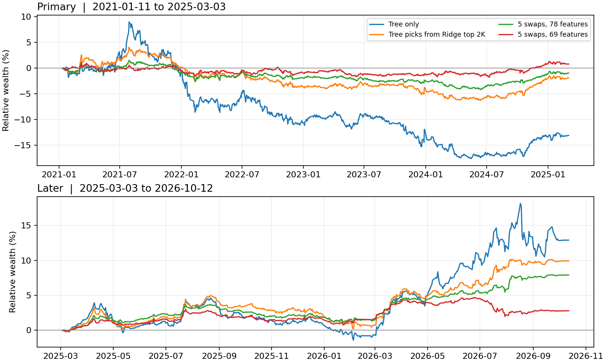

# EP40 综合实验报告｜赢家奖励、LightGBM 选股与有限换股

研究记录截至 2026-11-25，主要历史回测截至 2026-10-12。

**研究决定。** 沪深300保留收益秩 Ridge 为基线，把69项特征树有限换股保留为前瞻对照；中证800继续以各自训练口径的 Ridge 为基线。沪深300的十份错峰账户中，有限换股全周期费后收益为 **52.76%**，Ridge 为 **47.48%**，相差 **+5.27 个百分点**。这项增量在主段很小，在中证800也未复现。现有证据支持树对未来收益有排序能力，尚不足以认定它没有过拟合，或能稳定替代 Ridge。

| EP40 要回答的问题 | 历史证据给出的答案 |
|---|---|
| 训练时额外奖励买中赢家，能多赚钱吗？ | 线性模型在已有惩罚上加奖，两段每十日净差为 +0.19、−9.50 bp。买中更多赢家的同时也买中了更多大跌股票。 |
| 让 LightGBM 决定全部持仓有优势吗？ | 原版78项纯树在沪深300两段样本外 RankIC 均为正，后段净年化达25.00%。但原起点主段净年化仅0.38%，十份错峰全周期赚44.63%，落后 Ridge 2.85个百分点。 |
| 有没有两段都超过基线的办法？ | 让 Ridge 决定大部分仓位、69项树只替换约五席，沪深300错峰账户两段每100元多赚1.00、3.16元。两段去掉各自最佳三个月，优势都消失。 |
| 增量来自哪里，可以扩到800吗？ | 沪深300有限换股的增量主要来自换入股票的毛利。中证800直接迁移和重新训练均出现年度反转；两种缺价估值情景下，全周期都落后对应 Ridge。 |

## 一、怎样读这些数字

EP40 起于一个实际持仓问题。EP38 曾在已经选定的股票中调权，减轻了后来落入最差十分组的亏损，也减掉了部分赢家。EP40 允许奖惩改变入选名单，按实际成交和费用检验这次换股值不值。[原始问题与实验登记](GOAL.md)

- **股票与标签。** 原池为信号日历史沪深300成分中的合格股票。预测前十分之一是准备买的股票；真实 D1、D10 分别是同日合格股按随后十个交易日开盘至开盘收益划出的最差、最佳十分组。未来标签用于训练成熟样本和事后归因，选股时保留当时合格但后来缺标签的股票。
- **模型与执行。** 基线 R 是用78项特征拟合收益截面名次的 Ridge。每周取训练样本，按季度扩展训练23折，每折只用季度开始前已到期的标签。信号收盘形成，下一交易日开盘执行，净买10 bp、净卖20 bp，沿用停牌、无法成交、遗留仓位和公司行动处理。市场指数用全收益收盘端点。成分、行情及行业分类为本地回溯代理。
- **时间与资金。** 主段为2021-01-11至2025-03-03，后段为2025-03-03至2026-10-12。原起点分别有100、39个非重叠 H10 窗口。十起点检验将起始日偏移0至9个交易日；可实施的错峰账户把同一笔资本分十份，未启用资金持现，同股订单合并后收费。两段独立起账，沪深300全周期按期末净值相乘。
- **比较单位。** bp/H10 是每十日收益占期初本金的万分比；年化按252个交易日；年度及全周期采用复利。除明确写明指数外，“超额”均是策略减同池、同资金和同执行条件的 Ridge。差值从未舍入净值计算。主比较的95%区间按连续三个 H10 为块，循环重采样10,000次。[共同口径与历史推进条件](lightgbm/FOLLOWUP_EXPERIMENT_PLAN.md)

## 二、第一轮：奖励改变了谁能入选

第一轮只改变线性模型的训练目标。收益秩平方误差之外，对榜首的软入选席位施加奖惩，弱股定义为真实 D1–D5，赢家为真实 D10。附加项强度0.02、温度0.1，外层交易仍按分数取前 K 只等权。分档奖励逐步奖励 D8、D9、D10；幅度奖励考虑赢家超过同日中位数的幅度，两者按折内数据统一奖励尺度。

| 线性账户 | 主段净年化 | 后段净年化 | 树账户 | 主段净年化 | 后段净年化 |
|---|---:|---:|---|---:|---:|
| 原收益秩 Ridge | 5.56% | 7.41% | 普通收益秩树 | 0.38% | 25.00% |
| 只罚弱股 | 2.17% | 7.41% | 只罚弱股 | 2.76% | 9.26% |
| 只奖赢家 | −6.73% | 12.41% | 只奖赢家 | −3.68% | 23.39% |
| 奖惩并用 | 1.70% | 4.52% | 奖惩并用 | −12.80% | 11.64% |
| 双倍赢家奖励 | 0.05% | 7.35% | | | |
| 按名次分档奖励 | 5.53% | 9.59% | | | |
| 按超额幅度奖励 | 1.09% | 11.38% | | | |

**第一轮主比较是“奖惩并用减只罚”。** 主段真实 D10 多贡献58.05 bp/H10，但 D1–D5 多亏62.64 bp。合并其余持仓，毛差只剩+3.01 bp，再多付2.82 bp费用，净差为 **+0.19 bp**。后段 D10 多贡献65.92 bp，D1–D5 多亏82.43 bp，毛差−8.40 bp，再多付1.10 bp，净差为 **−9.50 bp**。两段配对区间均跨零。名次分档相对原 Ridge 的算术平均净差为+1.11、+9.23 bp/H10，但各段去掉最佳一个月后，剩余月份累计收益都落后。138次带奖惩的线性拟合中有135次用满迭代预算，结论限定于本次固定训练配方。[七组账户、左右尾和月份归因](REPORT.md) · [线性配对结果](results/paired.csv)

## 三、第二轮：换成树，能否得到更好的赢家和更少的输家

在同一股票池与139个窗口上，四组 LightGBM 均先用20棵收益秩树热启动，再用相同预算训练60棵。学习率0.04，最多15叶，每叶至少300行。树奖惩并用相对线性奖惩并用，主段每十日少赚60.98 bp，后段多赚26.41 bp；相对普通收益秩树，两段都落后，分别为54.52、43.28 bp/H10。特别是主段，在只罚树上增加赢家奖励，真实 D10 仅多贡献8.71 bp，真实 D1 多亏50.58 bp。后续研究因此转向普通收益秩树，检验它的排序和选股用途。[树模型四组对照](lightgbm/REPORT.md) · [树模型逐项差值](lightgbm/results/paired.csv)

### 关于过拟合，证据到哪里为止

RankIC 是每个日期预测名次与事后收益名次的 Spearman 相关。普通80棵树的主段样本外 RankIC 为 **0.0532 [0.0224, 0.0842]**，后段为 **0.0988 [0.0198, 0.1774]**；Ridge 分别为0.0692、0.0629。八组安慰剂只在训练日内打乱个股标签，保留原特征、训练预算和真实测试标签。真实树的两个区段均高于全部八组的 RankIC，但后段有一组安慰剂的组合净收益超过真实树。

树从20棵增到80棵，按折内训练日期汇总的训练 RankIC 从0.1392增至0.2129，139个外层日期的均值从0.0629增至0.0660。分段看，主段从0.0564降至0.0532，后段从0.0795升至0.0988；实际账户净差分别为−0.98、+20.55 bp/H10。训练内改善明显，样本外改善集中在后段。**可以确认历史样本外存在排序信号，无法排除过拟合或规则筛选带来的乐观偏差。** [学习曲线](lightgbm/followup/results/learning_oos.csv) · [安慰剂对照](lightgbm/followup/results/placebos.csv)

## 四、从替代 Ridge 到限制树的换股数量

下表左侧是原起点独立账户，右侧是十份错峰账户。中间两列给出树策略相对同口径 Ridge 的增量，便于识别“全周期领先，但主要靠后段”的情况。

| 沪深300选股规则 | 原起点主段净差 bp/H10 | 原起点后段净差 bp/H10 | 原起点全周期费后收益 | 错峰全周期费后收益 |
|---|---:|---:|---:|---:|
| Ridge 基线 | 0 | 0 | 38.47% | 47.48% |
| 78项纯树独立选全部 K 席 | −19.68 | +60.79 | 43.41% | 44.63% |
| Ridge 提名 2K，树选 K | −8.41 | +25.18 | 40.61% | 59.02% |
| Ridge 与树的百分位等权合分 | +1.86 | +31.13 | 59.52% | 59.06% |
| 78项树只决定约五个替换席位 | +5.54 | +28.98 | 63.97% | 57.56% |
| 69项树只决定约五个替换席位 | +4.48 | +11.24 | 51.83% | **52.76%** |

**登记的复选方案没有过线。** “Ridge 提名 2K、树选 K”是预定主比较。推进线要求原起点两段净差都为正、两段均值等权至少+5 bp/H10，且两段十起点中位数均为正。主段净差的95%区间为[−35.36,+16.35] bp/H10，后段为[−15.61,+64.34]。在保留共同仓位、只随机抽换入股票的200个对照账户中，复选方案的中位优势仅+1.29、+2.86 bp/H10。[复选与随机对照](lightgbm/followup/TABLES.md)

**有限换股改变了树能影响的资金。** 先由 Ridge 选前 K，只允许树从原前 K 中移出树评分最低的 floor(K/5) 只，再从 Ridge 第 K+1 至2K名中补入树评分最高的同样数量。78项版本在主、后段原起点均领先，但主段十份错峰每100元反而少赚1.29元。再把换股限定为同行业配对，主段仍少赚1.14元。删去九项市场动量、波动和回撤输入后，纯树在主段只有一个起点超过 Ridge；把同一棵69项树仅用于约五席，才得到两段错峰资金均为正的增量。Ridge 仍使用78项输入。[换股与删列的实验次序](lightgbm/followup/REPORT.md)

**选择69项候选的依据是两段一致性。** 合分和复选的错峰全周期收益较高，但各自主段终值低于 Ridge。69项有限换股每100元主段结束为130.80元，Ridge 为129.81元；后段分别为116.78元和113.62元。主段最大回撤分别为31.17%和30.23%，后段为14.67%和15.91%。主段十起点仅5/10领先，后段8/10领先，中位数分别为+0.35、+10.29 bp/H10。原起点双倍费用下仍有+3.84、+12.31 bp/H10；2019、2020较早历史的十起点中位数为+13.66、+12.10。主、后段分别去掉主动收益最好的三个月，剩余月份的错峰复利差为 **−2.02、−1.36 个百分点**。这项候选是在查看消融和换股结果后选定，较早历史也属于补充回放。[错峰账户与回撤](lightgbm/followup/results/funded.csv) · [早期复验](lightgbm/followup/results/earlier_scores.csv)

### 沪深300逐年费后收益与主动收益

超额单位为百分点。2021年从1月11日起，2026年至10月12日；2025年按3月3日的研究边界结账复投。年度表从每日资金净值重新计算。

| 年度 | Ridge | 78项纯树 | 纯树超额 | 69项有限换股 | 有限换股超额 |
|---|---:|---:|---:|---:|---:|
| 2021 | −0.17% | −0.78% | −0.61 | −0.54% | −0.37 |
| 2022 | −3.39% | −13.18% | −9.79 | −3.95% | −0.56 |
| 2023 | +2.31% | +0.80% | −1.51 | +2.11% | −0.19 |
| 2024 | +34.00% | +31.75% | −2.25 | +36.69% | +2.70 |
| 2025 | +13.74% | +15.05% | +1.31 | +15.34% | +1.61 |
| 2026 | −1.94% | +9.88% | +11.82 | −0.69% | +1.25 |
| 全周期 | +47.48% | +44.63% | −2.85 | +52.76% | +5.27 |

纯树连续四个年度落后 Ridge，2022年落后最多，2026年截至回测终点追回11.82个百分点。69项有限换股在2021–2023年分别小幅落后，2024年起领先，2024年超额最大。2026年候选和 Ridge 均亏损，该年超额来自少亏。沪深300全收益指数在同一全周期累计−9.12%，同期可选股等权的原起点账户累计−3.92%；指数增强与对 Ridge 的增量有不同的比较门槛。[基线与纯树日净值](lightgbm/followup/results/stagger.parquet) · [69项有限换股日净值](lightgbm/followup/results/market_challenge_stagger.parquet)

## 五、利润与超额从哪里来

**先看基线自身的利润。** 原起点每段各投100元，主段 Ridge 毛赚43.53元、付费19.57元、净赚23.96元，同池等权净亏14.05元。后段 Ridge 净赚11.70元，同池等权赚11.78元，指数涨15.30%。主段要超过 Ridge，须在已经获得较大选股收益的账户上进一步改善；后段绝对盈利同时受市场上涨影响。[按期初100元核算的逐股利润](lightgbm/followup/results/pnl_per_100.csv)

**纯树的阶段反转来自收益分布两端。** 主段纯树相对 Ridge 从真实 D10 多赚12.72 bp/H10，却因真实 D1 多亏25.21 bp/H10，再多付2.09 bp/H10费用。后段真实 D1、D2 分别少亏18.09、14.00 bp/H10，D10 多赚16.93 bp/H10。原 Ridge 前2K以外股票对纯树本身的净贡献，也从主段−9.99变为后段+45.14 bp/H10。冻结初始持股后，后段对 Ridge 的毛差在第1–5日为+15.67、第6–10日为+42.45、第11–20日为−10.48 bp，增量主要在第二周兑现。[真实收益分组](lightgbm/followup/results/bridge.csv) · [候选池之外的贡献](lightgbm/followup/results/ridge_tiers.csv) · [持有期分解](lightgbm/followup/results/decay.csv)

**行业配置能解释复选收益的一大部分。** 后段“Ridge 提名、树复选”领先25.18 bp/H10。沿用这套组合的行业席位、行业内用 Ridge 排序，就能领先22.97 bp/H10，同一行业预算内树再增加2.21 bp/H10。后段纯树的60.79 bp/H10增量中，复制行业预算取得24.58，同预算重选个股再增加36.21。进一步匹配行业和波动三分位，纯树仍领先复制账户29.74 bp/H10。对应复选对照因候选池受限，4,016个目标席位至少有2,723个必须重合；这限制了辨别风格来源的能力。[行业及风格对照](lightgbm/followup/TABLES.md)

**最终候选主要赚在换入端。** 在原起点的69项有限换股账户中，主段换入股、移出原持仓、共同持股权重差、遗留头寸分别贡献+6.17、−1.55、+0.12、−0.26 bp/H10；后段分别为+12.20、−1.80、+0.25、+0.60。被换出的原股票整体仍赚了钱。按实际错峰资金记账，每段100元本金的毛利、费用和净利能直接核平。

| 错峰账户，每段初始100元 | 主段毛利 | 主段费用 | 主段净利 | 后段毛利 | 后段费用 | 后段净利 |
|---|---:|---:|---:|---:|---:|---:|
| Ridge | 49.59 | 19.79 | 29.81 | 22.37 | 8.75 | 13.62 |
| 69项有限换股 | 51.02 | 20.22 | 30.80 | 25.51 | 8.73 | 16.78 |
| **增量** | **+1.43** | **+0.43** | **+1.00** | **+3.14** | **−0.02** | **+3.16** |

主段单股较大的正、负贡献差分别来自 SZ300751（+0.86元）及 SH688008（−0.75元）；后段为 SH601669（+0.47元）及 SH605117（−0.34元）。逐股账本解释了钱从哪些头寸产生。行业、波动和删列实验提供解释线索，历史市值尚未单独控制。[换入换出分解](lightgbm/followup/results/candidate_bridge.csv) · [错峰资金逐股盈亏](lightgbm/followup/results/funded_pnl_per_100.csv)

## 六、中证800迁移与重训

早期扩池只迁移冻结的普通树，后段纯树在全800和当日800内非300池分别领先同池 Ridge 41.36、42.92 bp/H10，但在主段三个共同可估值区间均落后。早期实验还包含全池等权账户，其持股在2022年就触发过估值中断。针对最终69项有限换股，随后另行执行每天评分、十份资金错峰的迁移与重训，两组均单独对比本组 Ridge。[早期扩池账户](lightgbm/followup/results/wide/summary.csv) · [最终验证登记](lightgbm/followup/csi800_69/PROTOCOL.md)

**直接迁移**使用原300季度 Ridge，把69项树按原300数据和配方还原，并核对40,700个重叠股票日的封存分数。**800重训**在历史800成分内重算同日收益秩，逐季用已成熟标签重训 Ridge 和树。两臂使用相同特征定义、资格、持有期、成交规则和费用。下表固定原300的席位数，K 为26–30；1,381个评分日期中1,372日换五只、9日换六只。

| 年度 | 迁移 Ridge | 迁移有限换股 | 超额（百分点） | 重训 Ridge | 重训有限换股 | 超额（百分点） |
|---|---:|---:|---:|---:|---:|---:|
| 2021 | +5.81% | +5.39% | −0.43 | +10.06% | +11.58% | +1.52 |
| 2022 | −9.79% | −10.90% | −1.11 | −10.78% | −12.63% | −1.86 |
| 2023 | 缺口 | 缺口 | — | 缺口 | 缺口 | — |
| 2024 | +31.93% | +31.01% | −0.92 | +36.83% | +38.36% | +1.53 |
| 2025 | +16.14% | +17.99% | +1.86 | +10.28% | +8.87% | −1.41 |
| 2026 | +3.08% | +2.31% | −0.78 | +5.71% | +5.25% | −0.45 |

**严格账本的2023年缺口。** 2023-06-16开盘，迁移、重训及各自 Ridge 均持有 SZ000540 中天金融，已超过账本允许的停牌估值期限。保留6月15日前的实际路径，6月19日共同从现金重启。固定原席位，迁移策略减 Ridge 在“起点至缺口前／重启至2025-03-03／后段”三个区间分别为−1.38、−0.05、+0.73个百分点；重训分别为−1.79、+1.31、−1.88。严格账本缺少2023全年及跨缺口的全周期收益。2024年的严格收益沿用重启后的资金路径。[逐账户缺口](lightgbm/followup/csi800_69/results/gaps.csv) · [共同可估值区间](lightgbm/followup/csi800_69/results/segments.csv)

为检验结论对停牌持仓估值的依赖，保留原买卖限制，分别暂按零和沿用此前收盘值。下表每格按“暂按零 / 沿用前值”列出**全周期策略减本组 Ridge 的收益率差（百分点）**。两列假设的结果不构成清算价界限或统计区间。

| 中证800席位口径 | 直接迁移 | 800重训 |
|---|---:|---:|
| 保留300席位，约换五只 | −0.41 / −0.63 | −3.27 / −4.09 |
| 按800前十分之一持74–79只，按原比例换14–15只 | −3.30 / −3.31 | −2.41 / −2.79 |
| 持74–79只，固定只换五只 | −0.27 / −0.27 | −1.20 / −1.49 |

在最接近沪深300的固定席位对照里，2023年两条情景的年度超额分别为迁移+1.38/+1.21、重训−0.50/−1.17个百分点。暂按零的全周期情景下，重训策略赚64.79%，同组 Ridge 赚68.07%；直接迁移策略赚54.98%，同组 Ridge 赚55.39%。**800重训改善了整个选股体系的绝对收益，但提高 Ridge 本身的幅度更大。** 换股环节的增量在三种席位设置、两种估值假设下全部为负。[中证800完整验证报告](lightgbm/followup/csi800_69/REPORT.md) · [逐年与情景全表](lightgbm/followup/csi800_69/results/annual.csv)

## 七、证据边界、复核与后续判据

1. **已能复核的结果。** 首轮七组账户共973个标准费窗口，逐股毛贡献减费用与净收益的最大绝对误差低于6×10⁻¹⁶。四组树共92个季度模型；后续窄池600个账户配置、41,945个窗口，逐股核平误差低于8×10⁻¹⁶。中证800验证覆盖1,076,242个合格股票日，后段12条资金路径逐日复核。大量账户重放共享相同行情，独立时间信息仍取决于实际回测长度。[首轮回执](results/verification.json) · [树模型回执](lightgbm/results/verification.json) · [窄池账本回执](lightgbm/followup/results/verification.json) · [800回执](lightgbm/followup/csi800_69/results/verification.json)
2. **已遭遇反例的判断。** 单纯增加赢家命中率、用树决定全部仓位、只选一个起点或强势年份，都不足以推断长期费后增量。原 EP36 与 EP40 两套树配方交叉比较时，更换标签的效果依赖训练配方和时期。回撤位置、振幅波动、逐日路径三族特征消融均未通过族内 Holm 5% 检验；5/10/20日持有期、延迟一天执行、双倍费率及市场状态分组的完整结果可供复查。[分组与敏感性表](lightgbm/followup/TABLES.md)
3. **待独立验证的判断。** 69项有限换股在沪深300主、后段完整月对 Ridge 分别平均领先2.39、11.10 bp/月，时间块95%区间分别为[−7.07,+12.23]、[−21.66,+46.19]。139个主要历史窗口已经反复观察，中证800与300也共享日历和部分股票。本轮没有入场前时间戳封存的新期结果。沪深300冻结 Ridge、纯树和有限换股对照，从规则登记后的新信号开始保存全池评分、目标、当时限制及实际交易；按原协议在12个成熟 H10 后核对归因，在24个后评估方向、区间和换手。中证800目前保留同池 Ridge。[冻结候选定义](lightgbm/followup/candidate.json) · [前瞻评估协议](lightgbm/FOLLOWUP_EXPERIMENT_PLAN.md)
