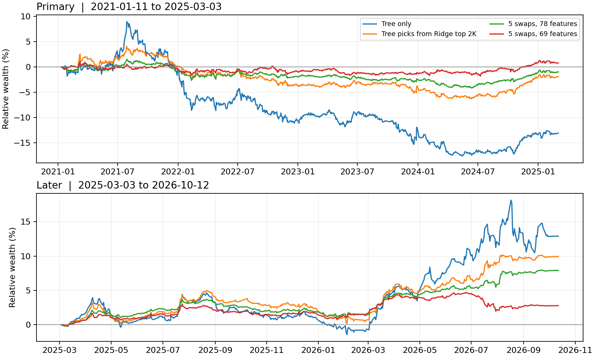

# EP40 收益秩 LightGBM 能否稳定增加利润

中证800外部验证已完成，包含原300模型迁移与800重新训练的逐年费后结果。[中证800验证记录](csi800_69/REPORT.md)

2026-11-25。历史沪深300成分，买入预测前十分之一的股票。基线 R 为 78 项特征的收益秩 Ridge。主段 2021-01-11 至 2025-03-03，后段 2025-03-03 至 2026-10-12。全文“领先”均指定比较账户。1 bp 为 0.01 个百分点。

**结论。** 普通收益秩树在两段季度滚动样本外都能给股票排序。训练内的改善远大于样本外，历史证据不足以排除过拟合。让树决定全部约 29 席，或者让 Ridge 提名约 58 只、再由树决定全部约 29 席，都未达到预登记推进线。发现一个较稳的探索候选：保留 Ridge 大部分持仓，让删去九项市场变量的树只决定约五个替换席位。它在两个区段的原起点和实际错峰资金账户都超过 Ridge。错峰全周期累计收益为 **52.76% 对 47.48%**。主段优势很薄，两个区段去掉各自最有利的三个月后均落后。保留 R 为研究基线，将有限换股规则冻结为前瞻对照。

## 先看实际账户

原起点每十个交易日调仓，平均目标约 29 只。表中累计假定主段期末按原规则结账，将全部净资产投入独立起账的后段。分段净年化按 252 个交易日。次日开盘买入收取 10 bp，卖出收取 20 bp，按同股净交易额收费。沪深300全收益指数使用收盘端点。

| 规则 | 主段净年化 | 后段净年化 | 全周期累计 | 主段减 R，bp/H10 | 后段减 R，bp/H10 |
|---|---:|---:|---:|---:|---:|
| 全部合格股等权 U | −3.74% | 7.46% | −3.92% | −37.25 | +1.26 |
| 沪深300全收益指数 | −5.82% | 9.64% | −9.12% | — | — |
| Ridge 基线 R | 5.56% | 7.41% | 38.47% | 0 | 0 |
| 78 项纯树 T | 0.38% | 25.00% | 43.41% | −19.68 | +60.79 |
| R 提名 2K、树选 K，B | 3.36% | 14.50% | 40.61% | −8.41 | +25.18 |
| R 与树百分位等权 A | 6.09% | 16.20% | 59.52% | +1.86 | +31.13 |
| 78 项树决定约五席，X11 | 7.06% | 15.56% | 63.97% | +5.54 | +28.98 |
| 69 项树决定约五席 | 6.82% | 10.60% | 51.83% | +4.48 | +11.24 |

主比较 B−R 的 95% 配对区间主段为 [−35.36, +16.35]、后段为 [−15.61, +64.34] bp/H10。主段仅 49/100 期领先，后段 19/39。纯树对应区间为 [−60.02, +20.84] 和 [−0.24, +125.08]。两种规则累计都能超过 R，主段都明显拖累。预登记的两段同正及十起点中位数同正条件均未满足。[账户和回撤](results/accounts.csv) · [所有逐项区间](results/paired.csv)

## 1．过拟合检验

23 个季度扩展折只用当季开始前已成熟的 H10 标签。冻结模型从收盘信号预测次日开盘至第 11 日开盘的收益秩。全池 RankIC 是每个日期按股票计算的 Spearman 相关，再按日期等权。

| 检验 | 主段 | 后段 |
|---|---:|---:|
| 树 80 棵，样本外 RankIC 及 95% 时间块区间 | 0.0532 [0.0224, 0.0842] | 0.0988 [0.0198, 0.1774] |
| Ridge 样本外 RankIC | 0.0692 | 0.0629 |
| 树 80 棵减 20 棵，样本外 RankIC 变化 | −0.0033 [−0.0147, 0.0084] | +0.0193 [−0.0005, 0.0417] |
| 80 棵减 20 棵，实际账户净差，bp/H10 | −0.98 | +20.55 |
| 8 个打乱训练标签的树，样本外 RankIC 最低至最高 | −0.0228 至 +0.0204 | −0.0208 至 +0.0452 |

真实树的训练内 RankIC 从 0.1392 升至 0.2129，139 个外层日期仅从 0.0629 升至 0.0660。前者按各折训练日期计，同一历史日期会随扩展窗口重复进入。每个安慰剂在训练日内打乱已成熟个股标签，使用原特征、原模型预算和真实外层标签。真实排序在两段均高于全部八个安慰剂，后段仍有一个安慰剂组合的平均净收益超过真实树。该结果支持特征与未来收益秩有关，也说明只凭一段赚钱很容易选中碰巧获利的组合。八次随机对照仅用来诊断。历史数据已被多次用于设计规则。[训练与外层逐日结果](results/learning.parquet) · [外层时间块区间](results/learning_oos.csv) · [安慰剂](results/placebo_ic.parquet)

## 2．从复选到有限换股

1. **先限制候选池。** B 的两段净差方向相反；反过来先用树提名、再用 R 复选，原起点相对 R 为 −2.00、+30.42 bp/H10。把 B 的共同仓位固定、仅随机抽换入股，B 相对 200 条随机路径的中位优势只有 +1.29、+2.86 bp/H10，两个随机范围都跨零。
2. **再限制树的决策数量。** X11 从 R 前 K 中剔除 T 评分最低的 floor(K/5) 只，从 R 第 K+1 到 2K 中按 T 评分补进同数。相对同数量机械换股，单独改剔除端贡献 +3.45、+12.50 bp/H10，单独改换入端贡献 +4.15、+10.50，两端交互 −0.11、+0.03。各段分别与维持 R 原仓比较，X11 为 +5.54 [−9.49, +20.18]、+28.98 [+6.27, +52.56]。这是登记的次要比较。
3. **换起点、换资金口径。** X11 在后段十个起点全部领先，主段仅五个。把单位资本分成十份，未启用的资金持现，每份每十日调仓；在总账户先合并同股订单，再按实际净额付费。主段原 78 项 X11 每 100 元少赚 1.29 元。为检验行业预算的影响，另做只允许在同行业配对换股的版本，主段仍少赚 1.14 元、后段多赚 2.78 元。
4. **用模型消融结果设计下一轮。** 纯树删去市场动量、波动和回撤九列后，原起点主段由 −19.68 改至 +0.70 bp/H10，但十个起点主段仅一个领先。将这棵 69 项树用于相同的五席换股，原起点两段为 +4.48 [−8.76, +17.61]、+11.24 [−17.46, +39.35]。双倍费用下仍为 +3.84、+12.31。十起点中位数为 +0.35、+10.29，正差起点 5/10、8/10。较早的 2019 和 2020 年按当时已成熟标签重新训练，十起点中位数为 +13.66、+12.10，正差起点 7/10、6/10。2020 年对 SH600816 长停牌后段分别按原值及折半估值，候选的十起点中位差均为 +12.10。两年属于补充历史。

| 十份错峰资金，每段初始 100 元 | 主段期末 | 后段期末 | 两段复投期末 |
|---|---:|---:|---:|
| Ridge | 129.81 | 113.62 | 147.48 |
| 纯树 | 112.76 | 128.27 | 144.63 |
| B | 127.31 | 124.90 | 159.02 |
| A | 129.02 | 123.28 | 159.06 |
| 78 项树换约五席 | 128.52 | 122.60 | 157.56 |
| **69 项树换约五席** | **130.80** | **116.78** | **152.76** |

69 项有限换股的错峰账户主段最大回撤为 −31.17%，R 为 −30.23%；后段分别为 −14.67%、约 −15.9%。主段 49 个内部完整月平均领先 +2.39 bp/月，95% 时间块区间 [−7.07, +12.23]。后段 18 个月为 +11.10 [−21.66, +46.19]。剔除各段主动收益最好的三个月，再对相同剩余月份各自复利，所得差额为 −2.02、−1.36 个百分点。若要求每个起点或每段剔除强月后都领先，本轮尚未找到合格方案。按全周期累计最高挑规则，也会选出与按两段同正不同的结果。[错峰资金净值与区间](results/funded.csv) · [新对照逐起点](results/challenge_phase.csv) · [早期复验](results/earlier_scores.csv)



## 3．利润和超额怎样产生

**绝对利润与相对利润。** 每段各从 100 元开始。原起点 R 主段毛赚 43.53、付费 19.57、净赚 23.96 元；同期全池等权净亏 14.05 元、全收益指数跌 21.18%。后段 R 净赚 11.70 元，全池等权赚 11.78 元、指数涨 15.30%。主段 R 的选股已创造很高的比较门槛，后段 R 的绝对盈利与广泛市场上涨同时出现。同池比较控制了投资范围和执行规则。[各股毛利、实付费用、净利](results/pnl_per_100.csv)

**为什么纯树前弱后强。** 主段 T 相对 R 的真实最高十分组 D10 多贡献 +12.72 bp/H10，真实最低十分组 D1 多亏 −25.21 bp/H10，费用又多付 2.09 bp/H10。后段两端都改善，D1 少亏 +18.09、D2 少亏 +14.00、D10 多赚 +16.93，整组合毛差 +60.76、净差 +60.79。纯树配置在 R 前 2K 以外的开盘资金平均占主段 38.28%、后段 33.98%；这一层对树账户的净贡献从 −9.99 变为 +45.14 bp/H10。固定初始持股看后段相对 R 的毛利，第 1–5 日 +15.67、第 6–10 日 +42.45、第 11–20 日 −10.48 bp。后段的额外收益主要在第二周兑现。[真实收益分组](results/bridge.csv) · [候选池之外的资金](results/ridge_tiers.csv) · [持有期分解](results/decay.csv)

**行业与个股各贡献了多少。** 在后段复制 B 的行业席位、行业内由 R 排序，已能取得相对 R 的 +22.97 bp/H10，B 在相同行业预算上只再增加 +2.21，区间 [−15.74, +19.63]。纯树的后段 +60.79 中，复制行业预算贡献 +24.58，同预算重新选股再贡献 +36.21；同时复制行业和波动三分位以后，纯树仍领先复制账户 +29.74 [+6.33, +58.05]。B 的行业×波动复制中，4,016 个目标席位至少 2,723 个因候选不足而必须重合，复制结果的辨别能力有限。后段纯树实际持仓的波动分位约 28%，主段约 43%。银行占后段纯树资金的 22.30%，同期等权池约 7.87%。树在两段呈现不同的风格暴露。[行业复制](results/replica_capacity.csv) · [持仓行业](results/industry.csv) · [风格暴露](results/styles.csv)

**有限换股到底赚在哪里。** 以下两行按原起点每个 H10 的期初本金归一化，分项含实付费用。换出项为原 R 独有持仓收益取负，正数表示避开亏损。

| 69 项树换约五席，相对 R | 共同持仓权重差 | 换入股 | 换出股 | 遗留头寸 | 净差，bp/H10 |
|---|---:|---:|---:|---:|---:|
| 主段 | +0.12 | +6.17 | −1.55 | −0.26 | +4.48 |
| 后段 | +0.25 | +12.20 | −1.80 | +0.60 | +11.24 |

该规则原起点主要赚在换入端，两段移出的股票整体仍赚钱。78 项版本的来源有差别，后段换入端净贡献 +19.65，避开原持仓净贡献 +8.82 bp/H10。分组归因按成交后真实资金核算，标签未知的持股保留。分组之和使用未舍入数。[69 项逐组收益桥](results/candidate_bridge.csv) · [78 项逐组收益桥](results/bridge.csv)

**把错峰超额还原成钱。** 主段 69 项有限换股每 100 元毛赚 51.02、付费 20.22，R 毛赚 49.59、付费 19.79。毛利多 1.43、费用多 0.43，净多赚 **1.00 元**。后段毛利多 3.14、费用少 0.02，净多赚 **3.16 元**。主段单只股票较大的正、负差来自 SZ300751（+0.86 元）和 SH688008（−0.75 元），后段来自 SH601669（+0.47 元）和 SH605117（−0.34 元）。这些是事后会计贡献，同行业、同波动和特征删列实验提供机制线索；均无法将每一元超额唯一分配给某个预测特征。[错峰逐股盈亏](results/funded_pnl_per_100.csv) · [逐月正负贡献最大的股票与行业](results/monthly_extremes.csv)

## 其余检验和复核

- 旧 E2 配方改为收益秩，主、后段分别比原 z 标签 +20.97、−29.40 bp/H10；EP40 配方改用收益秩则为 +33.58、+18.03。振幅波动、回撤位置和逐日收益路径三组消融都没有通过族内 Holm 5% 检验。EP40 与同秩旧配方的股票名次分歧总量中，主段约 88%、后段约 90% 来自特征完整的行，原生缺失单项实验的触发条件未满足。B 主段连费用前也落后，后段毛增益已足以覆盖费用，原计划的换手缓冲条件也未触发。[四格与消融](TABLES.md) · [缺失特征诊断](results/missing_features.csv)
- 扩池沿用 300 模型和截面参照。后段纯树在全800及当日800内非300池分别领先同池 R +41.36、+42.92 bp/H10。主段三个共同可估值区间纯树均落后同池 R。800 等权账本在 2022-06-30 出现持股无法估值，2023-06-16 另遇停牌估值缺口，同池各账户在共同完整窗口比较，缺口后重新起账。固定原300席位的结果另列。迁移缺乏跨段增量，本轮止于冻结迁移。[扩池账户和指数](results/wide/summary.csv) · [缺口日期和证券](results/wide/gaps.csv)
- 持仓账本使用复权单位、原始开盘成交限制和既有公司行动处理。历史成分、行业及行情为回溯代理。23 折模型重评分核对原 40,756 行，600 个窄池账户配置共 41,945 个窗口，逐股毛贡献减费用的最大窗口误差小于 8×10⁻¹⁶。基线与原树的名单、订单键、逐日净值、逐期费用和换手均已核对。所有相关随机路径和相位共享行情。[审计回执](results/verification.json) · [完整分组表](TABLES.md)
- 历史验证止于 2026-10-12。对 69 项有限换股，冻结 R、T、B、78 项和 69 项有限换股的定义及账本。需从登记后的新信号开始入场前保存评分、模型哈希和目标，12 个成熟 H10 复核归因，24 个评估方向及区间。现有证据支持把它列为前瞻候选，尚不足以替换 R。历史期内没有单独控制历史市值，规模暴露仍可解释一部分差异。[冻结候选](candidate.json) · [原计划](../FOLLOWUP_EXPERIMENT_PLAN.md)

## 复现

在本目录使用主题虚拟环境，设置 `OPENBLAS_NUM_THREADS=1` 和 `OMP_NUM_THREADS=2`。依次运行以下入口，输出在 `results/`。原始输入须包含本机 EP36、EP37、EP38 和 EP40 已封存的数据与模型，扩池行情缓存路径见 `transfer.py`。

```bash
for script in daily_scores refits run_accounts summarize generalization attribution time_diagnostics evidence stagger industry_trial market_challenge earlier transfer placebo conclusions diagnostics tables audit
do
  OPENBLAS_NUM_THREADS=1 OMP_NUM_THREADS=2 ../../../../../.venv/bin/python "${script}.py" || exit 1
done
```
