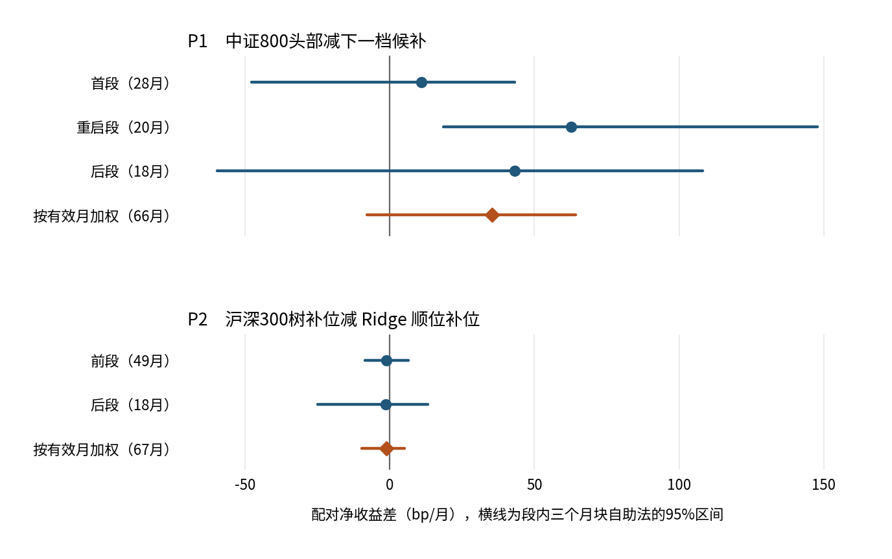

# EP41 执行报告｜沪深300与中证800的周至月度选股

运行号 **EP41-20261127-R1**。按修订版2的登记执行19个编号。首批两项主检验的历史账户截至2026-10-12。其余17项保留各自的简单对照、来源覆盖及准入条件。收益单位是每个共同完整月的平均净差，1 bp 等于0.01个百分点。每段从单位本金起算，跨估值断点不串接收益。[原始登记及当前执行入口](README.md) · [固定参数](config.yaml) · [逐项状态](run_register.csv)

## 首批主检验

| 主比较 | 独立阶段的净差，bp/月 | 按有效月数汇总 | 三月块95%区间 |
|---|---|---:|---:|
| P1　中证800重训 Ridge 头部，减同一排名中不重叠的下一档候补 | +11.00、+62.69、+43.31 | **+35.47**（66月） | **[−7.81, +64.24]** |
| P2　沪深300同一69项树卖单和核心仓，树挑补位减 Ridge 顺位补位 | −1.13、−1.35 | **−1.19**（67月） | **[−9.74, +5.21]** |

**P1 有历史领先，集中在少数月份和部分风险暴露上。** 头部和候补三段累计净收益分别为9.12%对4.30%、28.22%对12.55%、21.82%对14.04%。标准费真实交易路径上，毛差+28.06 bp/月，少付费用贡献+7.41。各段删除最强三个月后变为−21.53、+8.25、−28.95。控制同行业、自由流通市值与成交额后，0.10双卡尺仅覆盖26.13%头部目标席位；剩余资金持现的同本金比较为+4.00 bp/月，95%区间[−4.71,+12.46]。等席随机候补、原十个相位、重训与迁移、双费和缺价情景均有独立账本。[P1 账户与对照](p1/REPORT.md)

**P2 的买入当期和连续账户给出不同信号。** 在同一 Ridge 起始仓复制出的单期账本中，树补位的毛差为+3.59、+2.59 bp/H10；让两种补位规则各自延续实际仓位，月均毛差变为−1.28、−2.07 bp。树臂虽少付0.15、0.72 bp/月，连续净差仍为负。两种补位各自相对不换股的 Ridge 均有正的历史月均差，删强月后优势不稳。当前证据不足以由树替代原候补顺位。[P2 同起点、历史持仓与费用分解](p2/REPORT.md)

两项均使用标准费后十袖共同月、段内连续三个月移动块、10,000次抽样和种子4101。P1三段28/20/18月，P2两段49/18月。需有段内上月末净值作分母，2025年3月的重新起账月不计入主量。以原点估计重定中心构造正向零假设时，Holm校正后P1/P2为0.0224/0.5113。直接取自助分布非正尾部概率，校正后为0.1390/0.7206。登记未固定两种单侧构造的取舍，保留两者和双侧百分位区间。P1的统计判断对构造敏感，叠加风格支持与删月结果，宜保留为待检验候选。[统一重算表](primary_inference.csv) · [推断代码](verify_primary.py)

## 其余登记项

| 编号 | 实际回答 | 证据 |
|---|---|---|
| U1 | 同一800分数下，非300域减300域的树补位增量为+14.59、−13.90、+4.33 bp/月。两域、两种买单都有风格匹配的仅24/1,381日，无法归因于中盘域。 | [域内账户和配对资金](u1/REPORT.md) |
| U2 | 剔除3元以下股票避开了中天金融案例，三段整账户却少赚2.77、0.56、2.09 bp/月。低成交额、连续跌停筛选的方向都随阶段改变；公告限制缺完整的事前发布时间。 | [逐项随机对照、四档容量和时点核查](u2/REPORT.md) |
| M1 | 给69项树改用全池秩或行业秩，两段都落后原值输入。2022年合格股典型vol20低于2021年。 | [秩化、重复与行业回退](models/REPORT.md#m1) |
| M2 | 原值残差树落后同训练行的直接树；全池秩残差树前段持平附近，后段落后。 | [同尺度残差与四格](models/REPORT.md#m2) |
| M3 | 清洗内折早停相对残差原树改善+5.84、+4.01 bp/月，两段仍落后原 Ridge。 | [复杂度、列采样及学习曲线](models/REPORT.md#m3) |
| N1 | 五分钟数据重排候补的月均净差为+0.26、−6.55、+2.41 bp，每段仅两个共同完整月。一分钟端点限频，未形成完整账户。 | [分钟行情](sources/n1/REPORT.md) |
| N2 | EPS修正20日等权相对同覆盖顺位为+0.09、−0.12 bp/月，60日半衰期为−0.10、+1.93。短窗仅21席变化。 | [两窗覆盖与账户](sources/n2/REPORT.md) |
| N3 | 正式年报SUE在两段候补中仅3、7个股票日有值；快报代理另列。原计划中可评分者无法改变两种规则的排序，未识别经济增量。 | [公告事件、候补及资金](sources/n3_n4/REPORT.md) |
| N4 | 只重排原买入预算已覆盖的股票，港股相对A股信号为−0.89、+0.56 bp/月，A股自身五日动量为−0.47、+0.86。另列买满双重上市股票的高暴露敏感性。 | [双重上市映射与账户](sources/n3_n4/REPORT.md) |
| N5 | 四条披露的供货关系仅在7日支持在原买入预算中改选。5日真实关联收益相对顺位为−0.06、+0.24 bp/月，同行动量几乎给出相同结果。 | [公告原件、真实关联与伪连边](sources/n5/REPORT.md) |
| N6 | 两只ETF后段连续381个调仓信号，一日滞后份额及固定单位代理改变了8.80%的实付换入资金，月均−0.36 bp。历史首次版本缺口保留。 | [篮子、份额时钟和实际资金](sources/n6/REPORT.md) |
| V1 | 按冻结的左尾门槛逐折检查后，仅三个季度启用日频挑战者。否决2席相对原仓前段−3.66 bp/月，后段未触发；被否决股票含30席真实D10。 | [门槛与否决账户](models/REPORT.md#v1) |
| I1 | 一级行业内标签×冻结 Ridge 行业席位为−3.23、−8.28 bp/月；同规模伪行业对照未支持真实行业优势。±2席权重约束因首次公开时间不明停在审计。 | [行业标签和席位四格](models/REPORT.md#i1) |
| I2 | 对同一 Ridge 只改一席行业预算，两段月差−0.58、−0.05 bp。V28曾用这些年份选择方法，只作历史探索。 | [两代行业映射与配置、选股分解](models/REPORT.md#i2) |
| E1 | 成本门槛省费，后段放弃的毛收益更大。Ridge、树两臂在两池后段均落后各自无门槛账户。 | [300](e1_e2/300/REPORT.md) · [800](e1_800/REPORT.md) |
| E2 | 只动 Ridge 自然新买入预算，相对 Ridge 为+2.59、+7.47 bp/月；相对强制五席为+0.20、−3.63。两段区间均跨零，每段删三强月后均反号。 | [自然买单、机械和强制换股](e1_e2/300/REPORT.md) |
| E3 | 同训练样本、同H10持仓时，H10标签两段均胜H5和H20。分段毛贡献未见可重复的互补，按条件停在单期限。 | [三种期限与持仓交叉](models/REPORT.md#e3) |

## 如何核账

- **每期和逐月净差。** P1、P2 的原相位H10、十相位和十袖逐月结果各自保存。模型组的费后、毛收益和实付费用使用同一真实路径。各实验的支持资金不同，按整账户每月或按每元换入预算标注。[P1逐月](p1/results/monthly_pair.csv) · [P2逐月](p2/results/full_months.csv) · [模型各臂逐月](models/results/complete_months.csv)
- **订单、费用、现金与市场比较。** 每个账户入场前用信号日收盘的合格池，下一交易日开盘执行。历史成分、撮合限制、公司行动、同股净额收费继承EP40；两个指数分别使用全收益收盘端点。U2冲击成本为容量压力估算，订单为历史模拟成交。[P1真实路径订单](p1/results/orders.parquet) · [P2真实路径订单](p2/results/orders.parquet) · [模型订单](models/results/net_orders.parquet)
- **来源与失败区段。** 区分证券有效日期、公告首次可见时间、数据库回填和实际抓取日。上表直接链接到各项证据与反例。探索项不进入P1、P2的两项主检验族。两个主检验用独立C++账本从封存分数重建，逐日净值、现金、费用和抵消的最大绝对差为3.6×10⁻¹⁵。[独立重放误差](primary_book_parity.csv)
- 基础规则按登记，未规定的行业预算步长、子源样本、校准与机械配对细节在分报告中披露。[模型实现规格](models/PROTOCOL.md) · [执行回执](verification.json)

截至2026-11-27，上述账户均为历史研究回放。版本登记晚于历史账户终点，独立前瞻的12、24个成熟非重叠H10复核点仍待累积；未以10月12日后的回补样本代替新期。
