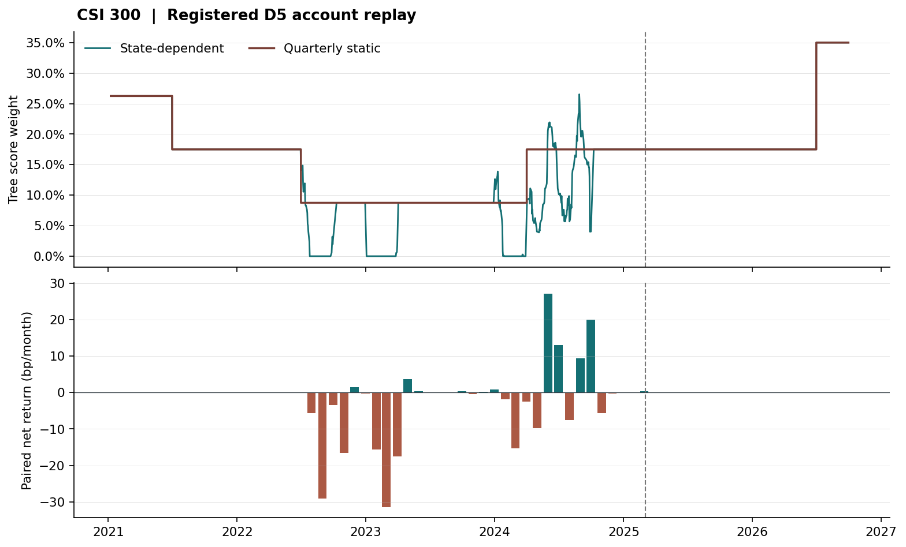

# D5 与 G1、G4–G7｜按市场状态混合 Ridge 与树

执行日为2026-11-27。D5 是本登记册唯一预先指定的主检验。沪深300动态混合相对同季静态混合，前49个完整月平均 **−1.77 bp/月**，后18个月 **0.00**。67个月加权 **−1.29 bp/月**，段内三个月移动块、10,000次抽样的95%区间为 **[−3.79，+0.85]**。登记的通过条件未满足。后段两臂完全相同，前段均差主要来自改选股票后的毛收益。[主要比较及所有基线](results/main/comparisons.csv) · [逐月账](results/main/monthly.csv)

## 从什么信息得到这个比较

每个交易日收盘，用当日合格股收益的四分位距，经20日平均后，在严格早于当天的252个交易日中求分位，得到 Z1。Z2 是相对成交活跃度，Z3、Z4 来自沪深300全收益指数的趋势与回撤。四个状态在独立抽核日逐个重算，误差均为零。补齐的2017年以来984行指数含与旧档重叠的校验日期。概率、状态和成分均维持历史回放的可见性口径。[状态审计](results/state_audit.csv) · [来源收据](results/index_receipt.json)

从当时已成熟的周标签重建早期日频季度折外预测，与原档合并后共547,760个沪深300股票日，其中407,372个为原外层评分。2021Q1交界在沪深300对1,166个、在800对3,079个早期股票日另用原归档模型复算。三套树分数最大差均为0，Ridge最大差小于1.07×10⁻¹³。沪深300冻结 Ridge78、原值树69 在两个外段各有1,001和391个估值日，日净值、现金、费用和内部净额与原账最大差2.67×10⁻¹⁵。[折外模型交界](results/early_model_parity.csv) · [逐日账户复核](results/main/baseline_parity.csv)

每个外季度先在过去八个已完成季度上用真实连续账户选静态树权重，再锁住该权重选择 Z1 的正斜率、零斜率或负斜率。两臂用相同的逐股百分位、K席、十份错峰本金、买10 bp卖20 bp。23个外季度均有23个内层共同完整月，无历史不足回退。仅5个外季度选了非零斜率，从2024Q4起每季均选零。1,389个外层评分日中303天动态权重不同，目标累计改选438席。在动态臂独有的当日新目标上，实际净买入合计约1.185份段首本金。多次换入使用的是滚动本金。[候选收益](results/main/inner_objectives.csv) · [候选内层资金和截断](results/main/inner_funding.csv) · [逐季参数](results/main/weights_quarterly.csv) · [实际改选](results/main/d5_quarterly_activity.csv)

| 沪深300月均费后差，bp | 前段49月 | 后段18月 | 合计67月 |
|---|---:|---:|---:|
| 动态减同季静态 | −1.77 | 0.00 | −1.29 |
| 双倍费用的动态减静态 | −1.75 | 0.00 | −1.28 |
| 动态减冻结 Ridge78 | +2.59 | +14.81 | +5.88 |
| 动态减冻结原值树69 | +29.35 | +25.91 | +28.43 |
| 动态减永久17.5%树权重 | −4.63 | −4.10 | −4.49 |
| 动态减仅靠内层历史估计的平均树权重 | −1.79 | 0.00 | −1.31 |
| 深度3加早停的独立动态复验，减其本身静态 | +1.82 | −7.36 | −0.65 |

23季均有足够历史供学习。67个完整月中，有18个月至少发生一次可下单的动态权重变化，均在前段。这18个月的完整账户净差均值为 −4.94 bp/月。按当月触发筛选的统计仍包含上一月延续到本月的仓位，主检验保留全部67个月。[逐月校准及实际启用](results/main/d5_active_months.csv)

前段动态减静态毛差 −1.771、实付费差 −0.004 bp/月。各段各删最强三个月后，汇总变为 −2.40 bp/月。全池日平均 RankIC 为动态0.0664、静态0.0667；在 Ridge 原排名约 K/2 至2K的换股边界为0.0263、0.0280。两段中冻结69树减原 Ridge 为 −26.76、−11.09 bp/月。EP41 后段 +58.13 所对应的树有78个输入；研究登记里的“前后变号”在这个69项基线没有出现。[全池与边界逐日排序](results/main/rankic.parquet) · [EP41原始臂名与账户](../../41_csi300_csi800_weekly_monthly_alpha/models/results/model_accounts.csv) · [浅层早停单独复验](results/shallow/comparisons.csv)

| 净收益或最大回撤 | 2021-01-11至2025-03-03 | 2025-03-03至2026-10-12 |
|---|---:|---:|
| 动态混合 | +30.47% | +17.11% |
| 同季静态 | +31.63% | +17.11% |
| 永久17.5% | +33.35% | +18.01% |
| 冻结 Ridge78 | +29.81% | +13.62% |
| 冻结原值树69 | +11.55% | +12.47% |
| 沪深300全收益 | −21.18% | +15.30% |
| 同池等权净账户 | −12.22% | +12.35% |
| 动态混合最大回撤 | −31.08% | −14.90% |

动态账户在2021、2022、2023、2024年的段内收益依次为 −0.40%、−4.58%、+2.41%、+36.47%。2025年前段与后段各为 −1.76%、+18.02%，2026年至10月12日为 −0.77%。指数取相应端点收盘，全体账户的年度、段收益、回撤、费用、现金、相对指数及等权差见表。[全账户年度](results/benchmark_years.csv) · [全账户月度基准](results/benchmark_months.csv)

## G1　市场离散度与两个冻结模型

对每个可评日各投相同本金，独立结算H10。前段高、中、低离散档的树减 Ridge 净差分别为 −22.11、−14.24、−1.48 bp/H10；后段分别为 −12.82、−1.40、+14.84。高档减低档分别为 **−20.63** [−72.96，+29.23]、**−27.66** [−126.93，+106.86] bp/H10。方向提示高离散时相对不利于树，估计区间较宽。前段高低档各覆盖27个月，后段仅12、8个月，原始信号日与起点有重叠。所有十相位、投入本金和前K交集均已保留。[状态覆盖](results/main/g1_states.csv) · [分块区间](results/main/g1_high_low.csv) · [实际资金来源与损益](results/main/funded_by_signal.parquet)

## G4　合分与分配资金

逐股合分的动态减静态为 −1.77/0.00 bp/月；先给R、T两张名单分配预算再合并下单为 −0.76/0.00，截回同样K席为 −0.29/0.00。按同月计算“合分增量减预算增量”，两段为 −1.01/0.00，汇总 **−0.74** [−2.93，+1.35]。动态合分平均28.87个目标，直接混合资金为43.06个，截回K后为28.87个。两种实施均未给出稳定的状态收益。[配对双重差](results/main/g4_double_difference.csv) · [席位、重叠资金与风格](results/main/g4_styles.parquet)

## G5　成交与指数状态

固定Z1门控后，每次仅加一个状态再用过去已成熟的内层账户确定方向。成交活跃Z2增量为 **+0.82/−1.87**，趋势Z3为 **−0.36/+0.59**，回撤Z4为 **+0.08/−5.01** bp/月。单独用Z2、Z3、Z4门控对同季静态的比较依次为 +1.17/−1.87、−0.49/+0.59、−0.16/−5.01。前段的高离散、低成交组合有69个评分日，来自11个月。共同市场状态的覆盖、实际改选席位和净买入限制了独立状态的解释。[单因素校准与结果](results/single_states/comparisons.csv) · [交叉状态](results/main/g5_cross_state.csv) · [两两组合与实付资金](results/main/g5_all_state_pairs.csv)

## G6　切换日期和确认迟滞

滞后20个交易日减同日门控为 **+0.82/0.00** bp/月，改为连续5个收盘确认后切换为 **+0.66/0.00**。实际方向与“当日状态更好”相反。两段共有58、16个连续状态区间，含各段起始区间。首次跨档后1–5日、6–10日及稳定期的起源资金、隔夜、日内和费用按各臂真实单据保留。[每次转移及持续时间](results/main/g6_transitions.csv) · [按交易来源的损益](results/main/state_contributions.csv)

## G7　跨池迁移

把沪深300的 b、s、Z1 不变地用于中证800非300部分，逐日先在该域重排各股票分数，再以域内前10%建仓。历史覆盖为465至501只，K为46至50，三段28、20、18个共同完整月。

| 费后差，bp/月 | 第一段 | 第二段 | 第三段 | 66个月 |
|---|---:|---:|---:|---:|
| 300股票模型迁移，动态减静态 | +0.01 | −6.41 | 0.00 | −1.94 |
| 800重训股票模型，动态减静态 | +0.84 | +2.12 | 0.00 | +1.00 |
| 本域重选参数减迁移参数，300股票模型 | −4.11 | +2.34 | −3.17 | −1.90 |
| 本域重选参数减迁移参数，800股票模型 | −8.75 | +5.33 | −0.60 | −2.26 |
| 改用本域Z1减沿用300的Z1，300股票模型 | +0.37 | +0.73 | 0.00 | +0.38 |
| 改用本域Z1减沿用300的Z1，800股票模型 | −0.12 | −0.78 | 0.00 | −0.28 |

本域与300的Z1相关系数约0.929。800重训模型的 +1.00 在每段删最强三个月后为 −0.17，最后一段没有动态差；更换股票模型即可改变结论。迁移纯树在第二段于2024-07-30出现估值断点，涉及该纯树的汇总只含58个月。域内等权在前两段也有提前截止，其基准仅按双方共有日期计算。[迁移模型各比较](results/g7_transfer/comparisons.csv) · [重训模型各比较](results/g7_refit/comparisons.csv) · [同月沪深300对照](results/g7_matched_calendar.csv) · [实际域敞口](results/domain_actual_exposures.parquet) · [基准估值边界](results/benchmark_limits.csv)

同输入同损失 G2 和变系数 Ridge G3 的训练、状态划分与诊断见模型组报告。本报告内的历史模型和状态均在同一已研究行情上回放。前瞻检查始于入场前真实封存决策后，12和24个非重叠成熟H10分别核验。[模型组](../scale/REPORT.md) · [总体登记](../MARKET_STATE.md)

